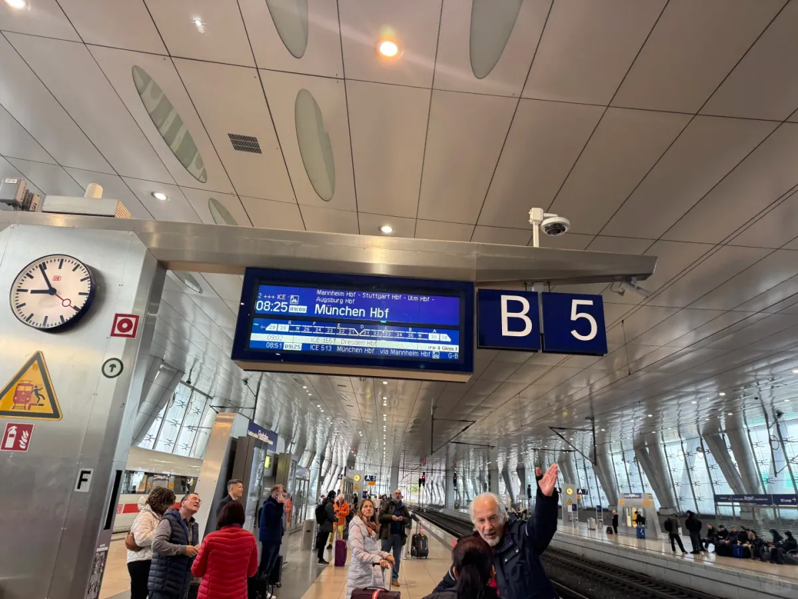

Терминал 3 — новейшее здание аэропорта Франкфурта, построенное на южной стороне аэродрома, так что между ним и терминалами 1 и 2 лежат взлётно-посадочные полосы. Зал просторный, указатели полные, но путь от самолёта до поезда включает больше шагов, чем ожидает большинство: паспортный контроль, багаж, довольно долгую поездку на автоматическом поезде и затем очень длинный коридор.

Корень проблемы — расположение вокзала. Все поезда дальнего следования во Франкфурте — и ICE, и IC — отправляются с **Fernbahnhof** на стороне терминала 1. У терминала 3 нет собственных платформ дальнего следования, поэтому пассажирам, начинающим оттуда, сначала нужно вернуться в терминал 1, а затем пересечь The Squaire — длинное здание, в котором находится вокзальный зал, — прежде чем добраться до поезда.

В октябре 2026 года путешественник засёк всё время. Самолёт приземлился в терминале 3 в **06:00**. После паспортного контроля, багажа и поиска дороги он оказался в зале Fernbahnhof около **07:50** — итого **1 час 40 минут**, без бега, обычным шагом с чемоданом. Этот гид разбирает поездку шаг за шагом и показывает, где время можно сэкономить, а где нельзя.

## 1. Терминал 3 и проблема расстояний

Терминал 3 существует, чтобы дать Франкфурту место для роста. Терминалы 1 и 2 годами работали почти на пределе, а единственное свободное место оставалось на дальней стороне полос — поэтому новое здание стоит отдельно от первой пары. Чтобы это работало, аэропорт продлил автоматический поезд SkyLine до терминала 3, так что шаттл-автобус между зданиями больше не нужен. Плата за это — более долгая поездка: две минуты от терминала 2 до терминала 1, но **восемь-десять минут** от терминала 3.

Этой поездки достаточно, чтобы засомневаться, не проехали ли вы свою остановку. Поезд петляет вокруг перрона по эстакаде, а за окном рулёжные дорожки, стоянки самолётов и ряды хвостовых оперений вместо чего-то похожего на терминал. Он действительно едет в объезд. Автор исходной заметки говорит о том же: терминал 3 новый, указатели есть, но **расстояния большие**, и значительная часть времени уходит только на автоматический поезд.

Что легче недооценить — это всё, что происходит до поездки. Шесть утра — время, когда скапливаются дальнемагистральные прилёты, поэтому и очередь на паспортном контроле, и багажные ленты могут быть медленными; если самолёт встал на удалённую стоянку, сначала будет автобус. Ничего этого нет в описании маршрута, но именно на это ушла большая часть 1 часа 40 минут. Так что когда вы читаете, что от терминала 3 до вокзала больше часа, проблема не в маршруте — время уходит на терминал, а не на путь.

Это также объясняет, почему при бронировании поезда после посадки в терминале 3 стоит закладывать больше запаса. Из терминала 2 сорок минут от посадки до места в S-Bahn — обычное дело. Терминал 3 добавляет автоматический поезд и длинный коридор, поэтому тот же комфортный запас превращается в час или больше. Бронируйте ICE минимум через два часа после посадки — и спешить не придётся; если в запасе всего час, лучше поменять билет на более поздний поезд, чем ставить на быструю багажную ленту.

## 2. SkyLine до терминала 1

Выйдя из прилёта, ищите синие подвесные указатели. Терминал 3 использует тот же визуальный язык, что и два других: слева значок самолёта с **1**, затем **A,B,C,Z** — четыре регистрационных зала терминала 1. Следующая строка — **Bahnhöfe / Train stations** и **AiRail Terminal**, правее — Busbahnhof (автовокзал) и Toiletten. Для железной дороги нужно следовать за строкой Terminal 1.

Коридор широкий, с тёмным каменным полом, крышей из наклонных стальных балок и световыми окнами. Идите со всеми три-пять минут — и дойдёте до эскалаторов и платформы SkyLine. Шаттл **бесплатный**, без турникетов и билетов, а ходит достаточно часто, поэтому ожидание обычно занимает меньше времени, чем сама поездка.

Зайдя в вагон, найдите место и держите чемодан рядом. Вагоны небольшие, а ранние прилёты часто приносят по два-три больших чемодана на человека, поэтому проход заполняется; если не удалось войти, следующий поезд — более простой вариант. Через восемь-десять минут вы прибываете в терминал 1, и ключевое слово меняется с Terminal на **Bahnhof**.

## 3. Fernbahnhof или Regionalbahnhof

Внутри терминала 1 железная дорога разделяется на два направления, и это самое важное решение на всём маршруте. Вокзал аэропорта состоит из двух половин: **Regionalbahnhof** прямо под терминалом 1 с путями 1–3 для S-Bahn и региональных поездов и **Fernbahnhof** на северо-западе под The Squaire с путями 4–7 для ICE и IC. Названия различаются одним словом, а направления противоположные.

Следуйте синему указателю **Fernbahnhof / Long-distance trains**, на котором также есть **Gleis 4–7** и **AiRail Terminal**. Чёрный указатель рядом перечисляет другой набор пунктов — The Squaire, Hilton, Hilton Garden Inn, Marriott, Sheraton и Frankfurt Airport Center — все в одном комплексе и, значит, в том же направлении. Жёлтая панель — стойка розыска багажа Lufthansa; если вы её видите, вы идёте правильно.

Затем начинается самая длинная прогулка маршрута: прямой коридор со стеклом с обеих сторон, выходящий на дорогу и массив The Squaire. Он занимает **пять-семь минут**, а вокзальный зал находится в дальнем конце. По пути есть движущиеся дорожки и лифты, если багаж тяжёлый. Ответвлений нет; единственный реальный риск — пойти не туда: если вы видите указатель Regionalbahnhof, значит, идёте к S-Bahn, разворачивайтесь.

| Вокзал | Где находится | Поезда | Для чего лучше |
| --- | --- | --- | --- |
| Fernbahnhof | Северо-западнее терминала 1, под The Squaire, 5–7 минут по коридору | Поезда дальнего следования ICE и IC, пути 4–7 | Гейдельберг, Мюнхен, Берлин, Кёльн и дальше |
| Regionalbahnhof | Прямо под терминалом 1, пути 1–3 | S-Bahn S8/S9 и региональные поезда | Центр Франкфурта, Майнц, Висбаден |

Ошибка не катастрофична. С Regionalbahnhof ходят S-Bahn в город, и на Хауптбанхофе можно пересесть на поезд дальнего следования ценой одной лишней пересадки и, возможно, получаса. По-настоящему неудобная ошибка — обратная: стоять на платформе Fernbahnhof с билетом на S-Bahn и ждать поезд, который никогда не придёт.

The Squaire заслуживает отдельного слова. Это самое узнаваемое здание аэропорта: 660-метровая «лежащая башня» над автомагистралью с отелями, офисами и ресторанами, а вокзальный зал находится у её основания. Идя по коридору, вы сначала видите здание сбоку, а затем оказываетесь под ним, так что растущий фасад — хороший знак. Внутри — **AiRail Terminal** Lufthansa: если вы забронированы на Lufthansa Express Rail, здесь можно зарегистрироваться и сдать багаж, оформить его до конечной точки и сесть в поезд налегке.

## 4. Билеты, платформы и задержки

В зале Fernbahnhof стеклянная крыша и большое табло **Abfahrt / Departure / Départ** посередине. Поезда перечислены по времени с промежуточными станциями (Über via), пунктом назначения (Ziel) и платформой (Gleis). Впервые приехавшие часто вглядываются в табло в поисках своей платформы и видят пустую графу. Для Deutsche Bahn это нормально: **платформу часто публикуют незадолго до отправления**, иногда не более чем за десять-пятнадцать минут.

Поэтому не спешите к платформе сразу по прибытии. В зале уточните две вещи: номер своего поезда и когда появится платформа. Приложение DB Navigator показывает ту же информацию и часто обновляется быстрее; без мобильного интернета стойте у табло или спросите на стойке DB Information справа.

На немецких вокзалах **нет турникетов**. Платформы открыты для всех, оплата основана на доверии, а проверка происходит в поезде: контролёр идёт по проходу и сканирует QR-код электронного билета. Убедитесь, что билет куплен и действителен до посадки; бумажные билеты нужно компостировать, электронные просто хранятся в телефоне.

Указатели платформ висят сверху, а строкой ниже мельче указаны зоны вагонов. Немецкие поезда дальнего следования останавливаются секциями A, B и C, поэтому если в билете указано «Wagen 31, Sektor B», стойте в зоне B — и нести багаж будет гораздо меньше. Во втором классе места не закреплены — занимайте любое свободное; первый класс находится в голове или хвосте состава и отмечен большой «1» на двери. Большие чемоданы ставьте в стойки у двери, а не тащите в салон — это самый полезный совет из исходной заметки.

Задержки в Германии обычное дело; десять или двадцать минут никого не удивляют. С гибким билетом (Flexpreis) вы просто садитесь на следующий поезд. С билетом по акции (Sparpreis) билет привязан к конкретному поезду и обычно не подлежит обмену, но когда из-за задержки DB вы опаздываете на пересадку, сотрудники обычно пускают вас на следующий поезд того же направления. В таком случае объясните ситуацию на стойке DB Information, а не покупайте второй билет. Опыт исходной заметки — пропущенную пересадку можно проехать следующим поездом без повторной покупки — в целом верен, хотя зависит от тарифа и правил дня.

Купить билет просто. Синие автоматы в зале переключаются на английский и принимают карты и монеты; DB Navigator — самый удобный вариант, там же можно забронировать место; если покупаете до отъезда из дома, платформы вроде Trainline или Omio тоже выдают электронные билеты. Бронируйте поезда дальнего следования **заранее**: билеты по акции заметно дешевле гибких, но их количество ограничено и они раскупаются. Если планы могут измениться, доплатите за гибкость. Во второй класс можно садиться без брони, но популярные выходные поезда заполняются, а бронь места обычно стоит всего несколько евро — на трёх-четырёхчасовом перегоне она того стоит.

## 5. Бюджет времени от посадки до отправления

Если разложить зафиксированную поездку, 1 час 40 минут ушли примерно так: почти половина — между посадкой и выходом из зоны прилёта, включая паспортный контроль, багаж и поиск указателей; ожидание и поездка на SkyLine — около четверти часа; коридор терминала 1 — пять-семь минут; остальное — чтение табло, спуск к платформе и поиск нужного вагона.

В заказе прямо сказано: **08:51** с Frankfurt (M) Flughafen Fernbf, ICE 513, пересадка на Mannheim Hauptbahnhof, прибытие в Heidelberg-Altstadt в **10:00**. В графе платформы только «следите за табло» — ровно то, о чём говорилось выше: платформу публикуют незадолго до отправления. От входа на вокзал в 07:50 до выхода в 08:51 прошёл час, что выглядит щедро, а на практике оказалось в самый раз для кофе, туалета и неспешной прогулки вниз.

Если вы приехали раньше, в зале есть кафе и пекарня, и посидеть немного приятнее, чем ждать на холодной платформе. Слушайте объявления и следите за экранами: станцию объявляют как «Frankfurt Flughafen Fernbahnhof», что отличается от Regionalbahnhof одним словом. На некоторых входах на платформу показывают порядок вагонов следующего поезда, так что один взгляд подскажет, к какому концу платформы идти, и избавит от необходимости тащить чемодан вдоль всего состава.

Несколько советов для первой попытки:

1. **Закладывайте 1,5–2 часа** от посадки до отправления. 1 час 40 минут — это обычный темп, а не щедрый; при позднем рейсе или медленном багаже два часа надёжнее.
2. **Не выходите из здания в терминале 1.** От SkyLine и далее весь маршрут проходит внутри; выйдете на улицу — придётся искать вход обратно.
3. **Следуйте за Fernbahnhof, а не Regionalbahnhof.** Указатели часто стоят рядом; синий с Gleis 4–7 — это вокзал дальнего следования.
4. **Держите электронный билет сохранённым и со скриншотом.** Мобильная связь на платформах и в вагонах нестабильна, а возиться с заказом при проверке неприятно.
5. **Пользуйтесь багажными стойками у двери.** Они оставляют проход свободным и сильно упрощают выход.

Этот маршрут основан на рассказе путешественника в октябре 2026 года; частота SkyLine и поезда и платформы DB зависят от информации дня на месте и на сайте оператора. Терминал 3 ещё новый, и его указатели будут меняться, поэтому смотреть на знаки по ходу надёжнее, чем запоминать маршрут.

## Полезные ссылки

- **На этом сайте**: [Аэропорт Франкфурта (FRA)](/airport/FRA), [Германия (DE)](/country/DE)
- **Википедия**: [Аэропорт Франкфурта](https://en.wikipedia.org/wiki/Frankfurt_Airport)
- **Baidu Baike**: [Аэропорт Франкфурта](https://baike.baidu.com/item/%E6%B3%95%E5%85%B0%E5%85%8B%E7%A6%8F%E6%9C%BA%E5%9C%BA)
