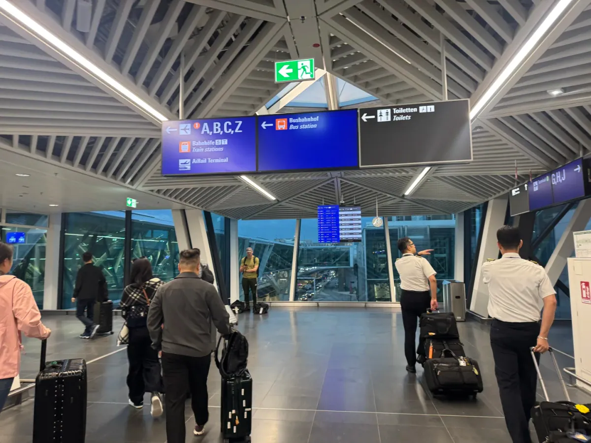

Terminal 3 ni jengo jipya zaidi la Uwanja wa Ndege wa Frankfurt, lililojengwa upande wa kusini wa uwanja wa ndege, na njia za kuruka zipo kati yake na Terminal 1 na 2. Ukumbi ni mpana na alama zipo kikamilifu, lakini kufika kutoka kwenye ndege hadi kwenye treni kunahitaji hatua nyingi zaidi kuliko watu wengi wanavyotarajia: udhibiti wa pasipoti, mizigo, safari ndefu kiasi kwenye chombo cha kusafirisha watu, na kisha ukanda mrefu sana.

Chanzo cha tatizo ni mahali kituo kilipo. Treni zote za masafa marefu za Frankfurt — ICE na IC kwa pamoja — zinaondoka kutoka **Fernbahnhof** upande wa Terminal 1. Terminal 3 haina majukwaa yake ya masafa marefu, hivyo abiria wanaoanza hapo lazima kwanza warudi Terminal 1 na kisha wavuke The Squaire, jengo refu linalohifadhi ukumbi wa kituo, kabla ya kufikia treni.

Mnamo Oktoba 2026 msafiri mmoja alipima muda wa safari yote. Ndege ilitua Terminal 3 saa **06:00**. Baada ya udhibiti wa pasipoti, mizigo na kutafuta njia, alifika kwenye ukumbi wa Fernbahnhof karibu saa **07:50** — jumla ya **saa 1 dakika 40**, bila kukimbia, akiwa na mwendo wa kawaida wa kutembea akiwa na sanduku. Mwongozo huu unachambua safari hiyo hatua kwa hatua na kuonyesha wapi muda unaweza kuokolewa na wapi hauwezi.

## 1. Terminal 3 na tatizo la umbali

Terminal 3 ipo ili kuipa Frankfurt nafasi ya kukua. Terminal 1 na 2 zilikuwa zikifanya kazi karibu na uwezo wake kamili kwa miaka mingi, na nafasi iliyobaki ilikuwa upande wa mbali wa njia za kuruka, ndiyo sababu jengo jipya liko mbali na zile mbili za awali. Ili hilo lifanikiwe, uwanja wa ndege uliongeza njia ya SkyLine hadi Terminal 3, hivyo abiria hawana tena haja ya basi la kuwasafirisha kati ya majengo. Bei ya hilo ni safari ndefu zaidi: dakika mbili kutoka Terminal 2 hadi Terminal 1, lakini **dakika nane hadi kumi** kutoka Terminal 3.

Safari hiyo ni ndefu vya kutosha kukufanya ujiulize kama umepitwa na kituo chako. Treni inazunguka eneo la ndege kwenye reli yake iliyoinuka, na nje ya dirisha kuna njia za teksi za ndege, maeneo ya kuegesha ndege na safu za mikia ya ndege badala ya kitu chochote kinachofanana na terminali. Kwa kweli ni safari ya njia ndefu. Mwandishi wa noti ya awali anaongeza hoja hiyo hiyo: Terminal 3 ni mpya, alama zipo, lakini **umbali ni mrefu**, na sehemu kubwa ya muda inatumika kwenye chombo hicho cha kusafirisha watu pekee.

Kinachodharauliwa kwa urahisi zaidi ni kila kitu kinachotokea kabla ya safari hiyo. Saa sita asubuhi ndio wakati ndege za masafa marefu zinapofika kwa wingi, hivyo foleni za pasipoti na mikanda ya mizigo zinaweza kuwa za polepole; ikiwa ndege itaegeshwa mbali na jengo, kuna safari ya basi kwanza. Hakuna cha hayo kinachoonekana kwenye maelezo ya njia, lakini ndicho kilichotumia sehemu kubwa ya saa 1 dakika 40. Kwa hivyo unaposoma kwamba kutoka Terminal 3 hadi kituo kunachukua zaidi ya saa moja, njia si tatizo — muda unatumika ndani ya terminali, si kwenye reli.

Hii pia inaeleza kwa nini yeyote anayetua Terminal 3 anapaswa kuweka nafasi zaidi ya ziada anapobukua treni. Kutoka Terminal 2, dakika arobaini kutoka kutua hadi kuketi kwenye S-Bahn ni kawaida. Terminal 3 inaongeza chombo cha kusafirisha watu na ukanda mrefu, hivyo nafasi hiyo hiyo ya starehe inakuwa saa moja au zaidi. Bukua ICE kwa angalau saa mbili baada ya kutua na hutakuwa na haraka; ukiwa na saa moja tu mkononi, badilisha kwenda treni ya baadaye badala ya kuweka matumaini kwenye mkanda wa mizigo wenye kasi.

## 2. SkyLine hadi Terminal 1

Ukitoka eneo la wanaowasili, tafuta alama za bluu zilizo juu. Terminal 3 inatumia mtindo huo huo wa alama kama zile nyingine mbili: upande wa kushoto kuna picha ya ndege yenye **1**, ikifuatiwa na **A,B,C,Z**, ikimaanisha kumbi nne za kuandikisha za Terminal 1. Mstari unaofuata unasomeka **Bahnhöfe / Train stations** na **AiRail Terminal**, na kwa mbali zaidi kulia kuna Busbahnhof (kituo cha basi) na Toiletten. Kwa upande wa reli, mstari wa Terminal 1 ndio wa kufuata.

Ukanda ni mpana, sakafu yake imepambwa kwa mawe ya giza, na paa lake limejengwa kwa chuma kilichopinda na madirisha ya juu. Fuata mkondo kwa dakika tatu hadi tano na utafika kwenye escalators na jukwaa la SkyLine. Chombo hicho ni **bure**, hakina milango ya geti na hakihitaji tiketi, na huduma ni ya mara kwa mara kiasi kwamba kusubiri kwa kawaida huchukua muda mfupi kuliko safari yenyewe.

Ukiwa ndani, tafuta nafasi na uweke sanduku lako karibu nawe. Mabehewa ni madogo, na wanaowasili asubuhi huwa na masanduku makubwa mawili au matatu kila mmoja, hivyo njia ya kupita inajaa; ikiwa huwezi kuingia, treni inayofuata ni chaguo rahisi. Dakika nane hadi kumi baadaye unafika Terminal 1, na neno la msingi linabadilika kutoka Terminal hadi **Bahnhof**.

## 3. Fernbahnhof au Regionalbahnhof

Ndani ya Terminal 1 reli inagawanyika katika mielekeo miwili, na huu ni uamuzi muhimu zaidi kwenye njia yote. Kituo cha uwanja wa ndege kina sehemu mbili: **Regionalbahnhof**, moja kwa moja chini ya Terminal 1 ikiwa na njia 1–3 za S-Bahn na treni za kikanda, na **Fernbahnhof**, upande wa kaskazini-magharibi chini ya The Squaire ikiwa na njia 4–7 za huduma za ICE na IC. Majina yanatofautiana kwa neno moja tu na mielekeo ni kinyume.

Fuata alama ya bluu ya **Fernbahnhof / Long-distance trains**, ambayo pia ina **Gleis 4–7** na **AiRail Terminal**. Alama nyeusi kando yake inaorodhesha maeneo tofauti — The Squaire, Hilton, Hilton Garden Inn, Marriott, Sheraton na Frankfurt Airport Center — yote yakiwa katika jengo moja na kwa hivyo mwelekeo mmoja. Bamba la njano ni dawati la Lufthansa la kufuatilia mizigo; kuiona kunamaanisha upo kwenye njia sahihi.

Kisha inakuja matembezi marefu zaidi ya njia: ukanda ulionyooka wenye kioo pande zote mbili, unaotazama barabara na mkusanyiko wa The Squaire. Unachukua **dakika tano hadi saba**, na ukumbi wa kituo upo mwisho wa mbali. Kuna njia za kusogeza na lifti njiani ikiwa mizigo ni mizito. Hakuna matawi ya kuchukua; hatari pekee ya kweli ni kwenda upande usiofaa — ukiona alama ya Regionalbahnhof, unaelekea S-Bahn, hivyo geuka.

| Kituo | Kilipo | Treni | Bora kwa |
| --- | --- | --- | --- |
| Fernbahnhof | Kaskazini-magharibi ya Terminal 1, chini ya The Squaire, dakika 5–7 kando ya ukanda | Treni za masafa marefu za ICE na IC, njia 4–7 | Heidelberg, Munich, Berlin, Cologne na zaidi |
| Regionalbahnhof | Moja kwa moja chini ya Terminal 1, njia 1–3 | S-Bahn S8/S9 na treni za kikanda | Katikati ya jiji la Frankfurt, Mainz, Wiesbaden |

Kukosea si janga. Regionalbahnhof ina treni za S-Bahn kuelekea jijini, na unaweza kubadilisha kwenda treni ya masafa marefu kwenye Hauptbahnhof, kwa gharama ya kubadilisha mara moja zaidi na pengine nusu saa. Kosa la kweli la kusumbua ni kinyume chake: kusimama kwenye jukwaa la Fernbahnhof ukiwa na tiketi ya S-Bahn, ukisubiri treni ambayo haitakuja kamwe.

The Squaire inastahili neno lake lenyewe. Ni jengo linalojulikana zaidi la uwanja wa ndege: "mnara wa kulala" wa mita 660 unaovuka barabara kuu, ulio na hoteli, ofisi na migahawa, na ukumbi wa kituo ukiwa chini yake. Unapotembea kando ya ukanda, kwanza unauona jengo kwa ubavuni na kisha unafika chini yake, hivyo uso wa jengo unaokua ni ishara nzuri. Ndani yake kuna **AiRail Terminal** ya Lufthansa: ikiwa umebukua Lufthansa Express Rail, unaweza kuandikisha na kuacha mizigo yako hapo, ukiweka lebo hadi unakoelekea na kuchukua treni kuelekea mjini mikono mitupu.

## 4. Tiketi, majukwaa na ucheleweshaji

Ukumbi wa Fernbahnhof una paa la kioo na ubao mkubwa wa **Abfahrt / Departure / Départ** unaoning'inia katikati. Treni zimeorodheshwa kwa muda pamoja na vituo vya kupitia (Über via), mahali pa mwisho (Ziel) na jukwaa (Gleis). Wanaokuja mara ya kwanza mara nyingi hutazama ubao wakitafuta jukwaa lao na kukuta safu wima iko wazi. Hiyo ni kawaida kwa Deutsche Bahn: **jukwaa mara nyingi hutangazwa muda mfupi kabla ya kuondoka**, wakati mwingine si zaidi ya dakika kumi au kumi na tano kabla.

Kwa hivyo usikimbilie kwenda jukwaani mara unapofika. Ndani ya ukumbi, thibitisha mambo mawili: namba ya treni yako, na jukwaa linapotokea. Programu ya DB Navigator inaonyesha taarifa hiyo hiyo na mara nyingi husasisha kwa haraka zaidi; ukiwa huna data ya simu, simama mbele ya ubao au uliza kwenye dawati la Habari la DB upande wa kulia.

Vituo vya Ujerumani **havina milango ya tiketi**. Majukwaa yako wazi kwa mtu yeyote, malipo hufanyika kwa kuaminiana, na ukaguzi hufanyika ndani ya treni: kondakta anapita kwenye njia ya kupita na kuchanganua msimbo wa QR kwenye tiketi yako ya kielektroniki. Hakikisha tiketi imenunuliwa na ni halali kabla ya kupanda; tiketi za karatasi lazima zipigwe muhuri, tiketi za kielektroniki zinabaki tu kwenye simu yako.

Alama za majukwaa zining'inia juu, na chini yake kuna mstari mdogo unaoonyesha kanda za mabehewa. Treni za masafa marefu za Ujerumani zinasimama katika sehemu zilizowekwa alama A, B na C, hivyo ikiwa tiketi yako inasema "Wagen 31, Sektor B", simama kwenye kanda B na utakuwa na mzigo mdogo sana wa kubeba. Daraja la pili halina viti vilivyotengwa — chukua kiti chochote kilicho huru; daraja la kwanza liko mbele au nyuma ya treni na lina alama kubwa "1" kwenye mlango. Weka masanduku makubwa kwenye rafu zilizo kando ya mlango badala ya kuyavuta hadi eneo la viti, na hii ni kidokezo chenye manufaa zaidi kwenye noti ya awali.

Ucheleweshaji ni jambo la kawaida Ujerumani; dakika kumi au ishirini si jambo la ajabu. Ukiwa na tiketi inayobadilika (Flexpreis) unachukua tu treni inayofuata. Ukiwa na tiketi ya bei nafuu (Sparpreis), tiketi imefungwa na huduma maalum na kwa kawaida haiwezi kubadilishwa, lakini ucheleweshaji wa DB unapokufanya ukose muunganisho, wafanyakazi kwa kawaida watakuruhusu kupanda treni inayofuata kuelekea mwelekeo huo huo. Ikifika hivyo, eleza hali hiyo kwenye dawati la Habari la DB badala ya kununua tiketi ya pili. Uzoefu wa noti ya awali — kwamba muunganisho uliokosekana unaweza kuchukuliwa kwenye treni inayofuata bila kununua tena — kwa ujumla unashikilia, ingawa inategemea nauli na kanuni za siku hiyo.

Kununua tiketi ni rahisi. Mashine za bluu zilizo ndani ya ukumbi zinabadilika kwenda Kiingereza na zinakubali kadi na sarafu; DB Navigator ni chaguo lifaalo zaidi na hukuruhusu kutenga kiti; ikiwa utanunua kabla ya kuondoka nyumbani, majukwaa kama Trainline au Omio hutoa tiketi za kielektroniki pia. Bukua treni za masafa marefu **mapema**: nauli za bei nafuu ni nafuu zaidi kuliko zile zinazobadilika lakini ni chache na huisha. Ikiwa mipango yako inaweza kubadilika, lipa zaidi kwa ajili ya kubadilika. Unaweza kupanda daraja la pili bila kutenga kiti, lakini huduma maarufu za wikendi zinajaa, na kutenga kiti kwa kawaida kunagharimu euro chache tu — kunafaa kwenye safari ya saa tatu au nne.

## 5. Bajeti ya muda kutoka kutua hadi kuondoka

Tukichambua safari iliyorekodiwa, saa 1 dakika 40 zilipita takriban hivi: karibu nusu ilitumika kati ya kutua na kutoka eneo la wanaowasili, ikiwemo udhibiti wa pasipoti, mizigo na kutafuta alama; kusubiri SkyLine pamoja na safari yenyewe zilichukua karibu robo saa; ukanda wa Terminal 1 dakika tano hadi saba; muda uliobaki ulitumika kusoma ubao, kuteremka hadi jukwaani na kutafuta behewa sahihi.

Ukurasa wa oda unasema waziwazi: saa **08:51** kutoka Frankfurt (M) Flughafen Fernbf, ICE 513, badilisha Mannheim Hauptbahnhof, wasili Heidelberg-Altstadt saa **10:00**. Sehemu ya jukwaa inasema tu "angalia ubao wa kituo" — hasa hoja iliyo juu, kwamba jukwaa hutangazwa karibu na muda wa kuondoka. Kutoka kuingia kituoni saa 07:50 hadi kuondoka saa 08:51 kulikuwa na saa moja, ambayo inaonekana ya ukarimu na kwa vitendo ilikuwa sahihi kabisa kwa kahawa, kusimama chooni na kutembea kwa utulivu hadi chini.

Ukifika mapema kuliko ulivyotarajia, ukumbi una mikahawa na duka la mkate, na kuketi kwa muda kunafaa kuliko kusubiri kwenye jukwaa la baridi. Sikiliza tangazo na tazama skrini: kituo hutangazwa kama "Frankfurt Flughafen Fernbahnhof", neno moja tofauti na Regionalbahnhof. Baadhi ya milango ya majukwaa inaonyesha mpangilio wa mabehewa ya treni inayofuata, hivyo mtazamo mmoja unakuambia mwisho gani wa jukwaa wa kuelekea na kuokoa kuvuta sanduku kwa urefu wote wa treni.

Mapendekezo machache kwa jaribio la kwanza:

1. **Tenga saa 1.5–2** kutoka kutua hadi kuondoka. Saa 1 dakika 40 ni mwendo wa kawaida, si wa ukarimu; ukiwa na ndege iliyochelewa au mizigo ya polepole, saa mbili ni salama zaidi.
2. **Usitoke nje ya jengo kwenye Terminal 1.** Kuanzia SkyLine na kuendelea, njia yote iko ndani; ukitoka nje itabidi utafute njia ya kuingia tena.
3. **Fuata Fernbahnhof, si Regionalbahnhof.** Alama mara nyingi zinaonekana kwa pamoja; ile ya bluu inayosomeka Gleis 4–7 ni kituo cha masafa marefu.
4. **Weka tiketi ya kielektroniki ikiwa imehifadhiwa na kwenye picha ya skrini.** Mawimbi ya simu ni hafifu kwenye majukwaa na ndani ya mabehewa, na kupekua ukurasa wa oda wakati wa ukaguzi si jambo la kupendeza.
5. **Tumia rafu za mizigo zilizo kando ya mlango.** Zinaweka njia ya kupita wazi na kurahisisha sana kushuka.

Maelezo haya ya safari yanatoka kwenye simulizi la msafiri mnamo Oktoba 2026; mara za SkyLine na treni na majukwaa ya DB hutegemea taarifa za siku hiyo kwenye eneo na kwenye tovuti ya mwendeshaji. Terminal 3 bado ni mpya na alama zake zitaendelea kubadilika, hivyo kutazama alama unaposonga ni kuaminika zaidi kuliko kukariri njia.

## Viungo vinavyohusiana

- **Kwenye tovuti hii**: [Uwanja wa Ndege wa Frankfurt (FRA)](/airport/FRA), [Ujerumani (DE)](/country/DE)
- **Wikipedia**: [Uwanja wa Ndege wa Frankfurt](https://en.wikipedia.org/wiki/Frankfurt_Airport)
- **Baidu Baike**: [Uwanja wa Ndege wa Frankfurt](https://baike.baidu.com/item/%E6%B3%95%E5%85%B0%E5%85%8B%E7%A6%8F%E6%9C%BA%E5%9C%BA)
