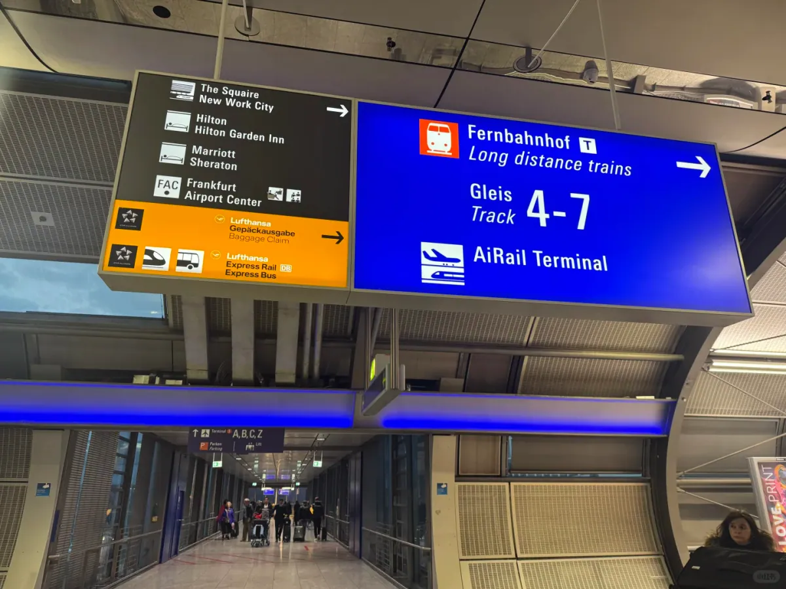

Terminal 3, Frankfurt Havalimanı'nın en yeni binası; hava sahasının güney tarafında, pistler onunla Terminal 1 ve 2 arasında kalacak şekilde inşa edildi. Salon geniş ve tabelalar eksiksiz, yine de uçaktan trene gitmek çoğu insanın beklediğinden fazla adım içeriyor: pasaport kontrolü, bagaj, yolcu taşıma sisteminde oldukça uzun bir yolculuk ve ardından çok uzun bir koridor.

Sorunun kökü istasyonun nerede olduğu. Frankfurt'taki her uzun mesafe treni — ICE de IC de — Terminal 1 tarafındaki **Fernbahnhof**'tan kalkıyor. Terminal 3'ün kendi uzun mesafe peronları yok, bu yüzden oradan başlayan yolcular önce Terminal 1'e dönmeli, sonra istasyon salonunu barındıran uzun bina The Squaire'i geçerek trene ulaşmalı.

Ekim 2026'da bir yolcu tüm süreci zamanladı. Uçak Terminal 3'e **06:00**'da indi. Pasaport kontrolü, bagaj ve yön bulmanın ardından Fernbahnhof salonuna varış **07:50** civarındaydı — toplamda **1 saat 40 dakika**, koşmadan, valizle normal bir yürüme temposunda. Bu rehber o yolculuğu adım adım bölüyor ve nerede zaman kazanılabileceğini, nerede kazanılamayacağını gösteriyor.

## 1. Terminal 3 ve mesafe sorunu

Terminal 3, Frankfurt'a büyüme alanı vermek için var. Terminal 1 ve 2 yıllardır kapasiteye yakın çalışıyordu ve kalan tek alan pistlerin uzak tarafıydı; bu yüzden yeni bina ilk ikisinden ayrı duruyor. Bunu işler hale getirmek için havalimanı SkyLine yolcu taşıma sistemini Terminal 3'e uzattı, böylece yolcular artık binalar arasında servis otobüsüne ihtiyaç duymuyor. Bedeli daha uzun bir yolculuk: Terminal 2'den Terminal 1'e iki dakika, ama Terminal 3'ten **sekiz-on dakika**.

Bu yolculuk, durağınızı kaçırdığınızı merak ettirecek kadar uzun. Tren yüksek hattında apronun etrafında dönüyor ve pencerenin dışında terminale benzeyen bir şey yerine taksi yolları, uçak park yerleri ve sıra sıra kuyruk yüzgeçleri var. Gerçekten uzun yoldan gidiyor. Orijinal notun yazarı da aynı noktayı belirtiyor: Terminal 3 yeni, tabelalar var, ama **mesafeler uzun** ve zamanın iyi bir kısmı yalnızca yolcu taşıma sisteminde geçiyor.

Daha kolay hafife alınan şey, yolculuktan önce olan her şey. Sabah altı, uzun mesafe varışlarının biriktiği saat; pasaport kuyrukları ve bagaj bantları yavaş olabiliyor; uçak uzak bir park yerine yanaşırsa önce otobüs yolculuğu var. Bunların hiçbiri bir güzergâh tarifinde görünmez, yine de 1 saat 40 dakikanın çoğunu bunlar oluşturdu. Yani Terminal 3'ten istasyona bir saatten fazla sürüyor diye okuduğunuzda sorun güzergâh değil — zaman terminalde geçiyor, rayda değil.

Bu aynı zamanda Terminal 3'e inen herkesin tren rezervasyonu yaparken neden daha fazla pay bırakması gerektiğini açıklıyor. Terminal 2'den inişten S-Bahn'da oturmaya kırk dakika olağan. Terminal 3 bir yolcu taşıma sistemi ve uzun bir koridor ekliyor, bu yüzden aynı rahat pay bir saat veya daha fazlasına çıkıyor. İnişten en az iki saat sonrasına bir ICE rezervasyonu yapın, acele etmeniz gerekmez; elinizde yalnızca bir saat varsa hızlı bir bagaj bandına güvenmek yerine sonraki trene geçin.

## 2. SkyLine ile Terminal 1'e

Varışlardan çıkarken mavi tavan tabelalarını arayın. Terminal 3 diğer ikisiyle aynı tasarım dilini kullanıyor: solda **1** rakamlı bir uçak simgesi, ardından **A,B,C,Z**, yani Terminal 1'in dört check-in salonu. Sonraki satırda **Bahnhöfe / Train stations** ve **AiRail Terminal**, daha sağda Busbahnhof (otobüs terminali) ve Toiletten yazıyor. Demiryolu için Terminal 1 satırını izleyin.

Koridor geniş, zemini koyu taş, çatısı açılı çelik ve ışıklıklarla kaplı. Akışı üç-beş dakika izleyin ve yürüyen merdivenler ile SkyLine peronuna ulaşın. Servis **ücretsiz**, kapısı yok ve bilet gerektirmiyor; sefer o kadar sık ki bekleme genellikle yolculuktan kısa sürüyor.

Araca bindikten sonra bir yer bulun ve valizinizi yakın tutun. Vagonlar küçük ve sabahın erken saatlerinde gelenler genellikle iki-üç büyük valiz taşıyor, bu yüzden koridor doluyor; binemiyorsanız bir sonraki tren daha kolay seçenek. Sekiz-on dakika sonra Terminal 1'e varıyorsunuz ve anahtar kelime Terminal'den **Bahnhof**'a dönüşüyor.

## 3. Fernbahnhof mu, Regionalbahnhof mu

Terminal 1'in içinde demiryolu iki yöne ayrılıyor ve bu tüm güzergâhtaki en önemli karar. Havalimanı istasyonunun iki yarısı var: doğrudan Terminal 1'in altında, S-Bahn ve bölgesel trenler için 1–3 numaralı raylarla **Regionalbahnhof** ve The Squaire'in altında kuzeybatı tarafında, ICE ile IC seferleri için 4–7 numaralı raylarla **Fernbahnhof**. Adlar tek kelimeyle farklı ve yönler birbirinin zıttı.

Mavi **Fernbahnhof / Long-distance trains** tabelasını izleyin; üzerinde **Gleis 4–7** ve **AiRail Terminal** de var. Yanındaki siyah tabela farklı bir varış noktaları dizisi listeliyor — The Squaire, Hilton, Hilton Garden Inn, Marriott, Sheraton ve Frankfurt Airport Center — hepsi aynı komplekste ve dolayısıyla aynı yönde. Sarı panel Lufthansa'nın bagaj takip gişesi; onu görmek doğru yönde gittiğiniz anlamına geliyor.

Sonra güzergâhın en uzun yürüyüşü geliyor: iki yanı cam, yola ve The Squaire'in büyük kütlesine bakan düz bir koridor. **Beş-yedi dakika** sürüyor ve istasyon salonu en uçta. Valizler ağırsa yol boyunca yürüyen bantlar ve asansörler var. Sapılacak yan yol yok; tek gerçek risk yanlış yöne gitmek — Regionalbahnhof tabelası görürseniz S-Bahn'a gidiyorsunuz demektir, geri dönün.

| İstasyon | Nerede | Trenler | En uygun olduğu durum |
| --- | --- | --- | --- |
| Fernbahnhof | Terminal 1'in kuzeybatısında, The Squaire'in altında, koridor boyunca 5–7 dakika | ICE ve IC uzun mesafe trenleri, 4–7 numaralı raylar | Heidelberg, Münih, Berlin, Köln ve ötesi |
| Regionalbahnhof | Doğrudan Terminal 1'in altında, 1–3 numaralı raylar | S-Bahn S8/S9 ve bölgesel trenler | Frankfurt şehir merkezi, Mainz, Wiesbaden |

Yanlış yapmak felaket değil. Regionalbahnhof'ta şehre giden S-Bahn trenleri var ve Hauptbahnhof'ta uzun mesafe trenine aktarma yapabilirsiniz; bedeli bir ek aktarma ve belki yarım saat. Asıl can sıkıcı hata tersi: S-Bahn biletiyle Fernbahnhof peronunda durup hiç gelmeyecek bir treni beklemek.

The Squaire ayrı bir paragrafı hak ediyor. Havalimanının en tanınabilir binası: otoyolun üzerine yayılmış 660 metrelik “yatan kule”; içinde oteller, ofisler ve restoranlar var, istasyon salonu da tabanında. Koridor boyunca yürürken binayı önce yandan görüyorsunuz, sonra altına varıyorsunuz; yani büyüyen bir cephe iyi işaret. İçinde Lufthansa'nın **AiRail Terminal**'i var: Lufthansa Express Rail ile rezervasyonunuz varsa burada check-in yapıp bagajınızı bırakabilir, varış noktanıza kadar etiketletebilir ve şehre eliniz boş trene binebilirsiniz.

## 4. Biletler, peronlar ve gecikmeler

Fernbahnhof salonunun cam çatısı ve ortasında asılı büyük bir **Abfahrt / Departure / Départ** panosu var. Trenler saat, uğradığı istasyonlar (Über via), varış yeri (Ziel) ve peron (Gleis) ile listeleniyor. İlk kez gelenler sık sık peronunu bulmak için panoya bakar ve sütunu boş bulur. Bu Deutsche Bahn için normal: **peron genellikle kalkıştan kısa süre önce duyurulur**, bazen en fazla on veya on beş dakika önce.

Bu yüzden varır varmaz perona koşmayın. Salonda iki şeyi teyit edin: tren numaranız ve peronun ne zaman görüneceği. DB Navigator uygulaması aynı bilgileri gösterir ve genellikle daha hızlı güncellenir; mobil veriniz yoksa panonun önünde durun veya sağdaki DB Information gişesine sorun.

Alman istasyonlarında **bilet turnikesi yok**. Peronlar herkese açık, ödeme güvene dayalı ve denetim trende yapılıyor: kondüktör koridorda yürüyüp e-biletinizdeki QR kodunu tarıyor. Binmeden önce biletin alınmış ve geçerli olduğundan emin olun; kâğıt biletler damgalanmalı, e-biletler telefonunuzda durur.

Peron tabelaları tepede asılı ve altındaki daha küçük satır vagon bölgelerini veriyor. Alman uzun mesafe trenleri A, B ve C olarak işaretlenmiş bölümlerde durur; biletinizde “Wagen 31, Sektor B” yazıyorsa B bölgesinde durun, taşıyacağınız mesafe çok azalır. İkinci sınıfta koltuk ataması yok — boş olanı alın; birinci sınıf dizinin önünde veya arkasında ve kapıda büyük bir “1” ile işaretli. Büyük valizleri oturma alanına sürüklemek yerine kapı yanındaki raflara koyun; orijinal nottaki en faydalı ipucu bu.

Almanya'da gecikmeler olağan; on veya yirmi dakika dikkat çekmez. Esnek biletle (Flexpreis) sonraki trene binersiniz. Tasarruf biletinde (Sparpreis) bilet belirli bir sefere bağlıdır ve normalde değiştirilemez, ancak DB gecikmesi yüzünden bir bağlantıyı kaçırdığınızda personel genellikle aynı yöndeki sonraki trene binmenize izin verir. Bu olursa ikinci bilet almak yerine durumu DB Information gişesinde anlatın. Orijinal notun deneyimi — kaçırılan bir bağlantının yeniden bilet almadan sonraki trene aktarılabildiği — genellikle geçerli, ancak ücret tarifesine ve günün kurallarına bağlı.

Bilet almak kolay. Salondaki mavi makineler İngilizceye geçer ve kart ile bozuk para kabul eder; DB Navigator en pratik seçenek ve koltuk rezervasyonu da yapmanızı sağlar; evden çıkmadan alıyorsanız Trainline veya Omio gibi platformlar da e-bilet düzenler. Uzun mesafe trenlerini **önceden** ayırtın: tasarruf ücretleri esnek olanlardan belirgin şekilde ucuzdur ama sınırlıdır ve tükenir. Planlarınız değişebilirse esneklik için farkı ödeyin. Rezervasyon olmadan ikinci sınıfa binebilirsiniz, ama popüler hafta sonu seferleri dolar ve koltuk rezervasyonu genellikle yalnızca birkaç avro tutar — üç-dört saatlik bir yolculukta buna değer.

## 5. İnişten kalkışa zaman bütçesi

Kaydedilen yolculuğu parçalara ayırınca 1 saat 40 dakika kabaca şöyle geçti: neredeyse yarısı iniş ile varış alanından çıkış arasında, pasaport kontrolü, bagaj ve tabelaları bulma dahil; SkyLine beklemesi ve yolculuk yaklaşık çeyrek saat; Terminal 1 koridoru beş-yedi dakika; geri kalanı panoyu okumak, perona yürümek ve doğru vagonu bulmakla geçti.

Sipariş sayfası açıkça söylüyor: **08:51** Frankfurt (M) Flughafen Fernbf, ICE 513, Mannheim Hauptbahnhof'ta aktarma, **10:00**'da Heidelberg-Altstadt varışı. Peron alanında yalnızca “istasyon panosunu izleyin” yazıyor — tam da yukarıdaki nokta, peronun kalkışa yakın duyurulduğu. 07:50'de istasyona girişten 08:51'de çıkışa kadar bir saat vardı; bu cömert görünüyor ve pratikte bir kahve, tuvalet molası ve acele etmeyen bir aşağı yürüyüş için tam doğruydu.

Beklediğinizden erken varırsanız salonda kafeler ve bir fırın var; bir süre oturmak soğuk peronda beklemekten iyidir. Anonsu dinleyin ve ekranları izleyin: istasyon “Frankfurt Flughafen Fernbahnhof” olarak anons edilir, Regionalbahnhof'tan tek kelime uzak. Bazı peron girişleri bir sonraki trenin vagon sırasını gösterir; bir bakış peronun hangi ucuna yürüyeceğinizi söyler ve valizi trenin boyunca sürüklemekten kurtarır.

İlk deneme için birkaç öneri:

1. İnişten kalkışa **1,5–2 saat ayırın**. 1 saat 40 dakika normal bir tempo, cömert olanı değil; uçuş gecikirse veya bagaj yavaşsa iki saat daha güvenli.
2. **Terminal 1'de binadan çıkmayın.** SkyLine'dan itibaren tüm güzergâh kapalı; dışarı adım atarsanız geri girmenin yolunu bulmanız gerekir.
3. **Regionalbahnhof'u değil Fernbahnhof'u izleyin.** Tabelalar sık sık yan yana çıkar; Gleis 4–7 yazan mavi olan uzun mesafe istasyonudur.
4. **E-bileti kayıtlı ve ekran görüntüsü alınmış tutun.** Peronlarda ve vagonlarda mobil sinyal zayıftır; denetimde sipariş sayfasını karıştırmak hoş değildir.
5. **Kapı yanındaki bagaj raflarını kullanın.** Koridoru açık tutar ve inmeyi çok kolaylaştırır.

Bu yürüyüş Ekim 2026'da bir yolcunun anlatımından geliyor; SkyLine sıklıkları ile DB trenleri ve peronları, günün koşullarına ve işletmecinin web sitesindeki bilgilere tabidir. Terminal 3 hâlâ yeni ve tabelaları değişmeye devam edecek; bu yüzden güzergâhı ezberlemek yerine ilerlerken tabelalara bakmak daha güvenilir.

## İlgili bağlantılar

- **Bu sitede**: [Frankfurt Havalimanı (FRA)](/airport/FRA), [Almanya (DE)](/country/DE)
- **Wikipedia**: [Frankfurt Airport](https://en.wikipedia.org/wiki/Frankfurt_Airport)
- **Baidu Baike**: [Frankfurt Airport](https://baike.baidu.com/item/%E6%B3%95%E5%85%B0%E5%85%8B%E7%A6%8F%E6%9C%BA%E5%9C%BA)
