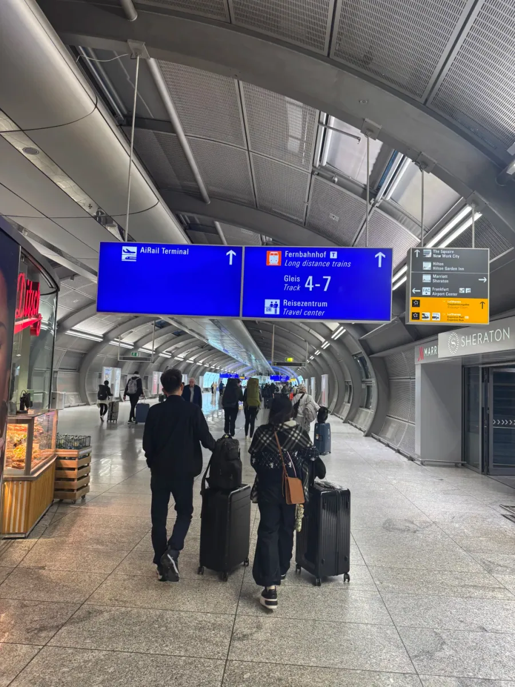

Термінал 3 — найновіша будівля Франкфуртського аеропорту, зведена на південному боці летовища, так що злітно-посадкові смуги лежать між ним і терміналами 1 та 2. Зал просторий, вказівники повні, однак шлях від літака до поїзда включає більше етапів, ніж більшість людей очікує: паспортний контроль, видача багажу, доволі довга поїздка пасажирським конвеєром, а потім дуже довгий коридор.

Корінь проблеми — розташування станції. Усі поїзди далекого сполучення у Франкфурті — і ICE, і IC — відправляються з **Fernbahnhof** з боку термінала 1. Термінал 3 не має власних платформ далекого сполучення, тож пасажирам, які стартують звідти, спершу треба повернутися до термінала 1, а потім перетнути The Squaire — довгу будівлю, у якій міститься станційний зал, — і лише тоді дістатися до поїзда.

У жовтні 2026 року один мандрівник засік увесь шлях. Літак приземлився в терміналі 3 о **06:00**. Після паспортного контролю, багажу й пошуку дороги він опинився в залі Fernbahnhof близько **07:50** — **1 година 40 хвилин** загалом, без бігу, звичайним кроком із валізою. Цей посібник розбирає ту подорож крок за кроком і показує, де час можна зекономити, а де — ні.

## 1. Термінал 3 і проблема відстані

Термінал 3 існує, щоб дати Франкфурту простір для зростання. Термінали 1 і 2 роками працювали майже на межі пропускної здатності, і єдине вільне місце було з іншого боку злітно-посадкових смуг — саме тому нова будівля стоїть окремо від початкової пари. Щоб це запрацювало, аеропорт продовжив SkyLine до термінала 3, тож пасажирам більше не потрібен шатл-автобус між будівлями. Плата за це — довша поїздка: дві хвилини від термінала 2 до термінала 1, але **вісім-десять хвилин** від термінала 3.

Ця поїздка досить довга, щоб засумніватися, чи не проїхали ви свою зупинку. Потяг петляє навколо перону естакадою, і за вікном — руліжні доріжки, стоянки літаків і ряди хвостових оперень, а не щось схоже на термінал. Він справді їде в об'їзд. Автор оригінальної нотатки каже те саме: термінал 3 новий, вказівники є, але **відстані великі**, і чимала частина часу йде лише на пасажирський конвеєр.

Що легше недооцінити — це все, що відбувається до поїздки. Шоста ранку — саме той час, коли далекомагістральні рейси прибувають один за одним, тож черги на паспортному контролі й стрічки видачі багажу можуть гальмувати; якщо літак став на віддаленій стоянці, спершу буде автобус. Нічого з цього немає в описі маршруту, але саме це з'їло більшу частину тих 1 години 40 хвилин. Тож коли ви читаєте, що від термінала 3 до станції — понад година, проблема не в маршруті: час іде в терміналі, а не в дорозі.

Це також пояснює, чому всім, хто прилітає в термінал 3, варто закладати більше запасу, бронюючи поїзд. З термінала 2 сорок хвилин від посадки до місця в S-Bahn — звична річ. Термінал 3 додає пасажирський конвеєр і довгий коридор, тож той самий комфортний запас перетворюється на годину чи більше. Забронюйте ICE щонайменше за дві години після посадки — і не будете поспішати; якщо у вас лише година, краще пересісти на пізніший поїзд, ніж сподіватися на швидку стрічку багажу.

## 2. SkyLine до термінала 1

Виходячи із зони прибуття, шукайте сині вказівники під стелею. Термінал 3 послуговується тією ж мовою дизайну, що й два інші: ліворуч — іконка літака з **1**, далі **A,B,C,Z**, що означає чотири реєстраційні зали термінала 1. Наступний рядок — **Bahnhöfe / Train stations** і **AiRail Terminal**, а ще праворуч — Busbahnhof (автобусна станція) і Toiletten. Для залізниці треба триматися рядка з терміналом 1.

Коридор широкий, з темнокам'яною підлогою, під кутовим сталевим дахом із ліхтарями. Просувайтеся з потоком три-п'ять хвилин — і дійдете до ескалаторів і платформи SkyLine. Шатл **безкоштовний**, без турнікетів і без квитка, а інтервал руху такий, що чекати зазвичай менше, ніж їхати.

Увійшовши, знайдіть місце й тримайте валізу близько до себе. Вагони маленькі, а ранні прибуття часто везуть по дві-три великі валізи на людину, тож прохід заповнюється; якщо не влізли — простіше дочекатися наступного потяга. Вісім-десять хвилин — і ви в терміналі 1, а ключове слово змінюється з Terminal на **Bahnhof**.

## 3. Fernbahnhof чи Regionalbahnhof

Усередині термінала 1 залізниця роздвоюється на два напрямки, і це найважливіше рішення на всьому маршруті. Станція аеропорту має дві половини: **Regionalbahnhof** безпосередньо під терміналом 1, колії 1–3 для S-Bahn і регіональних поїздів, і **Fernbahnhof** на північному заході під The Squaire, колії 4–7 для ICE та IC. Назви різняться одним словом, а напрямки — протилежні.

Ідіть за синім вказівником **Fernbahnhof / Long-distance trains**, на якому також є **Gleis 4–7** і **AiRail Terminal**. Чорний вказівник поряд перелічує інший набір пунктів — The Squaire, Hilton, Hilton Garden Inn, Marriott, Sheraton і Frankfurt Airport Center — усі в тому самому комплексі, а отже, в тому самому напрямку. Жовта панель — це стійка розшуку багажу Lufthansa; побачили її — отже, йдете правильно.

Далі — найдовша прогулянка маршруту: прямий коридор зі склом обабіч, з видом на проїзну частину й основну частину The Squaire. Це **п'ять-сім хвилин**, і станційний зал — у кінці. Дорогою є рухомі доріжки та ліфти, якщо сумки важкі. Відгалужень немає; єдиний реальний ризик — піти не в той бік: якщо побачили вказівник на Regionalbahnhof, ви прямуєте до S-Bahn, тож розвертайтеся.

| Станція | Де вона | Поїзди | Для чого найкраще |
| --- | --- | --- | --- |
| Fernbahnhof | Північний захід від термінала 1, під The Squaire, 5–7 хвилин коридором | Поїзди далекого сполучення ICE та IC, колії 4–7 | Гайдельберг, Мюнхен, Берлін, Кельн і далі |
| Regionalbahnhof | Безпосередньо під терміналом 1, колії 1–3 | S-Bahn S8/S9 і регіональні поїзди | Центр Франкфурта, Майнц, Вісбаден |

Помилка не катастрофічна. У Regionalbahnhof є поїзди S-Bahn до міста, і ви можете пересісти на поїзд далекого сполучення на Hauptbahnhof — ціною однієї додаткової пересадки й, можливо, пів години. По-справжньому неприємна помилка — зворотна: стояти на платформі Fernbahnhof з квитком на S-Bahn і чекати на поїзд, який ніколи не прийде.

The Squaire заслуговує окремої згадки. Це найвпізнаваніша будівля аеропорту: «лежача вежа» завдовжки 660 метрів, перекинута через автостраду, з готелями, офісами й ресторанами, а в її основі — станційний зал. Ідучи коридором, ви спершу бачите будівлю збоку, а потім опиняєтеся під нею, тож фасад, що більшає, — добрий знак. Усередині — **AiRail Terminal** Lufthansa: якщо у вас бронювання в межах Lufthansa Express Rail, тут можна зареєструватися й здати багаж, відправивши його відразу до місця призначення, і поїхати в місто з порожніми руками.

## 4. Квитки, платформи й затримки

Зал Fernbahnhof має скляний дах і велике табло **Abfahrt / Departure / Départ** посередині. Поїзди перелічені за часом, із проміжними станціями (Über via), пунктом призначення (Ziel) і платформою (Gleis). Новачки часто витріщаються на табло, шукаючи свою платформу, і бачать порожню колонку. Для Deutsche Bahn це норма: **платформу часто оголошують лише незадовго до відправлення**, іноді не більше ніж за десять-п'ятнадцять хвилин.

Тож не біжіть одразу на платформу. У залі перевірте дві речі: номер свого поїзда і коли з'явиться платформа. Застосунок DB Navigator показує ту саму інформацію і часто оновлюється швидше; без мобільного інтернету — станьте перед табло або запитайте на стійці DB Information праворуч.

На німецьких станціях **немає турнікетів**. Платформи відкриті для всіх, оплата тримається на довірі, а контроль відбувається в поїзді: провідник іде проходом і сканує QR-код вашого електронного квитка. Подбайте, щоб квиток був куплений і дійсний до посадки; паперові квитки треба компостувати, електронні просто живуть у телефоні.

Платформні вказівники висять під стелею, а дрібнішим рядком унизу позначені зони вагонів. Німецькі поїзди далекого сполучення зупиняються секціями, позначеними A, B і C, тож якщо у вашому квитку «Wagen 31, Sektor B» — станьте в зоні B, і нести доведеться значно менше. У другому класі місця не закріплені — сідайте на будь-яке вільне; перший клас — на початку або в кінці складу, позначений великою «1» на дверях. Великі валізи ставте на полиці біля дверей, а не тягніть їх у салон — це найкорисніша порада з оригінальної нотатки.

Затримки в Німеччині — звична річ; десять-двадцять хвилин нікого не дивують. З гнучким квитком (Flexpreis) ви просто сідаєте на наступний поїзд. З ощадним квитком (Sparpreis) квиток прив'язаний до конкретного рейсу і зазвичай не підлягає обміну, але коли через затримку DB ви пропускаєте пересадку, персонал зазвичай пускає вас на наступний поїзд у тому ж напрямку. Якщо так сталося, поясніть ситуацію на стійці DB Information, а не купуйте другий квиток. Досвід з оригінальної нотатки — що пропущену пересадку можна надолужити на наступному поїзді без повторної купівлі — загалом підтверджується, хоч усе залежить від тарифу й того, які правила діють того дня.

Купити квиток просто. Сині автомати в залі перемикаються на англійську й приймають картки та монети; DB Navigator — найзручніший варіант, він же дає змогу забронювати місце; якщо купуєте ще вдома, платформи на кшталт Trainline чи Omio теж видають електронні квитки. Бронюйте поїзди далекого сполучення **заздалегідь**: ощадні тарифи помітно дешевші за гнучкі, але їх мало і вони розходяться. Якщо плани можуть змінитися, доплатіть за гнучкість. У другий клас можна сісти й без бронювання, але популярні вихідні рейси заповнюються, а бронювання місця зазвичай коштує лише кілька євро — на три- чи чотиригодинній поїздці воно того варте.

## 5. Бюджет часу від посадки до відправлення

Розклавши зафіксовану подорож, 1 година 40 хвилин минули приблизно так: майже половина — між посадкою літака й виходом із зони прибуття, включно з паспортним контролем, багажем і пошуком вказівників; очікування SkyLine плюс поїздка — близько чверті години; коридор термінала 1 — п'ять-сім хвилин; решта — на читання табло, спуск до платформи й пошук потрібного вагона.

Сторінка замовлення каже прямо: **08:51** з Frankfurt (M) Flughafen Fernbf, ICE 513, пересадка на Mannheim Hauptbahnhof, прибуття до Heidelberg-Altstadt о **10:00**. У полі платформи — лише «стежте за табло станції», тобто рівно те, про що йшлося вище: платформу оголошують ближче до відправлення. Від входу на станцію о 07:50 до від'їзду о 08:51 минула година — звучить щедро, а на практиці виявилося саме тим, що треба: на каву, зупинку в туалеті й неквапливий спуск.

Якщо приїхали раніше, ніж очікували, у залі є кав'ярні й пекарня, і посидіти трохи краще, ніж чекати на холодній платформі. Слухайте оголошення й дивіться на екрани: станцію оголошують як «Frankfurt Flughafen Fernbahnhof», що відрізняється від Regionalbahnhof одним словом. Деякі входи на платформу показують порядок вагонів наступного поїзда, тож один погляд підкаже, до якого кінця платформи йти, і врятує від того, щоб тягти валізу вздовж усього поїзда.

Кілька порад для першої спроби:

1. **Закладайте 1,5–2 години** від посадки до відправлення. 1 година 40 хвилин — це звичайний темп, а не щедрий; із пізнім рейсом чи повільним багажем дві години безпечніше.
2. **Не виходьте з будівлі в терміналі 1.** Від SkyLine і далі весь маршрут усередині; вийдете надвір — доведеться шукати вхід назад.
3. **Ідіть за Fernbahnhof, а не Regionalbahnhof.** Вказівники часто стоять поруч; синій із написом Gleis 4–7 — це станція далекого сполучення.
4. **Тримайте е-квиток збереженим і знятим на скріншот.** Мобільний зв'язок на платформах і в вагонах нестабільний, а шукати сторінку замовлення під час контролю — неприємно.
5. **Користуйтеся полицями для багажу біля дверей.** Вони тримають прохід вільним і полегшують вихід.

Цей маршрут описано за розповіддю мандрівника з жовтня 2026 року; частота SkyLine, поїзди та платформи DB залежать від інформації на місці й на сайті оператора того дня. Термінал 3 ще новий, і його навігація постійно змінюється, тож дивитися на вказівники дорогою надійніше, ніж завчати маршрут.

## Пов'язані посилання

- **На цьому сайті**: [Франкфуртський аеропорт (FRA)](/airport/FRA), [Німеччина (DE)](/country/DE)
- **Вікіпедія**: [Франкфуртський аеропорт](https://en.wikipedia.org/wiki/Frankfurt_Airport)
- **Baidu Baike**: [Франкфуртський аеропорт](https://baike.baidu.com/item/%E6%B3%95%E5%85%B0%E5%85%8B%E7%A6%8F%E6%9C%BA%E5%9C%BA)
