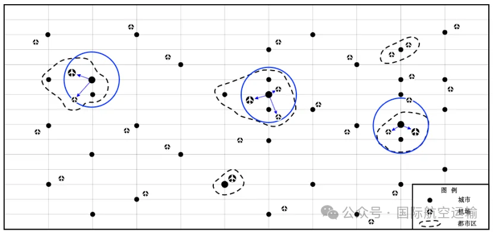

লন্ডনে আছে হিথ্রো, গ্যাটউইক, স্ট্যানস্টেড, লুটন, লন্ডন সিটি ও সাউথএন্ড। নিউ ইয়র্কে JFK, নিউয়ার্ক, লা গার্ডিয়া ও ওয়েস্টচেস্টার কাউন্টি; টোকিওতে হানেডা ও নারিতা; শিকাগোতে ও’হেয়ার ও মিডওয়ে; সাংহাইতে পুডং ও হংকিয়াও। এগুলো একে অন্যের সঙ্গে প্রতিযোগিতা করে এবং একে অন্যের ঘাটতি পূরণ করে, একসঙ্গে একটি মহানগর অঞ্চলের বিমান প্রবেশদ্বার গড়ে তোলে।

২০২৩ সালে চীনা জার্নাল Scientia Geographica Sinica-য় প্রকাশিত এক নিবন্ধে চায়না একাডেমি অব সিভিল এভিয়েশন সায়েন্স অ্যান্ড টেকনোলজির গবেষকরা ২০১৮ সালের বিমানবন্দর ও শহরের উপাত্ত ব্যবহার করে এমন গুচ্ছ গণনা করেন: ৫৯টি বহু-বিমানবন্দর ব্যবস্থা, ১৪২টি বেসামরিক বিমানবন্দর, যার ৮৯টি বড়। নিবন্ধে দুটি পুনরায় ব্যবহারযোগ্য সরঞ্জামও দেওয়া হয়েছে — দুই ধাপের অনুসন্ধান ও বিমানবন্দর থেকে মহানগর পর্যন্ত ৭০ কিমি দূরত্বের সীমা — যা দিয়ে “কোন বিমানবন্দর একই ব্যবস্থার অন্তর্গত” তা মানচিত্রে গণনা করা যায়।

## কী কী মিলে বহু-বিমানবন্দর ব্যবস্থা গড়ে ওঠে

পরিভাষাটি হলো বহু-বিমানবন্দর ব্যবস্থা (Multiple/Multi-Airport System), সংক্ষেপে MAS: একটি মহানগর অঞ্চলের মধ্যে দুই বা তার বেশি বড় বিমানবন্দর এবং অন্যান্য বিমানবন্দর। তিনটি শর্ত একসঙ্গে পূরণ হতে হবে।

প্রথমত, অন্তত দুটি বড় বিমানবন্দর, এবং নিয়ম হিসেবে অন্তত একটি প্রধান বিমানবন্দর। দ্বিতীয়ত, শুধু বাণিজ্যিক পরিষেবা, তাই সাধারণ বিমান চলাচল ও সামরিক বিমানক্ষেত্র গণনায় আসে না। তৃতীয়ত, একই মহানগর অঞ্চল।

ব্যবস্থাপনা এই সংজ্ঞার অংশ নয়। একই মালিকানার চেয়ে একই পশ্চাৎভূমি বেশি গুরুত্বপূর্ণ: হিথ্রো, গ্যাটউইক ও স্ট্যানস্টেড ভিন্ন ভিন্ন কোম্পানির, কিন্তু সেবা দেয় একই লন্ডনকে।

তৃতীয় শর্তটিই কঠিনতম। মহানগর অঞ্চলের সীমানা দেশে দেশে আলাদা, আর প্রশাসনিক রেখা আন্তঃশহর, আন্তঃপ্রদেশ এমনকি আন্তঃসীমান্ত সমন্বয় ধরতে পারে না — শেনচেন, হংকং ও মাকাও এর স্পষ্ট উদাহরণ। তাই দূরত্বের সীমা ও অনুসন্ধান অ্যালগরিদম।

## দুই ধাপের অনুসন্ধান: আগে মহানগর অঞ্চল, তারপর বিমানবন্দর

পদ্ধতিটির নাম দুই ধাপের অনুসন্ধান (Two-Step Search, TSS)। এটি ‘বিমানবন্দরটি কোন শহরের’ প্রশ্ন না করে উপাত্ত ও দূরত্বের ভিত্তিতে মহানগর অঞ্চল ও বিমানবন্দরকে জোড়া লাগায়।

প্রথম ধাপে মহানগর অঞ্চল খোঁজা হয়। একটি ট্রাফিক সীমার ওপরে থাকা প্রধান বিমানবন্দর থেকে শুরু করে জনসংখ্যার একটি সীমার ওপরে থাকা কাছের শহর বা মহানগর অঞ্চল খোঁজা হয়, পুনরাবৃত্তিগুলো এক নমুনায় মিলিয়ে দেওয়া হয়, আর ব্যাসার্ধ ৭০ কিমিতে সীমাবদ্ধ করা হয়, যাতে সম্পর্কহীন দূরের শহরগুলো টেনে আনা না হয়।

দ্বিতীয় ধাপে বিমানবন্দর খোঁজা হয়। প্রতিটি নমুনা মহানগর অঞ্চলের চারপাশে বিমানবন্দর-মহানগর সেবা দূরত্বের সমান ব্যাসার্ধ টানা হয় এবং ট্রাফিক সীমার ওপরে থাকা বাণিজ্যিক বিমানবন্দর খোঁজা হয়। দুটি বা তার বেশি যোগ্য বিমানবন্দর মিলে একটি বহু-বিমানবন্দর ব্যবস্থা হয়। নিবন্ধে উল্লেখ আছে, অ্যালগরিদমের প্রধান বিমানবন্দরের জন্য আলাদা ট্রাফিক সীমা লাগে না।

সত্তর কিলোমিটারই মূল পরামিতি: যতটা বড় হলে মূল অংশের সঙ্গে আগেই মিলে যাওয়া প্রতিবেশী শহরগুলো পর্যন্ত পৌঁছানো যায়, আবার যতটা ছোট হলে দুটি মহানগর অঞ্চল জোড়া লেগে যায় না। ভ্রমণকারীর জন্য এটি সড়কপথে মোটামুটি এক ঘণ্টা — সামঞ্জস্যপূর্ণ উপাত্ত ও বাস্তবসম্মত যাতায়াতের মধ্যে ভারসাম্য রাখা একটি কার্যকর সীমা, নির্দিষ্ট ভৌগোলিক সীমানা নয়।

পদ্ধতিটির জন্য শুধু শহুরে জনসংখ্যা ও বিমানবন্দরের ট্রাফিক দরকার, প্রশাসনিক মানচিত্র বা একই মালিকানা নয়। এটি সীমার প্রতি সংবেদনশীল, তাই ৫৯টি ব্যবস্থা তুলনাযোগ্য একটি ভিত্তিমানচিত্র, কোনো স্থির ক্রমতালিকা নয়।

## বৈশ্বিক চিত্র: ৫৯টি ব্যবস্থা, বেশির ভাগেই একটি প্রধান ও একটি সহায়ক

২০১৮ সালের ৫৯টি ব্যবস্থার বেশির ভাগ উত্তর গোলার্ধে; দক্ষিণে আছে শুধু ব্রাজিল (২), আর্জেন্টিনা (১) ও ইন্দোনেশিয়া (১)। ইউরোপে ২১টি, উত্তর আমেরিকায় ১৬টি, এশিয়া-প্রশান্ত মহাসাগরীয় অঞ্চলে ১৫টি, মধ্যপ্রাচ্যে ৪টি ও লাতিন আমেরিকায় ৩টি। দেশ অনুযায়ী: যুক্তরাষ্ট্র ১৩, চীন ৫, যুক্তরাজ্য ৪, জাপান ৪; ইতালি ও কানাডা প্রতিটি ৩; স্পেন, ব্রাজিল, জার্মানি ও দক্ষিণ কোরিয়া প্রতিটি ২।

একটি ব্যবস্থায় গড়ে ২.৪১টি বিমানবন্দর, আর ৯৩.২%-এ দুটি বা তিনটি বিমানবন্দর আছে। নিবন্ধে পরিপূরক ও ভারসাম্যপূর্ণ মডেল আলাদা করা হয়েছে, তারপর “এক প্রধান, এক সহায়ক”, “যমজ কেন্দ্র” ও “তিন কেন্দ্র” রূপের কথা বলা হয়েছে। এক-প্রধান-এক-সহায়ক সবচেয়ে সাধারণ, ৩০টি ব্যবস্থায়; এরপর যমজ কেন্দ্র ১১টিতে। ফলে বেশির ভাগ ব্যবস্থা একটি কেন্দ্র আর একটি সহায়ক বিমানক্ষেত্র: প্রধানটি দূরপাল্লার আন্তর্জাতিক রুট ও সংযোগ সামলায়, সহায়কটি দেশীয় ফ্লাইট, চার্টার, কম খরচের ট্রাফিক বা পণ্যবহন গ্রহণ করে।

## কেন এই ব্যবস্থাগুলো গুরুত্বপূর্ণ: ধারণক্ষমতা, প্রতিযোগিতা, বিশেষায়ন

প্রথমে ওজন। ২০১৮ সালে এই ৫৯টি ব্যবস্থা বিশ্বের বিমানবন্দরগুলোর ৫.৬% হলেও ৩৩৭ কোটি যাত্রী ও ৬ কোটি টন পণ্য সামলেছিল — বিশ্ব মোটের ৩৮.৩% ও ৪৯.৬%। শীর্ষ দশটির বেশির ভাগ ১০ কোটি যাত্রী ও ২০ লাখ টন পণ্যের বেশি পার করে।

| মহানগর অঞ্চল | প্রধান বিমানবন্দর | যাত্রী (১০ হাজার) | পণ্য (১০ হাজার টন) |
| --- | --- | --- | --- |
| লন্ডন | হিথ্রো (LHR), গ্যাটউইক (LGW), লন্ডন সিটি (LCY), লুটন (LTN), সাউথএন্ড (SEN), স্ট্যানস্টেড (STN) | 17760 | 216 |
| শেনচেন–হংকং–মাকাও | হংকং (HKG), মাকাও (MFM), শেনচেন বাওআন (SZX) | 13155 | 638 |
| টোকিও | হানেডা (HND), নারিতা (NRT) | 12949 | 364 |
| নিউ ইয়র্ক | JFK, নিউয়ার্ক (EWR), লা গার্ডিয়া (LGA), ওয়েস্টচেস্টার কাউন্টি (HPN) | 13909 | 223 |
| সাংহাই | পুডং (PVG), হংকিয়াও (SHA) | 11763 | 418 |
| দুবাই | দুবাই ইন্টারন্যাশনাল (DXB), দুবাই ওয়ার্ল্ড সেন্ট্রাল (DWC), শারজাহ (SHJ) | 10210 | 372 |
| প্যারিস | শার্ল দ্য গোল (CDG), অর্লি (ORY), বুভে (BVA) | 10914 | 225 |
| লস অ্যাঞ্জেলেস | LAX, বারব্যাঙ্ক (BUR), লং বিচ (LGB) | 10735 | 230 |
| বেইজিং | ক্যাপিটাল (PEK), নানইয়াং (NAY) | 10750 | 210 |
| সিউল | ইনচন (ICN), গিম্পো (GMP) | 9295 | 308 |

সংখ্যাগুলো ২০১৮ সালের এবং নিবন্ধের সারণির ক্রম অনুসারে। পণ্যে শীর্ষে শেনচেন–হংকং–মাকাও, ৬৩.৮ লাখ টন; এরপর সাংহাই ৪১.৮ লাখ টন; বিশ্বে এই দুটি যথাক্রমে প্রথম ও দ্বিতীয়।

প্রথমে ধারণক্ষমতা। বড় মহানগর অঞ্চলে চাহিদা সাধারণত একটি স্থান যা যোগ করতে পারে তার চেয়ে বেশি বেড়ে যায়; জমি, শব্দ, আকাশসীমা ও ভূমি সংযোগ কঠিন সীমা। হিথ্রোর স্লট কয়েক দশক ধরে টানটান, আর তৃতীয় রানওয়ে নিয়ে সমান সময় ধরে বিতর্ক চললেও তা তৈরি হয়নি, তাই বরাদ্দ দিয়েই প্রবৃদ্ধি নিয়ন্ত্রণ করা হয়; দ্বিতীয় বা তৃতীয় বিমানবন্দরই বাস্তব পথ। এরপর প্রতিযোগিতা: বাড়তি বিমানবন্দর এয়ারলাইনসকে আরেকটি ঘাঁটি ও দরকষাকষির সুযোগ দেয়, যাত্রীদের বিকল্প পথ দেয়, যদিও অতিরিক্ত বিচ্ছিন্নতা সংযোগকারী ট্রাফিক পাতলা করে দেয়। তৃতীয়ত বিশেষায়ন। হিথ্রো দূরপাল্লার পূর্ণ-পরিষেবা কেন্দ্র, স্ট্যানস্টেড ও লুটন কম খরচের ঘাঁটি, লন্ডন সিটি স্বল্পপাল্লার ব্যবসায়িক ফ্লাইট সামলায়; হানেডা দেশীয় ও নিকটপাল্লার দিকে ঝোঁকে, নারিতা দূরপাল্লার দিকে। এসব ভূমিকা বিবর্তনের ফসল; পরিকল্পনায় সেগুলো সহজে নকল করা যায় না।

## চীনের শহরগুলোর জন্য এর অর্থ

নিবন্ধে একটি মূল্যায়নও যোগ করা হয়েছে: চীনই উদীয়মান অঞ্চল। ২০১৮ সালে এখানে পাঁচটি ব্যবস্থা ছিল, যার সামনের সারিতে শেনচেন–হংকং–মাকাও, সাংহাই ও বেইজিং। চীনের শহুরে পরিসরের দেশের জন্য পাঁচটি বেশি নয়, তবে এটি একটি প্রবণতা দেখায়: জনসংখ্যা ও শিল্পঘনত্ব যখন যথেষ্ট বেশি হয়, তখন চাহিদার সীমার আগেই একটি বিমানবন্দরের ধারণক্ষমতার সীমা এসে পড়ে।

উপাত্ত শেষ হয় ২০১৮ সালে। বেইজিং দাশিং ২০১৯ সালে চালু হয় এবং নানইয়াং একই বছর বন্ধ হয়, ফলে বেইজিং “ক্যাপিটাল প্লাস নানইয়াং” থেকে “ক্যাপিটাল প্লাস দাশিং”-এ পরিণত হয়; চেংদু তিয়ানফু ২০২১ সালে চালু হয়; গুয়াংঝো-এর নতুন বিমানবন্দর পরিকল্পনায় ঢুকেছে। আবার গণনা করলে সংখ্যা বাড়ার সম্ভাবনা। ৫৯টি একটি অংশ, শেষ নয়।

সংখ্যার চেয়ে বেশি কাজের হলো নিবন্ধে অন্তর্নিহিত পরীক্ষাটি: নতুন বিমানবন্দর প্রশাসনিক এলাকার ভিত্তিতে নয়, বরং এটি মহানগর অঞ্চলের কার্যকর সেবা পরিধির মধ্যে পড়ে কি না এবং বিদ্যমান কেন্দ্রের সঙ্গে ভূমিকা ভাগ করতে পারে কি না, তার ভিত্তিতে ব্যবস্থার অন্তর্ভুক্ত হয়। ভ্রমণকারীর জন্য দ্বিতীয় বিমানবন্দরের মূল্য নির্ভরযোগ্য ভূমি পরিবহন আর প্রধানের ঘাটতি পূরণ করা রুটে। পরিকল্পনাকারীদের জন্য আকারের চেয়ে ক্রম বেশি গুরুত্বপূর্ণ: ধারণক্ষমতার আগে কাজ নির্ধারণ করুন, নেটওয়ার্কের আগে ভূমি পরিবহন যুক্ত করুন, আন্তর্জাতিক, দেশীয় ও পণ্য কে সামলাবে তা নিয়ে তর্কের আগে আন্তঃশহর সমন্বয় গড়ুন।

বহু-বিমানবন্দর ব্যবস্থা কখনোই সংখ্যার প্রতিযোগিতা নয়। এটি পরীক্ষা করে, একটি মহানগর অঞ্চল সীমিত আকাশসীমা, জমি ও স্লট তার সবচেয়ে ভালো সামলানো রুটগুলোতে বণ্টন করতে পারে কি না। দুই ধাপের অনুসন্ধান ও ৭০ কিমি সীমা সেই ধারণক্ষমতা চিনতে সাহায্য করে; এটি কাজ করবে কি না, তা এখনো নির্ভর করে শহরগুলো বসে শ্রমবিভাজন নিয়ে একমত হতে পারে কি না তার ওপর।

## সম্পর্কিত লিংক

- **এই সাইটে**: [হিথ্রো (LHR)](/airport/LHR), [JFK](/airport/JFK), [হানেডা (HND)](/airport/HND), [প্যারিস শার্ল দ্য গোল (CDG)](/airport/CDG), [ও’হেয়ার (ORD)](/airport/ORD), [সাংহাই পুডং (PVG)](/airport/PVG), [গুয়াংঝো বাইয়ুন (CAN)](/airport/CAN), [যুক্তরাজ্য (GB)](/country/GB), [যুক্তরাষ্ট্র (US)](/country/US), [জাপান (JP)](/country/JP)
- **Wikipedia**: [বিমানবন্দর](https://en.wikipedia.org/wiki/Airport), [মহানগর অঞ্চল](https://en.wikipedia.org/wiki/Metropolitan_area)
- **Baidu Baike**: [বিমানবন্দর গুচ্ছ (机场群)](https://baike.baidu.com/item/%E6%9C%BA%E5%9C%BA%E7%BE%A4)

ছবির সূত্র: নিবন্ধের লেখক ও ইন্টারন্যাশনাল এয়ার ট্রান্সপোর্ট। যাত্রী ও পণ্যের সংখ্যা নিবন্ধে উদ্ধৃত ২০১৮ সালের ACI বিমানবন্দর উপাত্ত; সংজ্ঞা ও বছর মূল লেখা অনুসারে। ভ্রমণের আগে বিমানবন্দর ও এয়ারলাইনসের নিজস্ব সাইট দেখে নিন।
