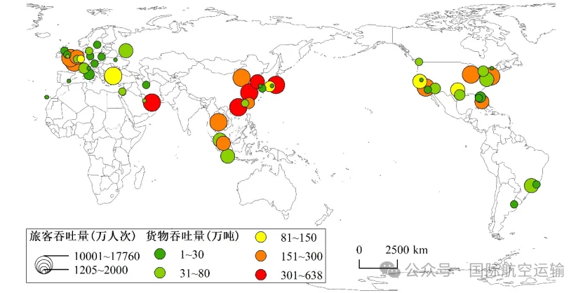
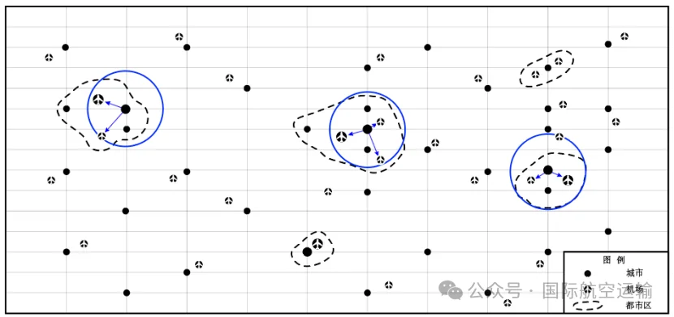

London has Heathrow, Gatwick, Stansted, Luton, London City and Southend. New York has JFK, Newark, LaGuardia and Westchester County; Tokyo has Haneda and Narita; Chicago has O'Hare and Midway; Shanghai has Pudong and Hongqiao. They compete and cover for one another, together forming one metropolitan area's air gateway.

In a paper in the Chinese journal Scientia Geographica Sinica in 2023, researchers at the China Academy of Civil Aviation Science and Technology used 2018 airport and city data to count such clusters: 59 multi-airport systems, 142 civil airports, 89 of them large. The paper also offers two reusable tools — a two-step search and a 70 km airport-to-metro distance threshold — that make "which airports belong to one system" calculable on a map.

## What counts as a multi-airport system

The term is Multiple/Multi-Airport System, or MAS: within one metropolitan area, two or more large airports plus other airports. Three conditions must hold together.

First, at least two large airports, and as a rule at least one primary. Second, commercial service only, so general-aviation and military fields do not count. Third, the same metropolitan area.

Management is not part of the definition. A shared hinterland matters more than a shared owner: Heathrow, Gatwick and Stansted belong to different companies and serve the same London.

The third condition is the hard one. Metropolitan boundaries differ by country, and administrative lines miss cross-city, cross-province and even cross-border combinations — Shenzhen, Hong Kong and Macau being the obvious case. Hence the distance threshold and the search algorithm.

## Two-step search: find the metro area, then the airports

The method is Two-Step Search (TSS). It pairs metro areas and airports by data and distance rather than asking which city an airport belongs to.

Step one looks for metro areas. Starting from primary airports above a traffic threshold, it searches nearby cities or metro areas above a population threshold, merges duplicates into a sample, and caps the radius at 70 km so unrelated distant cities are not dragged in.

Step two looks for airports. Around each sample metro area it draws a radius equal to the airport-to-metro service distance and searches for commercial airports above a traffic threshold. Two or more qualifying airports make a multi-airport system. The paper notes the algorithm needs no separate traffic threshold for the primary airport.

Seventy kilometres is the central parameter: large enough to reach neighbouring cities already merged with the core, small enough not to weld two metro areas together. For a traveller it is roughly an hour by road — an operating threshold balancing consistent data and realistic commuting, not a precise physical boundary.

The method needs only urban population and airport traffic, not administrative maps or shared ownership. It is sensitive to thresholds, so the 59 systems are a comparable base map, not a fixed league table.

## The global picture: 59 systems, mostly one main plus one secondary

The 59 systems of 2018 sit mostly in the northern hemisphere; the south has only Brazil (2), Argentina (1) and Indonesia (1). Europe accounts for 21, North America 16, Asia-Pacific 15, the Middle East 4 and Latin America 3. By country: the United States 13, China 5, the United Kingdom 4, Japan 4; Italy and Canada 3 each; Spain, Brazil, Germany and South Korea 2 each.

A system averages 2.41 airports, and 93.2% have two or three. The paper distinguishes complementary and balanced models, then "one primary, one secondary", "twin core" and "three core" forms. One-primary-one-secondary is commonest at 30 systems, twin-core next at 11. Most systems are therefore one hub with a supporting field: the primary carries long-haul international routes and connections, the secondary absorbs domestic flights, charters, low-cost traffic or cargo.

## Why these systems matter: capacity, competition, specialisation

Weight first. In 2018 these 59 systems were 5.6% of the world's airports but handled 3.37 billion passengers and 60 million tonnes of cargo — 38.3% and 49.6% of global totals. The top ten mostly exceed 100 million passengers and 2 million tonnes of cargo.

| Metro area | Main airports | Passengers (10,000) | Cargo (10,000 t) |
| --- | --- | --- | --- |
| London | Heathrow (LHR), Gatwick (LGW), London City (LCY), Luton (LTN), Southend (SEN), Stansted (STN) | 17760 | 216 |
| Shenzhen–Hong Kong–Macau | Hong Kong (HKG), Macau (MFM), Shenzhen Bao'an (SZX) | 13155 | 638 |
| Tokyo | Haneda (HND), Narita (NRT) | 12949 | 364 |
| New York | JFK, Newark (EWR), LaGuardia (LGA), Westchester County (HPN) | 13909 | 223 |
| Shanghai | Pudong (PVG), Hongqiao (SHA) | 11763 | 418 |
| Dubai | Dubai International (DXB), Dubai World Central (DWC), Sharjah (SHJ) | 10210 | 372 |
| Paris | Charles de Gaulle (CDG), Orly (ORY), Beauvais (BVA) | 10914 | 225 |
| Los Angeles | LAX, Burbank (BUR), Long Beach (LGB) | 10735 | 230 |
| Beijing | Capital (PEK), Nanyang (NAY) | 10750 | 210 |
| Seoul | Incheon (ICN), Gimpo (GMP) | 9295 | 308 |

Figures are for 2018 and follow the paper's table order. Shenzhen–Hong Kong–Macau leads on cargo with 6.38 million tonnes, Shanghai follows with 4.18 million; the two rank first and second worldwide.

Capacity comes first. Demand in a large metro area usually outgrows what one site can add; land, noise, airspace and surface access are hard limits. Heathrow's slots have been tight for decades and its third runway debated just as long without being built, so growth is rationed by allocation; a second or third airport is the practical route. Competition comes second: an extra airport gives airlines another base and bargaining option and passengers an alternative path, though too much fragmentation thins connecting traffic. Specialisation comes third. Heathrow is the long-haul full-service hub, Stansted and Luton are low-cost bases, London City handles short-haul business; Haneda leans domestic and near-haul, Narita long-haul. Those roles evolved; a plan cannot simply copy them.

## What it means for Chinese cities

The paper adds a judgement: China is the emerging region. In 2018 it had five systems, with Shenzhen–Hong Kong–Macau, Shanghai and Beijing in the front rank. Five is not many for a country of China's urban scale, but it points to a trend: once population and industrial density are high enough, one airport's capacity ceiling arrives before the demand ceiling.

The data stop in 2018. Beijing Daxing opened in 2019 and Nanyang closed the same year, turning Beijing from "Capital plus Nanyang" into "Capital plus Daxing"; Chengdu Tianfu opened in 2021; Guangzhou's new airport has entered planning. Recompute and the count would probably rise. The 59 are a slice, not the end.

More useful than the number is the test the paper implies: a new airport belongs to the system not by administrative area but by whether it sits inside the metro area's effective service range and can divide roles with the existing hub. For travellers, a second airport's value lies in reliable surface transport and routes that fill the primary's gaps. For planners, sequence matters more than size: define the function before the capacity, connect the ground transport before the network, build cross-city coordination before arguing over who does international, domestic and cargo.

A multi-airport system is never a contest in numbers. It tests whether a metro area can allocate limited airspace, land and slots to the routes it handles best. The two-step search and the 70 km threshold help recognise that capacity; whether it works still depends on the cities sitting down to agree the division of labour.

## Related links

- **On this site**: [Heathrow (LHR)](/airport/LHR), [JFK](/airport/JFK), [Haneda (HND)](/airport/HND), [Paris Charles de Gaulle (CDG)](/airport/CDG), [O'Hare (ORD)](/airport/ORD), [Shanghai Pudong (PVG)](/airport/PVG), [Guangzhou Baiyun (CAN)](/airport/CAN), [United Kingdom (GB)](/country/GB), [United States (US)](/country/US), [Japan (JP)](/country/JP)
- **Wikipedia**: [Airport](https://en.wikipedia.org/wiki/Airport), [Metropolitan area](https://en.wikipedia.org/wiki/Metropolitan_area)
- **Baidu Baike**: [Airport cluster (机场群)](https://baike.baidu.com/item/%E6%9C%BA%E5%9C%BA%E7%BE%A4)

Image source: the paper's authors and International Air Transport. Passenger and cargo figures are the 2018 ACI airport data cited by the paper; definitions and years follow the original. Check the airports' and airlines' own sites before travelling.
