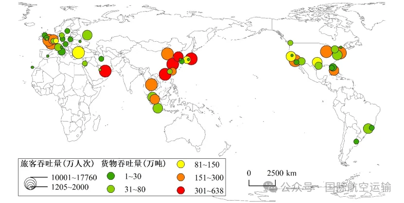

लंदन में हीथ्रो, गैटविक, स्टैनस्टेड, ल्यूटन, लंदन सिटी और साउथएंड हैं। न्यूयॉर्क में JFK, नेवार्क, लागार्डिया और वेस्टचेस्टर काउंटी; टोक्यो में हानेदा और नारिता; शिकागो में ओ'हेयर और मिडवे; शंघाई में पुडोंग और होंगकियाओ हैं। ये आपस में प्रतिस्पर्धा करते हैं और एक-दूसरे की पूर्ति करते हैं, और मिलकर एक महानगरीय क्षेत्र का हवाई प्रवेशद्वार बनाते हैं।

2023 में चीनी पत्रिका Scientia Geographica Sinica में प्रकाशित एक शोधपत्र में, चाइना एकेडमी ऑफ़ सिविल एविएशन साइंस एंड टेक्नोलॉजी के शोधकर्ताओं ने 2018 के हवाई अड्डा और शहर आँकड़ों का उपयोग करके ऐसे समूहों की गिनती की: 59 बहु-हवाईअड्डा प्रणालियाँ, 142 नागरिक हवाई अड्डे, जिनमें 89 बड़े थे। शोधपत्र दो ऐसे उपकरण भी देता है जिनका दोबारा उपयोग किया जा सकता है — एक दो-चरणीय खोज और हवाई अड्डे से महानगर तक 70 किमी की दूरी सीमा — जो नक़्शे पर यह गणना करना संभव बनाते हैं कि कौन-से हवाई अड्डे एक ही प्रणाली में हैं।

## बहु-हवाईअड्डा प्रणाली किसे कहते हैं

यह पद बहु-हवाईअड्डा प्रणाली (Multiple/Multi-Airport System, या MAS) है: एक ही महानगरीय क्षेत्र के भीतर दो या अधिक बड़े हवाई अड्डे तथा अन्य हवाई अड्डे। तीन शर्तें एक साथ पूरी होनी चाहिए।

पहली, कम से कम दो बड़े हवाई अड्डे, और नियमतः कम से कम एक प्रमुख हवाई अड्डा। दूसरी, केवल वाणिज्यिक सेवा, इसलिए सामान्य विमानन और सैन्य हवाई क्षेत्र इसमें नहीं गिने जाते। तीसरी, एक ही महानगरीय क्षेत्र।

प्रबंधन परिभाषा का हिस्सा नहीं है। साझा सेवा क्षेत्र साझा स्वामी से अधिक मायने रखता है: हीथ्रो, गैटविक और स्टैनस्टेड अलग-अलग कंपनियों के हैं और एक ही लंदन की सेवा करते हैं।

तीसरी शर्त सबसे कठिन है। महानगरीय सीमाएँ हर देश में अलग हैं, और प्रशासनिक रेखाएँ अंतर-शहर, अंतर-प्रांत और यहाँ तक कि सीमा-पार संयोजनों को छोड़ देती हैं — शेनझेन, हाँग काँग और मकाओ इसका स्पष्ट उदाहरण हैं। इसीलिए दूरी की सीमा और खोज एल्गोरिद्म सामने आते हैं।

## दो-चरणीय खोज: पहले महानगरीय क्षेत्र, फिर हवाई अड्डे

यह विधि दो-चरणीय खोज (Two-Step Search, TSS) है। यह यह पूछने के बजाय कि कोई हवाई अड्डा किस शहर का है, महानगरीय क्षेत्रों और हवाई अड्डों को आँकड़ों और दूरी के आधार पर जोड़ती है।

पहला चरण महानगरीय क्षेत्रों की खोज करता है। यातायात सीमा से ऊपर के प्रमुख हवाई अड्डों से शुरू करके यह जनसंख्या सीमा से ऊपर के आस-पास के शहरों या महानगरीय क्षेत्रों को खोजता है, दोहरावों को एक नमूने में मिला देता है, और त्रिज्या को 70 किमी पर सीमित करता है ताकि असंबंधित दूर के शहर इसमें न खिंच आएँ।

दूसरा चरण हवाई अड्डों की खोज करता है। हर नमूना महानगरीय क्षेत्र के चारों ओर यह हवाई अड्डे से महानगर तक की सेवा दूरी के बराबर त्रिज्या खींचता है और यातायात सीमा से ऊपर के वाणिज्यिक हवाई अड्डों को खोजता है। दो या अधिक योग्य हवाई अड्डे मिलकर बहु-हवाईअड्डा प्रणाली बनाते हैं। शोधपत्र कहता है कि एल्गोरिद्म को प्रमुख हवाई अड्डे के लिए अलग यातायात सीमा की ज़रूरत नहीं होती।

सत्तर किलोमीटर केंद्रीय मापदंड है: इतना बड़ा कि केंद्र में पहले से मिल चुके पड़ोसी शहरों तक पहुँच जाए, और इतना छोटा कि दो महानगरीय क्षेत्रों को जोड़ न दे। किसी यात्री के लिए यह सड़क से लगभग एक घंटे की दूरी है — एक परिचालन सीमा जो सुसंगत आँकड़ों और वास्तविक आवाजाही के बीच संतुलन बनाती है, कोई सटीक भौतिक सीमा नहीं।

इस विधि को केवल शहरी जनसंख्या और हवाई अड्डे के यातायात की ज़रूरत है, प्रशासनिक नक़्शे या साझा स्वामित्व की नहीं। यह सीमाओं के प्रति संवेदनशील है, इसलिए 59 प्रणालियाँ एक तुलनीय आधार नक़्शा हैं, कोई स्थिर रैंकिंग तालिका नहीं।

## वैश्विक तस्वीर: 59 प्रणालियाँ, ज़्यादातर एक मुख्य और एक सहायक

2018 की 59 प्रणालियाँ ज़्यादातर उत्तरी गोलार्ध में हैं; दक्षिणी गोलार्ध में केवल ब्राज़ील (2), अर्जेंटीना (1) और इंडोनेशिया (1) हैं। यूरोप में 21, उत्तरी अमेरिका में 16, एशिया-प्रशांत में 15, मध्य पूर्व में 4 और लैटिन अमेरिका में 3 हैं। देश के अनुसार: संयुक्त राज्य अमेरिका 13, चीन 5, यूनाइटेड किंगडम 4, जापान 4; इटली और कनाडा में 3-3; स्पेन, ब्राज़ील, जर्मनी और दक्षिण कोरिया में 2-2।

एक प्रणाली में औसतन 2.41 हवाई अड्डे हैं, और 93.2% में दो या तीन हैं। शोधपत्र पूरक और संतुलित मॉडलों तथा 'एक प्रमुख, एक सहायक', 'जुड़वाँ केंद्र' और 'तीन केंद्र' रूपों के बीच अंतर करता है। एक-प्रमुख-एक-सहायक 30 प्रणालियों में सबसे आम है, और उसके बाद 11 में जुड़वाँ केंद्र। इसलिए अधिकांश प्रणालियाँ एक मुख्य केंद्र और एक सहायक हवाई अड्डे वाली होती हैं: प्रमुख हवाई अड्डा लंबी दूरी के अंतरराष्ट्रीय मार्गों और संयोजनों को संभालता है, सहायक हवाई अड्डा घरेलू उड़ानें, चार्टर, कम लागत वाले यातायात या माल ढुलाई लेता है।

## ये प्रणालियाँ क्यों महत्वपूर्ण हैं: क्षमता, प्रतिस्पर्धा, विशेषीकरण

पहले भार। 2018 में ये 59 प्रणालियाँ दुनिया के हवाई अड्डों का 5.6% थीं, लेकिन इन्होंने 3.37 अरब यात्रियों और 6 करोड़ टन माल ढुलाई को संभाला — वैश्विक कुल का 38.3% और 49.6%। शीर्ष दस में से ज़्यादातर 10 करोड़ से अधिक यात्री और 20 लाख टन से अधिक माल संभालते हैं।

| महानगरीय क्षेत्र | मुख्य हवाई अड्डे | यात्री (10,000) | माल (10,000 टन) |
| --- | --- | --- | --- |
| लंदन | हीथ्रो (LHR), गैटविक (LGW), लंदन सिटी (LCY), ल्यूटन (LTN), साउथएंड (SEN), स्टैनस्टेड (STN) | 17760 | 216 |
| शेनझेन–हाँग काँग–मकाओ | हाँग काँग (HKG), मकाओ (MFM), शेनझेन बाओआन (SZX) | 13155 | 638 |
| टोक्यो | हानेदा (HND), नारिता (NRT) | 12949 | 364 |
| न्यूयॉर्क | JFK, नेवार्क (EWR), लागार्डिया (LGA), वेस्टचेस्टर काउंटी (HPN) | 13909 | 223 |
| शंघाई | पुडोंग (PVG), होंगकियाओ (SHA) | 11763 | 418 |
| दुबई | दुबई इंटरनेशनल (DXB), दुबई वर्ल्ड सेंट्रल (DWC), शारजाह (SHJ) | 10210 | 372 |
| पेरिस | शार्ल डे गॉल (CDG), ओर्ली (ORY), बोवे (BVA) | 10914 | 225 |
| लॉस एंजिल्स | LAX, बरबैंक (BUR), लॉन्ग बीच (LGB) | 10735 | 230 |
| बीजिंग | कैपिटल (PEK), नानयांग (NAY) | 10750 | 210 |
| सियोल | इंचियोन (ICN), गिम्पो (GMP) | 9295 | 308 |

आँकड़े 2018 के हैं और शोधपत्र की तालिका के क्रम का पालन करते हैं। शेनझेन–हाँग काँग–मकाओ 63.8 लाख टन माल के साथ आगे है, शंघाई 41.8 लाख टन के साथ उसके बाद; ये दोनों दुनिया भर में पहले और दूसरे स्थान पर हैं।

क्षमता सबसे पहले आती है। किसी बड़े महानगरीय क्षेत्र की माँग आमतौर पर उससे आगे बढ़ जाती है जितना एक स्थल जोड़ सकता है; भूमि, शोर, हवाई क्षेत्र और सतही पहुँच कठोर सीमाएँ हैं। हीथ्रो के स्लॉट दशकों से तंग रहे हैं और उसके तीसरे रनवे पर भी उतने ही समय से चर्चा हो रही है, बिना बने ही, इसलिए वृद्धि आवंटन से मात्रा-बद्ध है; दूसरा या तीसरा हवाई अड्डा व्यावहारिक रास्ता है। प्रतिस्पर्धा दूसरे स्थान पर है: अतिरिक्त हवाई अड्डा एयरलाइनों को एक और आधार और सौदेबाज़ी का विकल्प तथा यात्रियों को वैकल्पिक मार्ग देता है, हालाँकि बहुत अधिक विखंडन संयोजक यातायात को पतला कर देता है। विशेषीकरण तीसरे स्थान पर है। हीथ्रो लंबी दूरी का पूर्ण-सेवा केंद्र है, स्टैनस्टेड और ल्यूटन कम लागत वाले आधार हैं, लंदन सिटी अल्प-दूरी के व्यावसायिक यातायात को संभालता है; हानेदा घरेलू और निकट-दूरी की ओर झुका है, नारिता लंबी दूरी की ओर। ये भूमिकाएँ विकसित हुई हैं; कोई योजना उन्हें सीधे नक़ल नहीं कर सकती।

## चीनी शहरों के लिए इसका अर्थ

शोधपत्र एक आकलन भी जोड़ता है: चीन उभरता हुआ क्षेत्र है। 2018 में वहाँ पाँच प्रणालियाँ थीं, जिनमें शेनझेन–हाँग काँग–मकाओ, शंघाई और बीजिंग अग्रिम पंक्ति में थे। चीन के शहरी पैमाने वाले देश के लिए पाँच ज़्यादा नहीं हैं, लेकिन यह एक प्रवृत्ति की ओर संकेत करता है: जब जनसंख्या और औद्योगिक घनत्व काफ़ी ऊँचा हो जाता है, तो एक हवाई अड्डे की क्षमता की सीमा माँग की सीमा से पहले आ जाती है।

आँकड़े 2018 पर रुकते हैं। बीजिंग दाशिंग 2019 में खुला और नानयांग उसी वर्ष बंद हो गया, जिससे बीजिंग 'कैपिटल और नानयांग' से 'कैपिटल और दाशिंग' बन गया; चेंगदू तियानफ़ू 2021 में खुला; ग्वांगझोउ का नया हवाई अड्डा योजना के दायरे में आ गया है। दोबारा गणना करें तो संख्या शायद बढ़ जाए। 59 एक हिस्सा हैं, अंत नहीं।

संख्या से अधिक उपयोगी वह कसौटी है जो शोधपत्र निहित करता है: कोई नया हवाई अड्डा प्रणाली का हिस्सा प्रशासनिक क्षेत्र से नहीं, बल्कि इससे होता है कि वह महानगरीय क्षेत्र की प्रभावी सेवा सीमा के भीतर है या नहीं और मौजूदा केंद्र के साथ भूमिकाएँ बाँट सकता है या नहीं। यात्रियों के लिए दूसरे हवाई अड्डे का मूल्य भरोसेमंद सतही परिवहन और उन मार्गों में है जो प्रमुख हवाई अड्डे की कमियाँ भरते हैं। योजनाकारों के लिए क्रम आकार से अधिक मायने रखता है: क्षमता से पहले कार्य निर्धारित करें, नेटवर्क से पहले सतही परिवहन जोड़ें, और यह तय करने से पहले कि अंतरराष्ट्रीय, घरेलू और माल ढुलाई कौन संभालेगा, अंतर-शहर समन्वय बनाएँ।

बहु-हवाईअड्डा प्रणाली कभी संख्याओं की प्रतिस्पर्धा नहीं होती। यह परखती है कि कोई महानगरीय क्षेत्र सीमित हवाई क्षेत्र, भूमि और स्लॉट उन मार्गों को आवंटित कर सकता है या नहीं जिन्हें वह सबसे अच्छी तरह संभालता है। दो-चरणीय खोज और 70 किमी की सीमा उस क्षमता को पहचानने में मदद करते हैं; यह काम करेगा या नहीं, यह अब भी इस पर निर्भर है कि शहर बैठकर श्रम-विभाजन पर सहमत हों।

## संबंधित लिंक

- **इस साइट पर**: [हीथ्रो (LHR)](/airport/LHR), [JFK](/airport/JFK), [हानेदा (HND)](/airport/HND), [पेरिस शार्ल डे गॉल (CDG)](/airport/CDG), [ओ'हेयर (ORD)](/airport/ORD), [शंघाई पुडोंग (PVG)](/airport/PVG), [ग्वांगझोउ बाइयून (CAN)](/airport/CAN), [यूनाइटेड किंगडम (GB)](/country/GB), [संयुक्त राज्य अमेरिका (US)](/country/US), [जापान (JP)](/country/JP)
- **विकिपीडिया**: [हवाई अड्डा](https://en.wikipedia.org/wiki/Airport), [महानगरीय क्षेत्र](https://en.wikipedia.org/wiki/Metropolitan_area)
- **बाइडू बाइके**: [हवाई अड्डा समूह (机场群)](https://baike.baidu.com/item/%E6%9C%BA%E5%9C%BA%E7%BE%A4)

चित्र स्रोत: शोधपत्र के लेखक और इंटरनेशनल एयर ट्रांसपोर्ट। यात्री और माल के आँकड़े शोधपत्र में उद्धृत 2018 के ACI हवाई अड्डा आँकड़े हैं; परिभाषाएँ और वर्ष मूल के अनुसार हैं। यात्रा से पहले हवाई अड्डों और एयरलाइनों की अपनी साइटें जाँचें।
