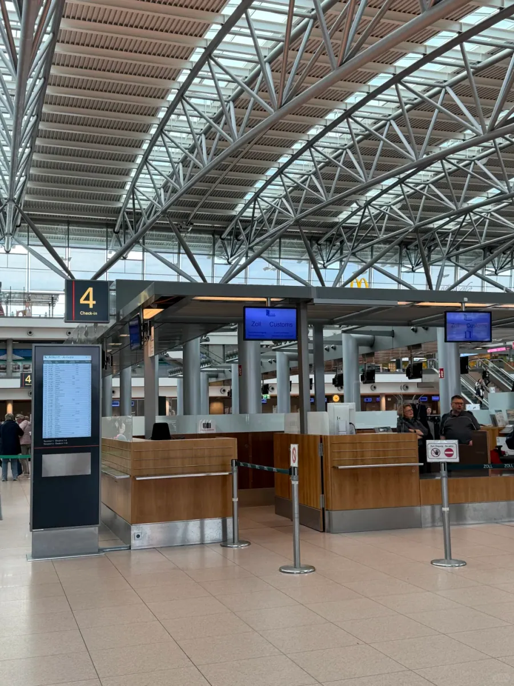
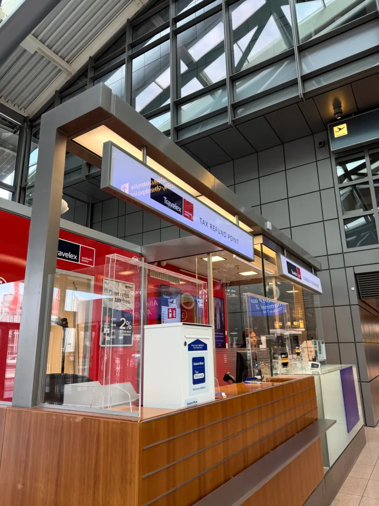

Hamburg Airport (HAM) lies about 8 km north of the city centre, with S-Bahn line S1 running from the airport station straight to the Hauptbahnhof; it is northern Germany's main gateway. The airport is compact: two terminals side by side, with check-in, security and gates a few minutes apart, and only a handful of refund counters. The process is concentrated rather than spread out, so finding the right desk once is enough.

The easiest route here is not the one most travellers expect. You do not drag the suitcase to a customs office and then come back to the check-in desk; the inspection, the stamp and the baggage drop all happen at the information counter in the check-in hall. But the whole thing depends on one thing: after you have the boarding pass, the suitcase must still be in your hand. Reverse the order and every later step collapses.

What follows is five steps: check in, get the stamp at the information counter, drop the bag there, confirm the payout, and post the form. Positions come from an actual claim in 2026; counters get rearranged, so check the airport website before you travel.

## 1. Check in, but do not drop the bag

The order is the whole story. German customs must see the goods and match them to the refund form and receipts, and once a suitcase is on the belt you cannot get it back — no goods, no stamp. While the author was queueing, a Chinese traveller ahead had already checked his bag in, and the staff told him plainly that they could not stamp the form: the case was in the baggage system and nobody could open it.

So the first step is: check in, print the boarding pass and the bag tag, and keep the suitcase beside you. **Once you have the boarding pass, do not hand the bag over yet.** Most European check-in halls have self-service machines that print both, so if the queue is long, take the boarding pass from a machine first.

Have the paperwork ready at this point: passport, boarding pass, the refund form issued by the shop, the matching receipts, and goods that are unused and unopened. German VAT is generally 19%, but the form has to be issued at the shop, and the name, passport number and date of leaving the EU on it must match your passport exactly — blank or mismatched fields get sent back to be filled in again.

One deadline is worth remembering: goods normally have to leave the EU within three months of the month of purchase. Past that window, customs can refuse the stamp. Put the form and receipts in the same pouch as soon as you buy something rather than hunting for them at the airport.

## 2. The information counter by check-in 4

The stamp is issued around check-in area 4. Look for the black sign with a large red 4 and the word Check-in; the desk is wooden, with a blue screen above it reading Zoll/Customs. Those two markers — the number 4 and the word Zoll — are all you need.

Staff inspect the goods, check the form against the receipts, and stamp it. The author's purchases were modest, so the case was not opened and the stamp was given straight away; that is common when amounts are small.

Do not turn that into an expectation. Customs can ask to see the goods, especially for watches, bags and electronics, and being asked to open the case is normal. Keep anything you are claiming near the top of the suitcase so you can produce it in seconds.

If someone ahead is refused, it is usually because the bag has already gone; retrieving a case from the baggage system is practically impossible, so remember the rule at check-in.

## 3. Drop the bag there

After the stamp, the author did not go back to the check-in desk: the suitcase was handed over at the information counter itself. That saves the walk in both directions — the bag goes onto the belt from where you are standing, and you can head for security.

Two things to confirm as the bag goes: that the destination code on the tag is correct, and that you keep the baggage receipt. It is stuck behind the boarding pass, and it is what you need if the suitcase goes missing.

Not every check-in desk accepts baggage, though. If this one only stamps, wheel the case back to check-in, drop it there and rejoin security — the bag is still with you, so the process still works.

Once the bag is gone it cannot be reopened, so before the stamp take out everything you might need: the goods, the receipts, and the refund form itself. Discovering that the form is inside the checked suitcase is a mistake with no easy fix.

## 4. The Global Blue counter and how you get paid

The stamped form goes to the Global Blue counter. Hamburg's refund point is run by Travelex and signed TAX REFUND POINT: red walls, a wooden counter, staff behind a glass screen, and a Global Blue drop box on the desk.

The counter first confirms how you want the money: cash, back to a credit card, or Alipay. The author asked for cash and was told only US dollars were available, so switched to Alipay. **At this counter, cash refunds come only in US dollars** — worth knowing before you join the queue.

The reason is supply: cash refunds are funded by a partner, and the desk holds only a few currencies, with euro notes usually kept for ordinary exchange. Taking dollars home means converting again, and two exchange spreads eat into the amount; a card or Alipay refund usually leaves more.

Which one is better depends on speed versus convenience:

| Payout | When it arrives | What to watch |
| --- | --- | --- |
| Cash | Immediately | Limited currencies; this counter pays only US dollars |
| Credit card | A few weeks | The form needs the card number, converted by the card scheme |
| Alipay | A few weeks | The form needs the account number and a signature |

Switching to Alipay means writing the account number on the form and signing it. Staff check each field — whether the account is legible, whether the name matches the passport, whether the signature is in the right box — and then hand over an envelope. The envelope is not optional: it is how the form travels back to the refund company.

This is the most error-prone moment in the whole process. One wrong digit or a missing signature and the refund is rejected and sent back, by which time you are at the gate. Read the form over yourself before handing it across.

## 5. Posting the form, and the money arriving

Seal the form in the envelope and post it in the box beside the counter, and the paperwork is done. The author noted that the yellow box other travellers describe was nowhere to be seen — boxes are swapped and repainted, so recognise the function rather than the colour: it sits near the Global Blue counter, and once the form is in, it stays in.

Before posting, photograph the stamped form, the receipts and the envelope, and note the reference number. You will need them to check progress, and if the envelope goes astray the photo is your only proof of posting.

The money takes a few weeks, depending on the company and the payout method. Keep the reference and a screenshot; if nothing has arrived after a month, look up the status through Global Blue's tracking or ask the counter to check.

Four mistakes in order of cost: dropping the bag before the stamp; using or unsealing the goods; leaving the account number or signature blank; and assuming posting is the end of it, with no copy kept. Avoid the first three and keep an eye on the fourth, and a Hamburg refund is smoother than expected.

If there is time before boarding, the airport bakery is worth a stop — in the author's words, among all the cold food on offer, that sandwich was a pleasant surprise. Positions, counters and payout methods here come from one actual claim, and desks and partners change, so check Hamburg Airport, the customs authority and Global Blue on the day.

## Related links

- **On this site**: [Germany (DE)](/country/DE)
- **Wikipedia**: [Hamburg Airport](https://en.wikipedia.org/wiki/Hamburg_Airport)
- **Baidu Baike**: [Hamburg Airport](https://baike.baidu.com/item/%E6%B1%89%E5%A0%A1%E6%9C%BA%E5%9C%BA)
