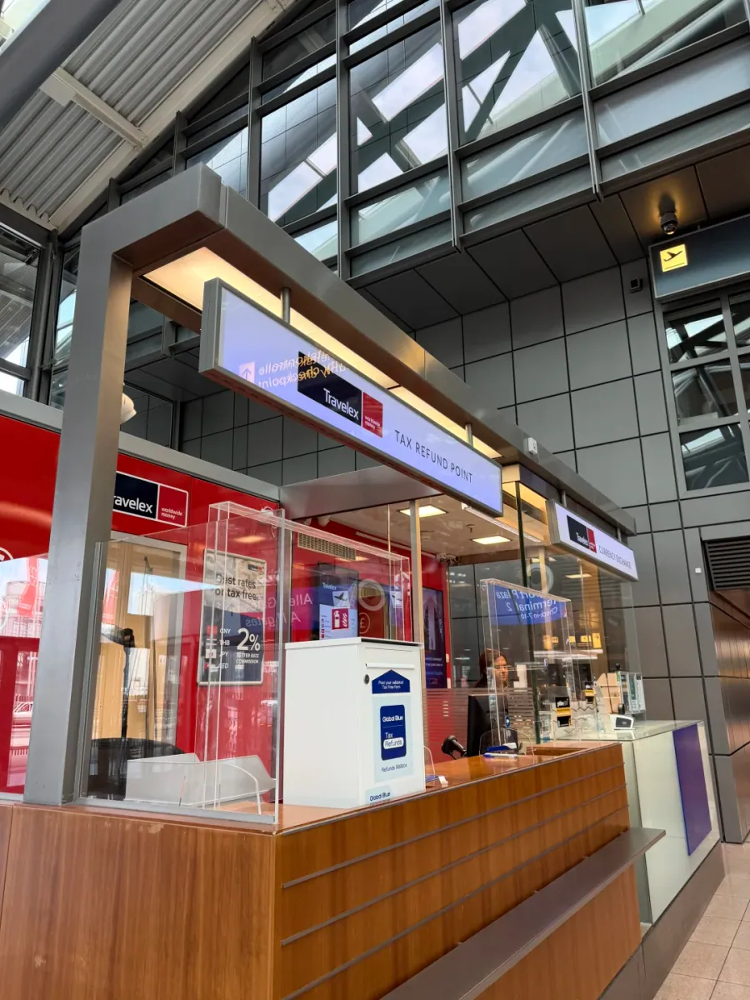

Bandara Hamburg (HAM) terletak sekitar 8 km di utara pusat kota, dengan jalur S-Bahn S1 dari stasiun bandara langsung ke Hauptbahnhof; bandara ini adalah gerbang utama Jerman utara. Bandaranya ringkas: dua terminal berdampingan, dengan check-in, keamanan, dan gerbang berjarak beberapa menit, dan hanya ada beberapa meja pengembalian dana. Prosesnya terkonsentrasi, bukan tersebar, jadi menemukan meja yang tepat sekali saja sudah cukup.

Rute termudah di sini bukanlah yang diperkirakan kebanyakan pelancong. Anda tidak perlu menyeret koper ke kantor bea cukai lalu kembali ke meja check-in; pemeriksaan, cap, dan penyerahan bagasi semuanya dilakukan di meja informasi di aula check-in. Tetapi semuanya bergantung pada satu hal: setelah Anda mendapatkan boarding pass, koper harus masih berada di tangan Anda. Balik urutannya dan setiap langkah berikutnya akan runtuh.

Berikut lima langkah: check-in, minta cap di meja informasi, serahkan tas di sana, konfirmasi pembayaran, dan masukkan formulir ke kotak. Posisinya berasal dari klaim nyata pada 2026; meja dapat dipindahkan, jadi periksa situs web bandara sebelum Anda bepergian.

## 1. Check-in, tetapi jangan serahkan tas

Urutannya adalah inti seluruh cerita. Bea cukai Jerman harus melihat barangnya dan mencocokkannya dengan formulir pengembalian dana serta tanda terima, dan begitu koper berada di ban berjalan Anda tidak dapat mengambilnya kembali — tidak ada barang, tidak ada cap. Saat penulis mengantre, seorang pelancong Tiongkok di depannya sudah menyerahkan tasnya saat check-in, dan staf dengan jelas mengatakan bahwa mereka tidak dapat mencap formulirnya: koper itu sudah masuk sistem bagasi dan tidak ada yang bisa membukanya.

Jadi langkah pertama adalah: check-in, cetak boarding pass dan label bagasi, dan simpan koper di samping Anda. **Setelah Anda memiliki boarding pass, jangan serahkan tasnya dulu.** Sebagian besar aula check-in di Eropa memiliki mesin swalayan yang mencetak keduanya, jadi jika antreannya panjang, ambil boarding pass dari mesin terlebih dahulu.

Siapkan dokumen pada tahap ini: paspor, boarding pass, formulir pengembalian dana yang diterbitkan toko, tanda terima yang sesuai, dan barang yang belum digunakan dan belum dibuka. PPN Jerman umumnya 19%, tetapi formulir harus diterbitkan di toko, dan nama, nomor paspor, serta tanggal meninggalkan UE di formulir harus persis sama dengan paspor Anda — kolom kosong atau tidak cocok akan dikembalikan untuk diisi ulang.

Satu tenggat waktu perlu diingat: barang biasanya harus meninggalkan UE dalam tiga bulan sejak bulan pembelian. Lewat dari jendela itu, bea cukai dapat menolak memberi cap. Simpan formulir dan tanda terima di kantong yang sama segera setelah Anda membeli sesuatu, daripada mencarinya di bandara.

## 2. Meja informasi dekat check-in 4

Cap diberikan di sekitar area check-in 4. Cari papan hitam dengan angka 4 merah besar dan kata Check-in; mejanya terbuat dari kayu, dengan layar biru di atasnya bertuliskan Zoll/Customs. Kedua penanda itu — angka 4 dan kata Zoll — adalah semua yang Anda perlukan.

Staf memeriksa barang, mencocokkan formulir dengan tanda terima, dan mencapnya. Pembelian penulis tidak besar, jadi kopernya tidak dibuka dan cap langsung diberikan; itu hal umum ketika jumlahnya kecil.

Jangan jadikan itu patokan. Bea cukai dapat meminta melihat barangnya, terutama untuk jam tangan, tas, dan elektronik, dan diminta membuka koper adalah hal normal. Simpan barang yang Anda klaim di bagian atas koper agar dapat Anda keluarkan dalam hitungan detik.

Jika seseorang di depan ditolak, biasanya karena tasnya sudah masuk sistem; mengambil koper dari sistem bagasi praktis tidak mungkin, jadi ingat aturan saat check-in.

## 3. Serahkan tas di sana

Setelah mendapat cap, penulis tidak kembali ke meja check-in: kopernya diserahkan di meja informasi itu juga. Ini menghemat berjalan kaki ke dua arah — tas masuk ke ban berjalan dari tempat Anda berdiri, dan Anda dapat langsung menuju keamanan.

Dua hal yang perlu dipastikan saat tas diserahkan: kode tujuan pada label sudah benar, dan Anda menyimpan tanda terima bagasi. Tanda terima itu ditempel di belakang boarding pass, dan itulah yang Anda perlukan jika koper hilang.

Namun, tidak setiap meja check-in menerima bagasi. Jika meja ini hanya memberi cap, dorong koper kembali ke check-in, serahkan di sana, lalu kembali ke antrean keamanan — tas masih bersama Anda, jadi prosesnya tetap berjalan.

Setelah tas diserahkan, tas tidak dapat dibuka lagi, jadi sebelum mendapat cap keluarkan semua yang mungkin Anda perlukan: barangnya, tanda terima, dan formulir pengembalian dana itu sendiri. Menemukan bahwa formulirnya ada di dalam koper yang sudah dicatat adalah kesalahan yang tidak mudah diperbaiki.

## 4. Meja Global Blue dan cara Anda dibayar

Formulir yang sudah dicap dibawa ke meja Global Blue. Titik pengembalian dana Hamburg dijalankan oleh Travelex dan bertanda TAX REFUND POINT: dinding merah, meja kayu, staf di balik layar kaca, dan kotak penyerahan Global Blue di atas meja.

Meja itu terlebih dahulu menanyakan bagaimana Anda ingin menerima uangnya: tunai, kembali ke kartu kredit, atau Alipay. Penulis meminta tunai dan diberi tahu hanya tersedia dolar AS, jadi beralih ke Alipay. **Di meja ini, pengembalian tunai hanya dalam dolar AS** — baik untuk diketahui sebelum Anda ikut mengantre.

Alasannya adalah pasokan: pengembalian tunai didanai oleh mitra, dan meja hanya menyimpan beberapa mata uang, dengan uang kertas euro biasanya disimpan untuk penukaran biasa. Membawa dolar pulang berarti menukarnya lagi, dan dua selisih kurs menggerus jumlahnya; pengembalian ke kartu atau Alipay biasanya menyisakan lebih banyak.

Mana yang lebih baik bergantung pada kecepatan versus kenyamanan:

| Cara pembayaran | Kapan tiba | Yang perlu diperhatikan |
| --- | --- | --- |
| Tunai | Segera | Mata uang terbatas; meja ini hanya membayar dalam dolar AS |
| Kartu kredit | Beberapa minggu | Formulir memerlukan nomor kartu, dikonversi oleh skema kartu |
| Alipay | Beberapa minggu | Formulir memerlukan nomor akun dan tanda tangan |

Beralih ke Alipay berarti menuliskan nomor akun di formulir dan menandatanganinya. Staf memeriksa setiap kolom — apakah nomor akun terbaca, apakah namanya cocok dengan paspor, apakah tanda tangannya berada di kotak yang benar — lalu menyerahkan amplop. Amplop itu bukan opsional: itulah cara formulir dikirim kembali ke perusahaan pengembalian dana.

Ini adalah momen paling rawan kesalahan dalam seluruh proses. Satu angka salah atau tanda tangan yang hilang membuat pengembalian dana ditolak dan dikirim kembali, dan saat itu Anda sudah berada di gerbang. Baca ulang formulirnya sendiri sebelum menyerahkannya.

## 5. Mengirim formulir, dan uangnya tiba

Segel formulir di amplop dan masukkan ke kotak di samping meja, dan urusan dokumen selesai. Penulis mencatat bahwa kotak kuning yang disebut pelancong lain tidak terlihat — kotak diganti dan dicat ulang, jadi kenali fungsinya, bukan warnanya: kotak itu berada di dekat meja Global Blue, dan begitu formulir masuk, formulir tetap di sana.

Sebelum mengirim, foto formulir yang sudah dicap, tanda terima, dan amplopnya, serta catat nomor referensinya. Anda akan memerlukannya untuk memeriksa kemajuan, dan jika amplopnya tersesat, foto adalah satu-satunya bukti pengiriman Anda.

Uangnya memakan waktu beberapa minggu, tergantung perusahaan dan metode pembayaran. Simpan nomor referensi dan tangkapan layar; jika belum ada yang masuk setelah sebulan, periksa status melalui pelacakan Global Blue atau minta meja memeriksanya.

Empat kesalahan menurut besarnya kerugian: menyerahkan tas sebelum mendapat cap; menggunakan atau membuka segel barang; membiarkan nomor akun atau tanda tangan kosong; dan menganggap pengiriman adalah akhir dari semuanya, tanpa menyimpan salinan. Hindari tiga yang pertama dan perhatikan yang keempat, maka pengembalian dana di Hamburg lebih lancar dari yang diperkirakan.

Jika ada waktu sebelum boarding, toko roti bandara layak disinggahi — menurut penulis, di antara semua makanan dingin yang tersedia, sandwich itu adalah kejutan yang menyenangkan. Posisi, meja, dan metode pembayaran di sini berasal dari satu klaim nyata, dan meja serta mitra dapat berubah, jadi periksa Bandara Hamburg, otoritas bea cukai, dan Global Blue pada hari itu.

## Tautan terkait

- **Di situs ini**: [Jerman (DE)](/country/DE)
- **Wikipedia**: [Bandara Hamburg](https://en.wikipedia.org/wiki/Hamburg_Airport)
- **Baidu Baike**: [Bandara Hamburg](https://baike.baidu.com/item/%E6%B1%89%E5%A0%A1%E6%9C%BA%E5%9C%BA)
