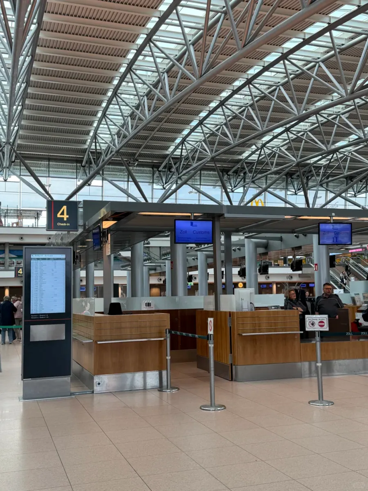

สนามบินฮัมบวร์ก (HAM) อยู่ทางเหนือของใจกลางเมืองประมาณ 8 กม. โดยมีรถไฟชานเมือง S1 วิ่งจากสถานีสนามบินตรงไปยัง Hauptbahnhof เป็นประตูหลักของเยอรมนีตอนเหนือ สนามบินมีขนาดกะทัดรัด: อาคารผู้โดยสารสองหลังเคียงกัน เช็คอิน รักษาความปลอดภัย และประตูขึ้นเครื่องห่างกันไม่กี่นาที และมีเคาน์เตอร์ขอคืนภาษีเพียงไม่กี่แห่ง กระบวนการจึงกระจุกตัวไม่กระจัดกระจาย การหาเคาน์เตอร์ให้ถูกครั้งเดียวก็เพียงพอ

เส้นทางที่ง่ายที่สุดที่นี่ไม่ใช่เส้นทางที่ผู้เดินทางส่วนใหญ่คาด คุณไม่ต้องลากกระเป๋าไปที่สำนักงานศุลกากรแล้วกลับมาเคาน์เตอร์เช็คอิน การตรวจสินค้า ประทับตรา และฝากกระเป๋าเกิดขึ้นที่เคาน์เตอร์ข้อมูลในโถงเช็คอินทั้งหมด แต่ทุกอย่างขึ้นอยู่กับสิ่งเดียว: หลังจากได้บัตรขึ้นเครื่องแล้ว กระเป๋าต้องยังอยู่ในมือคุณ หากสลับลำดับ ทุกขั้นถัดไปจะพังทลาย

ต่อไปนี้คือห้าขั้นตอน: เช็คอิน รับตราที่เคาน์เตอร์ข้อมูล ฝากกระเป๋าที่นั่น ยืนยันการรับเงิน และหย่อนแบบฟอร์ม ตำแหน่งต่าง ๆ มาจากการขอคืนจริงในปี 2026 เคาน์เตอร์อาจถูกจัดใหม่ จึงควรตรวจสอบเว็บไซต์สนามบินก่อนเดินทาง

## 1. เช็คอิน แต่อย่าฝากกระเป๋า

ลำดับคือทั้งหมดของเรื่องนี้ ศุลกากรเยอรมันต้องเห็นสินค้าและจับคู่กับแบบฟอร์มขอคืนภาษีและใบเสร็จ และเมื่อกระเป๋าขึ้นสายพานแล้วคุณจะไม่ได้คืน — ไม่มีสินค้า ไม่มีตราประทับ ระหว่างที่ผู้เขียนต่อคิว ผู้เดินทางชาวจีนข้างหน้าได้เช็คอินกระเป๋าไปแล้ว และเจ้าหน้าที่บอกตรง ๆ ว่าประทับแบบฟอร์มให้ไม่ได้: กระเป๋าอยู่ในระบบสัมภาระและไม่มีใครเปิดได้

ดังนั้นขั้นแรกคือ: เช็คอิน พิมพ์บัตรขึ้นเครื่องและป้ายกระเป๋า แล้วเก็บกระเป๋าไว้ข้างตัว **เมื่อได้บัตรขึ้นเครื่องแล้ว อย่าเพิ่งส่งกระเป๋า** โถงเช็คอินในยุโรปส่วนใหญ่มีเครื่องเซลฟ์เซอร์วิสที่พิมพ์ทั้งสองอย่าง ดังนั้นหากคิวยาว ให้รับบัตรขึ้นเครื่องจากเครื่องก่อน

เตรียมเอกสารให้พร้อมตรงนี้: หนังสือเดินทาง บัตรขึ้นเครื่อง แบบฟอร์มขอคืนภาษีที่ร้านออกให้ ใบเสร็จที่ตรงกัน และสินค้าที่ยังไม่ได้ใช้และยังไม่แกะ ภาษีมูลค่าเพิ่มเยอรมันโดยทั่วไปคือ 19% แต่แบบฟอร์มต้องออกโดยร้าน และชื่อ หมายเลขหนังสือเดินทาง และวันที่ออกจากสหภาพยุโรปบนแบบฟอร์มต้องตรงกับหนังสือเดินทางทุกตัวอักษร — ช่องว่างหรือข้อมูลไม่ตรงจะถูกส่งกลับให้กรอกใหม่

มีกำหนดเวลาหนึ่งที่ควรจำ: โดยปกติสินค้าต้องออกจากสหภาพยุโรปภายในสามเดือนนับจากเดือนที่ซื้อ เกินช่วงนั้นศุลกากรอาจปฏิเสธตราประทับ เก็บแบบฟอร์มและใบเสร็จไว้ในซองเดียวกันทันทีที่ซื้อของ แทนที่จะมาค้นหาที่สนามบิน

## 2. เคาน์เตอร์ข้อมูลข้างเช็คอิน 4

ตราประทับออกบริเวณพื้นที่เช็คอิน 4 มองหาป้ายสีดำที่มีเลข 4 สีแดงขนาดใหญ่และคำว่า Check-in เคาน์เตอร์เป็นไม้ มีจอสีน้ำเงินเหนือขึ้นไปเขียน Zoll/Customs สองเครื่องหมายนี้ — เลข 4 กับคำว่า Zoll — คือทั้งหมดที่คุณต้องรู้

เจ้าหน้าที่ตรวจสินค้า ตรวจแบบฟอร์มกับใบเสร็จ แล้วประทับตรา ของที่ผู้เขียนซื้อมีมูลค่าไม่มาก กระเป๋าจึงไม่ถูกเปิดและได้ตราทันที ซึ่งเป็นเรื่องปกติเมื่อยอดเงินน้อย

อย่าเปลี่ยนสิ่งนั้นเป็นความคาดหวัง ศุลกากรขอตรวจสินค้าได้ โดยเฉพาะนาฬิกา กระเป๋า และอุปกรณ์อิเล็กทรอนิกส์ และการถูกขอให้เปิดกระเป๋าเป็นเรื่องปกติ เก็บสิ่งที่ขอคืนภาษีไว้ใกล้ด้านบนของกระเป๋าเพื่อหยิบออกได้ในไม่กี่วินาที

หากคนข้างหน้าถูกปฏิเสธ มักเพราะกระเป๋าถูกส่งเข้าไปแล้ว การดึงกระเป๋าคืนจากระบบสัมภาระแทบเป็นไปไม่ได้ จึงควรจำกฎตอนเช็คอินไว้

## 3. ฝากกระเป๋าที่นั่น

หลังประทับตรา ผู้เขียนไม่ได้กลับไปเคาน์เตอร์เช็คอิน: กระเป๋าถูกส่งมอบที่เคาน์เตอร์ข้อมูลนั้นเอง ซึ่งประหยัดการเดินไปกลับ — กระเป๋าขึ้นสายพานจากจุดที่คุณยืนอยู่ และคุณเดินไปรักษาความปลอดภัยได้เลย

มีสองอย่างที่ต้องยืนยันตอนส่งกระเป๋า: รหัสจุดหมายบนป้ายถูกต้อง และคุณเก็บใบรับกระเป๋าไว้ ใบรับติดอยู่ด้านหลังบัตรขึ้นเครื่อง และเป็นสิ่งที่คุณต้องใช้หากกระเป๋าหาย

อย่างไรก็ตาม ไม่ใช่ทุกเคาน์เตอร์เช็คอินที่รับฝากกระเป๋า หากที่นี่ประทับตราให้เท่านั้น ให้เข็นกระเป๋ากลับไปเคาน์เตอร์เช็คอิน ฝากที่นั่น แล้วกลับเข้าคิวรักษาความปลอดภัย — กระเป๋ายังอยู่กับคุณ กระบวนการจึงยังใช้ได้

เมื่อกระเป๋าไปแล้วก็เปิดใหม่ไม่ได้ ดังนั้นก่อนประทับตรา ให้หยิบทุกอย่างที่อาจต้องใช้ออกมา: สินค้า ใบเสร็จ และแบบฟอร์มขอคืนภาษีเอง การค้นพบว่าแบบฟอร์มอยู่ในกระเป๋าที่โหลดแล้วเป็นความผิดพลาดที่แก้ไขได้ยาก

## 4. เคาน์เตอร์ Global Blue และวิธีรับเงิน

แบบฟอร์มที่ประทับตราแล้วไปที่เคาน์เตอร์ Global Blue จุดขอคืนภาษีของฮัมบวร์กดำเนินการโดย Travelex และมีป้าย TAX REFUND POINT: ผนังสีแดง เคาน์เตอร์ไม้ เจ้าหน้าที่หลังฉากกระจก และกล่องหย่อนของ Global Blue บนเคาน์เตอร์

เคาน์เตอร์จะถามก่อนว่าต้องการรับเงินอย่างไร: เงินสด คืนเข้าบัตรเครดิต หรือ Alipay ผู้เขียนขอเงินสดและได้รับคำตอบว่ามีเฉพาะดอลลาร์สหรัฐ จึงเปลี่ยนเป็น Alipay **ที่เคาน์เตอร์นี้ เงินสดคืนได้เฉพาะดอลลาร์สหรัฐ** — ควรรู้ก่อนเข้าคิว

เหตุผลอยู่ที่การจัดหาเงินสด: เงินสดคืนมาจากพันธมิตร และเคาน์เตอร์ถือเงินเพียงไม่กี่สกุล โดยธนบัตรยูโรมักเก็บไว้สำหรับแลกเปลี่ยนทั่วไป การนำดอลลาร์กลับบ้านหมายถึงต้องแลกอีกครั้ง และส่วนต่างสองครั้งจะกัดกินจำนวนเงิน การคืนเข้าบัตรหรือ Alipay มักเหลือมากกว่า

แบบใดดีกว่าขึ้นอยู่กับความเร็วเทียบกับความสะดวก:

| วิธีรับเงิน | เมื่อมาถึง | สิ่งที่ต้องระวัง |
| --- | --- | --- |
| เงินสด | ทันที | สกุลจำกัด; เคาน์เตอร์นี้จ่ายเฉพาะดอลลาร์สหรัฐ |
| บัตรเครดิต | ไม่กี่สัปดาห์ | แบบฟอร์มต้องมีหมายเลขบัตร แปลงโดยเครือข่ายบัตร |
| Alipay | ไม่กี่สัปดาห์ | แบบฟอร์มต้องมีหมายเลขบัญชีและลายเซ็น |

การเปลี่ยนเป็น Alipay หมายถึงเขียนหมายเลขบัญชีบนแบบฟอร์มและลงชื่อ เจ้าหน้าที่ตรวจทุกช่อง — หมายเลขบัญชีอ่านออกหรือไม่ ชื่อตรงกับหนังสือเดินทางหรือไม่ ลายเซ็นอยู่ในช่องที่ถูกต้องหรือไม่ — แล้วจึงยื่นซองให้ ซองไม่ใช่ตัวเลือกเสริม: เป็นวิธีที่แบบฟอร์มเดินทางกลับไปยังบริษัทขอคืนภาษี

นี่คือช่วงที่ผิดพลาดง่ายที่สุดในกระบวนการทั้งหมด ตัวเลขผิดหนึ่งหลักหรือขาดลายเซ็นหนึ่งแห่ง การขอคืนจะถูกปฏิเสธและส่งกลับ ซึ่งตอนนั้นคุณอาจอยู่ที่ประตูขึ้นเครื่องแล้ว อ่านแบบฟอร์มด้วยตัวเองก่อนยื่น

## 5. หย่อนแบบฟอร์ม และเงินที่มาถึง

ปิดผนึกแบบฟอร์มในซองแล้วหย่อนในกล่องข้างเคาน์เตอร์ เป็นอันเสร็จเอกสาร ผู้เขียนบันทึกว่ากล่องสีเหลืองที่ผู้เดินทางคนอื่นเล่าไว้ไม่เห็นมี — กล่องถูกเปลี่ยนและทาสีใหม่ จึงควรจำหน้าที่ไม่ใช่สี: กล่องอยู่ใกล้เคาน์เตอร์ Global Blue และเมื่อแบบฟอร์มลงไปแล้วก็อยู่ที่นั่น

ก่อนหย่อน ให้ถ่ายรูปแบบฟอร์มที่ประทับตรา ใบเสร็จ และซองไว้ และจดหมายเลขอ้างอิง คุณจะต้องใช้เพื่อตรวจความคืบหน้า และหากซองสูญหาย รูปถ่ายคือหลักฐานการส่งเพียงอย่างเดียวของคุณ

เงินใช้เวลาหลายสัปดาห์ ขึ้นอยู่กับบริษัทและวิธีรับเงิน เก็บหมายเลขอ้างอิงและภาพหน้าจอไว้ หากผ่านไปหนึ่งเดือนยังไม่ได้รับ ให้ตรวจสถานะผ่านระบบติดตามของ Global Blue หรือขอให้เคาน์เตอร์ตรวจสอบ

สี่ความผิดพลาดเรียงตามค่าเสียหาย: ฝากกระเป๋าก่อนประทับตรา; ใช้หรือแกะสินค้า; ปล่อยหมายเลขบัญชีหรือลายเซ็นว่าง; และคิดว่าการหย่อนซองคือจุดจบโดยไม่เก็บสำเนา หลีกเลี่ยงสามข้อแรกและระวังข้อที่สี่ การขอคืนภาษีที่ฮัมบวร์กจะราบรื่นกว่าที่คิด

หากมีเวลาก่อนขึ้นเครื่อง ร้านเบเกอรีในสนามบินคุ้มค่าแวะ — ตามคำของผู้เขียน ท่ามกลางอาหารเย็นทั้งหมดที่มี แซนด์วิชนั้นเป็นเรื่องน่าประหลาดใจที่ดี ตำแหน่ง เคาน์เตอร์ และวิธีรับเงินในที่นี้มาจากการขอคืนจริงครั้งหนึ่ง เคาน์เตอร์และพันธมิตรเปลี่ยนได้ จึงควรตรวจสอบสนามบินฮัมบวร์ก หน่วยงานศุลกากร และ Global Blue ในวันนั้น

## ลิงก์ที่เกี่ยวข้อง

- **ในเว็บไซต์นี้**: [เยอรมนี (DE)](/country/DE)
- **Wikipedia**: [สนามบินฮัมบวร์ก](https://en.wikipedia.org/wiki/Hamburg_Airport)
- **Baidu Baike**: [สนามบินฮัมบวร์ก](https://baike.baidu.com/item/%E6%B1%89%E5%A0%A1%E6%9C%BA%E5%9C%BA)
