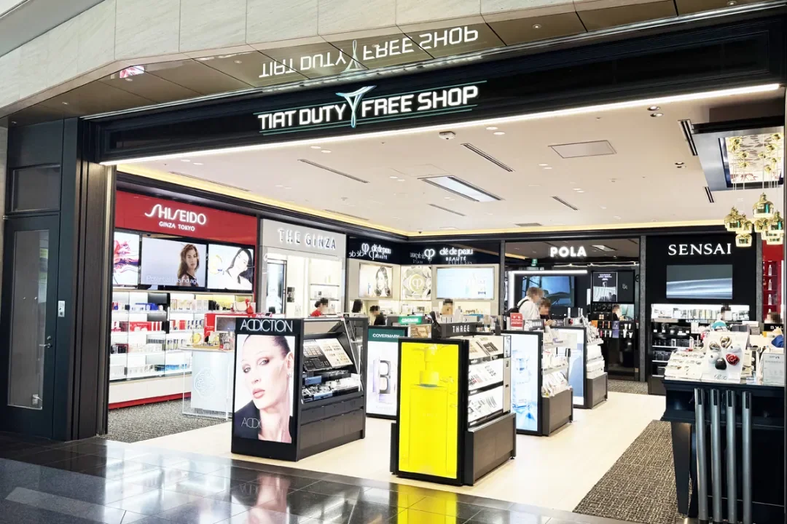

হানেদায় বিশাল কোনো ডিউটি-ফ্রি হল নেই, তবে ওঠার আগে শেষ দফায় কেনাকাটার জন্য যথেষ্ট আছে: কসমেটিকস, জাপানি হুইস্কি, সাকে, তামাক ও মিষ্টি — বেশিরভাগই টার্মিনাল 3-এ নিরাপত্তা তল্লাশির পরের একটি অংশজুড়ে, আর টার্মিনাল 2-এ একটি সাধারণ দোকান। মানুষকে সাধারণত পণ্যের পছন্দ নয়, বরং খোলার সময়, দোকানটি কোন টার্মিনালে এবং তরল জিনিস পরের ফ্লাইটে সঙ্গে নেওয়া যাবে কি না — এসবই বেশি আটকায়।

এই গাইডে তিনটি দোকান একে একে দেখা হয়েছে, তারপর ডিউটি-ফ্রি বনাম ট্যাক্স-ফ্রি, ANA ভাউচার ও প্রি-অর্ডার, এবং শেষে বিমানবন্দরে কেনা উচিত নাকি শহরে ফিরে — সেই প্রশ্নের উত্তর। মিষ্টি ও স্যুভেনির নিয়ে বিশেষভাবে জানতে দেখুন [সঙ্গী হানেদা বিমানবন্দর গাইড](/blog/haneda-airport-guide)।

## 1. ডিউটি-ফ্রি আর ট্যাক্স-ফ্রি এক নয়

হানেদায় যা কেনেন তা **ডিউটি-ফ্রি**: পণ্য নিরাপত্তা তল্লাশির পরে বিক্রি হয়, জাপানের ভোগ কর ও আমদানি পণ্যের শুল্ক ছাড়াই, তাই আমদানি করা কসমেটিকস ও স্পিরিট সাধারণত শহরের চেয়ে কম দামে পড়ে।

শহরের ওষুধের দোকান বা ডিপার্টমেন্ট স্টোরে যা কেনেন তা **ট্যাক্স-ফ্রি**: শুধু ভোগ কর, তাও শর্তসাপেক্ষে — এক দোকানে একদিনে কর-পূর্ব কমপক্ষে ¥5,000, কসমেটিকস ও খাবারের মতো ভোগ্যপণ্যের জন্য আলাদা ঊর্ধ্বসীমা, পণ্য ব্যাগে সিল করা এবং নীতিগতভাবে 30 দিনের মধ্যে জাপান থেকে বের করে নেওয়া, কিছু রিফান্ড কাউন্টারে হ্যান্ডলিং ফি।

এক লাইনে ব্যবহারিক পার্থক্য: **বিমানবন্দর ভোগ কর ও শুল্ক দুটোই মাফ করে; শহর শুধু ভোগ কর মাফ করে, তাও কাগজপত্রের ঝামেলাসহ — তবে আপনি পয়েন্ট অর্জন করতে পারেন, পণ্য চেষ্টা করে দেখতে পারেন এবং সঙ্গে সঙ্গে খুলতে পারেন।** জাপান শহরের ট্যাক্স-ফ্রি কেনাকাটাকে "আগে পুরো দাম, প্রস্থানে রিফান্ড" ব্যবস্থায় সরানোর সিদ্ধান্ত নিয়েছে (বর্তমানে 2026 সালের নভেম্বর থেকে নির্ধারিত); সময় ও পদ্ধতি নিয়ে জাতীয় কর সংস্থার (National Tax Agency) ঘোষণা দেখে নিন।

## 2. টার্মিনাল 3: গেট 109-এর পাশে কসমেটিকস

T3-এর প্রধান কসমেটিকস দোকান **TIAT DUTY FREE SHOP SOUTH COSMETIC**, **গেট 109**-এর সামনে, খোলা **06:00–24:30**। এটি ANA Trading Duty Free পরিচালিত এবং নিজেকে এমন ডিউটি-ফ্রি দোকান হিসেবে প্রচার করে যেখানে মাইল অর্জন করা যায় — শেষ স্কিনকেয়ার কেনাকাটা ওঠার ঠিক আগে পর্যন্ত ফেলে রাখার জন্য যুক্তিসঙ্গত জায়গা।

- **প্রধান ব্র্যান্ড:** ACCEiNE, ADDICTION, CLARINS, Clé de Peau Beauté, COVERMARK, DECORTÉ, Estée Lauder, ELIXIR, FAS, HABA, Kanebo, LUNASOL, ORBIS, POLA, ReFa, SENSAI, SK-II, SHISEIDO, SUQQU, THE GINZA, THREE, TWANY প্রভৃতি, সঙ্গে ফ্রেগরেন্স।

তাকগুলো ব্র্যান্ড অনুযায়ী সাজানো, জাপানি ও আন্তর্জাতিক লেবেল পাশাপাশি, আর জাপানি লাইনগুলোর রঙের পরিসর শহরের কাউন্টারের চেয়ে সাধারণত বেশি। রঙ মিলিয়ে নিতে বা পরামর্শ চাইতে চাইলে বিশ মিনিট বা তার বেশি সময় রাখুন: গেট কাছেই, তবে ব্যস্ত সময়ে ক্যাশের লাইন লম্বা হয়।

## 3. টার্মিনাল 3: মদ ও তামাক, এও গেট 109-এর পাশে

একই এলাকায় **TIAT DUTY FREE SHOP SOUTH LIQUOR & TOBACCO**, এটিও খোলা **06:00–24:30**। হানেদায় মদ কেনার সবচেয়ে ঘনীভূত জায়গা এটি, জাপানি হুইস্কি, স্কচ, কগনাক ও সাকের নিয়মিত তাকসহ।

- **জাপানি হুইস্কি:** NIKKA, SUNTORY প্রভৃতি
- **হুইস্কি:** Ballantine's, Chivas Regal, Royal Salute প্রভৃতি
- **ব্র্যান্ডি:** MARTELL, Rémy Martin, SUNTORY প্রভৃতি
- **জাপানি সাকে:** Dassai, Gekkeikan, Hakkaisan প্রভৃতি
- এছাড়া খাবার, জাপানি শোচু, সিগারেট ও হিটেড তামাক

কেনার আগে পরের ফ্লাইটের কথা ভাবুন। সংযোগ ফ্লাইট থাকলে শেষ অংশটি দেখুন; সরাসরি বাড়ি ফিরলে গন্তব্যের অনুমোদিত সীমার মধ্যে কিনুন। সাকে ও হুইস্কি তরল: ওঠার আগে কিনে হাতে নিয়ে গেলে চেক করা ব্যাগেজের হিসাবে পড়ে না, তবে সারা পথ হাতে বহন করতে হয়।

## 4. টার্মিনাল 2: TIAT DUTY FREE SOUVENIR

T2-এর সাধারণ ডিউটি-ফ্রি দোকান **TIAT DUTY FREE SOUVENIR**, ANA Trading Duty Free পরিচালিত, মদ, তামাক ও খাবার বিক্রি করে — বেস্টসেলার থেকে ক্রেতার পছন্দের পণ্য পর্যন্ত। এর সময় তিনটি ভাগে, মাঝে দুটি বন্ধ পর্ব:

- **06:25–12:50**
- **14:10–15:40**
- **16:35–25:05** (25:05 মানে পরদিন সকাল 01:05)

ভাগ করা সময়সূচির মানে দুপুরের দিকে একটি ফাঁক আর বিকেলের দিকে আরেকটি, যা ভোর ও রাতের ফ্লাইটের জন্য গুরুত্বপূর্ণ: আপনার ফ্লাইট 12:50–14:10 বা 15:40–16:35-এর মধ্যে পড়লে দোকান বন্ধ। এটি T2-এর আন্তর্জাতিক প্রস্থান এলাকায় — ইমিগ্রেশনের পর ডিউটি-ফ্রি চিহ্ন অনুসরণ করুন।

## 5. ANA ভাউচার ও প্রি-অর্ডার সংগ্রহ

তিনটি দোকানই **ANA ইলেকট্রনিক ভাউচার, ANA ট্রাভেল ভাউচার এবং ANA ইন-ফ্লাইট সেলস ও বিমানবন্দর দোকানের কুপন** নেয়। এগুলোর কোনোটি থাকলে কাউন্টারে জিজ্ঞেস করুন সেগুলো ব্যবহার করা যায় কি না, ভাঙতি (change) দেওয়া হয় কি না এবং নির্দিষ্ট পণ্যে সীমাবদ্ধ কি না — ভাউচারের ধরন অনুযায়ী নিয়ম আলাদা, আর দোকানের নোটিশই চূড়ান্ত।

ANA একটি ডিউটি-ফ্রি প্রি-অর্ডার সাইটও চালায়: ওড়ার আগে অর্ডার করুন, QR কোড বা রিজার্ভেশন নম্বর দিয়ে দোকান থেকে সংগ্রহ করুন। বোতল, সেট ও জনপ্রিয় শেডের জন্য এটি উপযুক্ত, যা আপনি আগেই ঠিক করে ফেলেছেন — তাকের সামনে সময় বাঁচে এবং পণ্য শেষ হয়ে যাওয়ার ঝুঁকি কমে। শেষ সময়, সংগ্রহস্থল ও কোন পণ্য রিজার্ভ করা যায় তা প্রি-অর্ডার সাইটেই ঠিক করা; সংগ্রহ করার সময় পাসপোর্ট ও বোর্ডিং পাস দেখাতে হবে।

## 6. সংযোগ ফ্লাইট, তরল এবং বিমানবন্দর বনাম শহর

**সংযোগ ফ্লাইটই বড় পরিবর্তনশীল।** হানেদায় কেনা ডিউটি-ফ্রি তরল যে ফ্লাইটে সেখান থেকে উঠছেন তাতে ঠিক আছে, কিন্তু তৃতীয় কোনো বিমানবন্দরে ট্রান্সফার করলে পরের নিরাপত্তা তল্লাশিতে 100 ml নিয়মই প্রযোজ্য। কিছু বিমানবন্দর এটি কেবল সিল করা ট্যাম্পার-এভিডেন্ট ব্যাগে (STEB) ভেতরে রসিদ রেখে অনুমোদন করে। নিরাপদ রুটিন: কর্মীদের ব্যাগ সিল করতে ও রসিদ রাখতে বলুন, আগেই নিশ্চিত করুন আপনার ট্রান্সফার বিমানবন্দর এটি গ্রহণ করে কি না, আর সন্দেহ থাকলে শেষ বিমানবন্দরেই বোতলটি কিনুন।

**হানেদায় কেনা ভালো:** জাপানি হুইস্কি ও বিমানবন্দর-এক্সক্লুসিভ সেট, Dassai-এর মতো সাকে, আমদানি করা কসমেটিকস ও ফ্রেগরেন্স (ভোগ কর নেই, শুল্ক নেই, সাধারণত শহরের ট্যাক্স-ফ্রি কেনার চেয়ে সস্তা), সিগারেট ও হিটেড তামাক। **শহরে কেনা ভালো:** যে স্কিনকেয়ার আগে চেষ্টা করে দেখতে চান, ওষুধের দোকানের জিনিস ও দৈনন্দিন পণ্য, এবং সব জায়গায় পাওয়া মিষ্টি ও স্যুভেনির — পয়েন্ট অর্জন করা যায়, দাম মেলানো যায়, আর সবকিছু বইতে হয় না।

তারপর বাড়ি ফেরার পথে সীমান্ত। চীনের কাস্টমস দেশে ফেরা বাসিন্দা ভ্রমণকারীদের বিদেশে কেনা পণ্যের জন্য শুল্কমুক্ত ভাতা দেয় (সাধারণত ¥5,000, মদ ও তামাকের জন্য আলাদা সীমা); এর বেশি হলে ঘোষণা করতে হবে ও কর দিতে হবে। কেনাকাটার আগেই ভাতাটা হিসাব করে নিন — তাকে বোতল মেলানোর চেয়ে এটি দ্রুত।

## সম্পর্কিত লিংক

- **এই সাইটে**: [হানেদা বিমানবন্দর (HND)](/airport/HND), [জাপান (JP)](/country/JP)
- **উইকিপিডিয়া**: [হানেদা বিমানবন্দর](https://en.wikipedia.org/wiki/Haneda_Airport)
- **Baidu Baike**: [হানেদা বিমানবন্দর](https://baike.baidu.com/item/%E7%BE%BD%E7%94%B0%E6%9C%BA%E5%9C%BA)
- **বিমানবন্দরের সাইট**: [হানেদা বিমানবন্দর – ডিউটি-ফ্রি দোকান খোঁজ](https://tokyo-haneda.com/en/shop_and_dine/search_df.html)

ছবির সূত্র: ANADutyFreeShop। খোলার সময়, অবস্থান ও ব্র্যান্ড দোকানগুলোর প্রকাশিত তথ্য অনুযায়ী; টার্মিনালের লেআউট, সময় ও প্রি-অর্ডার নিয়ম বদলাতে পারে, তাই ভ্রমণের আগে হানেদা বিমানবন্দরের ওয়েবসাইট ও দোকানের নোটিশ দেখে নিন।
