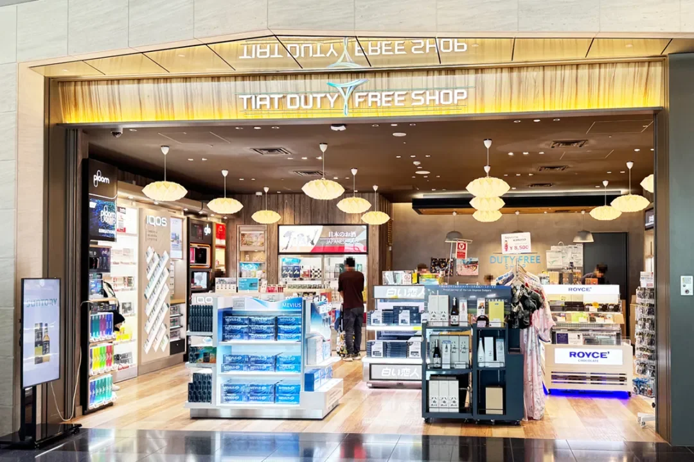

Haneda nemá obrovský bezcelní sál, ale na poslední kolo nákupů před nástupem do letadla toho nabízí dost: kosmetiku, japonskou whisky, sake, tabák a sladkosti, většinou podél jednoho úseku terminálu 3 za bezpečnostní kontrolou, plus jeden všeobecný obchod v terminálu 2. Co lidi obvykle zaskočí, nebývá výběr produktů — ale otevírací doba, to, ve kterém terminálu obchod je, a jestli tekutiny mohou letět s nimi na další let.

Tento průvodce prochází tři obchody jeden po druhém, pak se věnuje rozdílu mezi duty-free a tax-free, poukázkám ANA a předobjednávkám a nakonec tomu, zda nakupovat na letišti, nebo ve městě. Konkrétně sladkostem a suvenýrům se věnuje [navazující průvodce letištěm Haneda](/blog/haneda-airport-guide).

## 1. Duty-free a tax-free nejsou totéž

Co si na Hanedě koupíte, je **duty-free**: zboží se prodává za bezpečnostní kontrolou, bez japonské spotřební daně a bez cla na dovážené zboží, takže dovážená kosmetika a lihoviny obvykle stojí méně než ve městě.

Co koupíte v městské drogerii nebo obchodním domě, je **tax-free**: jen spotřební daň, a to za podmínek — minimálně 5 000 ¥ před zdaněním v jednom obchodě v jeden den, samostatný strop pro spotřební zboží, jako je kosmetika a potraviny, zboží zapečetěné v sáčku a v zásadě vyvezené z Japonska do 30 dnů, s manipulačním poplatkem u některých přepážek pro vrácení daně.

Praktický rozdíl v jedné větě: **letiště vás zbaví spotřební daně i cla; město jen spotřební daně, a ještě s papírováním — ale můžete sbírat body, vyzkoušet produkt a hned ho otevřít.** Japonsko se rozhodlo přesunout městské tax-free nákupy na systém, kdy se platí plná cena předem a daň se vrací při odjezdu (aktuálně naplánováno od listopadu 2026); termín a postup ověřte v oznámeních Národní daňové agentury.

## 2. Terminál 3: kosmetika u brány 109

Hlavní obchod s kosmetikou v T3 je **TIAT DUTY FREE SHOP SOUTH COSMETIC**, před **bránou 109**, otevřeno **06:00–24:30**. Provozuje ho ANA Trading Duty Free a prezentuje se jako bezcelní obchod, kde můžete sbírat míle — rozumné místo, kam odložit poslední nákup péče o pleť na chvíli před nástupem.

- **Hlavní značky:** ACCEiNE, ADDICTION, CLARINS, Clé de Peau Beauté, COVERMARK, DECORTÉ, Estée Lauder, ELIXIR, FAS, HABA, Kanebo, LUNASOL, ORBIS, POLA, ReFa, SENSAI, SK-II, SHISEIDO, SUQQU, THE GINZA, THREE, TWANY a další, plus parfémy.

Regály jsou rozdělené podle značek, japonské a mezinárodní značky vedle sebe, a japonské řady mívají širší škálu odstínů než městské pulty. Pokud si chcete najít správný odstín nebo se poradit, nechte si dvacet minut i víc: brána je blízko, ale u kasy se v nejvytíženějších časech tvoří fronty.

## 3. Terminál 3: lihoviny a tabák, také u brány 109

Ve stejné oblasti je **TIAT DUTY FREE SHOP SOUTH LIQUOR & TOBACCO**, také otevřeno **06:00–24:30**. Je to nejkoncentrovanější místo na nákup alkoholu na Hanedě, se stálými regály japonské whisky, skotské whisky, koňaku a sake.

- **Japonská whisky:** NIKKA, SUNTORY a další
- **Whisky:** Ballantine's, Chivas Regal, Royal Salute a další
- **Brandy:** MARTELL, Rémy Martin, SUNTORY a další
- **Japonské sake:** Dassai, Gekkeikan, Hakkaisan a další
- Dále potraviny, japonský šóčú, cigarety a zahřívaný tabák

Než nakoupíte, myslete na svůj další let. Pokud přestupujete, viz poslední část; pokud letíte přímo domů, držte se limitu cílové země. Sake a whisky jsou tekutiny: koupené před nástupem a vynesené v kabině se nezapočítávají do odbavených zavazadel, ale ponesete je celou cestu.

## 4. Terminál 2: TIAT DUTY FREE SOUVENIR

Všeobecný bezcelní obchod v T2 je **TIAT DUTY FREE SOUVENIR**, provozovaný ANA Trading Duty Free, který prodává lihoviny, tabák a potraviny, od bestsellerů po tipy doporučené nákupčími. Otevírací doba má tři bloky se dvěma přestávkami mezi nimi:

- **06:25–12:50**
- **14:10–15:40**
- **16:35–25:05** (25:05 je 01:05 následujícího rána)

Rozdělený jízdní řád znamená mezeru kolem poledne a další odpoledne, což je důležité pro časné a pozdní lety: pokud váš let připadá na 12:50–14:10 nebo 15:40–16:35, obchod je zavřený. Nachází se v mezinárodní odletové hale T2 — po pasové kontrole se držte značek duty-free.

## 5. Poukázky ANA a vyzvednutí předobjednávky

Všechny tři obchody přijímají **elektronické poukázky ANA, cestovní poukázky ANA a kupony ANA na palubní prodej a letištní obchody**. Pokud některý z nich máte, zeptejte se u kasy, zda jej lze uplatnit, zda se vrací drobné a zda se nevztahuje jen na určité zboží — pravidla se liší podle typu poukázky a rozhodující je oznámení obchodu.

ANA také provozuje stránky pro předobjednávky duty-free: objednejte před letem a vyzvedněte v obchodě pomocí QR kódu nebo čísla rezervace. Hodí se na lahve, sady a oblíbené odstíny, které už máte vybrané — ušetříte čas u regálu a snížíte riziko, že zboží bude vyprodané. Uzávěrku objednávek, místa vyzvednutí a to, které produkty lze rezervovat, určuje web předobjednávek; při vyzvednutí stále ukazujete pas a palubní vstupenku.

## 6. Přestupy, tekutiny a letiště versus město

**Přestup je ta velká proměnná.** Bezcelní tekutina koupená na Hanedě je v pořádku na let, kterým odtud odlétáte, ale pokud přestupujete na třetím letišti, další bezpečnostní kontrola stále uplatňuje pravidlo 100 ml. Některá letiště ji povolují jen v zapečetěném sáčku odolném proti neoprávněné manipulaci (STEB) s účtenkou uvnitř. Bezpečný postup: požádejte personál o zapečetění sáčku a uschovejte účtenku, předem si ověřte, zda vaše přestupní letiště takový sáček přijímá, a pokud si nejste jistí, kupte láhev raději na posledním letišti.

**Co se vyplatí koupit na Hanedě:** japonskou whisky a letištní exkluzivní sady, sake jako Dassai, dováženou kosmetiku a parfémy (bez spotřební daně a bez cla, obvykle levnější než městský tax-free nákup), cigarety a zahřívaný tabák. **Co je lepší koupit ve městě:** péči o pleť, kterou si chcete nejprve vyzkoušet, zboží z drogerie a věci denní potřeby a sladkosti a suvenýry, které jsou k dostání všude — můžete sbírat body, porovnávat ceny a nemusíte všechno nosit s sebou.

Pak je tu ještě hranice na cestě domů. Čínská celnice poskytuje rezidentním cestujícím nezdanitelný limit na zboží koupené v zahraničí (obecně 5 000 ¥, se samostatnými limity pro alkohol a tabák); cokoli nad tím je nutné deklarovat a zdanit. Spočítejte si limit před nákupem — je to rychlejší než porovnávat lahve u regálu.

## Související odkazy

- **Na tomto webu**: [Letiště Haneda (HND)](/airport/HND), [Japonsko (JP)](/country/JP)
- **Wikipedie**: [Letiště Haneda](https://en.wikipedia.org/wiki/Haneda_Airport)
- **Baidu Baike**: [Letiště Haneda](https://baike.baidu.com/item/%E7%BE%BD%E7%94%B0%E6%9C%BA%E5%9C%BA)
- **Web letiště**: [Letiště Haneda – vyhledávání bezcelních obchodů](https://tokyo-haneda.com/en/shop_and_dine/search_df.html)

Zdroj obrázků: ANADutyFreeShop. Otevírací doba, umístění a značky jsou uvedeny tak, jak je zveřejňují obchody; dispozice terminálů, otevírací doba a pravidla předobjednávek se mohou změnit, proto si před cestou ověřte web letiště Haneda a oznámení v obchodech.
