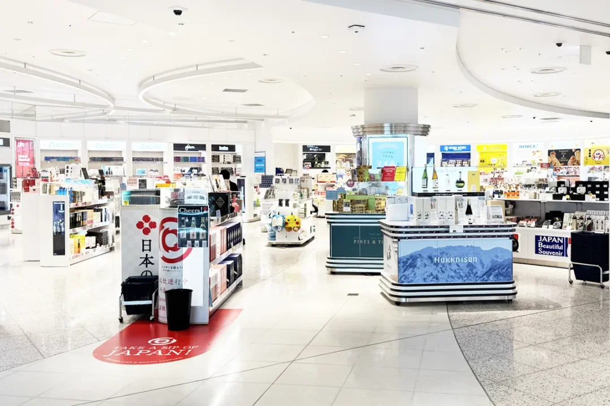

Haneda no tiene una gran sala duty-free, pero sí lo suficiente para la última ronda de compras antes de embarcar: cosmética, whisky japonés, sake, tabaco y dulces, sobre todo a lo largo de un tramo de la Terminal 3 después de seguridad, con una tienda general en la Terminal 2. Lo que despista casi nunca es la elección del producto, sino los horarios de apertura, en qué terminal está la tienda y si los líquidos pueden viajar contigo en el siguiente vuelo.

Esta guía repasa las tres tiendas una por una, y luego cubre duty-free frente a tax-free, los vales de ANA y la reserva anticipada, y por último si conviene comprar en el aeropuerto o en la ciudad. Para dulces y souvenirs en concreto, consulta la [guía complementaria del aeropuerto de Haneda](/blog/haneda-airport-guide).

## 1. Duty-free y tax-free no son lo mismo

Lo que compras en Haneda es **duty-free**: los productos se venden después de seguridad, sin IVA japonés y sin derechos de aduana sobre los bienes importados, así que la cosmética y los licores importados suelen costar menos que en la ciudad.

Lo que compras en una droguería o unos grandes almacenes de la ciudad es **tax-free**: solo el IVA, y con condiciones: un mínimo de 5.000 ¥ antes de impuestos en una sola tienda y un solo día, un límite aparte para consumibles como cosmética y alimentos, mercancía sellada en una bolsa y, en principio, sacada de Japón en un plazo de 30 días, con una comisión de gestión en algunos mostradores de reembolso.

La diferencia práctica en una línea: **el aeropuerto elimina el IVA y los derechos de aduana; la ciudad elimina solo el IVA, con papeleo, pero puedes ganar puntos, probar el producto y abrirlo enseguida.** Japón ha decidido trasladar las compras tax-free de la ciudad a un sistema de pago primero y reembolso a la salida (actualmente previsto para noviembre de 2026); consulta los anuncios de la Agencia Tributaria Nacional para conocer los plazos y el procedimiento.

## 2. Terminal 3: cosmética junto a la puerta 109

La principal tienda de cosmética de T3 es **TIAT DUTY FREE SHOP SOUTH COSMETIC**, frente a la **puerta 109**, abierta de **06:00 a 24:30**. La gestiona ANA Trading Duty Free y se anuncia como una tienda duty-free en la que puedes ganar millas: un lugar sensato para dejar la última compra de cuidado de la piel para justo antes de embarcar.

- **Marcas principales:** ACCEiNE, ADDICTION, CLARINS, Clé de Peau Beauté, COVERMARK, DECORTÉ, Estée Lauder, ELIXIR, FAS, HABA, Kanebo, LUNASOL, ORBIS, POLA, ReFa, SENSAI, SK-II, SHISEIDO, SUQQU, THE GINZA, THREE, TWANY y más, además de perfumería.

Las estanterías se agrupan por marca, con firmas japonesas e internacionales una al lado de otra, y las líneas japonesas suelen tener una gama de tonos más completa que los mostradores de la ciudad. Si quieres igualar el tono o pedir consejo, calcula veinte minutos o más: la puerta está cerca, pero las cajas hacen cola en las horas punta.

## 3. Terminal 3: licores y tabaco, también junto a la puerta 109

La misma zona alberga **TIAT DUTY FREE SHOP SOUTH LIQUOR & TOBACCO**, también abierta de **06:00 a 24:30**. Es el lugar más concentrado para comprar alcohol en Haneda, con estanterías fijas de whisky japonés, escocés, coñac y sake.

- **Whisky japonés:** NIKKA, SUNTORY y otros
- **Whisky:** Ballantine's, Chivas Regal, Royal Salute y otros
- **Brandy:** MARTELL, Rémy Martin, SUNTORY y otros
- **Sake japonés:** Dassai, Gekkeikan, Hakkaisan y otros
- También alimentos, shochu japonés, cigarrillos y tabaco calentado

Piensa en tu siguiente vuelo antes de comprar. Si haces conexión, consulta la última sección; si vuelas directo a casa, compra dentro de la franquicia de tu destino. El sake y el whisky son líquidos: comprados antes de embarcar y llevados en cabina, no cuentan contra el equipaje facturado, pero los llevas encima todo el camino.

## 4. Terminal 2: TIAT DUTY FREE SOUVENIR

La tienda duty-free general de T2 es **TIAT DUTY FREE SOUVENIR**, gestionada por ANA Trading Duty Free, que vende licores, tabaco y alimentos, desde los más vendidos hasta selecciones recomendadas por los compradores. Su horario se divide en tres bloques, con dos periodos cerrados entre medias:

- **06:25–12:50**
- **14:10–15:40**
- **16:35–25:05** (las 25:05 son la 01:05 del día siguiente)

El horario partido significa que hay un hueco hacia el mediodía y otro por la tarde, lo que importa para los vuelos tempranos y tardíos: si tu vuelo cae entre las 12:50 y las 14:10 o entre las 15:40 y las 16:35, la tienda está cerrada. Está en la zona de salidas internacionales de T2: sigue los carteles de duty-free una vez que hayas pasado inmigración.

## 5. Vales de ANA y recogida de reservas

Las tres tiendas aceptan **vales electrónicos de ANA, vales de viaje de ANA y cupones de venta a bordo y de tiendas del aeropuerto de ANA**. Si tienes alguno de estos, pregunta en la caja si se pueden usar, si dan cambio y si están restringidos a ciertos productos: las normas varían según el tipo de vale, y el aviso de la tienda es la referencia definitiva.

ANA también gestiona un sitio de reserva anticipada de duty-free: haz el pedido antes de volar y recógelo en la tienda con un código QR o un número de reserva. Va bien para botellas, sets y tonos populares que ya hayas decidido, ahorra tiempo en la estantería y reduce la posibilidad de que algo esté agotado. Los plazos de corte, los puntos de recogida y los productos reservables los fija el sitio de reserva; aun así muestras el pasaporte y la tarjeta de embarque al recoger.

## 6. Conexiones, líquidos y aeropuerto frente a ciudad

**Una conexión es la gran variable.** El líquido duty-free comprado en Haneda está bien en el vuelo en el que embarcas allí, pero si haces transbordo en un tercer aeropuerto, el siguiente control de seguridad sigue aplicando la regla de los 100 ml. Algunos aeropuertos lo permiten solo en una bolsa sellada a prueba de manipulación (STEB) con el recibo dentro. La rutina segura: pide al personal que selle la bolsa y guarda el recibo, confirma por adelantado si tu aeropuerto de transbordo lo acepta y, si tienes dudas, compra la botella en el último aeropuerto.

**Merece la pena comprar en Haneda:** whisky japonés y sets exclusivos del aeropuerto, sake como Dassai, cosmética y perfumería importadas (sin IVA y sin derechos de aduana, normalmente más baratas que una compra tax-free en la ciudad), cigarrillos y tabaco calentado. **Mejor comprar en la ciudad:** cuidado de la piel que quieras probar antes, productos de droguería y artículos diarios, y dulces y souvenirs disponibles en todas partes: puedes ganar puntos, comparar precios y evitar cargarlo todo.

Luego está la frontera a la vuelta a casa. La aduana china concede a los viajeros residentes una franquicia duty-free para bienes comprados en el extranjero (generalmente 5.000 ¥, con límites aparte para alcohol y tabaco); todo lo que supere esa cantidad debe declararse y tributar. Calcula la franquicia antes de comprar: es más rápido que comparar botellas en la estantería.

## Enlaces relacionados

- **En este sitio**: [Aeropuerto de Haneda (HND)](/airport/HND), [Japón (JP)](/country/JP)
- **Wikipedia**: [Haneda Airport](https://en.wikipedia.org/wiki/Haneda_Airport)
- **Baidu Baike**: [Haneda Airport](https://baike.baidu.com/item/%E7%BE%BD%E7%94%B0%E6%9C%BA%E5%9C%BA)
- **Web del aeropuerto**: [Haneda Airport – duty-free shop search](https://tokyo-haneda.com/en/shop_and_dine/search_df.html)

Fuente de las imágenes: ANADutyFreeShop. Los horarios de apertura, ubicaciones y marcas son los publicados por las tiendas; los planos de terminal, horarios y normas de reserva pueden cambiar, así que consulta la web del aeropuerto de Haneda y los avisos de la tienda antes de viajar.
