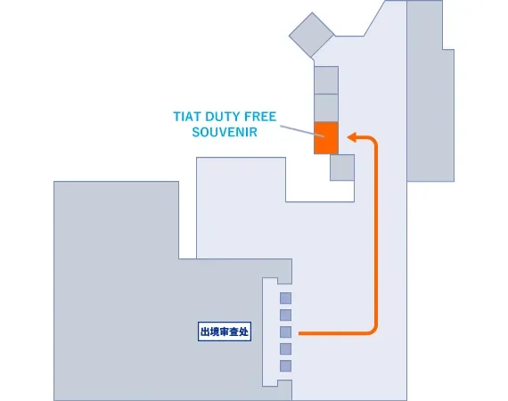

Haneda nu are o sală duty-free uriașă, dar are destul pentru ultima rundă de cumpărături înainte de îmbarcare: cosmetice, whisky japonez, sake, tutun și dulciuri, în mare parte de-a lungul unui singur tronson din Terminalul 3 după controlul de securitate, plus un magazin general în Terminalul 2. Ce îi încurcă pe oameni este rareori alegerea produsului — ci programul de funcționare, terminalul în care se află magazinul și dacă lichidele pot călători cu ei în următorul zbor.

Acest ghid ia cele trei magazine pe rând, apoi acoperă diferența dintre duty-free și tax-free, voucherele ANA și precomanda, iar la final dacă să cumperi de la aeroport sau în oraș. Pentru dulciuri și suveniruri în special, vezi [ghidul companion al Aeroportului Haneda](/blog/haneda-airport-guide).

## 1. Duty-free și tax-free nu sunt același lucru

Ce cumperi la Haneda este **duty-free**: bunurile se vând după controlul de securitate, fără taxa japoneză pe consum și fără taxa vamală pentru mărfurile importate, așa că produsele cosmetice și spirtoasele importate costă de obicei mai puțin decât în oraș.

Ce cumperi într-o farmacie sau un magazin universal din oraș este **tax-free**: doar taxa pe consum, și cu condiții — un minim de 5.000 ¥ fără taxă la un singur magazin, într-o singură zi, un plafon separat pentru consumabile precum cosmeticele și alimentele, bunuri sigilate într-o pungă și, în principiu, scoase din Japonia în termen de 30 de zile, cu o taxă de administrare la unele ghișee de rambursare.

Diferența practică într-o singură frază: **aeroportul elimină taxa pe consum și taxa vamală; orașul elimină doar taxa pe consum, cu acte — dar poți acumula puncte, poți proba produsul și îl poți deschide imediat.** Japonia a decis să treacă cumpărăturile tax-free din oraș la un sistem de plată integrală și rambursare la plecare (programat în prezent din noiembrie 2026); verifică anunțurile Agenției Naționale a Taxelor pentru momentul și procedura.

## 2. Terminalul 3: cosmetice lângă poarta 109

Magazinul principal de cosmetice din T3 este **TIAT DUTY FREE SHOP SOUTH COSMETIC**, în fața **porții 109**, deschis **06:00–24:30**. Este operat de ANA Trading Duty Free și se anunță ca un magazin duty-free unde poți acumula mile — un loc potrivit pentru a lăsa ultima achiziție de îngrijire a pielii până chiar înainte de îmbarcare.

- **Mărci principale:** ACCEiNE, ADDICTION, CLARINS, Clé de Peau Beauté, COVERMARK, DECORTÉ, Estée Lauder, ELIXIR, FAS, HABA, Kanebo, LUNASOL, ORBIS, POLA, ReFa, SENSAI, SK-II, SHISEIDO, SUQQU, THE GINZA, THREE, TWANY și altele, plus parfumuri.

Rafturile sunt grupate pe mărci, etichete japoneze și internaționale una lângă alta, iar gamele japoneze tind să aibă o varietate mai mare de nuanțe decât standurile din oraș. Dacă vrei să potrivești culoarea sau să ceri sfaturi, rezervă douăzeci de minute sau mai mult: poarta este aproape, dar la orele de vârf se face coadă la case.

## 3. Terminalul 3: băuturi și tutun, tot lângă poarta 109

Aceeași zonă găzduiește **TIAT DUTY FREE SHOP SOUTH LIQUOR & TOBACCO**, tot deschis **06:00–24:30**. Acesta este locul cel mai concentrat pentru a cumpăra alcool la Haneda, cu rafturi permanente pentru whisky japonez, Scotch, cognac și sake.

- **Whisky japonez:** NIKKA, SUNTORY și altele
- **Whisky:** Ballantine's, Chivas Regal, Royal Salute și altele
- **Brandy:** MARTELL, Rémy Martin, SUNTORY și altele
- **Sake japonez:** Dassai, Gekkeikan, Hakkaisan și altele
- De asemenea, alimente, shochu japonez, țigări și tutun încălzit

Gândește-te la următorul zbor înainte de a cumpăra. Dacă ai o escală, vezi ultima secțiune; dacă zbori direct acasă, cumpără în limita franșizei destinației. Sake-ul și whisky-ul sunt lichide: cumpărate înainte de îmbarcare și luate în cabină, nu se adaugă la bagajul de cală, dar le duci cu tine tot drumul.

## 4. Terminalul 2: TIAT DUTY FREE SOUVENIR

Magazinul duty-free general din T2 este **TIAT DUTY FREE SOUVENIR**, operat de ANA Trading Duty Free, care vinde băuturi, tutun și alimente, de la bestselleruri la recomandările cumpărătorilor. Programul său are trei intervale, cu două perioade de închidere între ele:

- **06:25–12:50**
- **14:10–15:40**
- **16:35–25:05** (25:05 este 01:05 a doua zi dimineață)

Programul fragmentat înseamnă că există o pauză în jurul prânzului și încă una după-amiaza, ceea ce contează pentru zborurile de dimineață și de seară: dacă zborul tău cade în intervalul 12:50–14:10 sau 15:40–16:35, magazinul este închis. Se află în zona de plecări internaționale a T2 — urmează semnele duty-free după ce treci de controlul de frontieră.

## 5. Vouchere ANA și ridicarea comenzilor precomandate

Toate cele trei magazine acceptă **vouchere electronice ANA, vouchere de călătorie ANA și cupoane ANA pentru vânzări la bord și magazine aeroportuare**. Dacă ai vreunul dintre ele, întreabă la casă dacă poate fi folosit, dacă se dă rest și dacă este restricționat la anumite bunuri — regulile diferă în funcție de tipul voucherului, iar anunțul magazinului este hotărâtor.

ANA are și un site de precomandă duty-free: comandă înainte de a zbura și ridică din magazin cu un cod QR sau un număr de rezervare. Este potrivit pentru sticle, seturi și nuanțe populare la care te-ai hotărât deja, economisind timp la raft și reducând șansa unui produs epuizat. Termenele limită, punctele de ridicare și produsele care pot fi rezervate sunt stabilite de site-ul de precomandă; tot trebuie să arăți pașaportul și cartea de îmbarcare la ridicare.

## 6. Escale, lichide și aeroport versus oraș

**O escală este marea variabilă.** Lichidul duty-free cumpărat la Haneda este în regulă pentru zborul cu care pleci de acolo, dar dacă faci transfer într-un al treilea aeroport, următorul control de securitate aplică în continuare regula celor 100 ml. Unele aeroporturi îl permit doar într-o pungă sigilată cu dovadă de manipulare (STEB), cu chitanța înăuntru. Rutina sigură: roagă personalul să sigileze punga și păstrează chitanța, confirmă dinainte dacă aeroportul de tranzit o acceptă, iar dacă nu ești sigur, cumpără sticla la ultimul aeroport.

**Merită cumpărat la Haneda:** whisky japonez și seturi disponibile doar în aeroport, sake precum Dassai, cosmetice și parfumuri importate (fără taxa pe consum și fără taxa vamală, de obicei mai ieftine decât o achiziție tax-free din oraș), țigări și tutun încălzit. **Mai bine de cumpărat în oraș:** produsele de îngrijire a pielii pe care vrei să le încerci mai întâi, produsele de farmacie și cele zilnice, precum și dulciurile și suvenirurile disponibile peste tot — poți acumula puncte, compara prețuri și evita să le cari pe toate.

Apoi este granița la întoarcere. Vama chineză acordă călătorilor rezidenți o franșiză duty-free pentru bunurile cumpărate în străinătate (în general 5.000 ¥, cu limite separate pentru alcool și tutun); orice depășește această sumă trebuie declarat și taxat. Calculează franșiza înainte de a cumpăra — este mai rapid decât să compari sticlele la raft.

## Linkuri utile

- **Pe acest site**: [Aeroportul Haneda (HND)](/airport/HND), [Japonia (JP)](/country/JP)
- **Wikipedia**: [Haneda Airport](https://en.wikipedia.org/wiki/Haneda_Airport)
- **Baidu Baike**: [Haneda Airport](https://baike.baidu.com/item/%E7%BE%BD%E7%94%B0%E6%9C%BA%E5%9C%BA)
- **Site-ul aeroportului**: [Haneda Airport – căutare magazine duty-free](https://tokyo-haneda.com/en/shop_and_dine/search_df.html)

Sursa imaginii: ANADutyFreeShop. Programul de funcționare, locațiile și mărcile sunt cele publicate de magazine; amenajările terminalelor, programul și regulile de precomandă se pot schimba, așa că verifică site-ul Aeroportului Haneda și anunțurile din magazin înainte de a călători.
