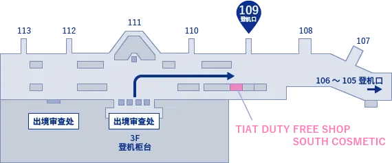

Haneda'nın devasa bir duty-free salonu yok, ama uçağa binmeden önceki son alışveriş turu için yeterli: kozmetik, Japon viskisi, sake, tütün ve tatlılar, çoğunlukla Terminal 3'ün güvenlik sonrası tek bir bölümünde, Terminal 2'de ise genel bir mağaza. İnsanların takıldığı şey nadiren ürün seçimi — çalışma saatleri, mağazanın hangi terminalde olduğu ve sıvıların bir sonraki uçağa binmelerine izin verilip verilmediği.

Bu rehber üç mağazayı tek tek ele alıyor, ardından duty-free ile tax-free farkını, ANA kuponlarını ve ön siparişi, son olarak da havalimanında mı yoksa şehirde mi alışveriş yapılacağını kapsıyor. Özellikle tatlılar ve hediyelikler için [Haneda havalimanı rehberine](/blog/haneda-airport-guide) bakın.

## 1. Duty-free ile tax-free aynı şey değil

Haneda'da aldığınız şey **duty-free**: mallar güvenlik sonrasında, Japon tüketim vergisi ve ithal mallarda gümrük vergisi olmadan satılıyor, bu yüzden ithal kozmetik ve içkiler genellikle şehirdekinden daha ucuza geliyor.

Şehirdeki bir eczane veya mağazada aldığınız şey **tax-free**: yalnızca tüketim vergisi muafiyeti ve koşullarla — tek mağazada tek günde vergi öncesi en az 5.000 ¥, kozmetik ve gıda gibi sarf malzemeleri için ayrı bir üst sınır, malların poşette mühürlenmesi ve prensipte 30 gün içinde Japonya'dan çıkarılması, bazı iade gişelerinde işlem ücreti.

Pratik fark tek cümlede: **havalimanı tüketim vergisini de gümrük vergisini de kaldırır; şehir yalnızca tüketim vergisini kaldırır, evrak işiyle birlikte — ama puan kazanabilir, ürünü deneyebilir ve hemen açabilirsiniz.** Japonya, şehirdeki tax-free alışverişi önce öde-sonra kalkışta iade sistemine taşımaya karar verdi (şu anda Kasım 2026'dan itibaren planlanıyor); zamanlama ve prosedür için Ulusal Vergi Dairesi'nin duyurularını kontrol edin.

## 2. Terminal 3: 109 numaralı kapının yanında kozmetik

T3'teki ana kozmetik mağazası **TIAT DUTY FREE SHOP SOUTH COSMETIC**, **109 numaralı kapının** önünde ve **06:00–24:30** arası açık. ANA Trading Duty Free tarafından işletiliyor ve mil kazanabileceğiniz bir duty-free mağazası olarak tanıtıyor — son cilt bakımı alışverişini uçağa binmeden hemen öncesine bırakmak için mantıklı bir yer.

- **Ana markalar:** ACCEiNE, ADDICTION, CLARINS, Clé de Peau Beauté, COVERMARK, DECORTÉ, Estée Lauder, ELIXIR, FAS, HABA, Kanebo, LUNASOL, ORBIS, POLA, ReFa, SENSAI, SK-II, SHISEIDO, SUQQU, THE GINZA, THREE, TWANY ve daha fazlası, ayrıca parfüm.

Raflar markaya göre gruplanmış, Japon ve uluslararası etiketler yan yana ve Japon markaları şehirdeki tezgâhlara göre genellikle daha geniş bir renk yelpazesi sunuyor. Renk eşleştirmek veya tavsiye almak istiyorsanız yirmi dakika veya daha fazla ayırın: kapı yakın, ama yoğun saatlerde kasalar kuyruk oluyor.

## 3. Terminal 3: içki ve tütün, yine 109 numaralı kapının yanında

Aynı alanda **TIAT DUTY FREE SHOP SOUTH LIQUOR & TOBACCO** var; o da **06:00–24:30** arası açık. Haneda'da alkol almak için en yoğunlaşmış yer burası; Japon viskisi, Scotch, konyak ve sake için düzenli raflar var.

- **Japon viskisi:** NIKKA, SUNTORY ve diğerleri
- **Viskiler:** Ballantine's, Chivas Regal, Royal Salute ve diğerleri
- **Brendi:** MARTELL, Rémy Martin, SUNTORY ve diğerleri
- **Japon sake:** Dassai, Gekkeikan, Hakkaisan ve diğerleri
- Ayrıca gıda, Japon shochu'su, sigara ve ısıtmalı tütün

Satın almadan önce bir sonraki uçuşunuzu düşünün. Aktarma yapıyorsanız son bölüme bakın; doğrudan eve uçuyorsanız varış ülkenizin izin verdiği sınır içinde alın. Sake ve viski sıvıdır: binmeden önce alınıp yanınızda taşınırsa checked-in bagaj limitine sayılmaz, ama yol boyunca siz taşırsınız.

## 4. Terminal 2: TIAT DUTY FREE SOUVENIR

T2'deki genel duty-free mağazası **TIAT DUTY FREE SOUVENIR**; ANA Trading Duty Free tarafından işletiliyor ve içki, tütün ile gıda satıyor; çok satanlardan alıcıların önerdiği seçimlere kadar. Çalışma saatleri üç blok halinde, aralarında iki kapalı dönemle:

- **06:25–12:50**
- **14:10–15:40**
- **16:35–25:05** (25:05, ertesi gün 01:05 demek)

Bölünmüş tarife, öğle civarında ve öğleden sonra bir boşluk olduğu anlamına geliyor; bu erken ve geç uçuşlar için önemli: uçuşunuz 12:50–14:10 veya 15:40–16:35 aralığına düşüyorsa mağaza kapalı. T2'nin uluslararası kalkış alanında — pasaport kontrolünden geçtikten sonra duty-free tabelalarını izleyin.

## 5. ANA kuponları ve ön sipariş teslimi

Üç mağaza da **ANA elektronik kuponlarını, ANA seyahat kuponlarını ve ANA uçak içi satış ile havalimanı mağaza kuponlarını** kabul ediyor. Bunlardan birine sahipseniz kasada kullanılıp kullanılamayacağını, para üstü verilip verilmediğini ve belirli ürünlerle sınırlı olup olmadığını sorun — kurallar kupon türüne göre değişir ve mağazanın duyurusu esastır.

ANA ayrıca bir duty-free ön sipariş sitesi işletiyor: uçmadan önce sipariş verin, mağazada QR kod veya rezervasyon numarasıyla teslim alın. Şişeler, setler ve zaten karar verdiğiniz popüler renkler için uygun; rafta zaman kazandırır ve ürünün tükenmiş olma olasılığını azaltır. Son sipariş saatleri, teslim noktaları ve hangi ürünlerin rezerve edilebileceği ön sipariş sitesi tarafından belirlenir; teslim alırken yine pasaportunuzu ve biniş kartınızı gösterirsiniz.

## 6. Aktarmalar, sıvılar ve havalimanı ile şehir karşılaştırması

**Aktarma büyük değişken.** Haneda'da alınan duty-free sıvı, oradan bindiğiniz uçuşta sorun değil, ama üçüncü bir havalimanında aktarma yaparsanız sonraki güvenlik kontrolü yine 100 ml kuralını uygular. Bazı havalimanları buna yalnızca fişi içinde, mühürlü ve kurcalamaya karşı korumalı bir poşette (STEB) izin verir. Güvenli rutin: poşeti mühürlemelerini ve fişi saklamalarını isteyin, aktarma havalimanınızın kabul edip etmediğini önceden teyit edin ve emin değilseniz şişeyi bunun yerine son havalimanında alın.

**Haneda'da almaya değer:** Japon viskisi ve yalnızca havalimanında satılan setler, Dassai gibi sake, ithal kozmetik ve parfüm (tüketim vergisi ve gümrük vergisi yok, genellikle şehirdeki tax-free alışverişten ucuz), sigara ve ısıtmalı tütün. **Şehirde almak daha iyi:** önce denemek istediğiniz cilt bakım ürünleri, eczane ürünleri ve günlük eşyalar, her yerde bulunan tatlılar ve hediyelikler — puan kazanabilir, fiyat karşılaştırabilir ve hepsini taşımaktan kurtulursunuz.

Bir de eve dönüşteki sınır var. Çin gümrüğü, yurt dışında alınan mallar için yerleşik yolculara duty-free bir muafiyet tanıyor (genellikle 5.000 ¥, alkol ve tütün için ayrı sınırlar); bunun üzerindeki her şey beyan edilmeli ve vergilendirilmeli. Alışverişe başlamadan önce muafiyeti hesaplayın — rafta şişe karşılaştırmaktan daha hızlı.

## İlgili bağlantılar

- **Bu sitede**: [Haneda Havalimanı (HND)](/airport/HND), [Japonya (JP)](/country/JP)
- **Wikipedia**: [Haneda Airport](https://en.wikipedia.org/wiki/Haneda_Airport)
- **Baidu Baike**: [Haneda Airport](https://baike.baidu.com/item/%E7%BE%BD%E7%94%B0%E6%9C%BA%E5%9C%BA)
- **Havalimanı sitesi**: [Haneda Airport – duty-free shop search](https://tokyo-haneda.com/en/shop_and_dine/search_df.html)

Görsel kaynağı: ANADutyFreeShop. Çalışma saatleri, konumlar ve markalar mağazaların yayımladığı şekildedir; terminal yerleşimleri, saatler ve ön sipariş kuralları değişebilir, bu yüzden seyahatten önce Haneda Havalimanı web sitesini ve mağaza içi duyuruları kontrol edin.
