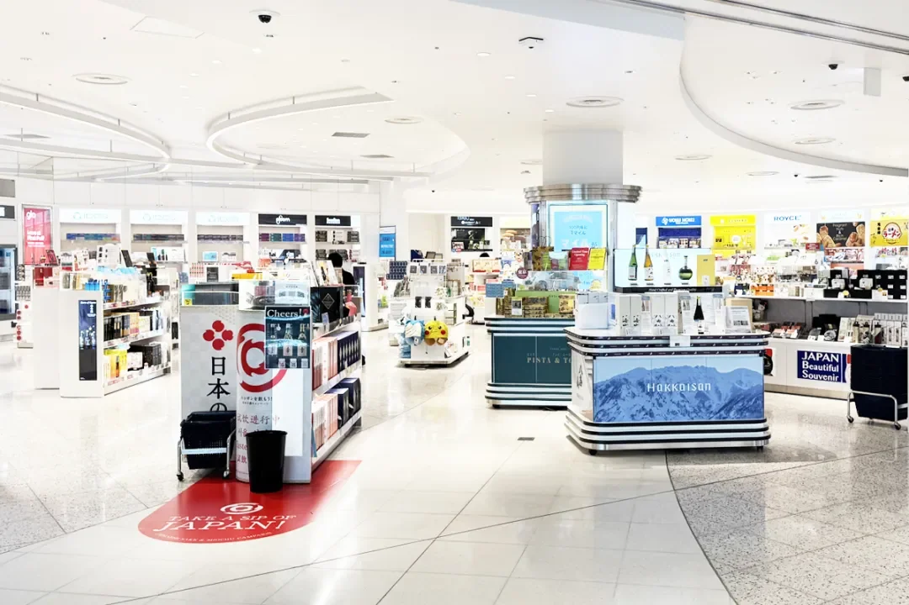
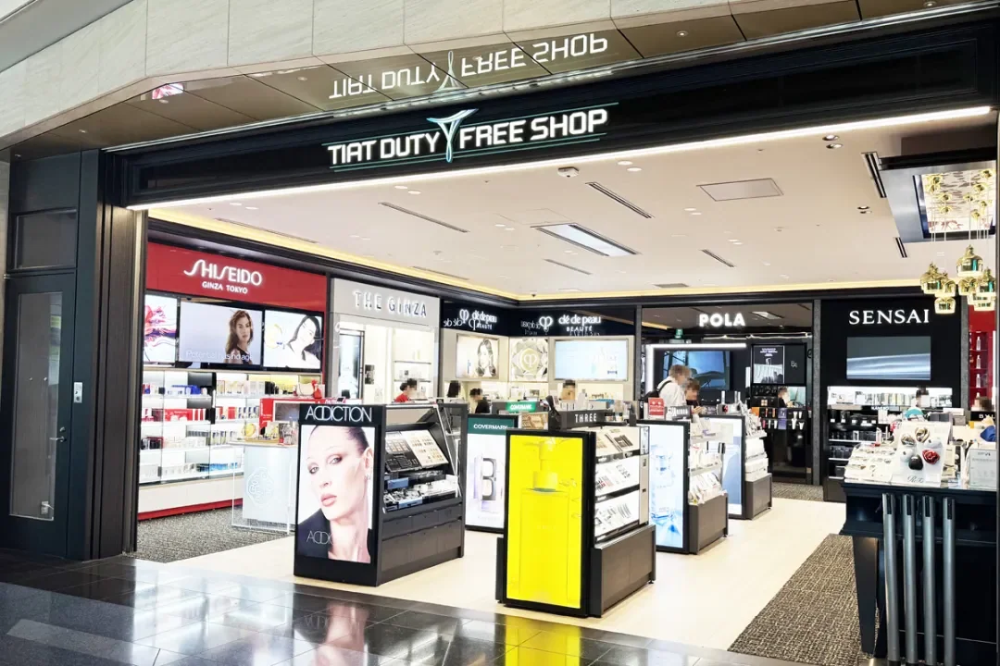
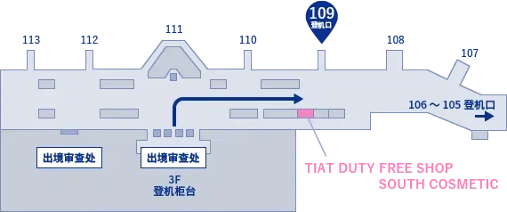
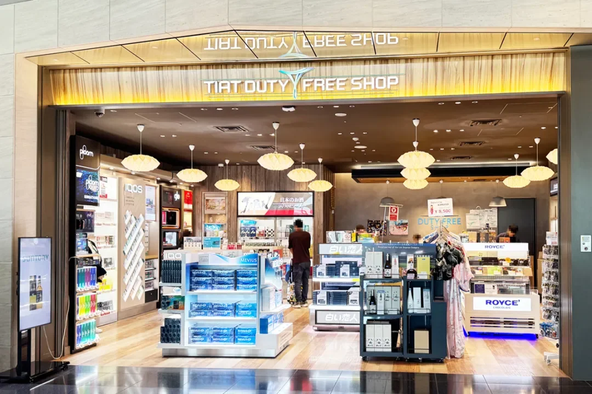
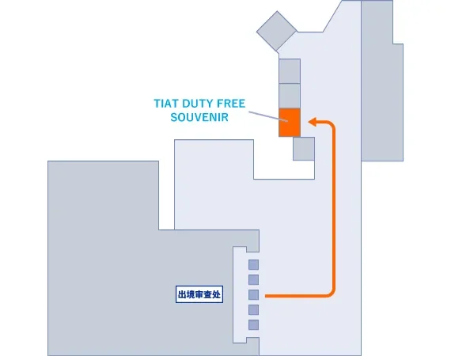

羽田機場的免稅店數量不多，但足夠覆蓋登機前的最後一輪採購：化妝品、日本威士忌、清酒、香菸與點心，大多集中在 T3 過安檢後的一條動線上，T2 另有一間綜合店。容易出錯的往往不是「買什麼」，而是營業時間、航廈位置，以及轉機時能不能把液體帶上下一程。

這篇按三間店分開講，再補上免稅與退稅的區別、ANA 代金券與預約取貨，最後給出「在機場買還是回市區買」的判斷。點心與伴手禮的具體推薦見[《羽田機場攻略》](/tw/blog/haneda-airport-guide)，這裡不重複。

## 一、先分清：機場免稅與市區退稅

在羽田機場買的叫 **duty-free（免稅）**：商品在安檢之後的隔離區出售，免掉日本消費稅，也免掉進口商品的關稅，所以進口化妝品與洋酒的價格通常比市區低一截。

市區藥妝店與百貨裡的叫 **tax-free（退稅）**：只免消費稅，而且有門檻——同一家店當天的稅前金額滿 5,000 日元起，消耗品（化妝品、食品）另有上限，封袋後原則上要在 30 天內帶出境，部分退稅櫃檯還會收手續費。

兩者的實際差別可以記成一句話：**機場免稅免的是「消費稅＋關稅」，市區退稅只免「消費稅」，還要走手續，但能積分、能試用、能當場拆封使用。** 日本已確定把市區免稅改成「先付稅、離境時統一退稅」的方式（按現行安排自 2026 年 11 月起），流程與時間請以日本國稅廳公告為準。

## 二、T3：閘口 109 前的化妝品店

T3 的主力化妝品店是 **TIAT DUTY FREE SHOP SOUTH COSMETIC**，位置在 **109 閘口前**，營業時間 **6:00–24:30**。它由 ANA TRADING DUTY FREE 運營，標榜「可以累積里程的免稅店」，適合把最後一件護膚品留到登機前再買。

- **主要品牌**：ACCEiNE、ADDICTION、嬌韻詩（CLARINS）、Clé de Peau Beauté、傲麗（COVERMARK）、黛珂（DECORTÉ）、雅詩蘭黛（ESTÉE LAUDER）、怡麗絲爾（ELIXIR）、FAS、HABA、佳麗寶（Kanebo）、日月晶彩（LUNASOL）、奧蜜思（ORBIS）、寶麗（POLA）、黎琺（ReFa）、絲光溢彩（SENSAI）、SK-II、資生堂（SHISEIDO）、SUQQU、御銀座（THE GINZA）、THREE、TWANY 等，另售香水。

貨架按品牌分割槽，日本品牌與國際品牌混排，日系線的色號通常比市區專櫃齊。需要試色或諮詢的，儘量留出二十分鐘以上——閘口就在旁邊，但免稅店在高峰時段要排隊結賬。

## 三、T3：酒與煙，同樣在 109 閘口前

同一片區域還有 **TIAT DUTY FREE SHOP SOUTH LIQUOR & TOBACCO**，營業時間同樣是 **6:00–24:30**。這間店是羽田買酒最集中的地方，日本威士忌、蘇格蘭威士忌、干邑與清酒都有固定貨架。

- **日本威士忌**：NIKKA、三得利（SUNTORY）等
- **威士忌**：百齡壇（Ballantine's）、芝華士（CHIVAS REGAL）、皇家禮炮（ROYAL SALUTE）等
- **白蘭地**：馬爹利（MARTELL）、人頭馬（Remy Martin）、三得利（SUNTORY）等
- **日本清酒**：獺祭、月桂冠、八海山等
- 此外還有食品、日本燒酒、香菸與加熱式香菸

買酒前先想清楚下一程：如果還要轉機，見本文最後一節；如果是直飛回國，按目的地海關的免稅額度買即可。清酒與威士忌都是液體，登機前購買、登機時攜帶，不佔託運行李額度，但也意味著全程要自己拎著。

## 四、T2：TIAT DUTY FREE SOUVENIR

T2 的綜合免稅店是 **TIAT DUTY FREE SOUVENIR**，由 ANA TRADING DUTY FREE 運營，賣酒類、菸草與食品，從經典暢銷款到買手推薦的明星商品都有。它的營業時間分成三段，中間有兩次閉店：

- **6:25–12:50**
- **14:10–15:40**
- **16:35–25:05**（25:05 即次日凌晨 1:05）

分段的作息意味著中午與下午各有一段空檔，趕早班機或晚班機時尤其要核對；如果航班時間卡在 12:50–14:10 或 15:40–16:35，這間店是關著的。店鋪位於 T2 的國際出發區域，進門後跟著免稅店標識走即可。

## 五、ANA 代金券與預約取貨

三間店都接受 **ANA 電子代金券、ANA 旅行券，以及 ANA 機內銷售與機場商店的優惠券**。如果手裡正好有這類券，結賬前先問一句能不能用、能不能找零、是否限於指定商品——不同券種的規則不一樣，以店內公告為準。

ANA 另設免稅品預約網站，可以在出發前先下單，到店憑二維碼或預約號取貨。適合已經確定要買的酒、套裝與熱門色號：省去在貨架前比價的時間，也不容易遇到斷貨。預約的截止時間、取貨點與可預約商品以預約頁面為準；取貨時仍需出示護照與登機牌。

## 六、轉機、液體限制與「機場買還是市區買」

**轉機是最大的變數。** 在羽田買的免稅液體可以帶上從羽田出發的那一班飛機，但如果你還要在第三地轉機，下一段安檢仍按 100 毫升的液體規定執行；只有裝在封口的防拆袋（STEB）裡、並附有購物憑證，部分機場才允許放行。穩妥的做法是：結賬時請店員封袋並保留小票，事先確認轉機機場是否承認；不確定就把酒留到最後一個機場再買。

**什麼東西值得在羽田買：** 日本威士忌與機場限定套裝、獺祭等清酒、進口化妝品與香水（免消費稅又免關稅，通常比市區退稅後更便宜）、香菸與加熱式香菸。**什麼東西回市區買更合適：** 想先試用再決定的護膚品、藥妝與日用品、隨處都能買到的點心伴手禮——市區能積分、能比價，也不用一路拎著。

最後是回國入境這一關：中國海關對居民旅客的境外購物有免稅額度（一般為 5,000 元人民幣，菸酒另有限量），超出部分需要申報納稅，具體以海關總署的規定為準。買酒之前，先算一下額度，比在貨架前反覆比較更省事。

## 相關連結

- **本站頁面**：[東京羽田機場（HND）](/tw/airport/HND)、[日本（JP）](/tw/country/JP)
- **維基百科**：[東京羽田機場](https://zh.wikipedia.org/wiki/%E7%BE%BD%E7%94%B0%E6%9C%BA%E5%9C%BA)
- **機場官網**：[羽田機場航廈 · 免稅店搜尋](https://tokyo-haneda.com/zh-CHS/shop_and_dine/search_df.html)

圖片來源：ANADutyFreeShop。文中營業時間、位置與品牌為店鋪公佈資料，航廈佈局、營業時間與預約規則可能調整，出行前請以羽田機場官網與店內公告為準。
