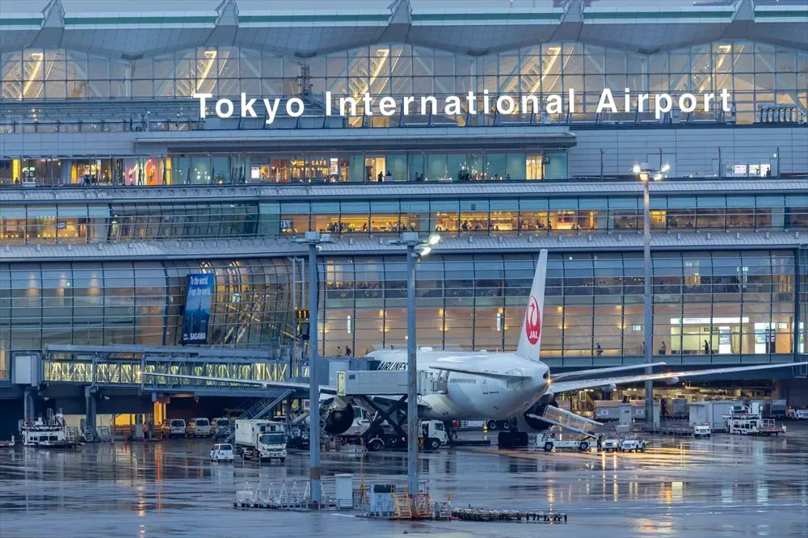
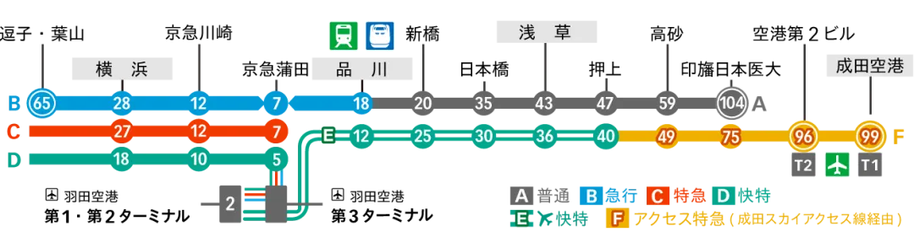
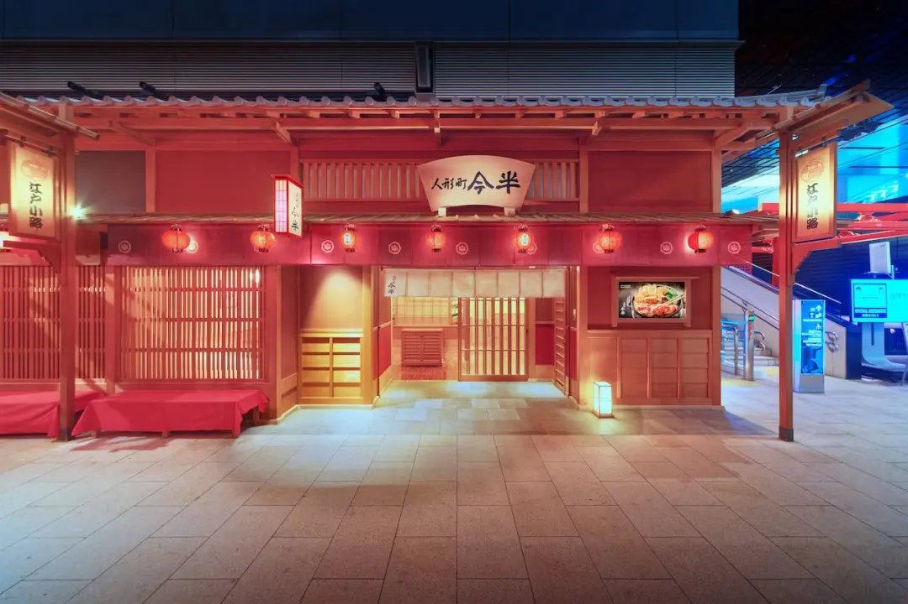
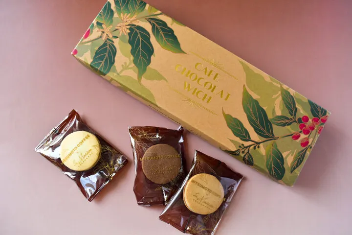

**হানেদা আন্তর্জাতিক বিমানবন্দর জাপানের কান্তো অঞ্চলের প্রধান প্রবেশদ্বার — এটি শুধু চীন ও জাপানের মধ্যে সরাসরি ফ্লাইটের কেন্দ্রই নয়, বরং সেই সূচনাবিন্দু যেখান থেকে পর্যটকরা টোকিও ও বিস্তৃত কান্তো অঞ্চলকে চিনতে শুরু করেন।**

দেশের অভ্যন্তরীণ ট্রান্সফার কেন্দ্রগুলোর একটি হিসেবে হানেদা আধুনিক শহরের ব্যস্ততার সঙ্গে ঐতিহ্যবাহী সংস্কৃতির গভীরতাকে যুক্ত করে, আর জাপানের নিজস্ব আকর্ষণ তার সবটুকুতে বোনা। আপনি এখান থেকে যাত্রা শুরু করুন বা পথ চলতে চলতে আসুন, বিমানবন্দরের ভেতরের সুবিধাগুলো ভ্রমণকে সহজ করে তোলে।

**আজ শুরু করি হানেদার গোশোইন স্ট্যাম্প দিয়ে, আর তারপর এই পাঁচ তারকা বিমানবন্দরের আকর্ষণ ঘুরে দেখি।**

## গোশোইন（ごしょういん / goshōin）

একটি "আকাশের গোশোইন" যা কেবল জাপানের বিমানবন্দরগুলোতেই পাওয়া যায়। এটি শুরু হয়েছিল জাপান এয়ারলাইন্সের আঞ্চলিক শহরগুলোকে প্রাণসঞ্চার করার একটি ভাবনা থেকে, আর এখন দেশজুড়ে 55টি বিমানবন্দরে কেনা যায়।

- **আনুমানিক দাম:** ¥350

অন্য বিমানবন্দরগুলোর গাইডের জন্য এই নিবন্ধের শেষে দেওয়া লিংকগুলো দেখুন।

### গোশোইনের তথ্য

- **বিমানবন্দর:** হানেদা টোকিও আন্তর্জাতিক বিমানবন্দর
- **বিমানবন্দর কোড:** HND
- **স্ট্যাম্প নম্বর এক:** হানেদা টোকিও আন্তর্জাতিক বিমানবন্দরকে JAL-এর অভ্যন্তরীণ নেটওয়ার্কের প্রথম বিমানবন্দর হিসেবে চিহ্নিত করে।
- **রানওয়ে:** বিমানবন্দরের নামের নিচের ধূসর দাগগুলো হানেদা টোকিও আন্তর্জাতিক বিমানবন্দর যে রানওয়ে সত্যিই ব্যবহার করে তা দেখায়।
- **লাল বিমান:** হানেদা টোকিও আন্তর্জাতিক বিমানবন্দরে JAL-এর প্রধান মডেল — এখানে A350-900।
- **মাঝখানের গোল স্ট্যাম্প:** বিমানবন্দরের নাম বা অবস্থান থেকে নেওয়া একটি অক্ষর, ঘুরিয়ে দেওয়া — এখানে সেটি 羽 (ha) অক্ষর, কাত করে রাখা।
- **কোথায় কিনবেন:** T1, JAL PLAZA

## মাত্র 15 মিনিটে টোকিওর কেন্দ্র

হানেদা আন্তর্জাতিক বিমানবন্দর তিনটি টার্মিনাল নিয়ে গঠিত, আন্তর্জাতিক ফ্লাইট প্রধানত T3-এ কেন্দ্রীভূত। একটি বিনামূল্যের শাটল বাস, কেইকিউ লাইন ও মনোরেল — তিনটিই টার্মিনালগুলোকে সংযুক্ত করে। **চীনের বেশ কয়েকটি শহর থেকে এখন হানেদায় সরাসরি ফ্লাইট আছে, যার মধ্যে বেইজিং, তিয়ানজিন, ছিংদাও, ডালিয়ান, সাংহাই, গুয়াংচৌ ও শেনচেন রয়েছে,** যা দুই দেশের মধ্যে যাতায়াত অনেক সহজ করে তুলেছে।

হানেদায় নামার পর শহরে যাওয়ার পথ দ্রুত ও বৈচিত্র্যময়। T3 স্টেশন থেকে দ্রুতগামী মনোরেল হামাৎসুচো — টোকিও টাওয়ারের কাছে — প্রায় 15 মিনিটে পৌঁছায়, যেখানে JR ইয়ামানোতে লাইনে বদলানো যায়। কেইকিউ লাইনে শিনাগাওয়া প্রায় 12 মিনিট, আসাকুসা প্রায় 36 মিনিট, আর ইয়োকোহামা মাত্র প্রায় 25 মিনিট।

নারিতা বিমানবন্দর প্রায় 1 ঘণ্টা 30 মিনিট দূরে। তোচিগি, গুনমা, শিজুওকা, ইয়ামানাশি, নাগানো ও সেন্দাইয়ের জন্য হাইওয়ে বাসও আছে, তাই শহরে দর্শন আর আরও দূরে ভ্রমণ — দুটোই সহজে শুরু হয়।

## হানেদায় যা অবশ্যই খাবেন

### অবশ্যই খাবার এক নম্বর: নিংগিওচো ইমাহান

- **কোথায়:** T3, 4F, এদো-কোজি 15
- **সময়:** দুপুর 11:00–15:00 (শেষ অর্ডার 14:30); রাত 17:00–22:00 (শেষ অর্ডার 20:30)

টোকিওর নিহোনবাশিতে নিংগিওচোর একটি পুরনো সুকিয়াকি প্রতিষ্ঠান; বিমানবন্দরের শাখাটি মূল দোকানের মতোই পরিশীলিত স্বাদের চারপাশে এদো-ধাঁচের সম্মুখভাগ জড়িয়ে রেখেছে। সুকিয়াকি খাওয়ার কয়েকটি উপায় আছে — সেট মিল, কোর্স, গোযেন — প্রত্যেকটি মাদি গরুর নির্বাচিত জাপানি ব্ল্যাক ওয়াগ্যুকে ঘিরে তৈরি: কোমল, রসালো ও স্বাদে ভরপুর। দোকানের নিজস্ব সস এজ করা গরুর মাংসের সুগন্ধ উঁচু করে তোলে, আর নিখুঁত রান্না মাংসের এই সমৃদ্ধির প্রতিটি কণা ধরে রাখে।

### অবশ্যই খাবার দুই নম্বর: উওগাশি নিহোন-ইচি

- **কোথায়:** T3, 3F, প্রস্থান এলাকার পরে, 108
- **সময়:** 24 ঘণ্টা খোলা

একটি দাঁড়িয়ে খাওয়ার সুশি চেইন, আর হানেদার প্রস্থান এলাকার ভেতরের শাখাটিও একই এদোমায়ে ঐতিহ্য ধরে রেখেছে। দোকান সুকিজি বাজার থেকে তাজা পণ্য বেছে নেয় এবং আপনার সামনেই প্রতিটি টুকরো গড়ে; আপনি সেট অর্ডার করতে পারেন বা নিজের পছন্দের মাছ বেছে গুনে নিতে পারেন। যাঁরা এখনই উড়ে যাবেন, বা জাপান ছাড়ার আগে সত্যিকারের সুশির আরেকটি স্বাদ নিতে চান — তাঁদের জন্য এটি সুবিধাজনক ও খুবই ভালো।

## শুধু হানেদায় পাওয়া স্যুভেনির

### CAFÉ CHOCOLAT WICH

- **কোথায়:** T3, 4F, এদো-কোজি 28, এদো শোকুহিনকান
- **আনুমানিক দাম:** 6টির জন্য ¥1,425

এই হানেদা-এক্সক্লুসিভ মিষ্টিটি গভীর কফির সুগন্ধকে ঘিরে তৈরি: সূক্ষ্ম বেলজিয়ান চকলেটের ভেতরে ক্রিস্পি বিস্কুট, স্তরে স্তরে চিবানোর অনুভূতি যা কফির সঙ্গে দারুণ যায়। কফি এসেছে 1957 সালে প্রতিষ্ঠিত ইয়োকোহামার রোস্টার সানবোন কফির মোটা করে ভাঙা বীজ থেকে, গুণমানের জন্য যা বিশেষভাবে প্রশংসিত; আর মিষ্টিটি তৈরি করে লা মেজঁ শিরোকানে — টোকিওর শিরোকানে থেকে শুরু হওয়া অভিজাত প্যাটিসারি। কফি, চকলেট ও বিস্কুট একসঙ্গে — রাখার মতো মার্জিত এবং উপহার হিসেবে আদর্শ।

### ইতো-ইয়ার "AIRPORT NOTEBOOK"

- **কোথায়:** T3, 4F, এদো-কোজি 27
- **আনুমানিক দাম:** প্রতিটি নোটবুক ¥660

ইতো-ইয়া 1904 সালে টোকিওর গিনজায় প্রতিষ্ঠিত একটি স্টেশনারি বিশেষজ্ঞ প্রতিষ্ঠান, নিজস্ব পণ্যের বিস্তৃত পরিসরের জন্য পরিচিত, যা স্টেশনারি-প্রেমীদের বারবার ফিরিয়ে আনে। হানেদার শাখাটি সেই একই মৌলিক চেতনা ধরে রেখেছে — মানসম্মত লেখার উপকরণ ও জাপানি স্টেশনারি, যা ভ্রমণকারীদের পছন্দ।

এর খেলাচ্ছলে করা "এয়ারপোর্ট" নোটবুক বিশেষ আকর্ষণ: সামনের ও পেছনের প্রচ্ছদ মিলে একটি একক বিমানবন্দরের দৃশ্য তৈরি করে, সঙ্গে সার্ভিস যান ও ওড়ার অপেক্ষায় থাকা বিমান — বিমানবন্দরের ব্যস্ত জীবন যেন আপনার হাতে। খুললেই পাতার ফাঁকে ছোট ছোট বিমান দেখা যায় — ছোট ছোট চমকে ভরা। এখানে হানেদা-অনলি ডিজাইনও আছে, স্যুভেনির হিসেবে বা নিজের জন্য রাখার জন্য ভালো।

ওড়ার আগে সময় থাকলে একবার দেখে আসা যায়।

## বিমানবন্দরে ও তার আশপাশে

### PLANETARIUM Starry Cafe

- **ঠিকানা:** T3, 5F, TOKYO POPTOWN 50
- **সময়:** 09:00–22:30 (শেষ অর্ডার 22:00); প্ল্যানেটারিয়াম 11:00 থেকে (শেষ প্রবেশ 21:00)

নাম থেকেই বোঝা যায়, এটি এমন একটি ক্যাফে যেখানে প্রজেক্ট করা তারাভরা আকাশের নিচে বসেন। এতে উন্নত হাইব্রিড প্রজেকশন সিস্টেম ব্যবহার করা হয়, যা পুরো গম্বুজ জুড়ে সিমলেস প্রজেকশন মিলিয়ে প্রায় 40 মিলিয়ন তারা দেখায়, সঙ্গে সূক্ষ্মভাবে ফুটিয়ে তোলা মিল্কি ওয়ে।

ওড়ার আগে সময় হাতে থাকলে তারাদের ভেতর দিয়ে একটু ভ্রমণ করে আসবেন না কেন?

### হানেদা এয়ারপোর্ট গার্ডেন

- **ঠিকানা:** টোকিও, ওতা-কু, হানেদা এয়ারপোর্ট 2-7-1
- **যাতায়াত:** T3-এর দ্বিতীয় তলার সংযোগ করিডর থেকে হেঁটে
- **ওয়েবসাইট:** [www.shopping-sumitomo-rd.com/haneda/shopping/](http://www.shopping-sumitomo-rd.com/haneda/shopping/)

2023 সালে খোলা এবং টার্মিনাল 3-এর সঙ্গে সরাসরি যুক্ত এই কমপ্লেক্সটি শুধু কেনাকাটা ও খাওয়ার জন্য নয়: এখানে একটি অনসেন ও একটি হোটেলও আছে।

ইজুমি তেনকু নো ইউ হানেদা এয়ারপোর্ট-এ বিরল প্রশস্ততা, পরিষ্কার দিনে মাউন্ট ফুজি দেখা যায়; সুবিধার মধ্যে আছে পুরুষ ও মহিলাদের ওপেন-এয়ার বাথ, রক সনা ও ডাইনিং এলাকা, যা গরম পানির ঝরনায় দিন কাটানোর আদর্শ জায়গা। বিমান ওঠা-নামার সময় ওপেন-এয়ার বাথে গা ডুবিয়ে থাকা এক আলাদা অভিজ্ঞতা।

পরেরবার হানেদা দিয়ে যাওয়ার সময় এই জায়গার সবকিছু উপভোগ করার জন্য কিছুটা সময় রেখে দিন — এবং এক ভিন্ন ধরনের যাত্রা উপভোগ করুন।

## অন্য বিমানবন্দরগুলোর গাইড

- [নারিতা আন্তর্জাতিক বিমানবন্দর গাইড](https://mp.weixin.qq.com/s?__biz=MzA3MjI1NDQxNA==&mid=2652373314&idx=1&sn=2cc9b26e9041d8fba85a695fc9570a82&scene=21#wechat_redirect)
- [নিউ চিতোসে (হোক্কাইদো) আন্তর্জাতিক বিমানবন্দর গাইড](https://mp.weixin.qq.com/s?__biz=MzA3MjI1NDQxNA==&mid=2652374162&idx=1&sn=c685409867a453fc351c35787a205e56&scene=21#wechat_redirect)
- [ফুকুওকা আন্তর্জাতিক বিমানবন্দর গাইড](https://mp.weixin.qq.com/s?__biz=MzA3MjI1NDQxNA==&mid=2652375055&idx=1&sn=0ab140b1895ababafe7a1e8991341d7a&scene=21#wechat_redirect)
- [চুবু সেন্ত্রাইর আন্তর্জাতিক বিমানবন্দর গাইড](https://mp.weixin.qq.com/s?__biz=MzA3MjI1NDQxNA==&mid=2652376462&idx=1&sn=b90e4b8fcfc7c0934be09f9f2658c036&scene=21#wechat_redirect)
- [হিরোশিমা বিমানবন্দর গাইড](https://mp.weixin.qq.com/s?__biz=MzA3MjI1NDQxNA==&mid=2652377958&idx=1&sn=8957ec2da9779d9a76aa2488b831e08b&scene=21#wechat_redirect)
- [কানসাই আন্তর্জাতিক বিমানবন্দর গাইড](https://mp.weixin.qq.com/s?__biz=MzA3MjI1NDQxNA==&mid=2652378218&idx=1&sn=e6b0ad7e1a509efac79fbcc6a99d9913&scene=21#wechat_redirect)
- [নাহা বিমানবন্দর গাইড](https://mp.weixin.qq.com/s?__biz=MzA3MjI1NDQxNA==&mid=2652378849&idx=1&sn=a43e621ae60abc174f72c5808aeccfc1&scene=21#wechat_redirect)

## ছবির সূত্র

কিছু ছবি নিচের সাইটগুলো থেকে নেওয়া:

- https://att-japan.net/ja/haneda-tokyo/
- https://ec.jal.co.jp/img//0002/img/pages/soranogoshoin/haneda-2.jpg
- https://restaurant.imahan.com/hanedaairport-3t/
- https://tokyo-haneda.com/
- https://haneda-shopping.jp/shop/g/gZ001088047/
- https://www.threads.net/@yama7260/post/DBIdqyZP61z
- https://co-trip.jp/article/611985
- https://www.ito-ya.co.jp/category/3001/45826215220871.html
- https://thegate12.com/jp/article/750#content-8
- https://www.gotokyo.org/jp/new-and-now/new-and-trending/221205/topics.html
- https://www.sankei.com/article/20221006-7S2A3FJ42FIMPMLBJU5QXCXC6E/photo/XGGOBJJ5F5MBVBLLXJAQNCXTKQ/
- https://www.fashion-press.net/news/56398

## সম্পর্কিত লিংক

- **এই সাইটে**: [টোকিও হানেদা বিমানবন্দর (HND)](/airport/HND), [জাপান (JP)](/country/JP)
- **উইকিপিডিয়া**: [টোকিও হানেদা বিমানবন্দর](https://en.wikipedia.org/wiki/Tokyo_Haneda_Airport)
- **Baidu Baike**: [টোকিও হানেদা বিমানবন্দর](https://baike.baidu.com/item/%E7%BE%BD%E7%94%B0%E6%9C%BA%E5%9C%BA)
