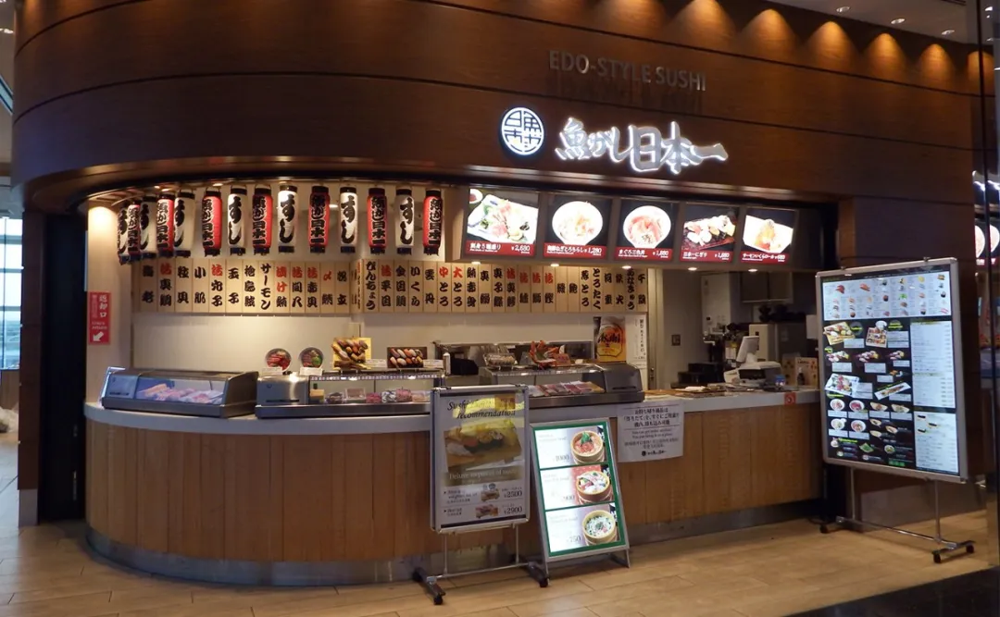
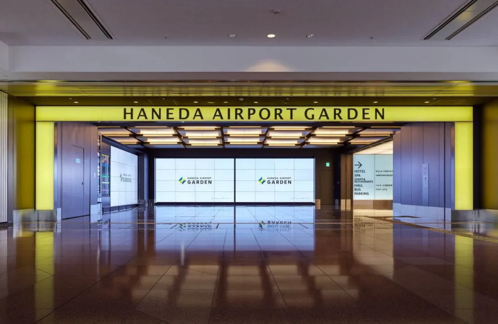
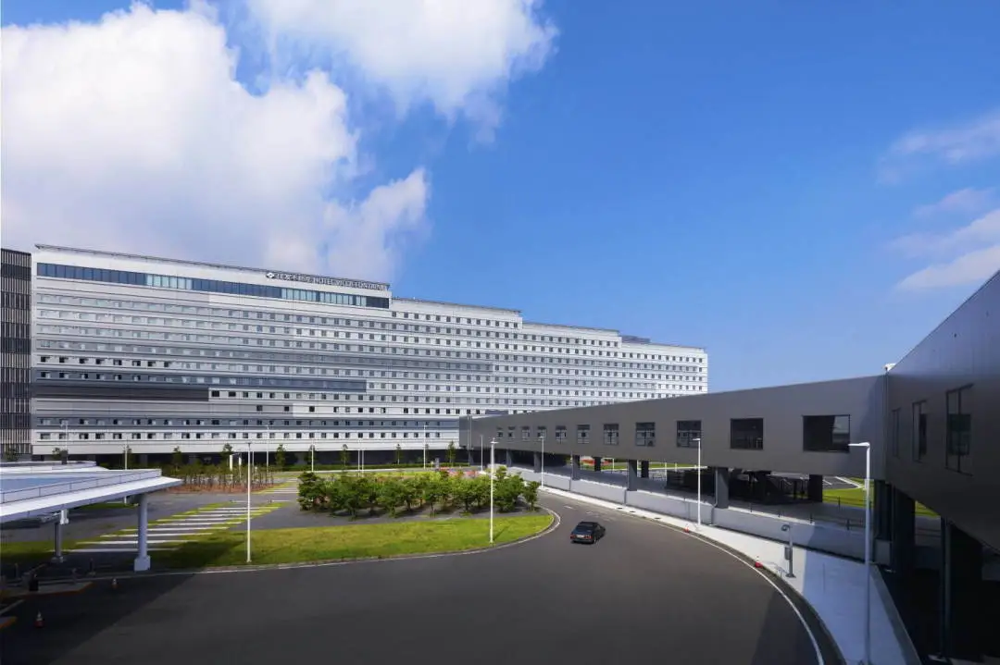

**Mezinárodní letiště Haneda je hlavní branou do japonského regionu Kantó — nejen uzlem přímých letů mezi Čínou a Japonskem, ale i výchozím bodem, z něhož návštěvníci poznávají Tokio a širší oblast Kantó.**

Jako jeden z tuzemských přestupních uzlů spojuje Haneda ruch moderního velkoměsta s hloubkou tradiční kultury a vším prostupuje osobité kouzlo Japonska. Ať už zde cesta začíná, nebo jen projíždíte, vybavení uvnitř letiště vám cestu usnadní.

**Dnes začneme razítkem góšóin z Hanedy a ukážeme vám, co dělá toto pětihvězdičkové letiště tak přitažlivým.**

## Góšóin (ごしょういん / goshōin)

„Nebeské góšóin“, které se dá sehnat jen na letištích po celém Japonsku. Vzniklo jako nápad Japan Airlines na oživení regionálních měst a dnes je lze koupit na 55 letištích po celé zemi.

- **Orientační cena:** 350 ¥

Odkazy na průvodce dalšími letišti najdete na konci článku.

### Údaje o góšóin

- **Letiště:** mezinárodní letiště Tokio Haneda
- **Kód letiště:** HND
- **Razítko číslo jedna:** označuje mezinárodní letiště Tokio Haneda jako první letiště v domácí síti JAL.
- **Vzletové a přistávací dráhy:** šedé značky pod názvem letiště představují dráhy, které mezinárodní letiště Tokio Haneda skutečně používá.
- **Červené letadlo:** hlavní typ JAL na mezinárodním letišti Tokio Haneda — zde A350-900.
- **Kruhové razítko uprostřed:** znak z názvu nebo umístění letiště, pootočený — zde znak 羽 (ha) obrácený na bok.
- **Kde ho koupit:** T1, JAL PLAZA

## Centrum Tokia za pouhých 15 minut

Mezinárodní letiště Haneda tvoří tři terminály, přičemž mezinárodní lety se soustředí do T3. Všechny tři terminály spojuje bezplatný kyvadlový autobus, linka Keikjú a monorail. **Několik čínských měst má nyní přímé lety na Hanedu, včetně Pekingu, Tchien-ťinu, Čching-tao, Ta-lienu, Šanghaje, Kantonu a Šen-čenu,** což cestování mezi oběma zeměmi výrazně usnadňuje.

Jakmile na Hanedě přistanete, možnosti dopravy do města jsou rychlé a rozmanité. Z nádraží u T3 dojede rychlý monorail do Hamamatsuchó — blízko Tokijské věže — za zhruba 15 minut; tam můžete přestoupit na linku JR Jamanote. Po lince Keikjú trvá cesta do Šinagawy asi 12 minut, do Asakusy kolem 36 minut a do Jokohamy jen asi 25 minut.

Letiště Narita je vzdálené asi 1 hodinu 30 minut. Jezdí odtud také dálkové autobusy do prefektur Točigi, Gunma, Šizuoka a Jamanaši, do Nagana a Sendai, takže poznávání města i výlety dál do okolí začínají snadno.

## Co na Hanedě musíte ochutnat

### První věc, kterou musíte ochutnat: Ningyocho Imahan

- **Kde:** T3, 4. patro, Edo-koji 15
- **Otevírací doba:** oběd 11:00–15:00 (poslední objednávka 14:30); večeře 17:00–22:00 (poslední objednávka 20:30)

Dlouho zavedený dům sukiyaki z tokijské čtvrti Ningjóčó v Nihonbaši; jeho letištní pobočka obléká stejnou vytříbenost jako originál do fasády ve stylu Edo. Sukiyaki si zde můžete dát několika způsoby — jako set, vícechodové menu nebo gozen — a každý staví na vybraném japonském černém wagyu z krav: jemné, šťavnaté a plné chuti. Domácí omáčka podtrhuje aroma zralého masa a pečlivá příprava udrží veškerou bohatost v mase.

### Druhá věc, kterou musíte ochutnat: Uogashi Nihon-Ichi

- **Kde:** T3, 3. patro, za odletovou zónou, 108
- **Otevírací doba:** nonstop, 24 hodin denně

Řetězec sushi pro stání, jehož pobočka v odletové zóně Hanedy zachovává stejnou tradici Edomae. Obchod vybírá čerstvé suroviny z trhu Cukidži a každý kousek tvaruje před vámi; můžete si dát set, nebo si vybrat vlastní ryby a platit podle počtu kousků. Pro cestující, kteří právě odlétají, i pro každého, kdo si chce před odjezdem z Japonska dát ještě jednu porci pořádného sushi, je to pohodlné a zároveň velmi dobré.

## Suvenýry jen z Hanedy

### CAFÉ CHOCOLAT WICH

- **Kde:** T3, 4. patro, Edo-koji 28, Edo Šokuhinkan
- **Orientační cena:** 1 425 ¥ za 6 kusů

Tato sladkost dostupná výhradně na Hanedě staví na hlubokém kávovém aromatu: jemná belgická čokoláda s křupavým sušenkovým středem pro vrstevnaté sousto, které se dokonale hodí ke kávě. Káva je z hrubě mletých zrn od Sanbon Coffee, jokohamské pražírny založené v roce 1957 a ceněné pro svou kvalitu, a cukrovinku vyrábí La Maison Shirokane, luxusní cukrárna, která vznikla v tokijské čtvrti Širokane. Káva, čokoláda a sušenka v jednom — dost elegantní na to, abyste si ji nechali, a ideální jako dárek.

### Ito-ya „AIRPORT NOTEBOOK“

- **Kde:** T3, 4. patro, Edo-koji 27
- **Orientační cena:** 660 ¥ za zápisník

Ito-ya je specialista na papírnictví založený v roce 1904 v tokijské Ginzě, známý hlubokou řadou originálních produktů, která fanoušky papírnictví přivádí znovu a znovu. Pobočka na Hanedě nese stejného originálního ducha — kvalitní psací potřeby a japonské papírnictví, které mají cestovatelé rádi.

Jeho hravý „letištní“ zápisník je obzvlášť lákavý: přední a zadní obálka dohromady tvoří jedinou letištní scénu, včetně obslužných vozidel a letadel čekajících na odlet, takže rušný život letiště držíte v ruce. Otevřete ho a mezi stránkami se objeví malá letadla — plná drobných překvapení. Jsou tu i designy dostupné jen na Hanedě, vhodné jako suvenýr nebo na památku.

Pokud máte před letem čas, stojí za to se zastavit.

## Na letišti a v okolí

### PLANETARIUM Starry Cafe

- **Adresa:** T3, 5. patro, TOKYO POPTOWN 50
- **Otevírací doba:** 09:00–22:30 (poslední objednávka 22:00); planetárium od 11:00 (poslední vstup 21:00)

Jak název napovídá, je to kavárna, kde sedíte pod promítanou hvězdnou oblohou. Využívá pokročilý hybridní projekční systém, který kombinuje bezešvou projekci vyplňující celou kupoli, a zobrazuje kolem 40 milionů hvězd s Mléčnou dráhou vykreslenou do nejmenších detailů.

Máte před letem čas navíc? Proč si neudělat krátký výlet mezi hvězdy?

### Haneda Airport Garden

- **Adresa:** 2-7-1 Haneda Airport, Óta-ku, Tokio
- **Přístup:** pěšky ze spojovací chodby ve druhém patře T3
- **Web:** [www.shopping-sumitomo-rd.com/haneda/shopping/](http://www.shopping-sumitomo-rd.com/haneda/shopping/)

Tento komplex otevřený v roce 2023 a přímo propojený s terminálem 3 není jen na nakupování a jídlo: má také onsen a hotel.

Izumi Tenku no Yu Haneda Airport má vzácně prostorný charakter a za jasných dnů odtud uvidíte horu Fudži; mezi zařízení patří mužské a ženské venkovní lázně, skalní sauna a stravovací prostory, takže je to ideální den pro horké prameny. Relaxace ve venkovní lázni, zatímco letadla startují a přistávají, je zážitek sám o sobě.

Až budete příště projíždět Hanedou, nechte si čas vstřebat všechno, co toto místo nabízí — a užijte si jiný druh cesty.

## Průvodce dalšími letišti

- [Průvodce mezinárodním letištěm Narita](https://mp.weixin.qq.com/s?__biz=MzA3MjI1NDQxNA==&mid=2652373314&idx=1&sn=2cc9b26e9041d8fba85a695fc9570a82&scene=21#wechat_redirect)
- [Průvodce mezinárodním letištěm New Chitose (Hokkaidó)](https://mp.weixin.qq.com/s?__biz=MzA3MjI1NDQxNA==&mid=2652374162&idx=1&sn=c685409867a453fc351c35787a205e56&scene=21#wechat_redirect)
- [Průvodce mezinárodním letištěm Fukuoka](https://mp.weixin.qq.com/s?__biz=MzA3MjI1NDQxNA==&mid=2652375055&idx=1&sn=0ab140b1895ababafe7a1e8991341d7a&scene=21#wechat_redirect)
- [Průvodce mezinárodním letištěm Čúbu Centrair](https://mp.weixin.qq.com/s?__biz=MzA3MjI1NDQxNA==&mid=2652376462&idx=1&sn=b90e4b8fcfc7c0934be09f9f2658c036&scene=21#wechat_redirect)
- [Průvodce letištěm Hirošima](https://mp.weixin.qq.com/s?__biz=MzA3MjI1NDQxNA==&mid=2652377958&idx=1&sn=8957ec2da9779d9a76aa2488b831e08b&scene=21#wechat_redirect)
- [Průvodce mezinárodním letištěm Kansai](https://mp.weixin.qq.com/s?__biz=MzA3MjI1NDQxNA==&mid=2652378218&idx=1&sn=e6b0ad7e1a509efac79fbcc6a99d9913&scene=21#wechat_redirect)
- [Průvodce letištěm Naha](https://mp.weixin.qq.com/s?__biz=MzA3MjI1NDQxNA==&mid=2652378849&idx=1&sn=a43e621ae60abc174f72c5808aeccfc1&scene=21#wechat_redirect)

## Zdroje obrázků

Některé obrázky pocházejí z těchto stránek:

- https://att-japan.net/ja/haneda-tokyo/
- https://ec.jal.co.jp/img//0002/img/pages/soranogoshoin/haneda-2.jpg
- https://restaurant.imahan.com/hanedaairport-3t/
- https://tokyo-haneda.com/
- https://haneda-shopping.jp/shop/g/gZ001088047/
- https://www.threads.net/@yama7260/post/DBIdqyZP61z
- https://co-trip.jp/article/611985
- https://www.ito-ya.co.jp/category/3001/45826215220871.html
- https://thegate12.com/jp/article/750#content-8
- https://www.gotokyo.org/jp/new-and-now/new-and-trending/221205/topics.html
- https://www.sankei.com/article/20221006-7S2A3FJ42FIMPMLBJU5QXCXC6E/photo/XGGOBJJ5F5MBVBLLXJAQNCXTKQ/
- https://www.fashion-press.net/news/56398

## Související odkazy

- **Na tomto webu**: [Letiště Tokio Haneda (HND)](/airport/HND), [Japonsko (JP)](/country/JP)
- **Wikipedie**: [Letiště Tokio Haneda](https://en.wikipedia.org/wiki/Tokyo_Haneda_Airport)
- **Baidu Baike**: [Letiště Tokio Haneda](https://baike.baidu.com/item/%E7%BE%BD%E7%94%B0%E6%9C%BA%E5%9C%BA)
