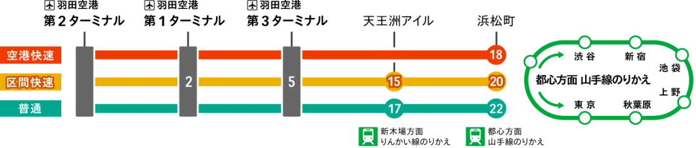
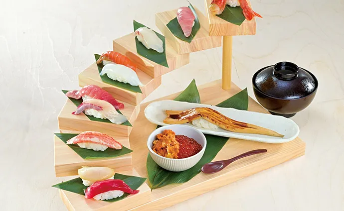

**El Aeropuerto Internacional de Haneda es la principal puerta de entrada a la región de Kantō de Japón: no solo el centro de los vuelos directos entre China y Japón, sino el punto de partida desde el que los visitantes conocen Tokio y la región de Kantō en general.**

Como uno de los centros de conexión nacionales del país, Haneda une el ajetreo de la ciudad moderna con la profundidad de la cultura tradicional, y el encanto particular de Japón está entretejido en todo ello. Tanto si empiezas aquí un viaje como si estás de paso, las instalaciones del aeropuerto hacen el trayecto más fácil.

**Hoy empecemos por el sello Goshoin de Haneda y recorramos el atractivo de este aeropuerto de cinco estrellas.**

## Goshoin（ごしょういん / goshōin）

Un “goshuin del cielo” disponible solo en aeropuertos de Japón. Nació como una idea de Japan Airlines para revitalizar las ciudades regionales, y ahora puede comprarse en 55 aeropuertos del país.

- **Precio de referencia:** 350 ¥

Consulta los enlaces al final de este artículo para ver guías de otros aeropuertos.

### Datos del Goshoin

- **Aeropuerto:** Aeropuerto Internacional de Tokio Haneda
- **Código de aeropuerto:** HND
- **Sello número uno:** marca el Aeropuerto Internacional de Tokio Haneda como el primer aeropuerto de la red nacional de JAL.
- **Pistas:** las marcas grises bajo el nombre del aeropuerto son las pistas que el Aeropuerto Internacional de Tokio Haneda usa realmente.
- **Avión rojo:** el principal tipo de JAL en el Aeropuerto Internacional de Tokio Haneda: aquí, el A350-900.
- **El sello redondo del centro:** un carácter del nombre o la ubicación del aeropuerto, girado; aquí es el carácter 羽 (ha) girado sobre uno de sus lados.
- **Dónde comprarlo:** T1, JAL PLAZA

## El centro de Tokio en solo 15 minutos

El Aeropuerto Internacional de Haneda se compone de tres terminales, con los vuelos internacionales concentrados en T3. Un autobús lanzadera gratuito, la línea Keikyū y el monorraíl conectan las tres terminales. **Varias ciudades de China tienen ahora vuelos directos a Haneda, incluidas Pekín, Tianjin, Qingdao, Dalian, Shanghái, Cantón y Shenzhen**, lo que facilita mucho los viajes entre los dos países.

Una vez aterrizado en Haneda, las opciones para entrar en la ciudad son rápidas y variadas. Desde la estación de T3, el monorraíl rápido llega a Hamamatsuchō —cerca de la Torre de Tokio— en unos 15 minutos, donde puedes cambiar a la línea JR Yamanote. En la línea Keikyū, Shinagawa queda a unos 12 minutos, Asakusa a unos 36 minutos y Yokohama solo a unos 25 minutos.

El aeropuerto de Narita está a aproximadamente 1 hora y 30 minutos. También hay autobuses de carretera a Tochigi, Gunma, Shizuoka, Yamanashi, Nagano y Sendai, así que tanto el turismo por la ciudad como los viajes más lejanos empiezan con facilidad.

## Lo que tienes que comer en Haneda

### Imprescindible número uno: Ningyocho Imahan

- **Dónde:** T3, 4F, Edo-koji 15
- **Horario:** comida 11:00–15:00 (último pedido 14:30); cena 17:00–22:00 (último pedido 20:30)

Una casa de sukiyaki de larga tradición de Ningyocho, en Nihonbashi (Tokio), cuya sucursal en el aeropuerto envuelve una fachada de estilo Edo en la misma refinación que el original. Hay varias formas de tomar el sukiyaki —menús fijos, cursos, gozen—, cada una construida en torno a wagyu japonés de vaca hembra seleccionado: tierno, jugoso y lleno de sabor. La salsa de la casa realza el aroma de la carne madurada, y una cocción cuidadosa conserva en la carne toda esa riqueza.

### Imprescindible número dos: Uogashi Nihon-Ichi

- **Dónde:** T3, 3F, después de la zona de salidas, 108
- **Horario:** abierto 24 horas

Una cadena de sushi de pie, y su sucursal dentro de la zona de salidas de Haneda mantiene la misma tradición Edomae. La tienda selecciona producto fresco del mercado de Tsukiji y forma cada pieza delante de ti; puedes pedir un set o elegir tu propio pescado y contar. Para los pasajeros a punto de volar, o para quien quiera un último sabor de sushi de verdad antes de dejar Japón, es a la vez cómodo y muy bueno.

## Souvenirs exclusivos de Haneda

### CAFÉ CHOCOLAT WICH

- **Dónde:** T3, 4F, Edo-koji 28, Edo Shokuhinkan
- **Precio de referencia:** 1.425 ¥ por 6

Este dulce exclusivo de Haneda se construye en torno a un profundo aroma a café: chocolate belga fino con un centro de galleta crujiente, para un bocado de varias capas que combina a la perfección con el café. El café son granos molidos gruesos de Sanbon Coffee, un tostador de Yokohama fundado en 1957 y apreciado por su calidad, y el dulce lo elabora La Maison Shirokane, la pastelería de alta gama que nació en Shirokane (Tokio). Café, chocolate y galleta en uno: lo bastante elegante para guardarlo e ideal como regalo.

### Ito-ya “AIRPORT NOTEBOOK”

- **Dónde:** T3, 4F, Edo-koji 27
- **Precio de referencia:** 660 ¥ por cuaderno

Ito-ya es una papelería especializada fundada en 1904 en Ginza (Tokio), conocida por una amplia gama de productos originales que hace volver a los amantes de la papelería. La sucursal de Haneda mantiene ese mismo espíritu original, con instrumentos de escritura de calidad y papelería japonesa que gusta a los viajeros.

Su juguetón cuaderno “AIRPORT NOTEBOOK” es un reclamo especial: las cubiertas delantera y trasera forman juntas una sola escena de aeropuerto, con vehículos de servicio y aviones esperando para despegar, así que la vida ajetreada de un aeropuerto cabe en tu mano. Ábrelo y aparecen pequeños aviones entre las páginas: lleno de pequeñas sorpresas. También hay diseños exclusivos de Haneda, buenos como souvenir o para quedárselos.

Con tiempo antes del vuelo, merece un vistazo.

## En el aeropuerto y cerca

### PLANETARIUM Starry Cafe

- **Dirección:** T3, 5F, TOKYO POPTOWN 50
- **Horario:** 09:00–22:30 (último pedido 22:00); planetario desde las 11:00 (última entrada 21:00)

Como su nombre indica, es una cafetería donde te sientas bajo un cielo estrellado proyectado. Utiliza un avanzado sistema de proyección híbrido que combina una proyección sin costuras para llenar toda la cúpula, mostrando unos 40 millones de estrellas con una Vía Láctea representada con gran detalle.

Con tiempo de sobra antes del vuelo, ¿por qué no hacer un breve viaje entre las estrellas?

### Haneda Airport Garden

- **Dirección:** 2-7-1 Haneda Airport, Ota-ku, Tokio
- **Acceso:** a pie desde el pasillo de conexión del segundo piso de T3
- **Web:** [www.shopping-sumitomo-rd.com/haneda/shopping/](http://www.shopping-sumitomo-rd.com/haneda/shopping/)

Inaugurado en 2023 y conectado directamente con la Terminal 3, este complejo es algo más que compras y restaurantes: también tiene un onsen y un hotel.

Izumi Tenku no Yu Haneda Airport tiene una sensación de espacio poco común, con el monte Fuji visible en días despejados; las instalaciones incluyen baños al aire libre de hombres y mujeres, una sauna de piedra y zonas de comedor, lo que lo convierte en un plan ideal de termas. Sumergirse en el baño al aire libre mientras los aviones despegan y aterrizan es una experiencia en sí misma.

La próxima vez que pases por Haneda, déjate algo de tiempo para disfrutar de todo lo que ofrece este lugar, y vive un tipo de viaje diferente.

## Guías de otros aeropuertos

- [Guía del Aeropuerto Internacional de Narita](https://mp.weixin.qq.com/s?__biz=MzA3MjI1NDQxNA==&mid=2652373314&idx=1&sn=2cc9b26e9041d8fba85a695fc9570a82&scene=21#wechat_redirect)
- [Guía del Aeropuerto Internacional de Nuevo Chitose (Hokkaido)](https://mp.weixin.qq.com/s?__biz=MzA3MjI1NDQxNA==&mid=2652374162&idx=1&sn=c685409867a453fc351c35787a205e56&scene=21#wechat_redirect)
- [Guía del Aeropuerto Internacional de Fukuoka](https://mp.weixin.qq.com/s?__biz=MzA3MjI1NDQxNA==&mid=2652375055&idx=1&sn=0ab140b1895ababafe7a1e8991341d7a&scene=21#wechat_redirect)
- [Guía del Aeropuerto Internacional Chūbu Centrair](https://mp.weixin.qq.com/s?__biz=MzA3MjI1NDQxNA==&mid=2652376462&idx=1&sn=b90e4b8fcfc7c0934be09f9f2658c036&scene=21#wechat_redirect)
- [Guía del Aeropuerto de Hiroshima](https://mp.weixin.qq.com/s?__biz=MzA3MjI1NDQxNA==&mid=2652377958&idx=1&sn=8957ec2da9779d9a76aa2488b831e08b&scene=21#wechat_redirect)
- [Guía del Aeropuerto Internacional de Kansai](https://mp.weixin.qq.com/s?__biz=MzA3MjI1NDQxNA==&mid=2652378218&idx=1&sn=e6b0ad7e1a509efac79fbcc6a99d9913&scene=21#wechat_redirect)
- [Guía del Aeropuerto de Naha](https://mp.weixin.qq.com/s?__biz=MzA3MjI1NDQxNA==&mid=2652378849&idx=1&sn=a43e621ae60abc174f72c5808aeccfc1&scene=21#wechat_redirect)

## Fuentes de las imágenes

Algunas imágenes proceden de los siguientes sitios:

- https://att-japan.net/ja/haneda-tokyo/
- https://ec.jal.co.jp/img//0002/img/pages/soranogoshoin/haneda-2.jpg
- https://restaurant.imahan.com/hanedaairport-3t/
- https://tokyo-haneda.com/
- https://haneda-shopping.jp/shop/g/gZ001088047/
- https://www.threads.net/@yama7260/post/DBIdqyZP61z
- https://co-trip.jp/article/611985
- https://www.ito-ya.co.jp/category/3001/45826215220871.html
- https://thegate12.com/jp/article/750#content-8
- https://www.gotokyo.org/jp/new-and-now/new-and-trending/221205/topics.html
- https://www.sankei.com/article/20221006-7S2A3FJ42FIMPMLBJU5QXCXC6E/photo/XGGOBJJ5F5MBVBLLXJAQNCXTKQ/
- https://www.fashion-press.net/news/56398

## Enlaces relacionados

- **En este sitio**: [Aeropuerto de Tokio Haneda (HND)](/airport/HND), [Japón (JP)](/country/JP)
- **Wikipedia**: [Tokyo Haneda Airport](https://en.wikipedia.org/wiki/Tokyo_Haneda_Airport)
- **Baidu Baike**: [Tokyo Haneda Airport](https://baike.baidu.com/item/%E7%BE%BD%E7%94%B0%E6%9C%BA%E5%9C%BA)
