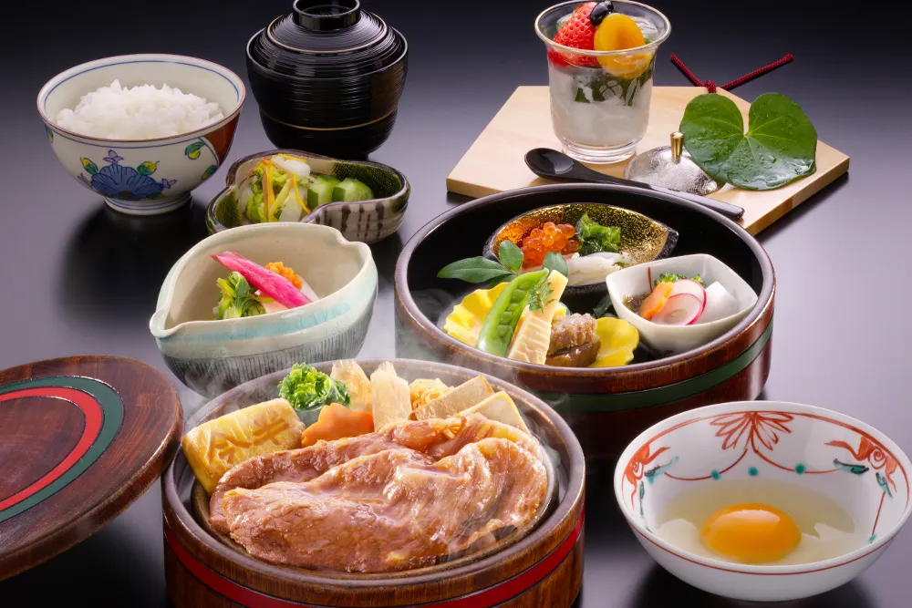

**हानेडा अंतरराष्ट्रीय हवाई अड्डा जापान के कांटो क्षेत्र का मुख्य प्रवेश द्वार है—न केवल चीन और जापान के बीच सीधी उड़ानों का केंद्र, बल्कि वह शुरुआती बिंदु भी जहाँ से आगंतुक टोक्यो और व्यापक कांटो क्षेत्र को जानना शुरू करते हैं।**

देश के घरेलू ट्रांज़िट केंद्रों में से एक के रूप में, हानेडा आधुनिक शहर की चहल-पहल को पारंपरिक संस्कृति की गहराई से जोड़ता है, और जापान का विशिष्ट आकर्षण इस सब में बुना हुआ है। चाहे आप यहाँ से यात्रा शुरू कर रहे हों या रास्ते में गुज़र रहे हों, हवाई अड्डे के भीतर की सुविधाएँ यात्रा को आसान बनाती हैं।

**आज, हम हानेडा की गोशोइन मुहर से शुरुआत करें और आपको इस पाँच सितारा हवाई अड्डे के आकर्षण से परिचित कराएँ।**

## गोशोइन（ごしょういん / goshōin）

जापान भर के हवाई अड्डों पर ही मिलने वाला "आकाशीय गोशुइन"। इसकी शुरुआत जापान एयरलाइंस के क्षेत्रीय शहरों को पुनर्जीवित करने के विचार से हुई, और अब इसे देश भर के 55 हवाई अड्डों पर खरीदा जा सकता है।

- **संदर्भ मूल्य:** ¥350

अन्य हवाई अड्डों की मार्गदर्शिकाओं के लिए इस लेख के अंत में दिए लिंक देखें।

### गोशोइन विवरण

- **हवाई अड्डा:** हानेडा टोक्यो अंतरराष्ट्रीय हवाई अड्डा
- **हवाई अड्डा कोड:** HND
- **मुहर संख्या एक:** हानेडा टोक्यो अंतरराष्ट्रीय हवाई अड्डे को JAL के घरेलू नेटवर्क का पहला हवाई अड्डा दर्शाती है।
- **रनवे:** हवाई अड्डे के नाम के नीचे के धूसर चिह्न वे रनवे हैं जिनका हानेडा टोक्यो अंतरराष्ट्रीय हवाई अड्डा वास्तव में उपयोग करता है।
- **लाल विमान:** हानेडा टोक्यो अंतरराष्ट्रीय हवाई अड्डे पर JAL का मुख्य प्रकार—यहाँ A350-900।
- **केंद्र में गोल मुहर:** हवाई अड्डे के नाम या स्थान का एक अक्षर, घुमाया हुआ—यहाँ यह 羽 (ha) अक्षर है, जो करवट पर घुमाया गया है।
- **कहाँ से खरीदें:** T1, JAL PLAZA

## सिर्फ़ 15 मिनट में मध्य टोक्यो

हानेडा अंतरराष्ट्रीय हवाई अड्डा तीन टर्मिनलों से बना है, जिनमें अंतरराष्ट्रीय उड़ानें T3 पर केंद्रित हैं। एक मुफ़्त शटल बस, केक्यू लाइन और मोनोरेल—तीनों तीनों टर्मिनलों को जोड़ते हैं। **चीन के कई शहरों से अब हानेडा के लिए सीधी उड़ानें हैं, जिनमें बीजिंग, तियानजिन, किंगदाओ, डालियान, शंघाई, ग्वांगझोउ और शेनझेन शामिल हैं,** जिससे दोनों देशों के बीच यात्रा बहुत आसान हो गई है।

हानेडा में उतरने के बाद, शहर जाने के विकल्प तेज़ और विविध हैं। T3 स्टेशन से तेज़ मोनोरेल लगभग 15 मिनट में हामामात्सुचो पहुँचती है—टोक्यो टावर के करीब—जहाँ आप JR यामानोते लाइन पर बदल सकते हैं। केक्यू लाइन पर, शिनागावा लगभग 12 मिनट, आसाकुसा लगभग 36 मिनट, और योकोहामा केवल लगभग 25 मिनट दूर है।

नारिता हवाई अड्डा लगभग 1 घंटा 30 मिनट दूर है। तोचिगी, गुन्मा, शिज़ुओका, यामानाशी, नागानो और सेंदाई के लिए हाईवे बसें भी हैं, इसलिए शहर में घूमना और दूर की यात्रा—दोनों आसानी से शुरू हो जाते हैं।

## हानेडा में क्या ज़रूर खाएँ

### ज़रूर खाने वाली पहली चीज़: निंग्योचो इमाहान

- **कहाँ:** T3, 4F, एदो-कोजी 15
- **समय:** दोपहर का भोजन 11:00–15:00 (अंतिम ऑर्डर 14:30); रात का भोजन 17:00–22:00 (अंतिम ऑर्डर 20:30)

टोक्यो के निहोनबाशी में निंग्योचो से एक पुराना प्रतिष्ठित सुकियाकी भोजनालय, इसकी हवाई अड्डा शाखा एदो-शैली के मुखौटे में मूल की उसी शालीनता को समेटे है। अपनी सुकियाकी का आनंद लेने के कई तरीके हैं—सेट भोजन, कोर्स, गोज़ेन—हर एक मादा गोवंश के चुने हुए जापानी ब्लैक वाग्यू पर आधारित: कोमल, रसीला और स्वाद से भरपूर। घर की सॉस परिपक्व बीफ़ की सुगंध को उभारती है, और सावधानी से पकाना मांस की उस समृद्धि का हर अंश बनाए रखता है।

### ज़रूर खाने वाली दूसरी चीज़: उओगाशी निहोन-इची

- **कहाँ:** T3, 3F, प्रस्थान क्षेत्र के बाद, 108
- **समय:** 24 घंटे खुला

खड़े होकर सुशी खाने की एक श्रृंखला, और हानेडा के प्रस्थान क्षेत्र के भीतर इसकी शाखा उसी एदोमाए परंपरा को बनाए रखती है। दुकान त्सुकीजी बाज़ार से ताज़ा उपज चुनती है और हर टुकड़ा आपके सामने बनाती है; आप सेट ऑर्डर कर सकते हैं या अपनी पसंद की मछली चुनकर टुकड़ों की गिनती के हिसाब से ऑर्डर कर सकते हैं। उड़ान भरने वाले यात्रियों के लिए, या जापान छोड़ने से पहले असली सुशी का एक और स्वाद चाहने वाले किसी के लिए, यह सुविधाजनक भी है और बहुत बढ़िया भी।

## केवल हानेडा में मिलने वाले स्मृतिचिह्न

### CAFÉ CHOCOLAT WICH

- **कहाँ:** T3, 4F, एदो-कोजी 28, एदो शोकुहिनकान
- **संदर्भ मूल्य:** 6 के लिए ¥1,425

यह केवल हानेडा में मिलने वाली मिठाई गहरी कॉफ़ी सुगंध पर बनी है: बेहतरीन बेल्जियन चॉकलेट के बीच कुरकुरा बिस्किट, जिससे हर कौर में परतें बनती हैं और जो कॉफ़ी के साथ बेहतरीन लगती है। कॉफ़ी सैनबोन कॉफ़ी की मोटी पिसी हुई फलियाँ हैं, जो 1957 में स्थापित योकोहामा की रोस्टर है और अपनी गुणवत्ता के लिए प्रतिष्ठित है; मिठाई खुद ला मेज़ों शिरोकाने बनाती है, जो टोक्यो के शिरोकाने में शुरू हुई उच्च-स्तरीय पेटिसरी है। एक साथ कॉफ़ी, चॉकलेट और बिस्किट—इतनी सुरुचिपूर्ण कि रखने योग्य, और उपहार के लिए आदर्श।

### इतोया "AIRPORT NOTEBOOK"

- **कहाँ:** T3, 4F, एदो-कोजी 27
- **संदर्भ मूल्य:** प्रति नोटबुक ¥660

इतोया स्टेशनरी की विशेषज्ञ है, जिसकी स्थापना 1904 में टोक्यो के गिंज़ा में हुई, और जो अपने मौलिक उत्पादों की गहरी श्रृंखला के लिए जानी जाती है, जो स्टेशनरी प्रेमियों को बार-बार वापस खींच लाती है। हानेडा शाखा वही मौलिक भावना लिए है, गुणवत्तापूर्ण लेखन उपकरणों और जापानी स्टेशनरी के साथ जो यात्रियों को भाती है।

इसकी चंचल "हवाई अड्डा" नोटबुक विशेष आकर्षण है: आगे और पीछे का कवर मिलकर एक ही हवाई अड्डे का दृश्य बनाते हैं, जिसमें सेवा वाहन और उड़ान भरने की प्रतीक्षा करते विमान शामिल हैं, इसलिए हवाई अड्डे की व्यस्त ज़िंदगी आपके हाथ में आ जाती है। इसे खोलिए और पन्नों के बीच छोटे-छोटे विमान निकल आते हैं—छोटे-छोटे आश्चर्यों से भरा। यहाँ केवल हानेडा में मिलने वाले डिज़ाइन भी हैं, जो स्मृतिचिह्न के रूप में या अपने पास रखने के लिए अच्छे हैं।

उड़ान से पहले समय हो तो एक नज़र डालना बनता है।

## हवाई अड्डे पर और आसपास

### प्लेनेटेरियम स्टैरी कैफ़े

- **पता:** T3, 5F, टोक्यो पॉपटाउन 50
- **समय:** 09:00–22:30 (अंतिम ऑर्डर 22:00); प्लेनेटेरियम 11:00 से (अंतिम प्रवेश 21:00)

जैसा नाम से पता चलता है, यह एक कैफ़े है जहाँ आप प्रक्षेपित तारों भरे आकाश के नीचे बैठते हैं। यह एक उन्नत हाइब्रिड प्रोजेक्शन प्रणाली का उपयोग करता है, जो पूरे गुंबद को भरने के लिए निर्बाध प्रक्षेपण को जोड़ती है और लगभग चार करोड़ तारे दिखाती है, आकाशगंगा को बारीक विवरण में प्रस्तुत करते हुए।

उड़ान से पहले समय बचा हो तो तारों के बीच एक छोटी यात्रा क्यों न करें?

### हानेडा एयरपोर्ट गार्डन

- **पता:** 2-7-1 हानेडा हवाई अड्डा, ओता-कु, टोक्यो
- **पहुँच:** T3 की दूसरी मंज़िल के जोड़ने वाले कॉरिडोर से पैदल
- **वेबसाइट:** [www.shopping-sumitomo-rd.com/haneda/shopping/](http://www.shopping-sumitomo-rd.com/haneda/shopping/)

2023 में खुला और टर्मिनल 3 से सीधे जुड़ा यह परिसर खरीदारी और भोजन से आगे की चीज़ है: इसमें ओनसेन और होटल भी हैं।

इज़ुमी तेनकू नो यू हानेडा एयरपोर्ट में दुर्लभ खुलेपन का एहसास है, साफ़ दिनों में माउंट फ़ूजी दिखता है; सुविधाओं में पुरुषों और महिलाओं के खुले स्नान, रॉक सॉना और भोजन क्षेत्र हैं, जो इसे गरम पानी के झरनों में एक आदर्श दिन बनाते हैं। विमानों के उड़ान भरने और उतरने के बीच खुले स्नान में डुबकी लगाना अपने आप में एक अनुभव है।

अगली बार हानेडा से गुज़रते समय, इस जगह की हर पेशकश को समेटने के लिए कुछ समय निकालिए—और एक अलग तरह की यात्रा का आनंद लीजिए।

## अन्य हवाई अड्डों की मार्गदर्शिकाएँ

- [नारिता अंतरराष्ट्रीय हवाई अड्डा मार्गदर्शिका](https://mp.weixin.qq.com/s?__biz=MzA3MjI1NDQxNA==&mid=2652373314&idx=1&sn=2cc9b26e9041d8fba85a695fc9570a82&scene=21#wechat_redirect)
- [न्यू चितोसे (होक्काइदो) अंतरराष्ट्रीय हवाई अड्डा मार्गदर्शिका](https://mp.weixin.qq.com/s?__biz=MzA3MjI1NDQxNA==&mid=2652374162&idx=1&sn=c685409867a453fc351c35787a205e56&scene=21#wechat_redirect)
- [फ़ुकुओका अंतरराष्ट्रीय हवाई अड्डा मार्गदर्शिका](https://mp.weixin.qq.com/s?__biz=MzA3MjI1NDQxNA==&mid=2652375055&idx=1&sn=0ab140b1895ababafe7a1e8991341d7a&scene=21#wechat_redirect)
- [चुबू सेंट्रायर अंतरराष्ट्रीय हवाई अड्डा मार्गदर्शिका](https://mp.weixin.qq.com/s?__biz=MzA3MjI1NDQxNA==&mid=2652376462&idx=1&sn=b90e4b8fcfc7c0934be09f9f2658c036&scene=21#wechat_redirect)
- [हिरोशिमा हवाई अड्डा मार्गदर्शिका](https://mp.weixin.qq.com/s?__biz=MzA3MjI1NDQxNA==&mid=2652377958&idx=1&sn=8957ec2da9779d9a76aa2488b831e08b&scene=21#wechat_redirect)
- [कंसाई अंतरराष्ट्रीय हवाई अड्डा मार्गदर्शिका](https://mp.weixin.qq.com/s?__biz=MzA3MjI1NDQxNA==&mid=2652378218&idx=1&sn=e6b0ad7e1a509efac79fbcc6a99d9913&scene=21#wechat_redirect)
- [नाहा हवाई अड्डा मार्गदर्शिका](https://mp.weixin.qq.com/s?__biz=MzA3MjI1NDQxNA==&mid=2652378849&idx=1&sn=a43e621ae60abc174f72c5808aeccfc1&scene=21#wechat_redirect)

## चित्र स्रोत

कुछ चित्र निम्नलिखित साइटों से लिए गए हैं:

- https://att-japan.net/ja/haneda-tokyo/
- https://ec.jal.co.jp/img//0002/img/pages/soranogoshoin/haneda-2.jpg
- https://restaurant.imahan.com/hanedaairport-3t/
- https://tokyo-haneda.com/
- https://haneda-shopping.jp/shop/g/gZ001088047/
- https://www.threads.net/@yama7260/post/DBIdqyZP61z
- https://co-trip.jp/article/611985
- https://www.ito-ya.co.jp/category/3001/45826215220871.html
- https://thegate12.com/jp/article/750#content-8
- https://www.gotokyo.org/jp/new-and-now/new-and-trending/221205/topics.html
- https://www.sankei.com/article/20221006-7S2A3FJ42FIMPMLBJU5QXCXC6E/photo/XGGOBJJ5F5MBVBLLXJAQNCXTKQ/
- https://www.fashion-press.net/news/56398

## संबंधित लिंक

- **इस साइट पर**: [टोक्यो हानेडा हवाई अड्डा (HND)](/airport/HND), [जापान (JP)](/country/JP)
- **विकिपीडिया**: [टोक्यो हानेडा हवाई अड्डा](https://en.wikipedia.org/wiki/Tokyo_Haneda_Airport)
- **Baidu Baike**: [टोक्यो हानेडा हवाई अड्डा](https://baike.baidu.com/item/%E7%BE%BD%E7%94%B0%E6%9C%BA%E5%9C%BA)
