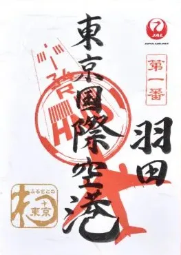
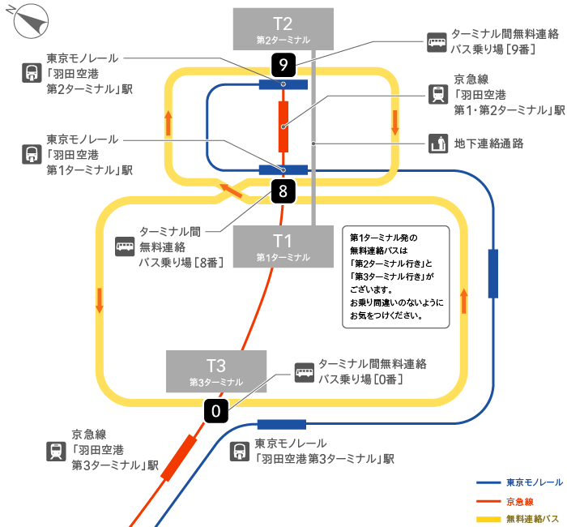
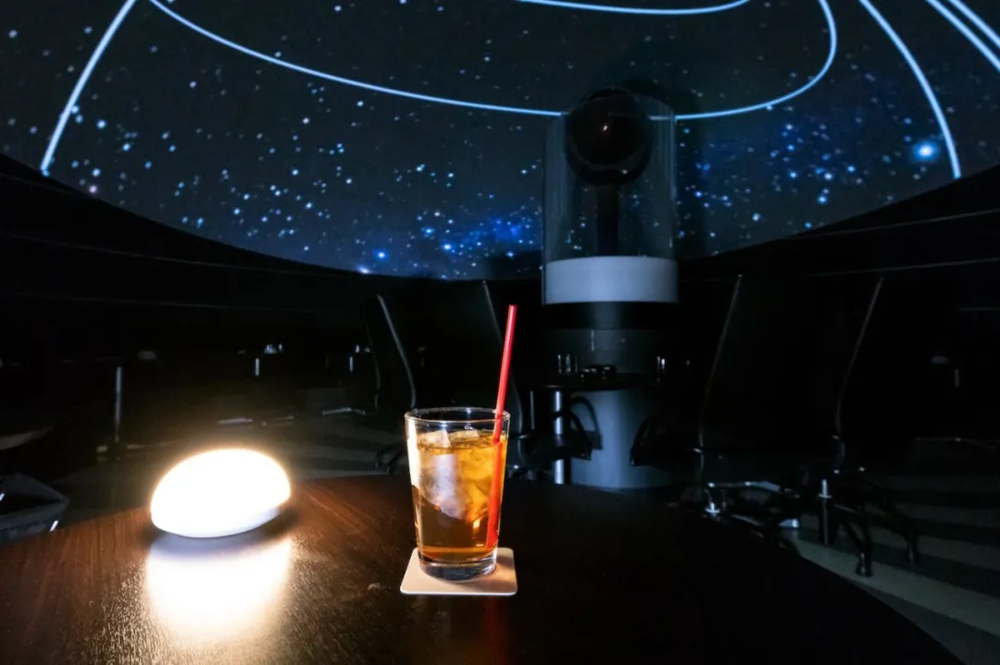

**Bandara Internasional Haneda adalah gerbang utama ke kawasan Kanto di Jepang — bukan hanya hub penerbangan langsung antara Tiongkok dan Jepang, tetapi juga titik awal bagi pengunjung untuk mengenal Tokyo dan kawasan Kanto yang lebih luas.**

Sebagai salah satu hub transfer domestik negara itu, Haneda menghubungkan hiruk-pikuk kota modern dengan kedalaman budaya tradisional, dan pesona khas Jepang terjalin di seluruhnya. Entah Anda memulai perjalanan di sini atau sekadar lewat, fasilitas di dalam bandara membuat perjalanan lebih mudah.

**Hari ini, mari mulai dari cap Goshoin Haneda dan mengajak Anda menjelajahi daya tarik bandara bintang lima ini.**

## Goshoin（ごしょういん / goshōin）

Sebuah “goshuin langit” yang hanya tersedia di bandara-bandara di Jepang. Awalnya merupakan ide Japan Airlines untuk menghidupkan kembali kota-kota regional, dan kini dapat dibeli di 55 bandara di seluruh negeri.

- **Harga referensi:** ¥350

Lihat tautan di akhir artikel ini untuk panduan bandara lain.

### Data Goshoin

- **Bandara:** Bandara Internasional Tokyo Haneda
- **Kode bandara:** HND
- **Cap nomor satu:** menandai Bandara Internasional Tokyo Haneda sebagai bandara pertama di jaringan domestik JAL.
- **Landasan pacu:** tanda abu-abu di bawah nama bandara adalah landasan pacu yang benar-benar digunakan Bandara Internasional Tokyo Haneda.
- **Pesawat merah:** tipe JAL utama di Bandara Internasional Tokyo Haneda — di sini, A350-900.
- **Cap bundar di tengah:** karakter dari nama atau lokasi bandara, diputar — di sini karakter 羽 (ha) dimiringkan.
- **Tempat membeli:** T1, JAL PLAZA

## Pusat Tokyo hanya dalam 15 menit

Bandara Internasional Haneda terdiri dari tiga terminal, dengan penerbangan internasional terkonsentrasi di T3. Bus antar-jemput gratis, jalur Keikyu, dan monorel semuanya menghubungkan ketiga terminal. **Beberapa kota di Tiongkok kini memiliki penerbangan langsung ke Haneda, termasuk Beijing, Tianjin, Qingdao, Dalian, Shanghai, Guangzhou, dan Shenzhen,** yang membuat perjalanan antara kedua negara jauh lebih mudah.

Setelah mendarat di Haneda, pilihan menuju kota cepat dan beragam. Dari stasiun T3, monorel cepat mencapai Hamamatsucho — dekat Tokyo Tower — dalam sekitar 15 menit, tempat Anda dapat berganti ke jalur JR Yamanote. Dengan jalur Keikyu, Shinagawa memakan waktu sekitar 12 menit, Asakusa sekitar 36 menit, dan Yokohama hanya sekitar 25 menit.

Bandara Narita berjarak sekitar 1 jam 30 menit. Ada juga bus jalan tol ke Tochigi, Gunma, Shizuoka, Yamanashi, Nagano, dan Sendai, sehingga wisata di kota dan perjalanan lebih jauh sama-sama mudah dimulai.

## Yang wajib Anda makan di Haneda

### Wajib makan nomor satu: Ningyocho Imahan

- **Lokasi:** T3, lantai 4, Edo-koji 15
- **Jam buka:** makan siang 11.00–15.00 (pesanan terakhir 14.30); makan malam 17.00–22.00 (pesanan terakhir 20.30)

Restoran sukiyaki mapan dari Ningyocho di Nihonbashi, Tokyo, cabang bandaranya membungkus kehalusan yang sama dengan aslinya dalam fasad bergaya Edo. Ada beberapa cara menikmati sukiyaki Anda — set meal, course, gozen — masing-masing dibangun di sekitar wagyu Hitam Jepang pilihan dari sapi betina: lembut, berair, dan penuh rasa. Saus khas restoran itu mengangkat aroma daging sapi yang dimatangkan, dan pemasakan yang cermat menjaga setiap kekayaan rasa itu tetap di dalam daging.

### Wajib makan nomor dua: Uogashi Nihon-Ichi

- **Lokasi:** T3, lantai 3, setelah area keberangkatan, 108
- **Jam buka:** buka 24 jam

Jaringan sushi berdiri, dan cabangnya di area keberangkatan Haneda mempertahankan tradisi Edomae yang sama. Toko memilih bahan segar dari pasar Tsukiji dan membentuk setiap potong di depan Anda; Anda dapat memesan set atau memilih ikan sendiri dan menghitungnya. Bagi penumpang yang akan segera terbang, atau siapa pun yang ingin mencicipi sushi yang layak sekali lagi sebelum meninggalkan Jepang, tempat ini nyaman sekaligus sangat enak.

## Suvenir khusus Haneda

### CAFÉ CHOCOLAT WICH

- **Lokasi:** T3, lantai 4, Edo-koji 28, Edo Shokuhinkan
- **Harga referensi:** ¥1.425 untuk 6

Manisan eksklusif Haneda ini dibangun di sekitar aroma kopi yang pekat: cokelat Belgia halus dengan bagian tengah biskuit renyah, menghasilkan gigitan berlapis yang sempurna dinikmati dengan kopi. Kopinya adalah biji giling kasar dari Sanbon Coffee, pemanggang kopi Yokohama yang didirikan pada 1957 dan dihargai karena kualitasnya, sedangkan kuenya sendiri dibuat oleh La Maison Shirokane, patisserie kelas atas yang bermula di Shirokane, Tokyo. Kopi, cokelat, dan biskuit dalam satu — cukup elegan untuk disimpan dan ideal sebagai hadiah.

### Ito-ya "AIRPORT NOTEBOOK"

- **Lokasi:** T3, lantai 4, Edo-koji 27
- **Harga referensi:** ¥660 per buku

Ito-ya adalah spesialis alat tulis yang didirikan pada 1904 di Ginza, Tokyo, dikenal karena rangkaian produk orisinalnya yang luas dan membuat para pencinta alat tulis kembali lagi. Cabang Haneda membawa semangat orisinal yang sama, dengan alat tulis berkualitas dan perlengkapan tulis Jepang yang disukai pelancong.

Buku catatan “airport” yang menyenangkan menjadi daya tarik tersendiri: sampul depan dan belakang bersama-sama membentuk satu pemandangan bandara, lengkap dengan kendaraan servis dan pesawat yang menunggu keberangkatan, sehingga kehidupan sibuk bandara berada di tangan Anda. Buka dan pesawat kecil muncul di antara halaman — penuh kejutan kecil. Ada juga desain khusus Haneda di sini, cocok sebagai suvenir atau untuk disimpan.

Jika ada waktu sebelum penerbangan, tempat ini layak dilihat.

## Di bandara dan sekitarnya

### PLANETARIUM Starry Cafe

- **Alamat:** T3, lantai 5, TOKYO POPTOWN 50
- **Jam buka:** 09.00–22.30 (pesanan terakhir 22.00); planetarium mulai 11.00 (masuk terakhir 21.00)

Sesuai namanya, ini adalah kafe tempat Anda duduk di bawah langit berbintang yang diproyeksikan. Kafe ini menggunakan sistem proyeksi hibrida canggih yang menggabungkan proyeksi mulus untuk memenuhi seluruh kubah, menampilkan sekitar 40 juta bintang dengan Bima Sakti yang dirender sangat rinci.

Dengan waktu luang sebelum penerbangan, mengapa tidak melakukan perjalanan singkat menembus bintang-bintang?

### Haneda Airport Garden

- **Alamat:** 2-7-1 Haneda Airport, Ota-ku, Tokyo
- **Akses:** berjalan kaki dari koridor penghubung lantai dua T3
- **Situs web:** [www.shopping-sumitomo-rd.com/haneda/shopping/](http://www.shopping-sumitomo-rd.com/haneda/shopping/)

Dibuka pada 2023 dan terhubung langsung ke Terminal 3, kompleks ini lebih dari sekadar belanja dan makan: di sini juga ada onsen dan hotel.

Izumi Tenku no Yu Haneda Airport memiliki kesan ruang yang jarang ditemukan, dengan Gunung Fuji terlihat pada hari cerah; fasilitasnya mencakup pemandian terbuka pria dan wanita, sauna batu, dan area bersantap, menjadikannya hari yang ideal di pemandian air panas. Berendam di pemandian terbuka sambil pesawat lepas landas dan mendarat adalah pengalaman tersendiri.

Lain kali Anda melewati Haneda, sisakan waktu untuk menikmati semua yang ditawarkan tempat ini — dan nikmati perjalanan dengan cara yang berbeda.

## Panduan bandara lain

- [Panduan Bandara Internasional Narita](https://mp.weixin.qq.com/s?__biz=MzA3MjI1NDQxNA==&mid=2652373314&idx=1&sn=2cc9b26e9041d8fba85a695fc9570a82&scene=21#wechat_redirect)
- [Panduan Bandara Internasional New Chitose (Hokkaido)](https://mp.weixin.qq.com/s?__biz=MzA3MjI1NDQxNA==&mid=2652374162&idx=1&sn=c685409867a453fc351c35787a205e56&scene=21#wechat_redirect)
- [Panduan Bandara Internasional Fukuoka](https://mp.weixin.qq.com/s?__biz=MzA3MjI1NDQxNA==&mid=2652375055&idx=1&sn=0ab140b1895ababafe7a1e8991341d7a&scene=21#wechat_redirect)
- [Panduan Bandara Internasional Chubu Centrair](https://mp.weixin.qq.com/s?__biz=MzA3MjI1NDQxNA==&mid=2652376462&idx=1&sn=b90e4b8fcfc7c0934be09f9f2658c036&scene=21#wechat_redirect)
- [Panduan Bandara Hiroshima](https://mp.weixin.qq.com/s?__biz=MzA3MjI1NDQxNA==&mid=2652377958&idx=1&sn=8957ec2da9779d9a76aa2488b831e08b&scene=21#wechat_redirect)
- [Panduan Bandara Internasional Kansai](https://mp.weixin.qq.com/s?__biz=MzA3MjI1NDQxNA==&mid=2652378218&idx=1&sn=e6b0ad7e1a509efac79fbcc6a99d9913&scene=21#wechat_redirect)
- [Panduan Bandara Naha](https://mp.weixin.qq.com/s?__biz=MzA3MjI1NDQxNA==&mid=2652378849&idx=1&sn=a43e621ae60abc174f72c5808aeccfc1&scene=21#wechat_redirect)

## Sumber gambar

Beberapa gambar berasal dari situs berikut:

- https://att-japan.net/ja/haneda-tokyo/
- https://ec.jal.co.jp/img//0002/img/pages/soranogoshoin/haneda-2.jpg
- https://restaurant.imahan.com/hanedaairport-3t/
- https://tokyo-haneda.com/
- https://haneda-shopping.jp/shop/g/gZ001088047/
- https://www.threads.net/@yama7260/post/DBIdqyZP61z
- https://co-trip.jp/article/611985
- https://www.ito-ya.co.jp/category/3001/45826215220871.html
- https://thegate12.com/jp/article/750#content-8
- https://www.gotokyo.org/jp/new-and-now/new-and-trending/221205/topics.html
- https://www.sankei.com/article/20221006-7S2A3FJ42FIMPMLBJU5QXCXC6E/photo/XGGOBJJ5F5MBVBLLXJAQNCXTKQ/
- https://www.fashion-press.net/news/56398

## Tautan terkait

- **Di situs ini**: [Bandara Tokyo Haneda (HND)](/airport/HND), [Jepang (JP)](/country/JP)
- **Wikipedia**: [Bandara Tokyo Haneda](https://en.wikipedia.org/wiki/Tokyo_Haneda_Airport)
- **Baidu Baike**: [Bandara Tokyo Haneda](https://baike.baidu.com/item/%E7%BE%BD%E7%94%B0%E6%9C%BA%E5%9C%BA)
