**L'aeroporto internazionale di Haneda è la principale porta d'ingresso per la regione giapponese del Kantō — non solo l'hub dei voli diretti tra Cina e Giappone, ma anche il punto di partenza da cui i visitatori conoscono Tokyo e l'ampia area del Kantō.**

Come uno degli hub nazionali di coincidenza del paese, Haneda collega il trambusto della città moderna con la profondità della cultura tradizionale, e il fascino particolare del Giappone è intrecciato in tutto questo. Che iniziate qui un viaggio o siate solo di passaggio, le strutture dell'aeroporto rendono il tragitto più facile.

**Oggi partiamo dal timbro goshoin di Haneda e vi accompagniamo attraverso il fascino di questo aeroporto a cinque stelle.**

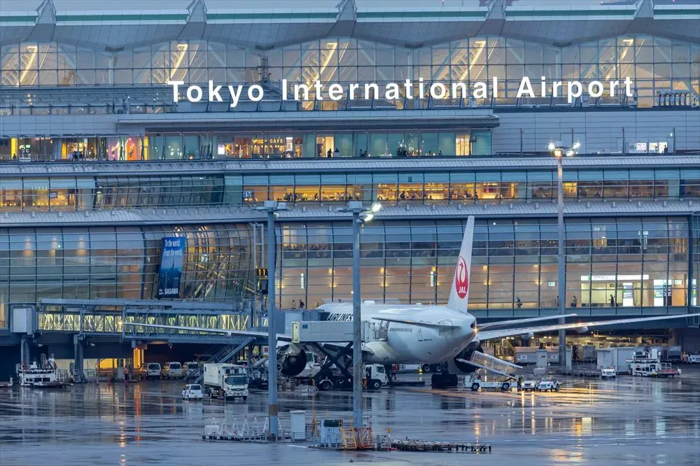

## Goshoin（ごしょういん / goshōin）

Un «goshuin del cielo» disponibile solo negli aeroporti del Giappone. È nato come idea di Japan Airlines per rivitalizzare le città regionali, e ora si può acquistare in 55 aeroporti del paese.

- **Prezzo indicativo:** ¥350

Vedere i link alla fine di questo articolo per le guide agli altri aeroporti.

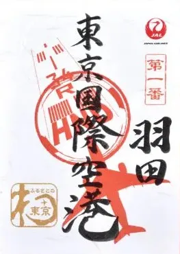

### Dati del goshoin

- **Aeroporto:** Aeroporto internazionale di Tokyo Haneda
- **Codice aeroportuale:** HND
- **Timbro numero uno:** contrassegna l'aeroporto internazionale di Tokyo Haneda come primo aeroporto sulla rete nazionale di JAL.
- **Piste:** i segni grigi sotto il nome dell'aeroporto sono le piste che l'aeroporto internazionale di Tokyo Haneda usa effettivamente.
- **Aereo rosso:** il tipo principale di JAL all'aeroporto internazionale di Tokyo Haneda — qui l'A350-900.
- **Il timbro rotondo al centro:** un carattere del nome o della posizione dell'aeroporto, ruotato — qui è il carattere 羽 (ha) girato su un lato.
- **Dove comprarlo:** T1, JAL PLAZA

## Il centro di Tokyo in appena 15 minuti

L'aeroporto internazionale di Haneda è composto da tre terminal, con i voli internazionali concentrati al T3. Un autobus navetta gratuito, la linea Keikyu e la monorotaia collegano tutti e tre i terminal. **Diverse città della Cina hanno ora voli diretti per Haneda, tra cui Pechino, Tianjin, Qingdao, Dalian, Shanghai, Guangzhou e Shenzhen,** il che rende i viaggi tra i due paesi molto più facili.

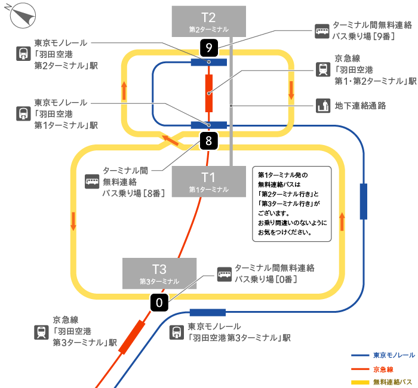

Una volta atterrati a Haneda, le opzioni per la città sono rapide e varie. Dalla stazione del T3 la monorotaia veloce raggiunge Hamamatsucho — vicino alla Tokyo Tower — in circa 15 minuti, dove potete cambiare sulla linea JR Yamanote. Con la linea Keikyu, Shinagawa è a circa 12 minuti, Asakusa a circa 36 minuti e Yokohama a circa 25 minuti.

L'aeroporto di Narita è a circa 1 ora e 30 minuti. Ci sono anche autobus autostradali per Tochigi, Gunma, Shizuoka, Yamanashi, Nagano e Sendai, quindi sia il turismo in città sia i viaggi più lontani partono facilmente.

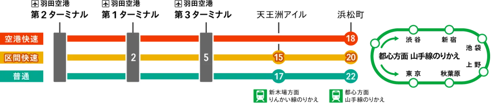

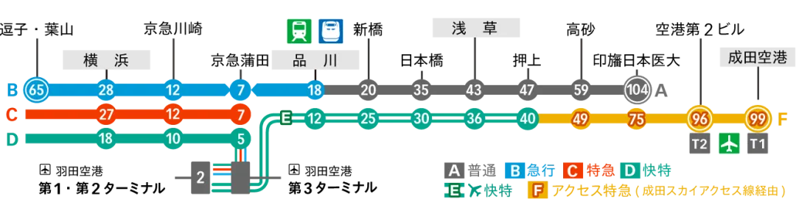

## Che cosa dovete mangiare a Haneda

### Il primo da non perdere: Ningyocho Imahan

- **Dove:** T3, 4° piano, Edo-koji 15
- **Orari:** pranzo 11:00–15:00 (ultimo ordine 14:30); cena 17:00–22:00 (ultimo ordine 20:30)

Un sukiyaki storico di Ningyocho, nel Nihonbashi di Tokyo, la cui filiale aeroportuale unisce una facciata in stile Edo alla stessa raffinatezza dell'originale. Ci sono diversi modi per mangiare il sukiyaki — set, percorsi, gozen — ognuno costruito intorno a wagyu giapponese Black selezionato da bovini femmine: tenero, succoso e pieno di sapore. La salsa della casa esalta l'aroma della carne stagionata, e una cottura accurata trattiene nella carne ogni minima parte di quella ricchezza.

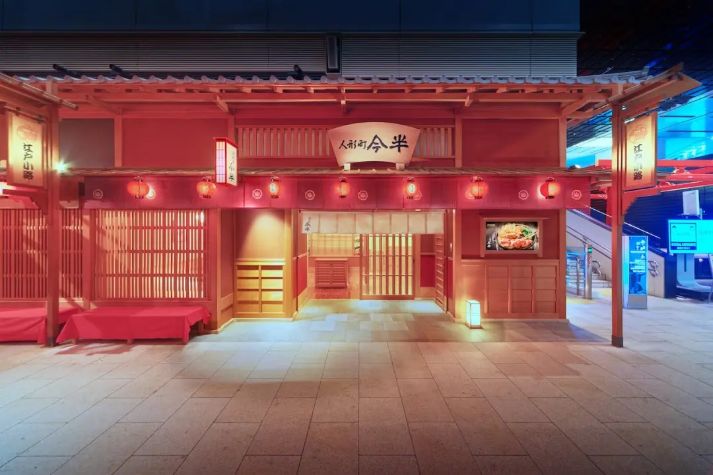

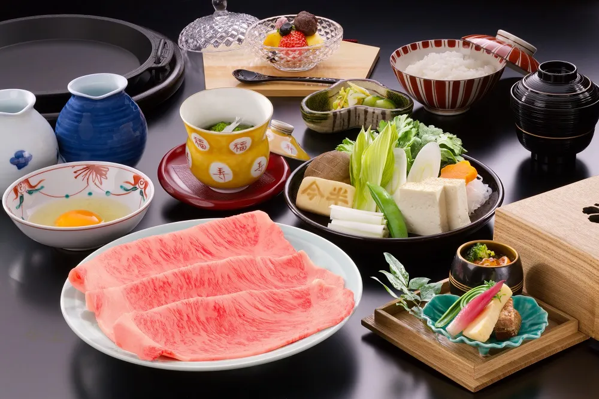

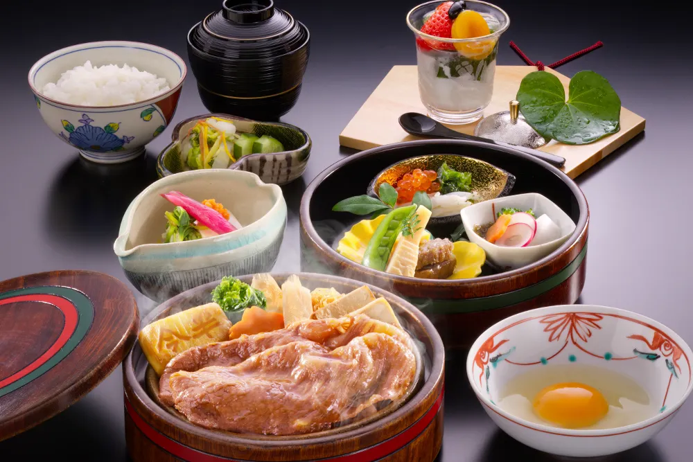

### Il secondo da non perdere: Uogashi Nihon-Ichi

- **Dove:** T3, 3° piano, dopo l'area partenze, 108
- **Orari:** aperto 24 ore

Una catena di sushi in piedi, e la sua filiale dentro l'area partenze di Haneda mantiene la stessa tradizione Edomae. Il negozio seleziona prodotti freschi dal mercato di Tsukiji e forma ogni pezzo davanti a voi; potete ordinare un set o scegliere il vostro pesce e contare. Per i passeggeri in partenza, o per chi vuole un ultimo assaggio di sushi vero prima di lasciare il Giappone, è insieme comodo e molto buono.

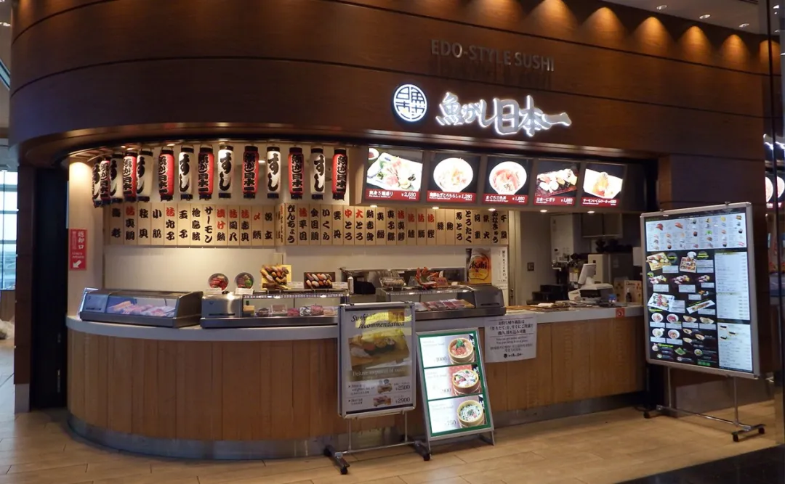

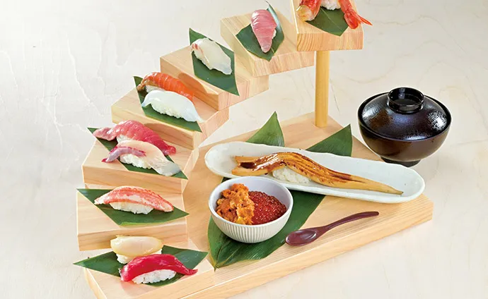

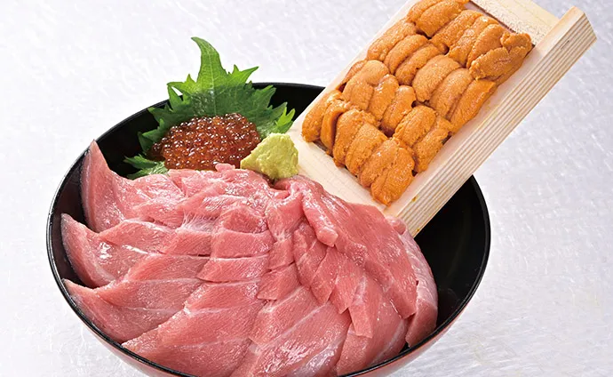

## Souvenir esclusivi di Haneda

### CAFÉ CHOCOLAT WICH

- **Dove:** T3, 4° piano, Edo-koji 28, Edo Shokuhinkan
- **Prezzo indicativo:** ¥1,425 per 6

Questo dolce esclusivo di Haneda è costruito intorno a un profondo aroma di caffè: cioccolato belga fine con un cuore di biscotto croccante, per un morso stratificato che si sposa perfettamente con il caffè. Il caffè è di chicchi macinati grossolanamente di Sanbon Coffee, torrefazione di Yokohama fondata nel 1957 e apprezzata per la sua qualità, e il dolce stesso è prodotto da La Maison Shirokane, la pasticceria di alta gamma nata nel quartiere Shirokane di Tokyo. Caffè, cioccolato e biscotto in uno — abbastanza elegante da conservare e ideale come regalo.

### Il taccuino «AIRPORT NOTEBOOK» di Ito-ya

- **Dove:** T3, 4° piano, Edo-koji 27
- **Prezzo indicativo:** ¥660 per taccuino

Ito-ya è uno specialista di cartoleria fondato nel 1904 a Ginza, Tokyo, noto per una vasta gamma di prodotti originali che fa tornare sempre gli appassionati di cartoleria. La filiale di Haneda porta lo stesso spirito originale, con strumenti di scrittura di qualità e cartoleria giapponese che i viaggiatori apprezzano.

Il suo giocoso taccuino «aeroporto» è un richiamo particolare: la copertina anteriore e quella posteriore formano insieme un'unica scena aeroportuale, completa di veicoli di servizio e aerei in attesa di partire, così la vita frenetica di un aeroporto è nelle vostre mani. Aprirlo e tra le pagine compaiono piccoli aerei: è pieno di piccole sorprese. Ci sono anche design esclusivi di Haneda, buoni come souvenir o da tenere.

Con un po' di tempo prima del volo, vale uno sguardo.

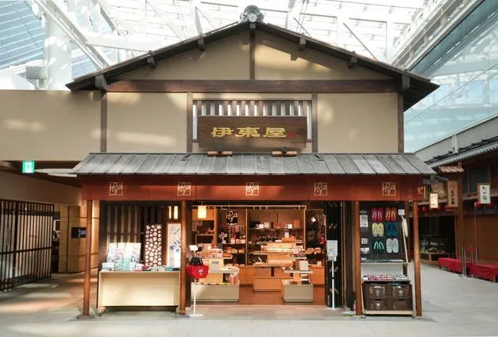

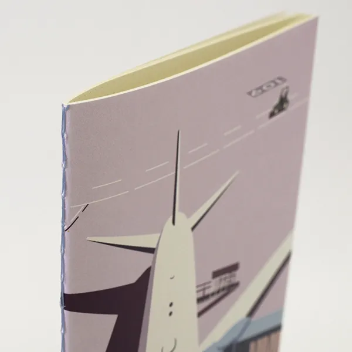

## In aeroporto e nei dintorni

### PLANETARIUM Starry Cafe

- **Indirizzo:** T3, 5° piano, TOKYO POPTOWN 50
- **Orari:** 09:00–22:30 (ultimo ordine 22:00); planetario dalle 11:00 (ultimo ingresso 21:00)

Come suggerisce il nome, è un caffè dove ci si siede sotto un cielo stellato proiettato. Usa un avanzato sistema di proiezione ibrido che combina una proiezione senza giunture per riempire l'intera cupola, mostrando circa 40 milioni di stelle con una Via Lattea resa in dettaglio fine.

Con tempo a disposizione prima del volo, perché non fare un breve viaggio tra le stelle?

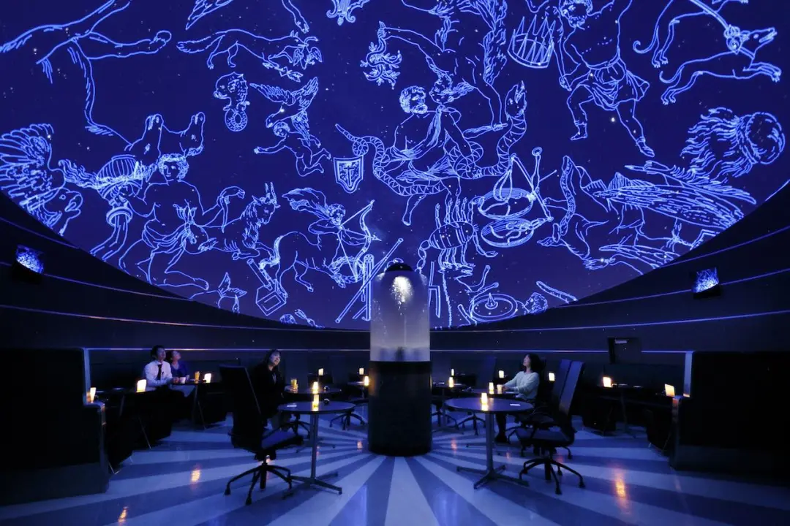

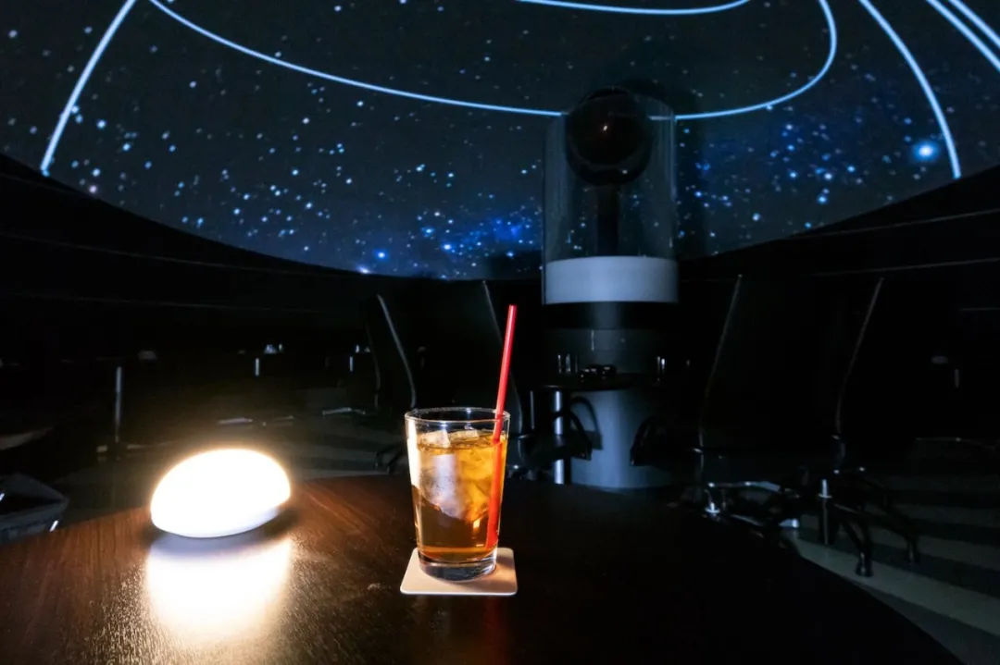

### Haneda Airport Garden

- **Indirizzo:** 2-7-1 Haneda Airport, Ota-ku, Tokyo
- **Accesso:** a piedi dal corridoio di collegamento del secondo piano del T3
- **Sito web:** [www.shopping-sumitomo-rd.com/haneda/shopping/](http://www.shopping-sumitomo-rd.com/haneda/shopping/)

Aperto nel 2023 e collegato direttamente al Terminal 3, questo complesso è più che shopping e ristorazione: ha anche un onsen e un hotel.

Izumi Tenku no Yu Haneda Airport ha un raro senso di spazio, con il Monte Fuji visibile nelle giornate limpide; le strutture includono bagni all'aperto maschili e femminili, una sauna di roccia e aree per la ristorazione, rendendolo ideale per una giornata alle terme. Immergersi nel bagno all'aperto mentre gli aerei decollano e atterrano è un'esperienza a sé.

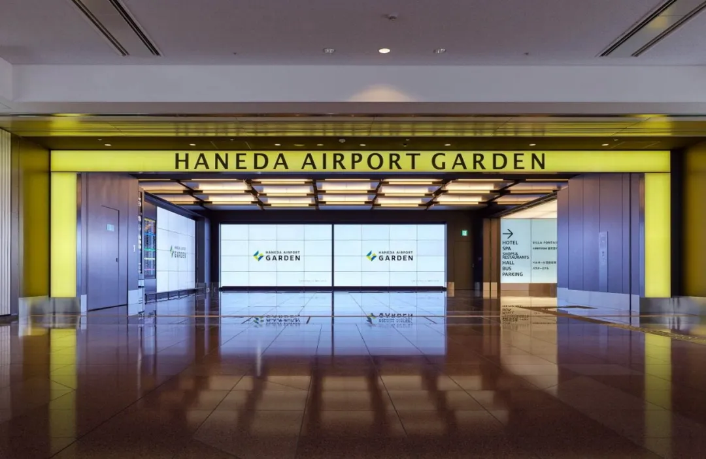

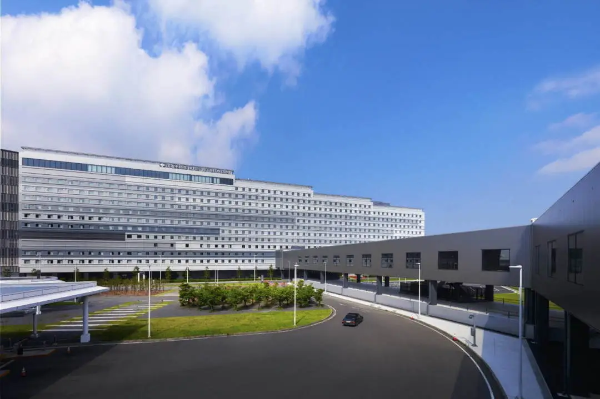

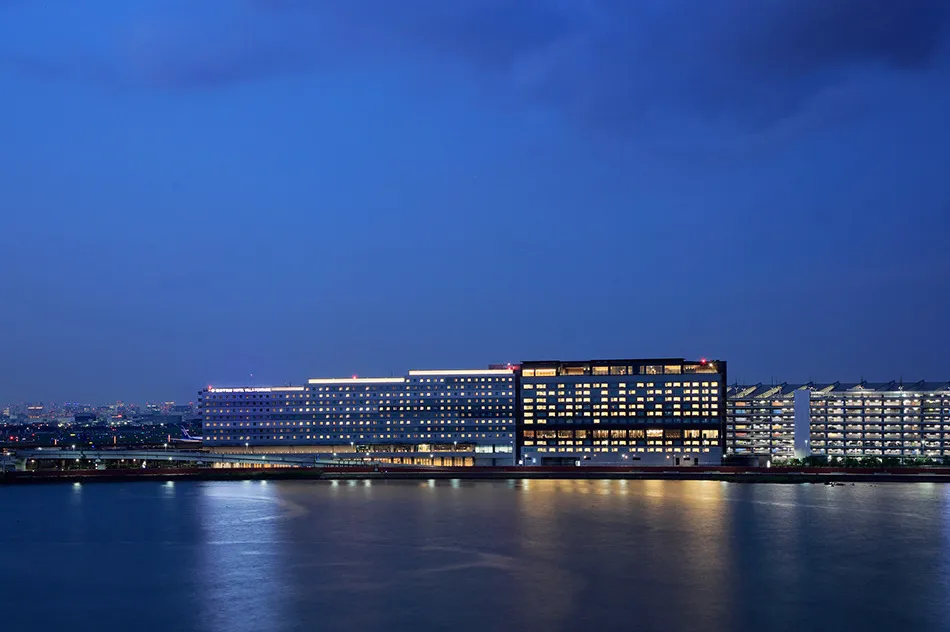

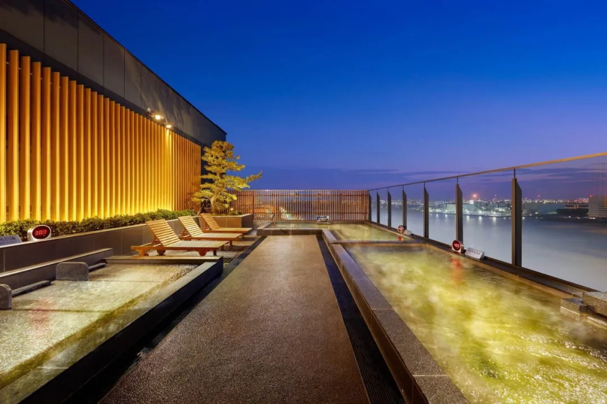

La prossima volta che passate da Haneda, lasciatevi un po' di tempo per assorbire tutto ciò che questo posto offre — e godetevi un tipo diverso di viaggio.

## Guide agli altri aeroporti

- [Guida all'aeroporto internazionale di Narita](https://mp.weixin.qq.com/s?__biz=MzA3MjI1NDQxNA==&mid=2652373314&idx=1&sn=2cc9b26e9041d8fba85a695fc9570a82&scene=21#wechat_redirect)
- [Guida all'aeroporto internazionale di New Chitose (Hokkaido)](https://mp.weixin.qq.com/s?__biz=MzA3MjI1NDQxNA==&mid=2652374162&idx=1&sn=c685409867a453fc351c35787a205e56&scene=21#wechat_redirect)
- [Guida all'aeroporto internazionale di Fukuoka](https://mp.weixin.qq.com/s?__biz=MzA3MjI1NDQxNA==&mid=2652375055&idx=1&sn=0ab140b1895ababafe7a1e8991341d7a&scene=21#wechat_redirect)
- [Guida all'aeroporto internazionale di Chubu Centrair](https://mp.weixin.qq.com/s?__biz=MzA3MjI1NDQxNA==&mid=2652376462&idx=1&sn=b90e4b8fcfc7c0934be09f9f2658c036&scene=21#wechat_redirect)
- [Guida all'aeroporto di Hiroshima](https://mp.weixin.qq.com/s?__biz=MzA3MjI1NDQxNA==&mid=2652377958&idx=1&sn=8957ec2da9779d9a76aa2488b831e08b&scene=21#wechat_redirect)
- [Guida all'aeroporto internazionale del Kansai](https://mp.weixin.qq.com/s?__biz=MzA3MjI1NDQxNA==&mid=2652378218&idx=1&sn=e6b0ad7e1a509efac79fbcc6a99d9913&scene=21#wechat_redirect)
- [Guida all'aeroporto di Naha](https://mp.weixin.qq.com/s?__biz=MzA3MjI1NDQxNA==&mid=2652378849&idx=1&sn=a43e621ae60abc174f72c5808aeccfc1&scene=21#wechat_redirect)

## Fonti delle immagini

Alcune immagini provengono dai seguenti siti:

- https://att-japan.net/ja/haneda-tokyo/
- https://ec.jal.co.jp/img//0002/img/pages/soranogoshoin/haneda-2.jpg
- https://restaurant.imahan.com/hanedaairport-3t/
- https://tokyo-haneda.com/
- https://haneda-shopping.jp/shop/g/gZ001088047/
- https://www.threads.net/@yama7260/post/DBIdqyZP61z
- https://co-trip.jp/article/611985
- https://www.ito-ya.co.jp/category/3001/45826215220871.html
- https://thegate12.com/jp/article/750#content-8
- https://www.gotokyo.org/jp/new-and-now/new-and-trending/221205/topics.html
- https://www.sankei.com/article/20221006-7S2A3FJ42FIMPMLBJU5QXCXC6E/photo/XGGOBJJ5F5MBVBLLXJAQNCXTKQ/
- https://www.fashion-press.net/news/56398

## Link utili

- **Su questo sito**: [Aeroporto di Tokyo Haneda (HND)](/airport/HND), [Giappone (JP)](/country/JP)
- **Wikipedia**: [Aeroporto di Tokyo Haneda](https://en.wikipedia.org/wiki/Tokyo_Haneda_Airport)
- **Baidu Baike**: [Aeroporto di Tokyo Haneda](https://baike.baidu.com/item/%E7%BE%BD%E7%94%B0%E6%9C%BA%E5%9C%BA)
