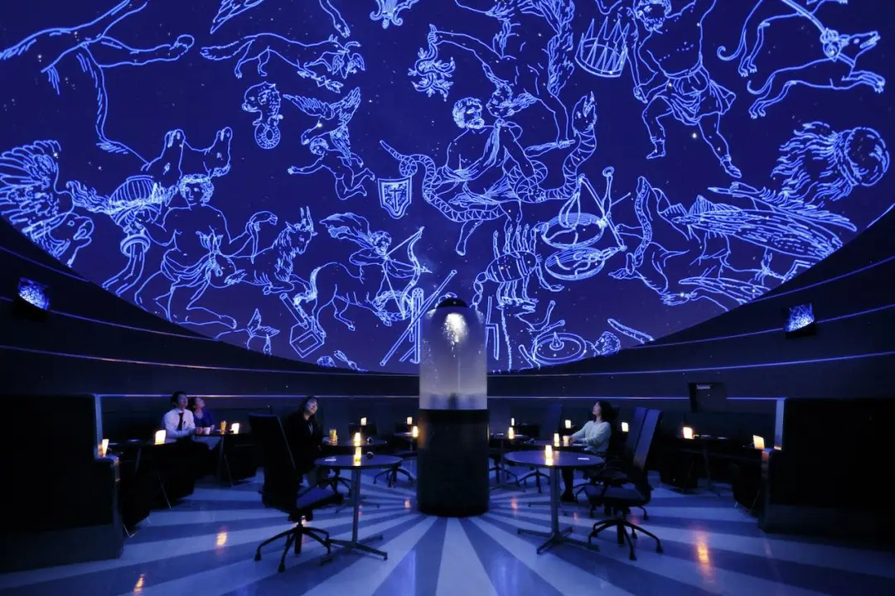
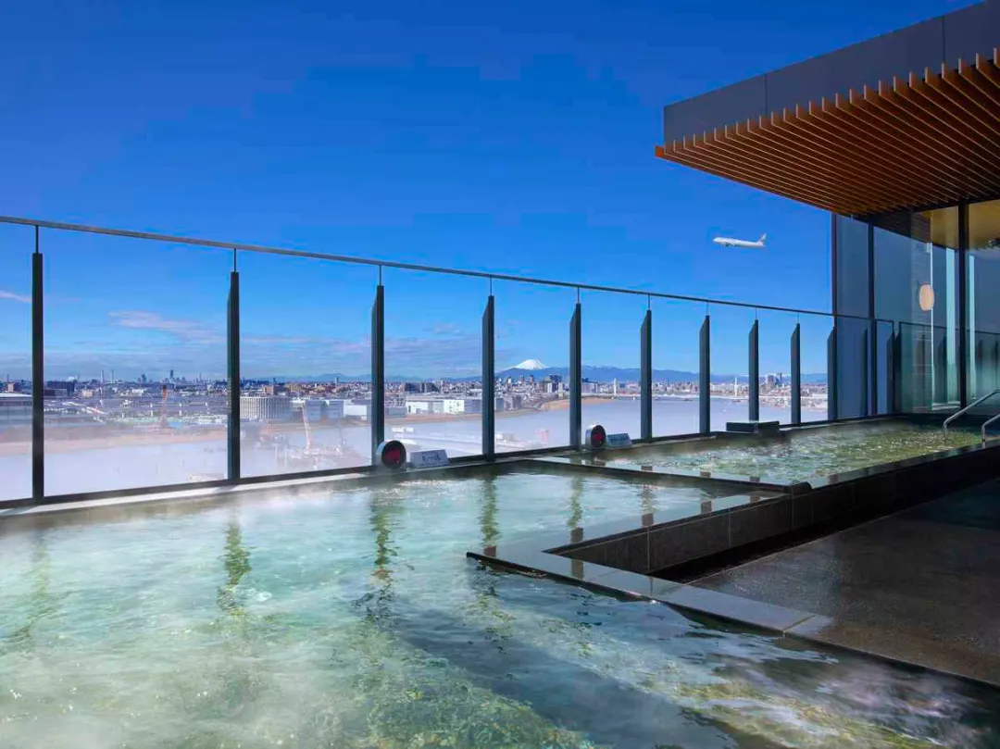

**O Aeroporto de Tóquio-Haneda é o principal portal da região de Kanto, no Japão — não só o hub dos voos diretos entre a China e o Japão, mas o ponto de partida a partir do qual os visitantes conhecem Tóquio e a região de Kanto em geral.**

Como um dos centros de conexão doméstica do país, Haneda liga a agitação da cidade moderna à profundidade da cultura tradicional, e o charme particular do Japão está entrelaçado em tudo isso. Seja começando uma viagem aqui ou apenas passando, as instalações dentro do aeroporto tornam o trajeto mais fácil.

**Hoje, vamos começar pelo carimbo Goshoin de Haneda e apresentar o apelo deste aeroporto cinco estrelas.**

## Goshoin（ごしょういん / goshōin）

Um “goshuin do céu” disponível apenas em aeroportos do Japão. Começou como uma ideia da Japan Airlines para revitalizar cidades regionais e hoje pode ser comprado em 55 aeroportos do país.

- **Preço de referência:** ¥350

Veja os links no fim deste artigo para guias de outros aeroportos.

### Dados do goshoin

- **Aeroporto:** Aeroporto de Tóquio-Haneda
- **Código do aeroporto:** HND
- **Carimbo número um:** marca o Aeroporto de Tóquio-Haneda como o primeiro aeroporto da malha doméstica da JAL.
- **Pistas:** as marcas cinzas abaixo do nome do aeroporto são as pistas que o Aeroporto de Tóquio-Haneda realmente usa.
- **Aeronave vermelha:** o principal modelo da JAL no Aeroporto de Tóquio-Haneda — aqui, o A350-900.
- **O carimbo redondo no centro:** um caractere do nome ou da localização do aeroporto, girado — aqui é o caractere 羽 (ha) deitado de lado.
- **Onde comprar:** T1, JAL PLAZA

## O centro de Tóquio em apenas 15 minutos

O Aeroporto de Tóquio-Haneda é formado por três terminais, com os voos internacionais concentrados no T3. Um ônibus shuttle gratuito, a linha Keikyu e o monotrilho ligam os três terminais. **Várias cidades da China hoje têm voos diretos para Haneda, incluindo Pequim, Tianjin, Qingdao, Dalian, Xangai, Cantão e Shenzhen,** o que torna a viagem entre os dois países muito mais fácil.

Depois de pousar em Haneda, as opções para a cidade são rápidas e variadas. Da estação do T3, o monotrilho rápido chega a Hamamatsucho — perto da Tokyo Tower — em cerca de 15 minutos, onde você pode trocar para a linha JR Yamanote. Na linha Keikyu, Shinagawa leva cerca de 12 minutos, Asakusa cerca de 36 minutos e Yokohama apenas cerca de 25 minutos.

O Aeroporto de Narita fica a cerca de 1 hora e 30 minutos. Há também ônibus rodoviários para Tochigi, Gunma, Shizuoka, Yamanashi, Nagano e Sendai, então tanto o turismo na cidade quanto as viagens mais distantes começam com facilidade.

## O que você precisa comer em Haneda

### Imperdível número um: Ningyocho Imahan

- **Onde:** T3, 4º andar, Edo-koji 15
- **Horário:** almoço 11:00–15:00 (último pedido 14:30); jantar 17:00–22:00 (último pedido 20:30)

Uma tradicional casa de sukiyaki de Ningyocho, no bairro de Nihonbashi, em Tóquio, e sua filial no aeroporto condensa a mesma sofisticação da matriz em uma fachada de estilo Edo. Há várias formas de comer o seu sukiyaki — refeições combinadas, menus degustação, gozen —, cada uma construída em torno de wagyu negro japonês selecionado, de fêmeas: macio, suculento e cheio de sabor. O molho da casa realça o aroma da carne maturada, e o preparo cuidadoso mantém cada pedaço dessa riqueza na carne.

### Imperdível número dois: Uogashi Nihon-Ichi

- **Onde:** T3, 3º andar, depois da área de embarque, 108
- **Horário:** aberto 24 horas

Uma rede de sushi em pé, e sua filial dentro da área de embarque de Haneda mantém a mesma tradição Edomae. A loja seleciona produtos frescos do mercado de Tsukiji e monta cada peça na sua frente; você pode pedir um conjunto ou escolher o seu peixe e contar as peças. Para passageiros prestes a embarcar, ou para quem quer mais um gostinho de sushi de verdade antes de deixar o Japão, é ao mesmo tempo prático e muito bom.

## Lembranças exclusivas de Haneda

### CAFÉ CHOCOLAT WICH

- **Onde:** T3, 4º andar, Edo-koji 28, Edo Shokuhinkan
- **Preço de referência:** ¥1.425 por 6

Este doce exclusivo de Haneda é construído em torno de um aroma profundo de café: chocolate belga fino com um centro de biscoito crocante, para uma mordida em camadas que combina perfeitamente com café. O café é de grãos moídos grossos da Sanbon Coffee, uma torrefadora de Yokohama fundada em 1957 e valorizada pela qualidade, e o doce em si é feito pela La Maison Shirokane, a confeitaria sofisticada que nasceu em Shirokane, em Tóquio. Café, chocolate e biscoito em um só — elegante o bastante para guardar e ideal como presente.

### Caderno “AIRPORT NOTEBOOK” da Ito-ya

- **Onde:** T3, 4º andar, Edo-koji 27
- **Preço de referência:** ¥660 por caderno

A Ito-ya é uma especialista em papelaria fundada em 1904 em Ginza, Tóquio, conhecida por uma linha profunda de produtos originais que faz os amantes de papelaria voltarem sempre. A filial de Haneda carrega o mesmo espírito original, com instrumentos de escrita de qualidade e papelaria japonesa de que os viajantes gostam.

Seu caderno “airport”, cheio de humor, é um atrativo à parte: as capas da frente e de trás formam juntas uma única cena de aeroporto, completa com veículos de serviço e aeronaves esperando para partir, então a vida agitada de um aeroporto fica na sua mão. Abra e pequenas aeronaves aparecem entre as páginas — cheio de pequenas surpresas. Há também designs exclusivos de Haneda, bons como lembrança ou para guardar.

Com tempo antes do voo, vale a pena dar uma olhada.

## No aeroporto e nos arredores

### PLANETARIUM Starry Cafe

- **Endereço:** T3, 5º andar, TOKYO POPTOWN 50
- **Horário:** 09:00–22:30 (último pedido 22:00); planetário a partir das 11:00 (última entrada 21:00)

Como o nome sugere, é um café onde você se senta sob um céu estrelado projetado. O café usa um sistema avançado de projeção híbrida que combina projeção sem emendas para preencher todo o domo, mostrando cerca de 40 milhões de estrelas com uma Via Láctea renderizada em detalhes finos.

Com tempo de sobra antes do voo, que tal uma pequena viagem pelas estrelas?

### Haneda Airport Garden

- **Endereço:** 2-7-1 Haneda Airport, Ota-ku, Tokyo
- **Acesso:** a pé pelo corredor de conexão do segundo andar do T3
- **Site:** [www.shopping-sumitomo-rd.com/haneda/shopping/](http://www.shopping-sumitomo-rd.com/haneda/shopping/)

Inaugurado em 2023 e ligado diretamente ao Terminal 3, este complexo é mais do que compras e restaurantes: também tem um onsen e um hotel.

O Izumi Tenku no Yu Haneda Airport tem uma sensação rara de espaço, com o Monte Fuji visível em dias claros; as instalações incluem banhos ao ar livre masculino e feminino, sauna de pedra e áreas para refeições, o que faz do local um programa ideal para um dia de termas. Mergulhar no banho ao ar livre enquanto aeronaves decolam e pousam é uma experiência à parte.

Na próxima vez que você passar por Haneda, reserve um tempo para aproveitar tudo o que este lugar oferece — e curta um tipo diferente de viagem.

## Guias de outros aeroportos

- [Guia do Aeroporto Internacional de Narita](https://mp.weixin.qq.com/s?__biz=MzA3MjI1NDQxNA==&mid=2652373314&idx=1&sn=2cc9b26e9041d8fba85a695fc9570a82&scene=21#wechat_redirect)
- [Guia do Aeroporto Internacional de Novo Chitose (Hokkaido)](https://mp.weixin.qq.com/s?__biz=MzA3MjI1NDQxNA==&mid=2652374162&idx=1&sn=c685409867a453fc351c35787a205e56&scene=21#wechat_redirect)
- [Guia do Aeroporto Internacional de Fukuoka](https://mp.weixin.qq.com/s?__biz=MzA3MjI1NDQxNA==&mid=2652375055&idx=1&sn=0ab140b1895ababafe7a1e8991341d7a&scene=21#wechat_redirect)
- [Guia do Aeroporto Internacional Chubu Centrair](https://mp.weixin.qq.com/s?__biz=MzA3MjI1NDQxNA==&mid=2652376462&idx=1&sn=b90e4b8fcfc7c0934be09f9f2658c036&scene=21#wechat_redirect)
- [Guia do Aeroporto de Hiroshima](https://mp.weixin.qq.com/s?__biz=MzA3MjI1NDQxNA==&mid=2652377958&idx=1&sn=8957ec2da9779d9a76aa2488b831e08b&scene=21#wechat_redirect)
- [Guia do Aeroporto Internacional de Kansai](https://mp.weixin.qq.com/s?__biz=MzA3MjI1NDQxNA==&mid=2652378218&idx=1&sn=e6b0ad7e1a509efac79fbcc6a99d9913&scene=21#wechat_redirect)
- [Guia do Aeroporto de Naha](https://mp.weixin.qq.com/s?__biz=MzA3MjI1NDQxNA==&mid=2652378849&idx=1&sn=a43e621ae60abc174f72c5808aeccfc1&scene=21#wechat_redirect)

## Fontes das imagens

Algumas imagens vêm dos seguintes sites:

- https://att-japan.net/ja/haneda-tokyo/
- https://ec.jal.co.jp/img//0002/img/pages/soranogoshoin/haneda-2.jpg
- https://restaurant.imahan.com/hanedaairport-3t/
- https://tokyo-haneda.com/
- https://haneda-shopping.jp/shop/g/gZ001088047/
- https://www.threads.net/@yama7260/post/DBIdqyZP61z
- https://co-trip.jp/article/611985
- https://www.ito-ya.co.jp/category/3001/45826215220871.html
- https://thegate12.com/jp/article/750#content-8
- https://www.gotokyo.org/jp/new-and-now/new-and-trending/221205/topics.html
- https://www.sankei.com/article/20221006-7S2A3FJ42FIMPMLBJU5QXCXC6E/photo/XGGOBJJ5F5MBVBLLXJAQNCXTKQ/
- https://www.fashion-press.net/news/56398

## Links relacionados

- **Neste site**: [Aeroporto de Tóquio-Haneda (HND)](/airport/HND), [Japão (JP)](/country/JP)
- **Wikipédia**: [Aeroporto de Tóquio-Haneda](https://en.wikipedia.org/wiki/Tokyo_Haneda_Airport)
- **Baidu Baike**: [Aeroporto de Tóquio-Haneda](https://baike.baidu.com/item/%E7%BE%BD%E7%94%B0%E6%9C%BA%E5%9C%BA)
