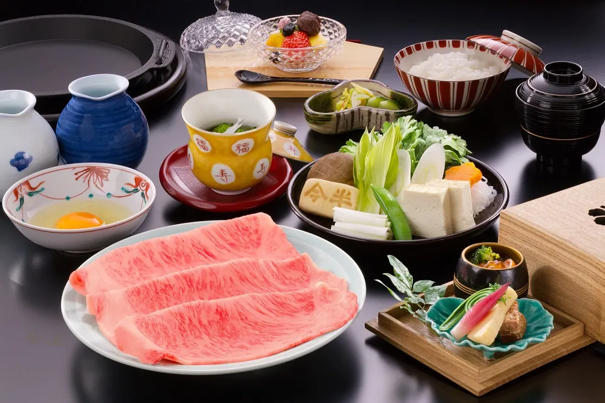
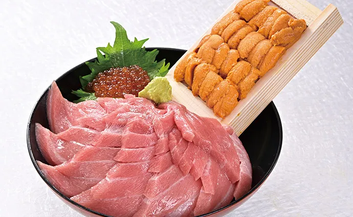
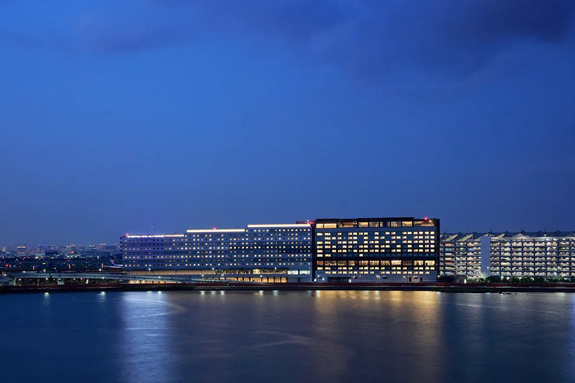

**Международный аэропорт Ханэда — главные воздушные ворота региона Канто в Японии: не только хаб прямых рейсов между Китаем и Японией, но и отправная точка, с которой путешественники знакомятся с Токио и всем регионом Канто.**

Как один из внутренних пересадочных хабов страны, Ханэда соединяет суету современного города с глубиной традиционной культуры, и особое очарование Японии вплетено во всё это. Начинаете ли вы здесь путешествие или проезжаете транзитом, инфраструктура аэропорта делает поездку проще.

**Сегодня начнём с печати госёин Ханэды и проведём вас по очарованию этого пятизвёздочного аэропорта.**

## Госёин（ごしょういん / goshōin）

«Небесный госёин», доступный только в аэропортах Японии. Он начался как идея Japan Airlines по оживлению региональных городов, а теперь его можно купить в 55 аэропортах страны.

- **Ориентировочная цена:** 350 иен

Ссылки на гиды по другим аэропортам — в конце статьи.

### Данные госёина

- **Аэропорт:** международный аэропорт Токио Ханэда
- **Код аэропорта:** HND
- **Номер печати один:** отмечает международный аэропорт Токио Ханэда как первый аэропорт во внутренней сети JAL.
- **Взлётно-посадочные полосы:** серые отметки под названием аэропорта — это полосы, которые международный аэропорт Токио Ханэда действительно использует.
- **Красный самолёт:** основной тип JAL в международном аэропорту Токио Ханэда — здесь A350-900.
- **Круглая печать в центре:** символ из названия или местоположения аэропорта, повёрнутый — здесь это иероглиф 羽 (ха), положенный на бок.
- **Где купить:** T1, JAL PLAZA

## Центр Токио всего за 15 минут

Международный аэропорт Ханэда состоит из трёх терминалов, международные рейсы сосредоточены в T3. Бесплатный шаттл, линия Keikyu и монорельс соединяют все три терминала. **В нескольких городах Китая теперь есть прямые рейсы в Ханэду, включая Пекин, Тяньцзинь, Циндао, Далянь, Шанхай, Гуанчжоу и Шэньчжэнь,** что делает поездки между двумя странами гораздо проще.

После посадки в Ханэде вариантов добраться до города много, и они быстрые. Со станции T3 скоростной монорельс доходит до Хамамацутё — рядом с Токийской башней — примерно за 15 минут, там можно пересесть на линию JR Yamanote. По линии Keikyu до Синагавы около 12 минут, до Асакусы около 36 минут, а до Йокогамы всего около 25 минут.

Аэропорт Нарита находится примерно в 1 часе 30 минутах. Есть также автобусы по скоростным дорогам до Тотиги, Гуммы, Сидзуоки, Яманаси, Нагано и Сэндая, так что и осмотр города, и поездки дальше начинаются легко.

## Что обязательно попробовать в Ханэде

### Обязательно попробовать номер один: Ningyocho Imahan

- **Где:** T3, 4-й этаж, Edo-koji 15
- **Часы:** обед 11:00–15:00 (последний заказ 14:30); ужин 17:00–22:00 (последний заказ 20:30)

Давний дом сукияки из Нингётё в токийском Нихонбаси; его отделение в аэропорту облекает фасад в стиле Эдо в ту же утончённость, что и оригинал. Сукияки здесь можно попробовать несколькими способами — сеты, курсы, гозэн, — и каждый построен вокруг отборной японской чёрной вагю от коров: нежной, сочной и ароматной. Фирменный соус подчёркивает аромат выдержанной говядины, а тщательное приготовление сохраняет всю её насыщенность в мясе.

### Обязательно попробовать номер два: Uogashi Nihon-Ichi

- **Где:** T3, 3-й этаж, после зоны вылета, 108
- **Часы:** открыто круглосуточно

Сеть стоячих суши, и её отделение в зоне вылета Ханэды хранит ту же традицию эдомаэ. Магазин выбирает свежие продукты на рынке Цукидзи и формирует каждый кусочек при вас; можно заказать сет или выбрать рыбу самому и считать. Для пассажиров, которые вот-вот улетают, или для тех, кто хочет ещё раз попробовать настоящие суши перед отъездом из Японии, это и удобно, и очень вкусно.

## Сувениры только из Ханэды

### CAFÉ CHOCOLAT WICH

- **Где:** T3, 4-й этаж, Edo-koji 28, Edo Shokuhinkan
- **Ориентировочная цена:** 1425 иен за 6 штук

Эта сладость, продающаяся только в Ханэде, построена вокруг глубокого кофейного аромата: тонкий бельгийский шоколад с хрустящей бисквитной серединкой даёт многослойный вкус, идеально подходящий к кофе. Кофе — крупно молотые зёрна Sanbon Coffee, йокогамского обжарщика, основанного в 1957 году и ценимого за качество, а само кондитерское изделие делает La Maison Shirokane — премиальная кондитерская, начавшая в токийском Сироканэ. Кофе, шоколад и бисквит в одном — достаточно изящно, чтобы оставить себе, и идеально в качестве подарка.

### Блокнот Ito-ya «AIRPORT NOTEBOOK»

- **Где:** T3, 4-й этаж, Edo-koji 27
- **Ориентировочная цена:** 660 иен за блокнот

Ito-ya — специалист по канцелярии, основанный в 1904 году в токийской Гиндзе и известный глубоким ассортиментом оригинальных товаров, который заставляет любителей канцелярии возвращаться снова. Отделение в Ханэде хранит тот же оригинальный дух: качественные письменные принадлежности и японская канцелярия, которые нравятся путешественникам.

Его игривый «аэропортовый» блокнот особенно притягивает: передняя и задняя обложки вместе образуют единую сцену аэропорта с служебными машинами и самолётами, ждущими вылета, так что кипучая жизнь аэропорта оказывается у вас в руках. Откройте — и между страницами появятся маленькие самолёты: полно маленьких сюрпризов. Здесь есть и дизайны только для Ханэды — хороши как сувениры или для себя.

Если до рейса есть время, стоит заглянуть.

## В аэропорту и рядом

### PLANETARIUM Starry Cafe

- **Адрес:** T3, 5-й этаж, TOKYO POPTOWN 50
- **Часы:** 09:00–22:30 (последний заказ 22:00); планетарий с 11:00 (последний вход 21:00)

Как следует из названия, это кафе, где вы сидите под проецируемым звёздным небом. Используется современная гибридная проекционная система, сочетающая бесшовную проекцию на весь купол и показывающая около 40 миллионов звёзд с детально проработанным Млечным Путём.

Если до рейса есть время, почему бы не совершить короткое путешествие к звёздам?

### Haneda Airport Garden

- **Адрес:** 2-7-1 Haneda Airport, Ota-ku, Tokyo
- **Как добраться:** пешком из соединительного коридора T3 на втором этаже
- **Сайт:** [www.shopping-sumitomo-rd.com/haneda/shopping/](http://www.shopping-sumitomo-rd.com/haneda/shopping/)

Открытый в 2023 году и напрямую соединённый с терминалом 3, этот комплекс предназначен не только для покупок и еды: здесь также есть онсэн и отель.

Izumi Tenku no Yu Haneda Airport обладает редким чувством пространства: в ясные дни видна гора Фудзи; в числе удобств — мужские и женские открытые ванны, каменная сауна и обеденные зоны, что делает его идеальным днём в горячих источниках. Погрузиться в открытую ванну, пока самолёты взлетают и садятся, — отдельное переживание.

В следующий раз, проезжая через Ханэду, оставьте себе время, чтобы впитать всё, что предлагает это место, — и насладиться другим путешествием.

## Гиды по другим аэропортам

- [Гид по международному аэропорту Нарита](https://mp.weixin.qq.com/s?__biz=MzA3MjI1NDQxNA==&mid=2652373314&idx=1&sn=2cc9b26e9041d8fba85a695fc9570a82&scene=21#wechat_redirect)
- [Гид по международному аэропорту Новый Титосэ (Хоккайдо)](https://mp.weixin.qq.com/s?__biz=MzA3MjI1NDQxNA==&mid=2652374162&idx=1&sn=c685409867a453fc351c35787a205e56&scene=21#wechat_redirect)
- [Гид по международному аэропорту Фукуока](https://mp.weixin.qq.com/s?__biz=MzA3MjI1NDQxNA==&mid=2652375055&idx=1&sn=0ab140b1895ababafe7a1e8991341d7a&scene=21#wechat_redirect)
- [Гид по международному аэропорту Тюбу Сэнтрайр](https://mp.weixin.qq.com/s?__biz=MzA3MjI1NDQxNA==&mid=2652376462&idx=1&sn=b90e4b8fcfc7c0934be09f9f2658c036&scene=21#wechat_redirect)
- [Гид по аэропорту Хиросима](https://mp.weixin.qq.com/s?__biz=MzA3MjI1NDQxNA==&mid=2652377958&idx=1&sn=8957ec2da9779d9a76aa2488b831e08b&scene=21#wechat_redirect)
- [Гид по международному аэропорту Кансай](https://mp.weixin.qq.com/s?__biz=MzA3MjI1NDQxNA==&mid=2652378218&idx=1&sn=e6b0ad7e1a509efac79fbcc6a99d9913&scene=21#wechat_redirect)
- [Гид по аэропорту Наха](https://mp.weixin.qq.com/s?__biz=MzA3MjI1NDQxNA==&mid=2652378849&idx=1&sn=a43e621ae60abc174f72c5808aeccfc1&scene=21#wechat_redirect)

## Источники изображений

Некоторые изображения взяты со следующих сайтов:

- https://att-japan.net/ja/haneda-tokyo/
- https://ec.jal.co.jp/img//0002/img/pages/soranogoshoin/haneda-2.jpg
- https://restaurant.imahan.com/hanedaairport-3t/
- https://tokyo-haneda.com/
- https://haneda-shopping.jp/shop/g/gZ001088047/
- https://www.threads.net/@yama7260/post/DBIdqyZP61z
- https://co-trip.jp/article/611985
- https://www.ito-ya.co.jp/category/3001/45826215220871.html
- https://thegate12.com/jp/article/750#content-8
- https://www.gotokyo.org/jp/new-and-now/new-and-trending/221205/topics.html
- https://www.sankei.com/article/20221006-7S2A3FJ42FIMPMLBJU5QXCXC6E/photo/XGGOBJJ5F5MBVBLLXJAQNCXTKQ/
- https://www.fashion-press.net/news/56398

## Полезные ссылки

- **На этом сайте**: [Аэропорт Токио Ханэда (HND)](/airport/HND), [Япония (JP)](/country/JP)
- **Википедия**: [Аэропорт Токио Ханэда](https://en.wikipedia.org/wiki/Tokyo_Haneda_Airport)
- **Baidu Baike**: [Аэропорт Токио Ханэда](https://baike.baidu.com/item/%E7%BE%BD%E7%94%B0%E6%9C%BA%E5%9C%BA)
