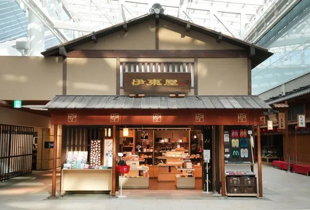

**Uwanja wa Ndege wa Kimataifa wa Haneda ndio lango kuu la eneo la Kanto nchini Japani — si tu kitovu cha safari za moja kwa moja kati ya China na Japani, bali pia mahali pa kuanzia ambapo wageni huijua Tokyo na eneo pana la Kanto.**

Kama mojawapo ya vitovu vya kuunganisha safari za ndani nchini, Haneda huunganisha shughuli nyingi za mji wa kisasa na kina cha utamaduni wa jadi, na haiba maalum ya Japani imesukwa katika yote. Iwe unaanza safari hapa au unapita tu, vifaa vilivyo ndani ya uwanja wa ndege hurahisisha safari.

**Leo, tuanze na muhuri wa Goshoin wa Haneda na tukupeleke katika mvuto wa uwanja huu wa ndege wa nyota tano.**

## Goshoin（ごしょういん / goshōin）

"goshuin ya anga" inayopatikana tu katika viwanja vya ndege kote Japani. Ilianza kama wazo la Japan Airlines la kuhuisha miji ya kanda, na sasa inaweza kununuliwa katika viwanja 55 vya ndege nchini kote.

- **Bei ya kumbukumbu:** ¥350

Angalia viungo mwishoni mwa makala hii kwa miongozo ya viwanja vingine vya ndege.

### Taarifa za Goshoin

- **Uwanja wa ndege:** Uwanja wa Ndege wa Kimataifa wa Haneda Tokyo
- **Msimbo wa uwanja wa ndege:** HND
- **Namba ya muhuri ya kwanza:** inaonyesha Uwanja wa Ndege wa Kimataifa wa Haneda Tokyo kama uwanja wa kwanza kwenye mtandao wa safari za ndani wa JAL.
- **Njia za kuruka na kutua:** alama za kijivu chini ya jina la uwanja wa ndege ni njia za kuruka na kutua ambazo Uwanja wa Ndege wa Kimataifa wa Haneda Tokyo hutumia kwa hakika.
- **Ndege nyekundu:** aina kuu ya ndege ya JAL katika Uwanja wa Ndege wa Kimataifa wa Haneda Tokyo — hapa, A350-900.
- **Muhuri wa mviringo katikati:** herufi kutoka jina au eneo la uwanja wa ndege, iliyozungushwa — hapa ni herufi 羽 (ha) iliyolazwa ubavu.
- **Mahali pa kuinunua:** T1, JAL PLAZA

## Katikati ya Tokyo kwa dakika 15 pekee

Uwanja wa Ndege wa Kimataifa wa Haneda una terminali tatu, na safari za kimataifa zimejikita T3. Basi la bure la kuhamisha abiria, reli ya Keikyu na reli ya njia moja huunganisha terminali zote tatu. **Miji kadhaa nchini China sasa ina safari za moja kwa moja kuelekea Haneda, ikiwa ni pamoja na Beijing, Tianjin, Qingdao, Dalian, Shanghai, Guangzhou na Shenzhen,** jambo linalorahisisha sana kusafiri kati ya nchi mbili.

Ukishatua Haneda, chaguo za kuingia mjini ni za haraka na mbalimbali. Kutoka kituo cha T3, reli ya njia moja ya haraka hufika Hamamatsucho — karibu na Tokyo Tower — kwa takriban dakika 15, ambako unaweza kubadilisha kwenda reli ya JR Yamanote. Kwenye reli ya Keikyu, Shinagawa huchukua takriban dakika 12, Asakusa takriban dakika 36, na Yokohama karibu dakika 25 pekee.

Uwanja wa Ndege wa Narita uko umbali wa takriban saa 1 na dakika 30. Pia kuna mabasi ya barabara kuu kuelekea Tochigi, Gunma, Shizuoka, Yamanashi, Nagano na Sendai, kwa hiyo kutalii mjini na kusafiri mbali zaidi zote huanza kwa urahisi.

## Vyakula usivyokosa Haneda

### Mlo wa kwanza usiokosa: Ningyocho Imahan

- **Mahali:** T3, ghorofa ya 4, Edo-koji 15
- **Saa:** chakula cha mchana 11:00–15:00 (oda ya mwisho 14:30); chakula cha jioni 17:00–22:00 (oda ya mwisho 20:30)

Mgahawa wa sukiyaki wa muda mrefu kutoka Ningyocho, Nihonbashi jijini Tokyo, tawi lake la uwanja wa ndege lina uso wa mbele wa mtindo wa Edo unaozunguka ubora na umaridadi uleule wa mgahawa wa awali. Kuna njia kadhaa za kula sukiyaki yako — milo iliyowekwa, kozi, gozen — kila moja ikiwa imejengwa kuzunguka wagyu nyeusi ya Japani iliyochaguliwa kutoka kwa ng'ombe wa kike: laini, yenye maji na ladha tele. Mchuzi wa mgahawa huinua harufu ya nyama iliyoiva, na upishi wa uangalifu huhifadhi kila sehemu ya utajiri huo ndani ya nyama.

### Mlo wa pili usiokosa: Uogashi Nihon-Ichi

- **Mahali:** T3, ghorofa ya 3, baada ya eneo la kuondoka, 108
- **Saa:** wazi saa 24

Mnyororo wa mikahawa ya sushi ya kusimama, na tawi lake ndani ya eneo la kuondoka la Haneda linahifadhi utamaduni uleule wa Edomae. Duka huchagua mazao mapya kutoka soko la Tsukiji na kuunda kila kipande mbele yako; unaweza kuagiza seti au kuchagua samaki wako mwenyewe na kuhesabu. Kwa abiria wanaokaribia kuruka, au yeyote anayetaka ladha moja zaidi ya sushi halisi kabla ya kuondoka Japani, ni rahisi kufikia na ni kitamu sana.

## Vitu vya ukumbusho vinavyopatikana Haneda pekee

### CAFÉ CHOCOLAT WICH

- **Mahali:** T3, ghorofa ya 4, Edo-koji 28, Edo Shokuhinkan
- **Bei ya kumbukumbu:** ¥1,425 kwa 6

Peremende hii ya kipekee ya Haneda imejengwa kuzunguka harufu kubwa ya kahawa: chokoleti laini ya Ubelgiji yenye kitovu cha biskuti kilichokolea, kwa mlo wa tabaka unaoendana kikamilifu na kahawa. Kahawa ni chembe zilizosagwa kwa ukubwa kutoka Sanbon Coffee, kiwanda cha kuchoma kahawa cha Yokohama kilichoanzishwa mwaka 1957 na kinachothaminiwa kwa ubora wake, na peremende yenyewe inatengenezwa na La Maison Shirokane, duka la keki la hali ya juu lililoanza Shirokane, Tokyo. Kahawa, chokoleti na biskuti kwa pamoja — yenye umaridadi wa kutosha kuihifadhi na bora kama zawadi.

### Ito-ya "AIRPORT NOTEBOOK"

- **Mahali:** T3, ghorofa ya 4, Edo-koji 27
- **Bei ya kumbukumbu:** ¥660 kwa daftari

Ito-ya ni mtaalamu wa vifaa vya kuandikia aliyeanzishwa mwaka 1904 huko Ginza, Tokyo, anayejulikana kwa mfululizo mpana wa bidhaa asili unaowafanya wapenda vifaa vya kuandikia kurudi tena. Tawi la Haneda lina roho hiyo hiyo ya ubunifu, likiwa na vifaa bora vya kuandikia na vifaa vya kuandikia vya Kijapani vinavyopendwa na wasafiri.

Daftari lake la kuchekesha la "uwanja wa ndege" ni kivutio hasa: okava za mbele na za nyuma kwa pamoja huunda eneo moja la uwanja wa ndege, likiwa na magari ya huduma na ndege zinazosubiri kuondoka, kwa hiyo maisha yenye shughuli nyingi ya uwanja wa ndege yako mkononi mwako. Uifungue na ndege ndogo zinaonekana kati ya kurasa — zimejaa mshangao mdogo mdogo. Pia kuna miundo ya Haneda pekee hapa, nzuri kama vitu vya ukumbusho au vya kuhifadhi.

Ukiwa na muda kabla ya ndege yako, inafaa kuiangalia.

## Ndani ya uwanja wa ndege na karibu

### PLANETARIUM Starry Cafe

- **Anwani:** T3, ghorofa ya 5, TOKYO POPTOWN 50
- **Saa:** 09:00–22:30 (oda ya mwisho 22:00); jumba la sayari kuanzia 11:00 (kuingia kwa mwisho 21:00)

Kama jina linavyodokeza, hii ni mkahawa unaoketi chini ya anga la nyota linaloonyeshwa kwa projekta. Hutumia mfumo wa kisasa wa mseto wa projekta unaounganisha picha bila mshono ili kujaza kuba lote, ukionyesha nyota takriban milioni 40 na Njia Nyeupe iliyoonyeshwa kwa undani mzuri.

Ukiwa na muda wa ziada kabla ya ndege yako, kwa nini usifanye safari fupi kati ya nyota?

### Haneda Airport Garden

- **Anwani:** Uwanja wa Ndege wa Haneda 2-7-1, Ota-ku, Tokyo
- **Ufikiaji:** kwa miguu kutoka ukanda wa kuunganisha wa ghorofa ya pili wa T3
- **Tovuti:** [www.shopping-sumitomo-rd.com/haneda/shopping/](http://www.shopping-sumitomo-rd.com/haneda/shopping/)

Ilifunguliwa mwaka 2023 na imeunganishwa moja kwa moja na Terminali 3; jengo hili si la ununuzi na kula tu: pia lina onsen na hoteli.

Izumi Tenku no Yu Haneda Airport ina hisia adimu ya uwazi, na Mlima Fuji unaonekana siku za uwazi; vifaa vyake ni pamoja na bafu za nje za wanaume na wanawake, sauna ya mwamba na maeneo ya kula, na kuifanya siku bora kwenye chemchemi za maji ya moto. Kujilowesha kwenye bafu la nje wakati ndege zinapaa na kutua ni uzoefu wa pekee.

Wakati mwingine utakapopita Haneda, jitengee muda wa kufurahia kila kitu mahali hapa kinachotoa — na ufurahie safari ya aina tofauti.

## Miongozo ya viwanja vingine vya ndege

- [Mwongozo wa Uwanja wa Ndege wa Kimataifa wa Narita](https://mp.weixin.qq.com/s?__biz=MzA3MjI1NDQxNA==&mid=2652373314&idx=1&sn=2cc9b26e9041d8fba85a695fc9570a82&scene=21#wechat_redirect)
- [Mwongozo wa Uwanja wa Ndege wa Kimataifa wa New Chitose (Hokkaido)](https://mp.weixin.qq.com/s?__biz=MzA3MjI1NDQxNA==&mid=2652374162&idx=1&sn=c685409867a453fc351c35787a205e56&scene=21#wechat_redirect)
- [Mwongozo wa Uwanja wa Ndege wa Kimataifa wa Fukuoka](https://mp.weixin.qq.com/s?__biz=MzA3MjI1NDQxNA==&mid=2652375055&idx=1&sn=0ab140b1895ababafe7a1e8991341d7a&scene=21#wechat_redirect)
- [Mwongozo wa Uwanja wa Ndege wa Kimataifa wa Chubu Centrair](https://mp.weixin.qq.com/s?__biz=MzA3MjI1NDQxNA==&mid=2652376462&idx=1&sn=b90e4b8fcfc7c0934be09f9f2658c036&scene=21#wechat_redirect)
- [Mwongozo wa Uwanja wa Ndege wa Hiroshima](https://mp.weixin.qq.com/s?__biz=MzA3MjI1NDQxNA==&mid=2652377958&idx=1&sn=8957ec2da9779d9a76aa2488b831e08b&scene=21#wechat_redirect)
- [Mwongozo wa Uwanja wa Ndege wa Kimataifa wa Kansai](https://mp.weixin.qq.com/s?__biz=MzA3MjI1NDQxNA==&mid=2652378218&idx=1&sn=e6b0ad7e1a509efac79fbcc6a99d9913&scene=21#wechat_redirect)
- [Mwongozo wa Uwanja wa Ndege wa Naha](https://mp.weixin.qq.com/s?__biz=MzA3MjI1NDQxNA==&mid=2652378849&idx=1&sn=a43e621ae60abc174f72c5808aeccfc1&scene=21#wechat_redirect)

## Vyanzo vya picha

Baadhi ya picha zinatoka kwenye tovuti zifuatazo:

- https://att-japan.net/ja/haneda-tokyo/
- https://ec.jal.co.jp/img//0002/img/pages/soranogoshoin/haneda-2.jpg
- https://restaurant.imahan.com/hanedaairport-3t/
- https://tokyo-haneda.com/
- https://haneda-shopping.jp/shop/g/gZ001088047/
- https://www.threads.net/@yama7260/post/DBIdqyZP61z
- https://co-trip.jp/article/611985
- https://www.ito-ya.co.jp/category/3001/45826215220871.html
- https://thegate12.com/jp/article/750#content-8
- https://www.gotokyo.org/jp/new-and-now/new-and-trending/221205/topics.html
- https://www.sankei.com/article/20221006-7S2A3FJ42FIMPMLBJU5QXCXC6E/photo/XGGOBJJ5F5MBVBLLXJAQNCXTKQ/
- https://www.fashion-press.net/news/56398

## Viungo vinavyohusiana

- **Kwenye tovuti hii**: [Uwanja wa Ndege wa Haneda Tokyo (HND)](/airport/HND), [Japani (JP)](/country/JP)
- **Wikipedia**: [Uwanja wa Ndege wa Haneda Tokyo](https://en.wikipedia.org/wiki/Tokyo_Haneda_Airport)
- **Baidu Baike**: [Uwanja wa Ndege wa Haneda Tokyo](https://baike.baidu.com/item/%E7%BE%BD%E7%94%B0%E6%9C%BA%E5%9C%BA)
