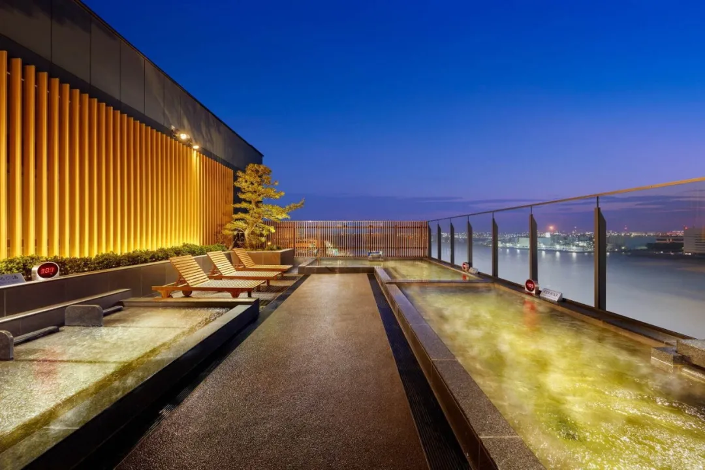

**ท่าอากาศยานนานาชาติฮาเนดะเป็นประตูหลักสู่ภูมิภาคคันโตของญี่ปุ่น — ไม่เพียงเป็นศูนย์กลางเที่ยวบินตรงระหว่างจีนกับญี่ปุ่น แต่ยังเป็นจุดเริ่มต้นที่ผู้มาเยือนใช้ทำความรู้จักโตเกียวและพื้นที่คันโตที่กว้างขึ้น**

ในฐานะหนึ่งในศูนย์กลางการเปลี่ยนเครื่องภายในประเทศของญี่ปุ่น ฮาเนดะเชื่อมความคึกคักของเมืองสมัยใหม่เข้ากับความลึกของวัฒนธรรมดั้งเดิม และเสน่ห์เฉพาะตัวของญี่ปุ่นก็ถักทออยู่ตลอดทั้งนั้น ไม่ว่าคุณจะเริ่มต้นการเดินทางที่นี่หรือเพียงผ่านทาง สิ่งอำนวยความสะดวกภายในสนามบินก็ทำให้การเดินทางง่ายขึ้น

**วันนี้ เริ่มจากตราโกโชอินของฮาเนดะ แล้วพาคุณไปรู้จักเสน่ห์ของสนามบินห้าดาวแห่งนี้**

## โกโชอิน（ごしょういん / goshōin）

"โกโชอินบนฟ้า" ที่หาได้เฉพาะสนามบินทั่วญี่ปุ่น เริ่มจากแนวคิดของ Japan Airlines เพื่อฟื้นฟูเมืองในภูมิภาค และปัจจุบันซื้อได้ที่สนามบิน 55 แห่งทั่วประเทศ

- **ราคาอ้างอิง:** ¥350

ดูคู่มือสนามบินอื่น ๆ ได้จากลิงก์ท้ายบทความนี้

### ข้อมูลตราโกโชอิน

- **สนามบิน:** ท่าอากาศยานนานาชาติโตเกียวฮาเนดะ
- **รหัสสนามบิน:** HND
- **ตราหมายเลขหนึ่ง:** ระบุว่าท่าอากาศยานนานาชาติโตเกียวฮาเนดะเป็นสนามบินแห่งแรกในเครือข่ายภายในประเทศของ JAL
- **รันเวย์:** เครื่องหมายสีเทาใต้ชื่อสนามบินคือรันเวย์ที่ท่าอากาศยานนานาชาติโตเกียวฮาเนดะใช้งานจริง
- **เครื่องบินสีแดง:** เครื่องบินหลักของ JAL ที่ท่าอากาศยานนานาชาติโตเกียวฮาเนดะ — ในที่นี้คือ A350-900
- **ตรากลมกลางภาพ:** ตัวอักษรจากชื่อหรือที่ตั้งของสนามบินที่หมุนแล้ว — ในที่นี้คือตัวอักษร 羽 (ha) ที่พลิกตะแคง
- **จุดจำหน่าย:** T1, JAL PLAZA

## ใจกลางโตเกียวในเวลาเพียง 15 นาที

ท่าอากาศยานนานาชาติฮาเนดะประกอบด้วยอาคารผู้โดยสารสามหลัง โดยเที่ยวบินระหว่างประเทศกระจุกตัวที่ T3 รถบัสรับส่งฟรี รถไฟสาย Keikyu และรถไฟโมโนเรลเชื่อมอาคารทั้งสาม **หลายเมืองในจีนมีเที่ยวบินตรงไปฮาเนดะแล้ว รวมถึงปักกิ่ง เทียนจิน ชิงเต่า ต้าเหลียน เซี่ยงไฮ้ กว่างโจว และเสินเจิ้น** ซึ่งทำให้การเดินทางระหว่างสองประเทศง่ายขึ้นมาก

เมื่อลงจอดที่ฮาเนดะ ทางเลือกเข้าเมืองมีทั้งเร็วและหลากหลาย จากสถานี T3 รถไฟโมโนเรลด่วนถึง Hamamatsucho — ใกล้โตเกียวทาวเวอร์ — ในเวลาประมาณ 15 นาที ซึ่งเปลี่ยนต่อรถไฟ JR สาย Yamanote ได้ ส่วนรถไฟ Keikyu ถึงชินางาวะในประมาณ 12 นาที ถึงอาซากุสะประมาณ 36 นาที และถึงโยโกฮาม่าเพียงประมาณ 25 นาที

สนามบินนาริตะอยู่ห่างประมาณ 1 ชั่วโมง 30 นาที นอกจากนี้ยังมีรถบัสทางหลวงไปยังโทจิงิ กุนมะ ชิซุโอกะ ยามานาชิ นางาโนะ และเซ็นได การท่องเที่ยวในเมืองและการเดินทางไกลจึงเริ่มได้ง่ายทั้งคู่

## สิ่งที่ต้องกินที่ฮาเนดะ

### ของต้องกินอันดับหนึ่ง: Ningyocho Imahan

- **ที่ตั้ง:** T3 ชั้น 4 Edo-koji 15
- **เวลาเปิด:** มื้อกลางวัน 11:00–15:00 (สั่งสุดท้าย 14:30); มื้อเย็น 17:00–22:00 (สั่งสุดท้าย 20:30)

ร้านสุกียากี้เก่าแก่จากย่าน Ningyocho ในนิฮงบาชิ โตเกียว สาขาที่สนามบินห่อหน้าร้านสไตล์เอโดะไว้รอบความประณีตแบบเดียวกับร้านเดิม มีหลายวิธีรับประทานสุกียากี้ — เซ็ตอาหาร คอร์ส หรือโกเซ็น — แต่ละแบบสร้างจากเนื้อวัวดำญี่ปุ่นคัดสรรจากโคเพศเมีย: นุ่ม ชุ่มฉ่ำ และเต็มรสชาติ ซอสของร้านยกกลิ่นเนื้อแก่ และการปรุงอย่างพิถีพิถันเก็บความเข้มข้นนั้นไว้ในเนื้อทุกคำ

### ของต้องกินอันดับสอง: Uogashi Nihon-Ichi

- **ที่ตั้ง:** T3 ชั้น 3 หลังพื้นที่ขาออก 108
- **เวลาเปิด:** เปิด 24 ชั่วโมง

เชนซูชิแบบยืนกิน และสาขาภายในพื้นที่ขาออกของฮาเนดะยังรักษาประเพณีเอโดมาเอะไว้เหมือนเดิม ร้านคัดวัตถุดิบสดจากตลาดสึกิจิและปั้นแต่ละคำต่อหน้าคุณ สั่งเป็นเซ็ตหรือเลือกปลาเองแล้วนับจำนวนก็ได้ สำหรับผู้โดยสารที่กำลังจะบินออกหรือใครก็ตามที่อยากลิ้มซูชิแท้ ๆ อีกครั้งก่อนออกจากญี่ปุ่น ที่นี่ทั้งสะดวกและอร่อยมาก

## ของที่ระลึกที่มีเฉพาะฮาเนดะ

### CAFÉ CHOCOLAT WICH

- **ที่ตั้ง:** T3 ชั้น 4 Edo-koji 28 Edo Shokuhinkan
- **ราคาอ้างอิง:** ¥1,425 สำหรับ 6 ชิ้น

ขนมหวานเฉพาะฮาเนดะนี้สร้างรอบกลิ่นกาแฟเข้ม: ช็อกโกแลตเบลเยียมเนื้อดีห่อใจกลางบิสกิตกรุบกรอบ ให้รสสัมผัสหลายชั้นที่เข้ากับกาแฟอย่างสมบูรณ์แบบ กาแฟเป็นเมล็ดบดหยาบจาก Sanbon Coffee โรงคั่วในโยโกฮาม่าที่ก่อตั้งปี 1957 และเป็นที่ยกย่องเรื่องคุณภาพ ส่วนตัวขนมผลิตโดย La Maison Shirokane เพสทรีระดับสูงที่เริ่มจากย่านชิโรคาเนะในโตเกียว กาแฟ ช็อกโกแลต และบิสกิตในชิ้นเดียว — หรูหราพอจะเก็บไว้และเหมาะเป็นของขวัญ

### สมุด "AIRPORT NOTEBOOK" ของ Ito-ya

- **ที่ตั้ง:** T3 ชั้น 4 Edo-koji 27
- **ราคาอ้างอิง:** ¥660 ต่อเล่ม

Ito-ya เป็นร้านเครื่องเขียนเฉพาะทางที่ก่อตั้งปี 1904 ในย่านกินซะ โตเกียว ขึ้นชื่อเรื่องผลิตภัณฑ์ออริจินัลหลากหลายที่ทำให้คนรักเครื่องเขียนกลับมาอีกครั้ง สาขาฮาเนดะคงจิตวิญญาณออริจินัลเดียวกัน ด้วยเครื่องเขียนคุณภาพและเครื่องเขียนญี่ปุ่นที่นักเดินทางชื่นชอบ

สมุด "airport" สนุก ๆ ของร้านเป็นจุดดึงดูดพิเศษ: ปกหน้าและปกหลังรวมกันเป็นภาพสนามบินเดียวที่สมบูรณ์ พร้อมรถบริการและเครื่องบินที่รอออกเดินทาง ชีวิตที่วุ่นวายของสนามบินจึงอยู่ในมือคุณ เปิดออกแล้วเครื่องบินลำเล็กจะปรากฏระหว่างหน้า — เต็มไปด้วยความประหลาดใจเล็ก ๆ ที่นี่ยังมีดีไซน์เฉพาะฮาเนดะ เหมาะเป็นของที่ระลึกหรือเก็บไว้เอง

หากมีเวลาก่อนเที่ยวบิน คุ้มค่าแก่การแวะชม

## ที่สนามบินและใกล้เคียง

### PLANETARIUM Starry Cafe

- **ที่อยู่:** T3 ชั้น 5 TOKYO POPTOWN 50
- **เวลาเปิด:** 09:00–22:30 (สั่งสุดท้าย 22:00); ท้องฟ้าจำลองเริ่ม 11:00 (เข้าครั้งสุดท้าย 21:00)

ตามชื่อร้าน นี่คือคาเฟ่ที่คุณนั่งใต้ท้องฟ้าจำลองที่ฉายดาว ใช้ระบบฉายภาพไฮบริดขั้นสูงที่รวมการฉายแบบไร้รอยต่อเต็มโดม แสดงดาวประมาณ 40 ล้านดวงพร้อมทางช้างเผือกที่ถ่ายทอดอย่างละเอียด

หากมีเวลาเหลือก่อนเที่ยวบิน ทำไมไม่ลองเดินทางสั้น ๆ ผ่านดวงดาวดูล่ะ?

### Haneda Airport Garden

- **ที่อยู่:** 2-7-1 Haneda Airport, Ota-ku, Tokyo
- **การเข้าถึง:** เดินจากทางเชื่อมชั้นสองของ T3
- **เว็บไซต์:** [www.shopping-sumitomo-rd.com/haneda/shopping/](http://www.shopping-sumitomo-rd.com/haneda/shopping/)

เปิดในปี 2023 และเชื่อมต่อโดยตรงกับอาคารผู้โดยสาร 3 คอมเพล็กซ์นี้ไม่ได้มีเพียงช้อปปิ้งและร้านอาหาร: ยังมีออนเซ็นและโรงแรมด้วย

Izumi Tenku no Yu Haneda Airport มีความรู้สึกกว้างขวางหายาก โดยมองเห็นภูเขาฟูจิในวันที่ฟ้าใส สิ่งอำนวยความสะดวกมีบ่อน้ำพุร้อนกลางแจ้งชายและหญิง ซาวน่าหิน และพื้นที่รับประทานอาหาร ทำให้เป็นวันที่เหมาะกับการแช่น้ำพุร้อน การแช่บ่อกลางแจ้งขณะเครื่องบินขึ้นและลงเป็นประสบการณ์เฉพาะตัว

ครั้งต่อไปที่คุณผ่านฮาเนดะ ให้เหลือเวลาไว้สัมผัสทุกสิ่งที่นี่มอบให้ — และสนุกกับการเดินทางในอีกรูปแบบหนึ่ง

## คู่มือสนามบินอื่น ๆ

- [คู่มือท่าอากาศยานนานาชาตินาริตะ](https://mp.weixin.qq.com/s?__biz=MzA3MjI1NDQxNA==&mid=2652373314&idx=1&sn=2cc9b26e9041d8fba85a695fc9570a82&scene=21#wechat_redirect)
- [คู่มือท่าอากาศยานนานาชาติชินชิโตเสะ (ฮอกไกโด)](https://mp.weixin.qq.com/s?__biz=MzA3MjI1NDQxNA==&mid=2652374162&idx=1&sn=c685409867a453fc351c35787a205e56&scene=21#wechat_redirect)
- [คู่มือท่าอากาศยานนานาชาติฟุกุโอกะ](https://mp.weixin.qq.com/s?__biz=MzA3MjI1NDQxNA==&mid=2652375055&idx=1&sn=0ab140b1895ababafe7a1e8991341d7a&scene=21#wechat_redirect)
- [คู่มือท่าอากาศยานนานาชาติชูบุเซ็นแทรร์](https://mp.weixin.qq.com/s?__biz=MzA3MjI1NDQxNA==&mid=2652376462&idx=1&sn=b90e4b8fcfc7c0934be09f9f2658c036&scene=21#wechat_redirect)
- [คู่มือสนามบินฮิโรชิมะ](https://mp.weixin.qq.com/s?__biz=MzA3MjI1NDQxNA==&mid=2652377958&idx=1&sn=8957ec2da9779d9a76aa2488b831e08b&scene=21#wechat_redirect)
- [คู่มือท่าอากาศยานนานาชาติคันไซ](https://mp.weixin.qq.com/s?__biz=MzA3MjI1NDQxNA==&mid=2652378218&idx=1&sn=e6b0ad7e1a509efac79fbcc6a99d9913&scene=21#wechat_redirect)
- [คู่มือสนามบินนาฮะ](https://mp.weixin.qq.com/s?__biz=MzA3MjI1NDQxNA==&mid=2652378849&idx=1&sn=a43e621ae60abc174f72c5808aeccfc1&scene=21#wechat_redirect)

## แหล่งที่มาของภาพ

ภาพบางส่วนมาจากเว็บไซต์ต่อไปนี้:

- https://att-japan.net/ja/haneda-tokyo/
- https://ec.jal.co.jp/img//0002/img/pages/soranogoshoin/haneda-2.jpg
- https://restaurant.imahan.com/hanedaairport-3t/
- https://tokyo-haneda.com/
- https://haneda-shopping.jp/shop/g/gZ001088047/
- https://www.threads.net/@yama7260/post/DBIdqyZP61z
- https://co-trip.jp/article/611985
- https://www.ito-ya.co.jp/category/3001/45826215220871.html
- https://thegate12.com/jp/article/750#content-8
- https://www.gotokyo.org/jp/new-and-now/new-and-trending/221205/topics.html
- https://www.sankei.com/article/20221006-7S2A3FJ42FIMPMLBJU5QXCXC6E/photo/XGGOBJJ5F5MBVBLLXJAQNCXTKQ/
- https://www.fashion-press.net/news/56398

## ลิงก์ที่เกี่ยวข้อง

- **ในเว็บไซต์นี้**: [สนามบินโตเกียวฮาเนดะ (HND)](/airport/HND), [ญี่ปุ่น (JP)](/country/JP)
- **Wikipedia**: [สนามบินโตเกียวฮาเนดะ](https://en.wikipedia.org/wiki/Tokyo_Haneda_Airport)
- **Baidu Baike**: [สนามบินโตเกียวฮาเนดะ](https://baike.baidu.com/item/%E7%BE%BD%E7%94%B0%E6%9C%BA%E5%9C%BA)
