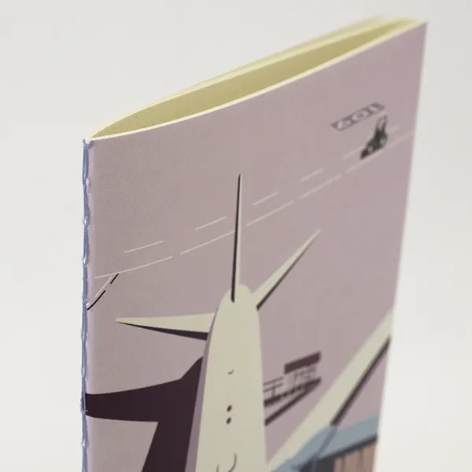

**Міжнародний аеропорт Ханеда — головні ворота до регіону Канто в Японії: не лише вузловий пункт прямих рейсів між Китаєм і Японією, а й відправна точка, з якої мандрівники знайомляться з Токіо та всім регіоном Канто.**

Як один із внутрішніх пересадочних вузлів країни, Ханеда поєднує гамір сучасного міста з глибиною традиційної культури, і особливий шарм Японії пронизує все це. Чи ви починаєте тут подорож, чи просто проїздом — інфраструктура аеропорту зробить поїздку простішою.

**Сьогодні почнімо з печатки Ґосьоін аеропорту Ханеда і разом пройдімося принадами цього п'ятизіркового аеропорту.**

## Ґосьоін（ごしょういん / goshōin）

«Небесний ґосьоін», який можна придбати лише в аеропортах Японії. Ідея народилася в Japan Airlines як спосіб оживити регіональні міста, а нині печатку можна купити в 55 аеропортах країни.

- **Орієнтовна ціна:** 350 єн

Посилання на довідники про інші аеропорти шукайте в кінці статті.

### Дані печатки Ґосьоін

- **Аеропорт:** Міжнародний аеропорт Токіо Ханеда
- **Код аеропорту:** HND
- **Печатка номер один:** позначає Міжнародний аеропорт Токіо Ханеда як перший аеропорт у внутрішній мережі JAL.
- **Злітно-посадкові смуги:** сірі позначки під назвою аеропорту — це смуги, які Міжнародний аеропорт Токіо Ханеда справді використовує.
- **Червоний літак:** основний тип JAL у Міжнародному аеропорту Токіо Ханеда — тут A350-900.
- **Кругла печатка в центрі:** ієрогліф із назви аеропорту або його місця, повернутий — тут це ієрогліф 羽 (ha), покладений набік.
- **Де купити:** T1, JAL PLAZA

## Центр Токіо лише за 15 хвилин

Міжнародний аеропорт Ханеда складається з трьох терміналів, міжнародні рейси зосереджені в T3. Усі три термінали сполучають безкоштовний шатл, лінія Keikyu та монорейка. **Кілька міст Китаю мають прямі рейси до Ханеди, зокрема Пекін, Тяньцзінь, Ціндао, Далянь, Шанхай, Гуанчжоу і Шеньчжень,** що робить подорожі між двома країнами значно простішими.

Щойно ви приземлитеся в Ханеді, варіанти дістатися до міста будуть швидкими й різноманітними. Від станції T3 швидка монорейка доїжджає до Хамамацучо — неподалік від Токійської вежі — приблизно за 15 хвилин, де можна пересісти на лінію JR Yamanote. Лінією Keikyu до Сінаґави — близько 12 хвилин, до Асакуси — близько 36 хвилин, а до Йокогами — лише 25 хвилин.

Аеропорт Нарита — приблизно за 1 годину 30 хвилин. Є також автобуси по швидкісних трасах до Тотіґі, Ґумми, Сідзуоки, Яманасі, Наґано й Сендая, тож і огляд міста, і подорожі далі починаються легко.

## Що обов'язково скуштувати в Ханеді

### Перше обов'язкове місце: Ningyocho Imahan

- **Де:** T3, 4 поверх, Edo-koji 15
- **Години роботи:** обід 11:00–15:00 (останнє замовлення 14:30); вечеря 17:00–22:00 (останнє замовлення 20:30)

Старовинний дім сукіякі з Нінґьочо в токійському Ніхонбасі: його аеропортна філія має фасад у стилі Едо, але зберігає ту саму вишуканість, що й оригінал. Сукіякі тут можна скуштувати кількома способами — сет-меню, курси, ґодзен, — і кожен будується на добірній японській чорній ваґю з корів: ніжній, соковитій і насиченій на смак. Фірмовий соус підкреслює аромат витриманої яловичини, а ретельне приготування зберігає всю цю насиченість у м'ясі.

### Друге обов'язкове місце: Uogashi Nihon-Ichi

- **Де:** T3, 3 поверх, після зони вильоту, 108
- **Години роботи:** цілодобово

Мережа суші-барів, де їдять стоячи; її філія в зоні вильоту Ханеди зберігає ту саму традицію Едомае. Магазин відбирає свіжу продукцію на ринку Цукідзі й формує кожен шматочок на ваших очах; можна замовити сет або вибрати рибу самостійно й рахувати за шматочками. Для пасажирів, які от-от вилетять, чи для кожного, хто хоче ще один смак справжніх суші перед від'їздом із Японії, це і зручно, і дуже смачно.

## Сувеніри, які бувають лише в Ханеді

### CAFÉ CHOCOLAT WICH

- **Де:** T3, 4 поверх, Edo-koji 28, Edo Shokuhinkan
- **Орієнтовна ціна:** 1 425 єн за 6 штук

Ці ласощі, ексклюзивні для Ханеди, побудовані навколо глибокого кавового аромату: вишуканий бельгійський шоколад із хрусткою бісквітною серединкою — багатошарова текстура, що ідеально поєднується з кавою. Кава — це грубо мелені зерна від Sanbon Coffee, обсмажувача з Йокогами, заснованого 1957 року й відомого своєю якістю, а самі ласощі виготовляє La Maison Shirokane — елітна кондитерська, що починалася в токійському районі Сірокане. Кава, шоколад і бісквіт в одному — достатньо вишукано, щоб залишити собі, і ідеально як подарунок.

### Ito-ya «AIRPORT NOTEBOOK»

- **Де:** T3, 4 поверх, Edo-koji 27
- **Орієнтовна ціна:** 660 єн за блокнот

Ito-ya — спеціаліст із канцелярії, заснований 1904 року в токійській Ґіндзі, відомий широким асортиментом оригінальних товарів, який змушує поціновувачів канцелярії повертатися знову. Філія в Ханеді зберігає той самий оригінальний дух: якісні письмові приладдя та японська канцелярія, які подобаються мандрівникам.

Особливо приваблює його грайливий «аеропортний» блокнот: обкладинки спереду й ззаду разом утворюють єдину сцену аеропорту — зі службовими машинами й літаками, що чекають на виліт, тож жваве життя аеропорту опиняється у вас у руках. Відкрийте його — і між сторінками з'являться маленькі літаки: безліч дрібних сюрпризів. Тут є й дизайни, що бувають лише в Ханеді, — гарні і як сувенір, і для себе.

Якщо перед рейсом є час, варто зазирнути.

## В аеропорту та поруч

### PLANETARIUM Starry Cafe

- **Адреса:** T3, 5 поверх, TOKYO POPTOWN 50
- **Години роботи:** 09:00–22:30 (останнє замовлення 22:00); планетарій з 11:00 (останній вхід 21:00)

Як випливає з назви, це кафе, де ви сидите під спроєктованим зоряним небом. Тут використовують сучасну гібридну проєкційну систему, яка поєднує безшовну проєкцію на весь купол і показує близько 40 мільйонів зірок, а Чумацький Шлях промальований у найдрібніших деталях.

Якщо перед рейсом є вільний час, чому б не вирушити в коротку подорож зорями?

### Haneda Airport Garden

- **Адреса:** 2-7-1 Haneda Airport, Ота-ку, Токіо
- **Як дістатися:** пішки зі сполучного коридору другого поверху T3
- **Сайт:** [www.shopping-sumitomo-rd.com/haneda/shopping/](http://www.shopping-sumitomo-rd.com/haneda/shopping/)

Відкритий 2023 року й з'єднаний безпосередньо з Терміналом 3, цей комплекс призначений не лише для покупок і їжі: тут є онсен і готель.

Izumi Tenku no Yu Haneda Airport вражає рідкісним відчуттям простору: у ясні дні видно гору Фудзі; тут є чоловічі та жіночі відкриті ванни, кам'яна сауна й зони відпочинку з їжею, тож це ідеальний день у гарячих джерелах. Зануритися у відкриту ванну, поки літаки злітають і сідають, — окрема насолода.

Наступного разу, коли будете в Ханеді, залиште собі трохи часу, щоб відчути все, що пропонує це місце, — і насолодіться подорожжю іншого ґатунку.

## Довідники про інші аеропорти

- [Довідник з Міжнародного аеропорту Нарита](https://mp.weixin.qq.com/s?__biz=MzA3MjI1NDQxNA==&mid=2652373314&idx=1&sn=2cc9b26e9041d8fba85a695fc9570a82&scene=21#wechat_redirect)
- [Довідник з Міжнародного аеропорту Новий Тітосе (Хоккайдо)](https://mp.weixin.qq.com/s?__biz=MzA3MjI1NDQxNA==&mid=2652374162&idx=1&sn=c685409867a453fc351c35787a205e56&scene=21#wechat_redirect)
- [Довідник з Міжнародного аеропорту Фукуока](https://mp.weixin.qq.com/s?__biz=MzA3MjI1NDQxNA==&mid=2652375055&idx=1&sn=0ab140b1895ababafe7a1e8991341d7a&scene=21#wechat_redirect)
- [Довідник з Міжнародного аеропорту Тюбу Сентрайр](https://mp.weixin.qq.com/s?__biz=MzA3MjI1NDQxNA==&mid=2652376462&idx=1&sn=b90e4b8fcfc7c0934be09f9f2658c036&scene=21#wechat_redirect)
- [Довідник з аеропорту Хіросіма](https://mp.weixin.qq.com/s?__biz=MzA3MjI1NDQxNA==&mid=2652377958&idx=1&sn=8957ec2da9779d9a76aa2488b831e08b&scene=21#wechat_redirect)
- [Довідник з Міжнародного аеропорту Кансай](https://mp.weixin.qq.com/s?__biz=MzA3MjI1NDQxNA==&mid=2652378218&idx=1&sn=e6b0ad7e1a509efac79fbcc6a99d9913&scene=21#wechat_redirect)
- [Довідник з аеропорту Наха](https://mp.weixin.qq.com/s?__biz=MzA3MjI1NDQxNA==&mid=2652378849&idx=1&sn=a43e621ae60abc174f72c5808aeccfc1&scene=21#wechat_redirect)

## Джерела зображень

Деякі зображення взято з таких сайтів:

- https://att-japan.net/ja/haneda-tokyo/
- https://ec.jal.co.jp/img//0002/img/pages/soranogoshoin/haneda-2.jpg
- https://restaurant.imahan.com/hanedaairport-3t/
- https://tokyo-haneda.com/
- https://haneda-shopping.jp/shop/g/gZ001088047/
- https://www.threads.net/@yama7260/post/DBIdqyZP61z
- https://co-trip.jp/article/611985
- https://www.ito-ya.co.jp/category/3001/45826215220871.html
- https://thegate12.com/jp/article/750#content-8
- https://www.gotokyo.org/jp/new-and-now/new-and-trending/221205/topics.html
- https://www.sankei.com/article/20221006-7S2A3FJ42FIMPMLBJU5QXCXC6E/photo/XGGOBJJ5F5MBVBLLXJAQNCXTKQ/
- https://www.fashion-press.net/news/56398

## Пов'язані посилання

- **На цьому сайті**: [Аеропорт Токіо Ханеда (HND)](/airport/HND), [Японія (JP)](/country/JP)
- **Вікіпедія**: [Аеропорт Токіо Ханеда](https://en.wikipedia.org/wiki/Tokyo_Haneda_Airport)
- **Baidu Baike**: [Аеропорт Токіо Ханеда](https://baike.baidu.com/item/%E7%BE%BD%E7%94%B0%E6%9C%BA%E5%9C%BA)
