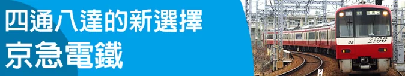

হানেদা টোকিওর কেন্দ্রের খুব কাছে এবং শহরে ঢোকার কয়েকটি উপায় দেয়: মনোরেল, কেইকিউ ট্রেন, বিমানবন্দর বাস ও ট্যাক্সি — প্রত্যেকটির নিজস্ব যুক্তিসঙ্গত ব্যবহার আছে। তিনটি বিষয় উত্তর ঠিক করে দেয় — আপনি টোকিওর কোন দিকে থাকছেন, কত ব্যাগ সামলাতে হবে, এবং কত দেরিতে নামছেন।

এই গাইডে টার্মিনাল থেকে শহর পর্যন্ত অংশটুকু আছে: প্রতিটি লাইন কোথায় যায়, খরচ কত, কোথায় বদলাতে হয়, আর ট্রেন বন্ধের পরে নামলে কী করবেন। টার্মিনাল, রেস্তোরাঁ ও স্যুভেনির নিয়ে দেখুন [সঙ্গী হানেদা বিমানবন্দর গাইড](/blog/haneda-airport-guide)।

## 1. কোন এলাকার জন্য কোন লাইন

"দ্রুততম লাইন" তুলনা করা ভুল প্রশ্ন। হানেদার দুটি রেলপথই বিমানবন্দর ছাড়ে, কিন্তু একটি চলে উত্তর-পূর্বে, অন্যটি উত্তর-পশ্চিমে, আর ভুলটি বেছে নিলে বাড়তি ট্রান্সফার যোগ হয়।

| এলাকা ও গন্তব্য | সেরা বিকল্প | কোথায় বদলাবেন | আনুমানিক ভাড়া |
| --- | --- | --- | --- |
| হামাৎসুচো, শিম্বাশি, শিওদোমে; ওদাইবা | টোকিও মনোরেল | ওদাইবার জন্য রিংকাই লাইনে তেন্নোজু আইলে | প্রায় ¥500 |
| টোকিও স্টেশন, আকিহাবারা, উয়েনো | মনোরেল → হামাৎসুচো → JR ইয়ামানোতে বা কেইহিন-তোহোকু লাইন | হামাৎসুচো | প্রায় ¥500, সঙ্গে JR অংশ |
| শিনাগাওয়া, গোতান্দা, শিবুয়া, শিনজুকু, ইকেবুকুরো | কেইকিউ → শিনাগাওয়া → JR ইয়ামানোতে লাইন | শিনাগাওয়া | প্রায় ¥300, সঙ্গে JR অংশ |
| গিনজা, নিহোনবাশি, আসাকুসা, ওশিয়াগে | কেইকিউ সরাসরি তোয়েই আসাকুসা লাইনে | কোনোটি নয় | ¥430–530 |
| ইয়োকোহামা, চায়নাটাউন | কেইকিউ | কোনোটি নয় | প্রায় ¥340 |
| আপনার হোটেলের দরজা, ডিজনি, হাকোনে, কারুইজাওয়া | বিমানবন্দর বাস | কোনোটি নয় | অঞ্চলভিত্তিক, সাধারণত ট্রেনের চেয়ে বেশি |
| রাতের আগমন, দল, ভারী ব্যাগ | ট্যাক্সি | কোনোটি নয় | মিটারে |

এক বাক্যে: **পূর্ব দিকে যান মনোরেলে, পশ্চিম বা দক্ষিণে যান কেইকিউতে, আর বাসের কথা ভাবুন কেবল যখন গন্তব্য হোটেল বা কান্তো অঞ্চলের দূরে কোথাও।** এগুলো আনুমানিক সংখ্যা — ভ্রমণের আগে পরিচালকদের নিজস্ব সাইটে দেখে নিন।

## 2. টোকিও মনোরেল — পূর্ব টোকিওর জন্য দ্রুততম

টোকিও মনোরেল JR East পরিচালিত এবং এর একটি মাত্র লাইন, হানেদা এয়ারপোর্ট লাইন, যা বিমানবন্দর থেকে হামাৎসুচো পর্যন্ত চলে। 1998 সালে কেইকিউ বিমানবন্দরে পৌঁছানোর আগে এটি হানেদায় ঢোকার একমাত্র রেলপথ ছিল।

- **ভাড়া:** হানেদার যেকোনো টার্মিনাল থেকে হামাৎসুচো পর্যন্ত প্রায় ¥500।
- **যাত্রার সময়:** টার্মিনাল 3 (আন্তর্জাতিক) থেকে সবচেয়ে দ্রুত প্রায় 14 মিনিট; সব স্টেশনে থামা ট্রেনে একটু বেশি সময় লাগে।
- **ট্রান্সফার:** হামাৎসুচো JR ইয়ামানোতে ও কেইহিন-তোহোকু লাইনের সঙ্গে যুক্ত, তাই শিম্বাশি, টোকিও স্টেশন, আকিহাবারা, উয়েনো ও JR নেটওয়ার্কের বাকি অংশ সহজ।

ওদাইবার জন্য শহরে ঢুকে আবার ফিরে আসার বদলে তেন্নোজু আইলে রিংকাই লাইনে বদলান। T1, T2 ও T3-এর প্রত্যেকটিতে এর একটি স্টেশন আছে — আগমন হল থেকে Monorail চিহ্ন অনুসরণ করুন। JR গ্রুপের অংশ হওয়ায় গেটে IC কার্ড নেয়।

## 3. কেইকিউ — শিনাগাওয়া, ইয়োকোহামা ও আসাকুসা

কেইকিউ হানেদা এয়ারপোর্ট স্টেশন ছেড়ে উত্তরে শিনাগাওয়া পৌঁছায় সবচেয়ে দ্রুত প্রায় 11 মিনিটে, আর দক্ষিণে ইয়োকোহামা — যা এটিকে পশ্চিম টোকিও ও কানাগাওয়ার জন্য কাজের ঘোড়া করে তোলে। এটি পাঁচ শ্রেণির ট্রেন চালায়, ধীরতম থেকে দ্রুততম: লোকাল, এয়ারপোর্ট এক্সপ্রেস, এক্সপ্রেস, র্যাপিড লিমিটেড এক্সপ্রেস ও এয়ারপোর্ট র্যাপিড লিমিটেড এক্সপ্রেস। **সবগুলোর ভাড়া একই** — শুধু থামার সংখ্যা বদলায়। তাড়া থাকলে র্যাপিডের জন্য অপেক্ষা করুন; না থাকলে যা আগে আসে তাতে উঠুন।

ভাড়া গন্তব্য অনুযায়ী ভাগ করা, টার্মিনাল 3 থেকে:

- **শিনাগাওয়া ও সেনগাকুজি**, উত্তরে: প্রায় ¥300
- **ইয়োকোহামা**, দক্ষিণে: প্রায় ¥340
- সেনগাকুজি পেরিয়ে **তোয়েই আসাকুসা লাইনে**: **শিম্বাশি** পর্যন্ত প্রায় ¥430, **হিগাশি-গিনজা ও নিহোনবাশি** পর্যন্ত ¥470, এবং **আসাকুসা ও ওশিয়াগে** পর্যন্ত ¥530

কেইকিউ তোয়েই আসাকুসা লাইনে সরাসরি চলাচল করে, তাই গিনজা, নিহোনবাশি ও আসাকুসার জন্য সেনগাকুজিতে বদলাতে হয় না। এই থ্রু সার্ভিসই হিগাশি-গিনজা ও আসাকুসার জন্য কেইকিউকে মনোরেলের চেয়ে ভালো বিকল্প করে তোলে। শিনাগাওয়ায় JR ইয়ামানোতে, কেইহিন-তোহোকু ও তোকাইদো লাইন এবং তোকাইদো শিনকানসেনে বদলানো যায়; দাইমোনে তোয়েই সাবওয়েতে বদলানো যায়। শিবুয়া, শিনজুকু ও ইকেবুকুরোর জন্য কেইকিউ নিয়ে শিনাগাওয়া, তারপর ইয়ামানোতে লাইন; অথবা কেইকিউ নিয়ে দাইমোন, তারপর সাবওয়ে।

## 4. বিমানবন্দর বাস — দরজা থেকে দরজা, তবে ধীর ও দামি

বিমানবন্দর বাসই একমাত্র বিকল্প যা আপনাকে ও আপনার ব্যাগ হোটেলের দরজা পর্যন্ত পৌঁছে দেয়। হানেদার নেটওয়ার্ক বিস্তৃত: টোকিওতে এটি টোকিও স্টেশন, শিনজুকু, ইকেবুকুরো, শিবুয়া, শিনাগাওয়া, রোপ্পোংগি, গিনজা, আকিহাবারা, আসাকুসা ও ওদাইবা সেবা দেয়, আর কান্তো জুড়ে চিবা, কানাগাওয়া, সাইতামা, ইবারাকি, তোচিগি, গুনমা, ইয়ামানাশি ও ফুকুশিমা, সঙ্গে টোকিও ডিজনি রিসর্ট, হাকোনে, কারুইজাওয়া, কাওয়াগুচি হ্রদ ও গোতেম্বা পর্যন্ত পৌঁছায়।

বিমানবন্দর বর্তমানে যে আনুমানিক সময় প্রকাশ করে, সে অনুযায়ী প্রধান রুটগুলোতে মোটামুটি লাগে:

| গন্তব্য | আনুমানিক সময় | T3-এ স্ট্যান্ড |
| --- | --- | --- |
| টোকিও স্টেশন | প্রায় 35 মিনিট | 1F, স্ট্যান্ড 1 |
| শিনজুকু স্টেশন | প্রায় 35 মিনিট | স্ট্যান্ড 3 |
| শিবুয়া স্টেশন | প্রায় 40 মিনিট | স্ট্যান্ড 4 |
| ইকেবুকুরো স্টেশন | প্রায় 55 মিনিট | স্ট্যান্ড 2 |
| আসাকুসা | প্রায় 1 ঘণ্টা 5 মিনিট | স্ট্যান্ড 5 |
| টোকিও ডিজনি রিসর্ট | প্রায় 30–40 মিনিট | স্ট্যান্ড 5 |
| ইয়োকোহামা স্টেশন | প্রায় 30 মিনিট | স্ট্যান্ড 7 |

কয়েকটি বিষয় জেনে রাখুন: স্ট্যান্ডগুলো প্রথম তলায়, আর T3-এ দ্বিতীয় তলার আগমন লবি থেকে নিচে নেমে সেগুলোতে পৌঁছাতে হয়। টিকিট মেশিন বা কাউন্টার থেকে, আর কিছু রুট আগে থেকে রিজার্ভ করা যায়। গিনজা, আকাসাকা/রোপ্পোংগি, আকিহাবারা, তোরানোমন ও শিনাগাওয়া/এবিসুর রুট বর্তমানে বন্ধ, তাই আগে বিমানবন্দরের সাইটে নিশ্চিত হয়ে নিন। **শেষ কথা স্পষ্ট: সহজ শহর-আসা-যাওয়ার জন্য বাস ট্রেনের চেয়ে বেশি খরচ করায় এবং অগত্যা দ্রুততর নয়। এর মূল্য কম বদল, নিশ্চিত আসন, আর হোটেলে বা শহরতলিতে থামা।**

## 5. ট্যাক্সি ও রাতের আগমন

ট্যাক্সি তিনটি টার্মিনালের বাইরে প্রথম তলায় লাইনে দাঁড়ায় — Taxi চিহ্ন অনুসরণ করুন। মিটার চলে, আর বেশিরভাগ কেন্দ্রীয় গন্তব্যে ট্রেন বা বাসের চেয়ে অনেক বেশি খরচ হয়; রাত প্রায় 22:00 থেকে রাতের সারচার্জ প্রযোজ্য, তাই ট্যাক্সি মূলত তখনই যুক্তিযুক্ত যখন ভাড়া ভাগ হয় বা ব্যাগ অনেক।

বড় সমস্যা দাম নয়, শেষ ট্রেন। মনোরেল ও কেইকিউ দুটোই প্রায় মধ্যরাতে বন্ধ হয়, আর সঠিক সময় টার্মিনাল ও সপ্তাহের দিন অনুযায়ী বদলায়। বিমানবন্দর রাতের ও ভোরের শাটল বাসও চালায় প্রধান টোকিও স্টেশন ও কিছু হোটেলে, দিনের তুলনায় অনেক কম ঘনঘন। মাঝরাতে নামলে ট্যাক্সি নেওয়ার সিদ্ধান্তের আগে সেই রাতের শেষ ট্রেন ও রাতের বাসের সময় দেখে নিন।

## 6. IC কার্ড, ভাড়া ও শেষ ট্রেন

- **IC কার্ড:** Suica, PASMO এবং জাতীয়ভাবে আন্তঃব্যবহারযোগ্য IC কার্ড (ICOCA প্রভৃতি) মনোরেল, কেইকিউ ও বিমানবন্দর বাসে চলে; ঢোকার-বেরোনোর সময় ট্যাপ করুন, টিকিটের লাইন এড়িয়ে যান। কার্ড স্টেশনের মেশিনে বিক্রি ও রিচার্জ হয়, আর ফোনে রাখা Suica বা PASMO একইভাবে কাজ করে।
- **ভাড়া:** মনোরেল অংশভিত্তিক, কেইকিউ দূরত্বভিত্তিক, সঙ্গে JR বা সাবওয়ের অংশ আলাদা হিসেবে। পুরো যাত্রায় একটি কার্ড দিয়ে গেলে প্রতিটি অংশ আলাদা কেনার চেয়ে ভালো।
- **শেষ ট্রেন:** দুটি রেলপথই প্রায় মধ্যরাতে বন্ধ হয়, আর T3 T1 ও T2-এর চেয়ে কিছুটা আলাদা। ট্রেন থাকবে ধরে নেবেন না।
- **যাওয়ার আগে দেখে নিন:** এখানে দেওয়া ভাড়া 2023 সালের। মনোরেল, কেইকিউ ও বিমানবন্দর বাসের বর্তমান ভাড়া, সময়সূচি ও রাতের সেবার জন্য সেই দিনই পরিচালকদের ওয়েবসাইট দেখুন।

## সম্পর্কিত লিংক

- **এই সাইটে**: [হানেদা বিমানবন্দর (HND)](/airport/HND), [জাপান (JP)](/country/JP)
- **উইকিপিডিয়া**: [হানেদা বিমানবন্দর](https://en.wikipedia.org/wiki/Haneda_Airport)
- **Baidu Baike**: [হানেদা বিমানবন্দর](https://baike.baidu.com/item/%E7%BE%BD%E7%94%B0%E6%9C%BA%E5%9C%BA)
- **বিমানবন্দরের সাইট**: [হানেদা বিমানবন্দরে যাতায়াত](https://tokyo-haneda.com/en/access/index.html), [হাইওয়ে ও ডেডিকেটেড বাস](https://tokyo-haneda.com/en/access/bus/index.html)

ছবির সূত্র: মূল নিবন্ধের ছবি; রুট ম্যাপগুলো বিমানবন্দর ও পরিচালকরা প্রকাশ করে। এখানে বেশিরভাগ ভাড়া 2023 সালের — ভ্রমণের দিন টোকিও মনোরেল, কেইকিউ ও হানেদা বিমানবন্দরের ওয়েবসাইট দেখুন।
