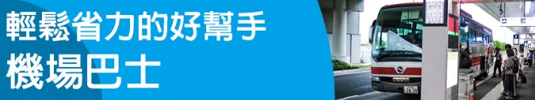

Haneda está cerca del centro de Tokio y ofrece varias formas de entrar: monorraíl, trenes Keikyu, autobuses de aeropuerto y taxis, cada una con su uso sensato. Tres cosas deciden la respuesta: en qué lado de Tokio te alojas, cuánto equipaje mueves y lo tarde que aterrizas.

Esta guía cubre el trayecto desde la terminal hasta la ciudad: adónde va cada línea, cuánto cuesta, dónde cambias y qué hacer si aterrizas después de que los trenes dejen de circular. Para las terminales en sí, los restaurantes y los souvenirs, consulta la [guía complementaria del aeropuerto de Haneda](/blog/haneda-airport-guide).

## 1. Qué línea para cada zona

Comparar “la línea más rápida” es la pregunta equivocada. Los dos ferrocarriles de Haneda salen del aeropuerto, pero uno va hacia el noreste y el otro hacia el noroeste, y elegir mal añade transbordos.

| Zona y destino | Mejor opción | Cambio en | Tarifa de referencia |
| --- | --- | --- | --- |
| Hamamatsucho, Shimbashi, Shiodome; Odaiba | Monorraíl de Tokio | Tennozu Isle para la Rinkai Line a Odaiba | unos ¥500 |
| Estación de Tokio, Akihabara, Ueno | Monorraíl → Hamamatsucho → JR Yamanote o Keihin-Tohoku Line | Hamamatsucho | unos ¥500, más el tramo de JR |
| Shinagawa, Gotanda, Shibuya, Shinjuku, Ikebukuro | Keikyu → Shinagawa → JR Yamanote Line | Shinagawa | unos ¥300, más el tramo de JR |
| Ginza, Nihombashi, Asakusa, Oshiage | Keikyu con servicio directo a la Toei Asakusa Line | ninguno | ¥430–530 |
| Yokohama, Chinatown | Keikyu | ninguno | unos ¥340 |
| La puerta de tu hotel, Disney, Hakone, Karuizawa | Autobús de aeropuerto | ninguno | por zonas, en general más caro que el tren |
| Llegada tardía, un grupo, mucho equipaje | Taxi | ninguno | con taxímetro |

En una frase: **hacia el este en el monorraíl, hacia el oeste o el sur en Keikyu, y piensa en el autobús solo cuando el destino sea un hotel o algún lugar de la región de Kanto.** Son cifras de referencia: consulta las webs de los operadores antes de viajar.

## 2. Monorraíl de Tokio: el más rápido para el este de Tokio

El monorraíl de Tokio lo opera JR East y tiene una sola línea, la Haneda Airport Line, que va del aeropuerto a Hamamatsucho. Hasta que Keikyu llegó al aeropuerto en 1998, era el único ferrocarril que entraba en Haneda.

- **Tarifa:** unos ¥500 desde cualquier terminal de Haneda hasta Hamamatsucho.
- **Tiempo de viaje:** unos 14 minutos en el trayecto más rápido desde la Terminal 3 (internacional) hasta Hamamatsucho; los trenes que paran en todas las estaciones tardan algo más.
- **Transbordos:** Hamamatsucho conecta con las líneas JR Yamanote y Keihin-Tohoku, así que Shimbashi, la Estación de Tokio, Akihabara, Ueno y el resto de la red JR son sencillos.

Para Odaiba, cambia en Tennozu Isle a la Rinkai Line en lugar de entrar en la ciudad y volver sobre tus pasos. Tiene una estación en cada una de las terminales T1, T2 y T3: sigue los carteles del monorraíl desde la llegada. Al formar parte del grupo JR, acepta tarjetas IC en el torno.

## 3. Keikyu: Shinagawa, Yokohama y Asakusa

Keikyu sale de la estación Haneda Airport y llega a Shinagawa en unos 11 minutos en su trayecto más rápido hacia el norte, y a Yokohama hacia el sur, lo que la convierte en la opción más práctica para el oeste de Tokio y Kanagawa. Opera cinco clases de tren, de la más lenta a la más rápida: local, airport express, express, rapid limited express y airport rapid limited express. **La tarifa es la misma en todas**; solo cambia el número de paradas. Si tienes prisa, espera a un rapid; si no, sube al primero que llegue.

Las tarifas se agrupan por destino, desde la Terminal 3:

- **Shinagawa y Sengakuji**, hacia el norte: unos ¥300
- **Yokohama**, hacia el sur: unos ¥340
- Por Sengakuji hasta la **Toei Asakusa Line**: unos ¥430 a **Shimbashi**, ¥470 a **Higashi-Ginza y Nihombashi**, y ¥530 a **Asakusa y Oshiage**

Como Keikyu continúa por la Toei Asakusa Line, Ginza, Nihombashi y Asakusa no necesitan transbordo en Sengakuji. Ese servicio directo es lo que hace de Keikyu una apuesta mejor que el monorraíl para Higashi-Ginza y Asakusa. En Shinagawa puedes cambiar a las líneas JR Yamanote, Keihin-Tohoku y Tokaido, y al Tokaido Shinkansen; en Daimon, al metro Toei. Para Shibuya, Shinjuku e Ikebukuro, toma Keikyu hasta Shinagawa y luego la Yamanote Line, o Keikyu hasta Daimon y luego el metro.

## 4. Autobuses de aeropuerto: puerta a puerta, pero más lentos y más caros

El autobús de aeropuerto es la única opción que te lleva a ti y a tu equipaje hasta la puerta de un hotel. La red de Haneda es amplia: en Tokio cubre la Estación de Tokio, Shinjuku, Ikebukuro, Shibuya, Shinagawa, Roppongi, Ginza, Akihabara, Asakusa y Odaiba, y en toda la región de Kanto llega a Chiba, Kanagawa, Saitama, Ibaraki, Tochigi, Gunma, Yamanashi y Fukushima, además de Tokyo Disney Resort, Hakone, Karuizawa, el lago Kawaguchi y Gotemba.

Según las estimaciones que el aeropuerto publica actualmente, los trayectos principales tardan aproximadamente:

| Destino | Tiempo estimado | Parada en T3 |
| --- | --- | --- |
| Estación de Tokio | unos 35 minutos | 1F, parada 1 |
| Estación de Shinjuku | unos 35 minutos | parada 3 |
| Estación de Shibuya | unos 40 minutos | parada 4 |
| Estación de Ikebukuro | unos 55 minutos | parada 2 |
| Asakusa | unas 1 hora 5 minutos | parada 5 |
| Tokyo Disney Resort | unos 30–40 minutos | parada 5 |
| Estación de Yokohama | unos 30 minutos | parada 7 |

Algunas cosas que conviene saber: las paradas están en la primera planta y, en T3, se baja desde el vestíbulo de llegadas de la segunda planta para llegar a ellas. Los billetes se sacan en máquinas o en el mostrador, y algunas rutas se pueden reservar. Las rutas a Ginza, Akasaka/Roppongi, Akihabara, Toranomon y Shinagawa/Ebisu están suspendidas por ahora, así que confírmalo primero en la web del aeropuerto. **La conclusión es clara: para un simple viaje de ida y vuelta a la ciudad, el autobús cuesta más que el tren y no es necesariamente más rápido. Su valor son menos transbordos, un asiento garantizado y una parada en el hotel o en las afueras.**

## 5. Taxis y llegadas tardías

Los taxis hacen cola en la primera planta, a la salida de las tres terminales: sigue los carteles de Taxi. El taxímetro corre, y la mayoría de los destinos céntricos cuestan mucho más que el tren o el autobús; a partir de las 22:00 aproximadamente se aplica un recargo nocturno, así que un taxi tiene sentido sobre todo cuando se reparte la tarifa o cuando el equipaje es abundante.

El problema mayor no es el precio, sino el último tren. Tanto el monorraíl como Keikyu dejan de circular alrededor de medianoche, y los horarios exactos varían según la terminal y el día de la semana. El aeropuerto también opera autobuses lanzadera nocturnos y de madrugada hasta las principales estaciones de Tokio y algunos hoteles, con mucha menos frecuencia que durante el día. Si aterrizas cerca de medianoche, consulta los últimos trenes y los autobuses nocturnos de esa noche antes de decidirte por un taxi.

## 6. Tarjetas IC, tarifas y últimos trenes

- **Tarjetas IC:** Suica, PASMO y las tarjetas IC interoperables a nivel nacional (ICOCA y otras) funcionan en el monorraíl, en Keikyu y en los autobuses de aeropuerto; toca al entrar y al salir y sáltate la cola de billetes. Las tarjetas se venden y se recargan en las máquinas de las estaciones, y una Suica o PASMO en tu móvil funciona igual.
- **Tarifas:** el monorraíl por secciones, Keikyu por distancia, y cualquier tramo de JR o de metro se cobra aparte. Una sola tarjeta para todo el trayecto es mejor que comprar cada tramo.
- **Últimos trenes:** ambos ferrocarriles dejan de circular alrededor de medianoche, y la T3 difiere ligeramente de la T1 y la T2. No des por hecho que todavía habrá tren.
- **Comprueba antes de ir:** las tarifas citadas aquí son de 2023. Para las tarifas, los horarios y los servicios nocturnos actuales del monorraíl, Keikyu y los autobuses de aeropuerto, consulta las webs de los operadores el mismo día.

## Enlaces relacionados

- **En este sitio**: [Aeropuerto de Haneda (HND)](/airport/HND), [Japón (JP)](/country/JP)
- **Wikipedia**: [Aeropuerto de Haneda](https://en.wikipedia.org/wiki/Haneda_Airport)
- **Baidu Baike**: [Aeropuerto de Haneda](https://baike.baidu.com/item/%E7%BE%BD%E7%94%B0%E6%9C%BA%E5%9C%BA)
- **Web del aeropuerto**: [Acceso al aeropuerto de Haneda](https://tokyo-haneda.com/en/access/index.html), [autobuses por autopista y dedicados](https://tokyo-haneda.com/en/access/bus/index.html)

Fuente de las imágenes: imágenes del artículo original; los mapas de rutas los publican el aeropuerto y los operadores. La mayoría de las tarifas citadas aquí son de 2023: consulta las webs del monorraíl de Tokio, de Keikyu y del aeropuerto de Haneda el día en que viajes.
