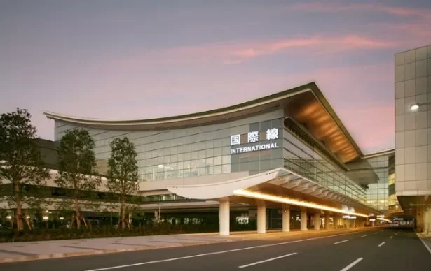
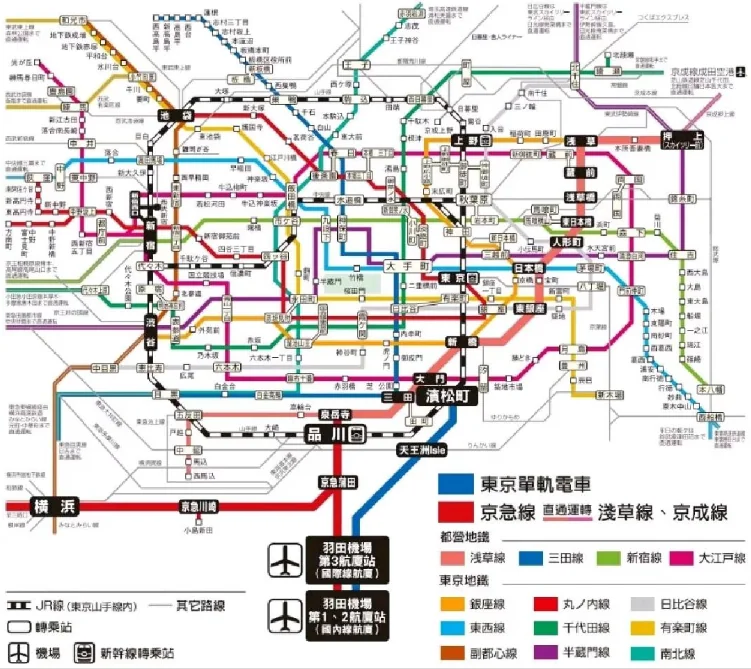
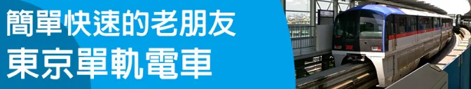
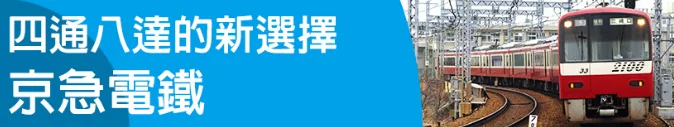
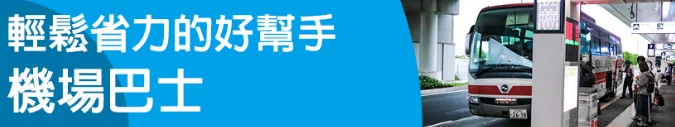
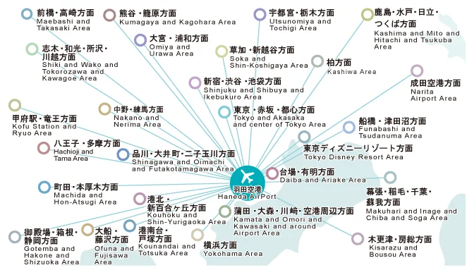

하네다는 도쿄 도심과 가까워 들어가는 방법이 여러 가지입니다. 모노레일, 게이큐 열차, 공항 버스, 택시가 각각 나름의 쓰임새를 가집니다. 답을 정하는 것은 세 가지입니다. 도쿄의 어느 쪽에 묵는지, 짐이 얼마나 되는지, 얼마나 늦게 도착하는지입니다.

이 안내는 터미널에서 시내까지의 구간을 다룹니다. 각 노선이 어디로 가는지, 요금은 얼마인지, 어디서 갈아타는지, 열차가 끊긴 뒤에 도착하면 어떻게 해야 하는지입니다. 터미널 자체와 식당, 기념품에 대해서는 [하네다 공항 안내](/blog/haneda-airport-guide)를 참고하십시오.

## 1. 지역별로 어느 노선인가

"가장 빠른 노선"을 비교하는 것은 잘못된 질문입니다. 하네다의 두 철도는 모두 공항에서 출발하지만 하나는 북동쪽으로, 다른 하나는 북서쪽으로 달리며, 잘못 고르면 환승이 늘어납니다.

| 지역과 목적지 | 가장 좋은 선택 | 환승역 | 참고 요금 |
| --- | --- | --- | --- |
| 하마마쓰초, 신바시, 시오도메, 오다이바 | 도쿄 모노레일 | 오다이바 방면 린카이 선은 덴노즈 아일에서 | 약 ¥500 |
| 도쿄역, 아키하바라, 우에노 | 모노레일 → 하마마쓰초 → JR 야마노테·게이힌토호쿠 선 | 하마마쓰초 | 약 ¥500 + JR 구간 |
| 시나가와, 고탄다, 시부야, 신주쿠, 이케부쿠로 | 게이큐 → 시나가와 → JR 야마노테 선 | 시나가와 | 약 ¥300 + JR 구간 |
| 긴자, 니혼바시, 아사쿠사, 오시아게 | 게이큐 직통으로 도에이 아사쿠사 선 | 없음 | ¥430–530 |
| 요코하마, 차이나타운 | 게이큐 | 없음 | 약 ¥340 |
| 숙소 문 앞, 디즈니, 하코네, 가루이자와 | 공항 버스 | 없음 | 구역 요금, 보통 열차보다 비쌈 |
| 심야 도착, 단체, 무거운 짐 | 택시 | 없음 | 미터기 |

한 문장으로 말하면 이렇습니다. **동쪽으로 가면 모노레일, 서쪽이나 남쪽으로 가면 게이큐, 목적지가 호텔이거나 간토 일대 외곽일 때만 버스를 생각하십시오.** 모두 참고 수치이니 여행 전에 운영사 사이트에서 확인하십시오.

## 2. 도쿄 모노레일 — 도쿄 동부에 가장 빠릅니다

도쿄 모노레일은 JR 동일본이 운영하며 하네다 공항선 한 노선이 공항에서 하마마쓰초까지 이어집니다. 1998년 게이큐가 공항까지 들어오기 전까지는 하네다로 가는 유일한 철도였습니다.

- **요금:** 하네다 어느 터미널에서 하마마쓰초까지 약 ¥500.
- **소요 시간:** 3터미널(국제선)에서 가장 빠른 열차로 약 14분이며, 각역 정차는 조금 더 걸립니다.
- **환승:** 하마마쓰초에서 JR 야마노테·게이힌토호쿠 선과 연결되므로 신바시, 도쿄역, 아키하바라, 우에노 등 JR 네트워크 어디로든 수월합니다.

오다이바로 간다면 시내로 들어갔다 되돌아오지 말고 덴노즈 아일에서 린카이 선으로 갈아타십시오. T1, T2, T3에 각각 역이 있으니 도착층에서 모노레일 표지판을 따라가십시오. JR 그룹이므로 개찰구에서 IC 카드를 쓸 수 있습니다.

## 3. 게이큐 — 시나가와, 요코하마, 아사쿠사

게이큐는 하네다 공항역을 떠나 북쪽으로 시나가와까지 가장 빠르면 약 11분, 남쪽으로 요코하마까지 이어지므로, 도쿄 서부와 가나가와의 주력 노선입니다. 열차 등급은 느린 것부터 빠른 것까지 다섯 가지입니다. 보통, 공항 쾌속, 쾌속, 통근 쾌속, 공항 통근 쾌속입니다. **요금은 모두 같고** 정차역 수만 다릅니다. 급하면 쾌속을 기다리고, 그렇지 않으면 먼저 오는 열차를 타십시오.

요금은 목적지별 구간제이며, 3터미널 기준으로 이렇습니다.

- **북쪽의 시나가와와 센가쿠지:** 약 ¥300
- **남쪽의 요코하마:** 약 ¥340
- 센가쿠지를 지나 **도에이 아사쿠사 선**으로 직통할 때: **신바시** 약 ¥430, **히가시긴자·니혼바시** ¥470, **아사쿠사·오시아게** ¥530

게이큐가 도에이 아사쿠사 선으로 직통하기 때문에 긴자, 니혼바시, 아사쿠사는 센가쿠지에서 갈아탈 필요가 없습니다. 이 직통 운행 덕분에 히가시긴자와 아사쿠사에서는 게이큐가 모노레일보다 낫습니다. 시나가와에서는 JR 야마노테·게이힌토호쿠·도카이도 선과 도카이도 신칸센으로, 다이몬에서는 도에이 지하철로 갈아탈 수 있습니다. 시부야, 신주쿠, 이케부쿠로로 가려면 게이큐로 시나가와까지 간 뒤 야마노테 선을 타거나, 게이큐로 다이몬까지 간 뒤 지하철을 타십시오.

## 4. 공항 버스 — 문 앞까지, 하지만 더 느리고 더 비쌉니다

공항 버스는 승객과 짐을 호텔 입구까지 데려다주는 유일한 선택입니다. 하네다의 노선망은 넓습니다. 도쿄에서는 도쿄역, 신주쿠, 이케부쿠로, 시부야, 시나가와, 롯폰기, 긴자, 아키하바라, 아사쿠사, 오다이바를 잇고, 간토 전역으로는 지바, 가나가와, 사이타마, 이바라키, 도치기, 군마, 야마나시, 후쿠시마와 도쿄 디즈니 리조트, 하코네, 가루이자와, 가와구치호, 고텐바까지 이어집니다.

공항이 현재 게시하는 예상치는 다음과 같습니다.

| 목적지 | 예상 시간 | T3 정류장 |
| --- | --- | --- |
| 도쿄역 | 약 35분 | 1층 1번 |
| 신주쿠역 | 약 35분 | 3번 |
| 시부야역 | 약 40분 | 4번 |
| 이케부쿠로역 | 약 55분 | 2번 |
| 아사쿠사 | 약 1시간 5분 | 5번 |
| 도쿄 디즈니 리조트 | 약 30–40분 | 5번 |
| 요코하마역 | 약 30분 | 7번 |

몇 가지 알아 둘 점이 있습니다. 정류장은 1층에 있고, T3에서는 2층 도착 로비에서 내려가야 합니다. 승차권은 발매기나 카운터에서 사며 일부 노선은 예약할 수 있습니다. 긴자, 아카사카·롯폰기, 아키하바라, 도라노몬, 시나가와·에비스 노선은 현재 운휴 중이므로 공항 사이트에서 먼저 확인하십시오. **결론은 분명합니다. 단순한 시내 왕복이라면 버스는 열차보다 비싸고 반드시 빠르지도 않습니다. 버스의 가치는 환승이 적고, 좌석이 보장되며, 호텔이나 교외까지 바로 간다는 데 있습니다.**

## 5. 택시와 심야 도착

택시는 세 터미널 모두 1층 밖에서 줄을 서 있습니다. Taxi 표지판을 따라가십시오. 미터기가 돌아가고, 대부분의 도심 목적지는 열차나 버스보다 훨씬 비쌉니다. 22시 무렵부터 심야 할증이 붙으므로, 택시는 요금을 나눠 낼 때나 짐이 많을 때 주로 합리적입니다.

더 큰 문제는 가격이 아니라 막차입니다. 모노레일과 게이큐는 모두 자정 무렵 운행을 마치고, 정확한 시각은 터미널과 요일에 따라 다릅니다. 공항은 도쿄 주요 역과 일부 호텔로 심야·새벽 셔틀버스도 운행하지만 낮보다 배차가 훨씬 뜸합니다. 자정 무렵 도착한다면 택시를 타기로 결정하기 전에 그날 밤의 막차와 심야 버스를 확인하십시오.

## 6. IC 카드, 요금, 막차

- **IC 카드:** Suica, PASMO와 전국 호환 IC 카드(ICOCA 등)는 모노레일, 게이큐, 공항 버스에서 모두 쓸 수 있습니다. 타고 내릴 때 태그하면 발매기 줄을 서지 않아도 됩니다. 카드는 역 발매기에서 사고 충전하며, 휴대전화의 Suica나 PASMO도 같은 방식으로 작동합니다.
- **요금:** 모노레일은 구간제, 게이큐는 거리제이며, JR이나 지하철 구간은 별도로 부과됩니다. 전 구간을 카드 하나로 쓰는 편이 구간마다 사는 것보다 낫습니다.
- **막차:** 두 철도 모두 자정 무렵 운행을 마치고, T3는 T1·T2와 조금 다릅니다. 열차가 아직 있을 것이라고 가정하지 마십시오.
- **가기 전에 확인:** 여기 적힌 요금은 2023년 기준입니다. 현재의 모노레일·게이큐·공항 버스 요금과 시간표, 심야 운행은 당일 운영사 웹사이트에서 확인하십시오.

## 관련 링크

- **이 사이트에서**: [하네다 공항(HND)](/airport/HND), [일본(JP)](/country/JP)
- **Wikipedia**: [하네다 공항](https://en.wikipedia.org/wiki/Haneda_Airport)
- **Baidu Baike**: [하네다 공항](https://baike.baidu.com/item/%E7%BE%BD%E7%94%B0%E6%9C%BA%E5%9C%BA)
- **공항 사이트**: [하네다 공항 접근 교통](https://tokyo-haneda.com/en/access/index.html), [고속·전용 버스](https://tokyo-haneda.com/en/access/bus/index.html)

이미지 출처: 원문 기사의 이미지이며, 노선도는 공항과 운영사가 게시한 것입니다. 여기 적힌 요금은 대부분 2023년 기준이므로, 여행하는 날 도쿄 모노레일, 게이큐, 하네다 공항 웹사이트에서 확인하십시오.
