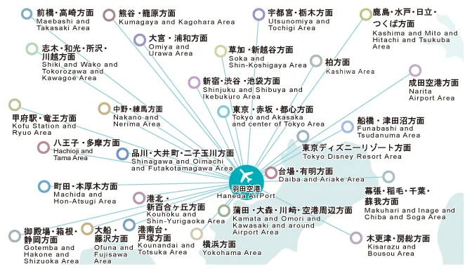

Haneda ligt dicht bij het centrum van Tokio en biedt verschillende manieren om de stad in te komen: monorail, Keikyu-treinen, luchthavenbussen en taxi's, elk met een eigen logische inzet. Drie dingen bepalen het antwoord — aan welke kant van Tokio je verblijft, hoeveel bagage je meeneemt en hoe laat je landt.

Deze gids behandelt het traject van de terminal naar de stad: waar elke lijn naartoe gaat, wat het kost, waar je overstapt en wat je moet doen als je landt nadat de treinen zijn gestopt. Voor de terminals zelf, de restaurants en de souvenirs, zie de [bijbehorende gids over Haneda Airport](/blog/haneda-airport-guide).

## 1. Welke lijn voor welke buurt

"De snelste lijn" vergelijken is de verkeerde vraag. De twee spoorlijnen van Haneda vertrekken allebei van de luchthaven, maar de ene loopt naar het noordoosten en de andere naar het noordwesten, en de verkeerde kiezen kost je extra overstappen.

| Buurt en bestemming | Beste optie | Overstappen in | Richtprijs |
| --- | --- | --- | --- |
| Hamamatsucho, Shimbashi, Shiodome; Odaiba | Tokyo Monorail | Tennozu Isle voor de Rinkai-lijn naar Odaiba | ongeveer ¥500 |
| Tokyo Station, Akihabara, Ueno | Monorail → Hamamatsucho → JR Yamanote- of Keihin-Tohoku-lijn | Hamamatsucho | ongeveer ¥500, plus het JR-traject |
| Shinagawa, Gotanda, Shibuya, Shinjuku, Ikebukuro | Keikyu → Shinagawa → JR Yamanote-lijn | Shinagawa | ongeveer ¥300, plus het JR-traject |
| Ginza, Nihombashi, Asakusa, Oshiage | Keikyu met doorgaande dienst op de Toei Asakusa-lijn | geen | ¥430–530 |
| Yokohama, Chinatown | Keikyu | geen | ongeveer ¥340 |
| De deur van je hotel, Disney, Hakone, Karuizawa | Luchthavenbus | geen | per zone, doorgaans duurder dan de trein |
| Late aankomst, een groep, zware tassen | Taxi | geen | op de meter |

In één zin: **naar het oosten met de monorail, naar het westen of zuiden met Keikyu, en denk pas aan de bus als de bestemming een hotel is of ergens in de Kanto-regio ligt.** Dit zijn richtprijzen — controleer voor je reis de sites van de vervoerders.

## 2. Tokyo Monorail — het snelst voor Oost-Tokio

De Tokyo Monorail wordt geëxploiteerd door JR East en heeft één lijn, de Haneda Airport Line, die van de luchthaven naar Hamamatsucho loopt. Tot Keikyu in 1998 de luchthaven bereikte, was het de enige spoorverbinding naar Haneda.

- **Tarief:** ongeveer ¥500 van elke terminal van Haneda naar Hamamatsucho.
- **Reistijd:** ongeveer 14 minuten op zijn snelst van Terminal 3 (internationaal) naar Hamamatsucho; treinen die op alle stations stoppen doen er iets langer over.
- **Overstappen:** in Hamamatsucho sluit je aan op de JR Yamanote- en Keihin-Tohoku-lijnen, dus Shimbashi, Tokyo Station, Akihabara, Ueno en de rest van het JR-net zijn eenvoudig te bereiken.

Voor Odaiba kun je beter in Tennozu Isle overstappen op de Rinkai-lijn dan eerst de stad in te gaan en terug te komen. De monorail heeft een station bij elk van de terminals T1, T2 en T3 — volg vanaf de aankomsthal de borden Monorail. Omdat de lijn deel uitmaakt van de JR-groep, kun je bij de poortjes met een IC-kaart inchecken.

## 3. Keikyu — Shinagawa, Yokohama en Asakusa

Keikyu vertrekt van station Haneda Airport: naar het noorden bereikt de lijn Shinagawa in ongeveer 11 minuten op zijn snelst, naar het zuiden Yokohama, wat Keikyu het werkpaard maakt voor West-Tokio en Kanagawa. Er rijden vijf treinklassen, van langzaam naar snel: stoptrein, Airport Express, Express, Rapid Limited Express en Airport Rapid Limited Express. **Het tarief is voor alle vijf hetzelfde** — alleen het aantal stops verschilt. Heb je haast, wacht dan op een rapid; zo niet, neem dan wat het eerst komt.

De tarieven zijn ingedeeld per bestemming, vanaf Terminal 3:

- **Shinagawa en Sengakuji**, naar het noorden: ongeveer ¥300
- **Yokohama**, naar het zuiden: ongeveer ¥340
- Via Sengakuji door naar de **Toei Asakusa-lijn**: ongeveer ¥430 naar **Shimbashi**, ¥470 naar **Higashi-Ginza en Nihombashi**, en ¥530 naar **Asakusa en Oshiage**

Omdat Keikyu doorrijdt op de Toei Asakusa-lijn, hoef je voor Ginza, Nihombashi en Asakusa niet over te stappen in Sengakuji. Die doorgaande dienst maakt Keikyu voor Higashi-Ginza en Asakusa een betere keuze dan de monorail. In Shinagawa kun je overstappen op de JR Yamanote-, Keihin-Tohoku- en Tokaido-lijnen en op de Tokaido Shinkansen; in Daimon op de metro van Toei. Voor Shibuya, Shinjuku en Ikebukuro neem je Keikyu naar Shinagawa en dan de Yamanote-lijn, of Keikyu naar Daimon en dan de metro.

## 4. Luchthavenbussen — van deur tot deur, maar langzamer en duurder

De luchthavenbus is de enige optie die jou en je bagage tot aan de ingang van een hotel brengt. Het netwerk van Haneda is groot: in Tokio bedient het Tokyo Station, Shinjuku, Ikebukuro, Shibuya, Shinagawa, Roppongi, Ginza, Akihabara, Asakusa en Odaiba, en in de rest van Kanto reikt het tot Chiba, Kanagawa, Saitama, Ibaraki, Tochigi, Gunma, Yamanashi en Fukushima, plus Tokyo Disney Resort, Hakone, Karuizawa, het Kawaguchimeer en Gotemba.

Volgens de schattingen die de luchthaven momenteel publiceert, duren de belangrijkste ritten ongeveer:

| Bestemming | Geschatte tijd | Halte in T3 |
| --- | --- | --- |
| Tokyo Station | ongeveer 35 minuten | 1F, halte 1 |
| Shinjuku Station | ongeveer 35 minuten | halte 3 |
| Shibuya Station | ongeveer 40 minuten | halte 4 |
| Ikebukuro Station | ongeveer 55 minuten | halte 2 |
| Asakusa | ongeveer 1 uur 5 minuten | halte 5 |
| Tokyo Disney Resort | ongeveer 30–40 minuten | halte 5 |
| Yokohama Station | ongeveer 30 minuten | halte 7 |

Een paar dingen om te weten: de haltes liggen op de eerste verdieping, en in T3 ga je van de aankomsthal op de tweede verdieping naar beneden om ze te bereiken. Kaartjes komen uit automaten of van de balie, en sommige routes kun je reserveren. Routes naar Ginza, Akasaka/Roppongi, Akihabara, Toranomon en Shinagawa/Ebisu zijn momenteel opgeschort, dus controleer dat eerst op de site van de luchthaven. **De conclusie is simpel: voor een gewoon retourtje naar de stad kost de bus meer dan de trein en is hij niet per se sneller. De waarde zit in minder overstappen, een gegarandeerde zitplaats en een halte bij het hotel of in de buitenwijken.**

## 5. Taxi's en late aankomsten

Taxi's staan bij alle drie de terminals op de eerste verdieping in de rij — volg de borden Taxi. De meter loopt, en de meeste bestemmingen in het centrum kosten veel meer dan de trein of de bus; vanaf ongeveer 22:00 geldt een toeslag voor de late avond, dus een taxi is vooral logisch als je de rit deelt of veel bagage hebt.

Het grotere probleem is niet de prijs, maar de laatste trein. De monorail en Keikyu stoppen allebei rond middernacht, en de exacte tijden verschillen per terminal en per dag van de week. De luchthaven rijdt ook late-night- en vroegochtendshuttlebussen naar de belangrijkste stations van Tokio en sommige hotels, veel minder vaak dan overdag. Land je rond middernacht, zoek dan de laatste treinen en late bussen van die nacht op voordat je besluit een taxi te nemen.

## 6. IC-kaarten, tarieven en laatste treinen

- **IC-kaarten:** Suica, PASMO en de landelijk bruikbare IC-kaarten (ICOCA en andere) werken op de monorail, bij Keikyu en in de luchthavenbussen; tik in en uit en sla de rij bij het kaartjesloket over. Kaarten worden verkocht en opgewaardeerd bij automaten op de stations, en Suica of PASMO op je telefoon werkt hetzelfde.
- **Tarieven:** monorail per traject, Keikyu per afstand, waarbij elk JR- of metrotraject apart wordt gerekend. Eén kaart voor de hele reis is voordeliger dan elk stukje apart kopen.
- **Laatste treinen:** beide spoorlijnen stoppen rond middernacht, en T3 verschilt iets van T1 en T2. Ga er niet van uit dat er nog een trein rijdt.
- **Controleer voor vertrek:** de hier genoemde tarieven dateren uit 2023. Voor actuele tarieven, dienstregelingen en late diensten van monorail, Keikyu en luchthavenbussen gebruik je op de dag zelf de websites van de vervoerders.

## Gerelateerde links

- **Op deze site**: [Haneda Airport (HND)](/airport/HND), [Japan (JP)](/country/JP)
- **Wikipedia**: [Haneda Airport](https://en.wikipedia.org/wiki/Haneda_Airport)
- **Baidu Baike**: [Haneda Airport](https://baike.baidu.com/item/%E7%BE%BD%E7%94%B0%E6%9C%BA%E5%9C%BA)
- **Luchthavensite**: [Toegang tot Haneda Airport](https://tokyo-haneda.com/en/access/index.html), [snelweg- en speciale bussen](https://tokyo-haneda.com/en/access/bus/index.html)

Bron van de afbeeldingen: afbeeldingen uit het oorspronkelijke artikel; de routekaarten zijn gepubliceerd door de luchthaven en de vervoerders. De meeste tarieven hier dateren uit 2023 — controleer op de dag van je reis de websites van Tokyo Monorail, Keikyu en Haneda Airport.
