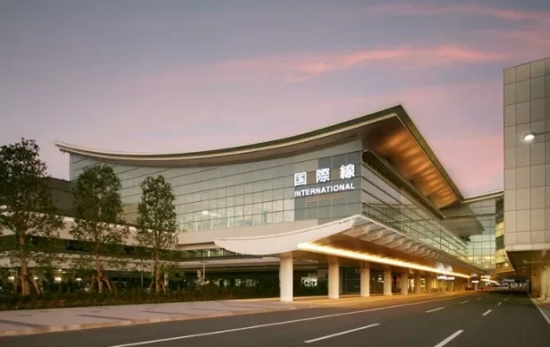

ฮาเนดะตั้งอยู่ใกล้ใจกลางโตเกียวและมีทางเข้าเมืองหลายทาง ทั้งโมโนเรล รถไฟเคย์คิว รถบัสสนามบิน และแท็กซี่ ซึ่งแต่ละแบบมีจุดที่เหมาะสมของตัวเอง สามสิ่งเป็นตัวกำหนดคำตอบ — คุณพักอยู่ฝั่งไหนของโตเกียว มีสัมภาระมากแค่ไหน และลงจอดดึกแค่ไหน

คู่มือนี้ครอบคลุมช่วงจากอาคารผู้โดยสารถึงตัวเมือง: แต่ละสายไปที่ไหน ค่าโดยสารเท่าไร เปลี่ยนรถที่ไหน และควรทำอย่างไรหากลงจอดหลังรถไฟหยุดวิ่ง สำหรับตัวอาคารผู้โดยสาร ร้านอาหาร และของที่ระลึก โปรดดู[คู่มือสนามบินฮาเนดะฉบับคู่กัน](/blog/haneda-airport-guide)

## 1. สายไหนเหมาะกับพื้นที่ไหน

การเปรียบเทียบว่า "สายไหนเร็วที่สุด" เป็นคำถามที่ผิด ทั้งรถไฟสองสายของฮาเนดะออกจากสนามบินเหมือนกัน แต่สายหนึ่งวิ่งไปทางตะวันออกเฉียงเหนือและอีกสายไปทางตะวันตกเฉียงเหนือ การเลือกผิดสายจะเพิ่มการเปลี่ยนรถ

| พื้นที่และจุดหมาย | ตัวเลือกที่ดีที่สุด | เปลี่ยนที่ | ค่าโดยสารอ้างอิง |
| --- | --- | --- | --- |
| ฮามามัตสึโจ ชิมบาชิ ชิโอโดเมะ; โอไดบะ | โตเกียวโมโนเรล | เทนโนซุไอส์ลสำหรับสายริงไกไปโอไดบะ | ประมาณ ¥500 |
| สถานีโตเกียว อากิฮาบาระ อุเอโนะ | โมโนเรล → ฮามามัตสึโจ → สาย JR ยามาโนเตะ หรือเคฮิง-โทโฮกุ | ฮามามัตสึโจ | ประมาณ ¥500 บวกค่าสาย JR |
| ชินางาวะ โกตันดะ ชิบูย่า ชินจูกุ อิเกบุกุโระ | เคย์คิว → ชินางาวะ → สาย JR ยามาโนเตะ | ชินางาวะ | ประมาณ ¥300 บวกค่าสาย JR |
| กินซะ นิฮมบาชิ อาซากุสะ โอชิอาเงะ | เคย์คิววิ่งตรงต่อเนื่องสู่สายโทเออาซากุสะ | ไม่ต้องเปลี่ยน | ¥430–530 |
| โยโกฮาม่า ไชน่าทาวน์ | เคย์คิว | ไม่ต้องเปลี่ยน | ประมาณ ¥340 |
| หน้าประตูโรงแรม ดิสนีย์ ฮาโกเนะ คารุอิซาวะ | รถบัสสนามบิน | ไม่ต้องเปลี่ยน | คิดตามโซน โดยทั่วไปสูงกว่ารถไฟ |
| มาถึงดึก เป็นกลุ่ม สัมภาระหนัก | แท็กซี่ | ไม่ต้องเปลี่ยน | ตามมิเตอร์ |

พูดสั้น ๆ: **ไปทางตะวันออกให้ใช้โมโนเรล ไปทางตะวันตกหรือใต้ให้ใช้เคย์คิว และคิดถึงรถบัสเฉพาะเมื่อปลายทางเป็นโรงแรมหรือที่ใดที่หนึ่งไกลออกไปในภูมิภาคคันโต** ตัวเลขเหล่านี้เป็นค่าอ้างอิง — ตรวจสอบเว็บไซต์ของผู้ให้บริการก่อนเดินทาง

## 2. โตเกียวโมโนเรล — เร็วที่สุดสำหรับโตเกียวฝั่งตะวันออก

โตเกียวโมโนเรลดำเนินการโดย JR East และมีเพียงเส้นทางเดียวคือสายฮาเนดะแอร์พอร์ต ซึ่งวิ่งจากสนามบินไปยังฮามามัตสึโจ จนกระทั่งเคย์คิวเข้ามาถึงสนามบินในปี 1998 โมโนเรลเคยเป็นรถไฟเพียงสายเดียวที่ให้บริการสู่ฮาเนดะ

- **ค่าโดยสาร:** ประมาณ ¥500 จากอาคารผู้โดยสารใดก็ได้ของฮาเนดะไปยังฮามามัตสึโจ
- **เวลาเดินทาง:** ประมาณ 14 นาทีเมื่อเร็วที่สุดจากอาคารผู้โดยสาร 3 (ระหว่างประเทศ) ไปยังฮามามัตสึโจ รถไฟที่จอดทุกสถานีใช้เวลานานกว่าเล็กน้อย
- **การเปลี่ยนรถ:** ฮามามัตสึโจเชื่อมกับสาย JR ยามาโนเตะและเคฮิง-โทโฮกุ ดังนั้นชิมบาชิ สถานีโตเกียว อากิฮาบาระ อุเอโนะ และเครือข่าย JR ส่วนอื่นจึงไปได้ง่าย

สำหรับโอไดบะ ให้เปลี่ยนที่เทนโนซุไอส์ลไปยังสายริงไก แทนที่จะเข้าเมืองแล้วย้อนกลับ มีสถานีที่อาคารผู้โดยสาร 1, 2 และ 3 — ทำตามป้ายโมโนเรลจากบริเวณขาเข้า เนื่องจากอยู่ในเครือข่าย JR จึงใช้บัตร IC ที่ประตูได้

## 3. เคย์คิว — ชินางาวะ โยโกฮาม่า และอาซากุสะ

เคย์คิวออกจากสถานีฮาเนดะแอร์พอร์ต ไปถึงชินางาวะในเวลาประมาณ 11 นาทีเมื่อเร็วที่สุดทางเหนือ และโยโกฮาม่าทางใต้ ทำให้เป็นกำลังหลักสำหรับโตเกียวฝั่งตะวันตกและคานางาวะ ให้บริการรถไฟห้าประเภทจากช้าที่สุดไปเร็วที่สุด: ธรรมดา, สนามบินเอ็กซ์เพรส, เอ็กซ์เพรส, แรพิดลิมิเต็ดเอ็กซ์เพรส และสนามบินแรพิดลิมิเต็ดเอ็กซ์เพรส **ค่าโดยสารเท่ากันทุกประเภท** — ต่างกันเพียงจำนวนสถานีที่จอด หากคุณรีบ ให้รอรถไฟแบบแรพิด หากไม่รีบ ขึ้นขบวนไหนมาก่อนก็ได้

ค่าโดยสารแบ่งตามจุดหมาย จากอาคารผู้โดยสาร 3:

- **ชินางาวะและเซ็นงาคุจิ** ทางเหนือ: ประมาณ ¥300
- **โยโกฮาม่า** ทางใต้: ประมาณ ¥340
- ผ่านเซ็นงาคุจิไปยัง**สายโทเออาซากุสะ**: ประมาณ ¥430 ไป**ชิมบาชิ**, ¥470 ไป**ฮิงาชิ-กินซะและนิฮมบาชิ** และ ¥530 ไป**อาซากุสะและโอชิอาเงะ**

เนื่องจากเคย์คิววิ่งตรงต่อเนื่องเข้าสู่สายโทเออาซากุสะ กินซะ นิฮมบาชิ และอาซากุสะจึงไม่ต้องเปลี่ยนรถที่เซ็นงาคุจิ บริการวิ่งตรงนี้เองที่ทำให้เคย์คิวน่าเลือกกว่าโมโนเรลสำหรับฮิงาชิ-กินซะและอาซากุสะ ที่ชินางาวะคุณเปลี่ยนไปสาย JR ยามาโนเตะ เคฮิง-โทโฮกุ และโทไกโด รวมถึงชินคันเซ็นโทไกโดได้ ที่ไดมอนเปลี่ยนไปรถไฟใต้ดินโทเอได้ สำหรับชิบูย่า ชินจูกุ และอิเกบุกุโระ ให้ใช้เคย์คิวถึงชินางาวะแล้วต่อสายยามาโนเตะ หรือเคย์คิวถึงไดมอนแล้วต่อรถไฟใต้ดิน

## 4. รถบัสสนามบิน — ถึงหน้าประตู แต่ช้ากว่าและแพงกว่า

รถบัสสนามบินเป็นทางเลือกเดียวที่พาคุณและสัมภาระไปถึงหน้าประตูโรงแรม เครือข่ายของฮาเนดะกว้างขวาง: ในโตเกียวให้บริการสถานีโตเกียว ชินจูกุ อิเกบุกุโระ ชิบูย่า ชินางาวะ รปปงงิ กินซะ อากิฮาบาระ อาซากุสะ และโอไดบะ และทั่วคันโตไปถึงชิบะ คานางาวะ ไซตามะ อิบารากิ โทจิงิ กุมมะ ยามานาชิ และฟุกุชิมะ รวมถึงโตเกียวดิสนีย์รีสอร์ต ฮาโกเนะ คารุอิซาวะ ทะเลสาบคาวากุจิ และโกเต็มบะ

ตามเวลาประมาณการที่สนามบินเผยแพร่ในปัจจุบัน เส้นทางหลักใช้เวลาประมาณ:

| จุดหมาย | เวลาประมาณ | ป้ายที่อาคารผู้โดยสาร 3 |
| --- | --- | --- |
| สถานีโตเกียว | ประมาณ 35 นาที | ชั้น 1 ป้าย 1 |
| สถานีชินจูกุ | ประมาณ 35 นาที | ป้าย 3 |
| สถานีชิบูย่า | ประมาณ 40 นาที | ป้าย 4 |
| สถานีอิเกบุกุโระ | ประมาณ 55 นาที | ป้าย 2 |
| อาซากุสะ | ประมาณ 1 ชั่วโมง 5 นาที | ป้าย 5 |
| โตเกียวดิสนีย์รีสอร์ต | ประมาณ 30–40 นาที | ป้าย 5 |
| สถานีโยโกฮาม่า | ประมาณ 30 นาที | ป้าย 7 |

มีหลายเรื่องที่ควรรู้: ป้ายจอดอยู่ชั้น 1 และที่อาคารผู้โดยสาร 3 คุณต้องลงจากโถงขาเข้าชั้น 2 เพื่อไปถึงป้าย ตั๋วซื้อได้จากเครื่องหรือเคาน์เตอร์ และบางเส้นทางสามารถจองล่วงหน้าได้ ปัจจุบันเส้นทางไปกินซะ อากาซากะ/รปปงงิ อากิฮาบาระ โทระโนมอน และชินางาวะ/เอบิสึถูกระงับชั่วคราว จึงควรตรวจสอบที่เว็บไซต์สนามบินก่อน **ข้อสรุปชัดเจน: สำหรับการไปกลับในเมืองแบบง่าย ๆ รถบัสแพงกว่ารถไฟและไม่ได้เร็วเสมอไป คุณค่าของมันคือการเปลี่ยนรถน้อยลง มีที่นั่งแน่นอน และจอดที่โรงแรมหรือย่านชานเมือง**

## 5. แท็กซี่และการมาถึงตอนดึก

แท็กซี่ต่อคิวอยู่ชั้น 1 ด้านนอกอาคารผู้โดยสารทั้งสามหลัง — ทำตามป้าย Taxi มิเตอร์เดิน และจุดหมายในใจกลางเมืองส่วนใหญ่แพงกว่ารถไฟหรือรถบัสมาก มีค่าบริการเพิ่มช่วงดึกตั้งแต่ประมาณ 22:00 ดังนั้นแท็กซี่จึงคุ้มหลัก ๆ เมื่อแบ่งค่าโดยสารกันหลายคนหรือมีกระเป๋าจำนวนมาก

ปัญหาที่ใหญ่กว่าไม่ใช่ราคา แต่คือรถไฟเที่ยวสุดท้าย ทั้งโมโนเรลและเคย์คิวหยุดให้บริการราวเที่ยงคืน และเวลาที่แน่นอนแตกต่างกันตามอาคารผู้โดยสารและวันในสัปดาห์ สนามบินยังมีรถบัสรับส่งช่วงดึกและเช้ามืดไปยังสถานีหลักในโตเกียวและโรงแรมบางแห่ง โดยวิ่งถี่น้อยกว่าตอนกลางวันมาก หากคุณลงจอดใกล้เที่ยงคืน ให้ตรวจสอบรถไฟเที่ยวสุดท้ายและรถบัสช่วงดึกของคืนนั้นก่อนตัดสินใจเรียกแท็กซี่

## 6. บัตร IC ค่าโดยสาร และรถไฟเที่ยวสุดท้าย

- **บัตร IC:** Suica, PASMO และบัตร IC ที่ใช้ร่วมกันทั่วประเทศ (ICOCA และอื่น ๆ) ใช้ได้กับโมโนเรล เคย์คิว และรถบัสสนามบิน แตะเข้าและออกเพื่อข้ามคิวซื้อตั๋ว บัตรมีจำหน่ายและเติมเงินได้ที่เครื่องในสถานี และ Suica หรือ PASMO ในโทรศัพท์ก็ใช้ได้เช่นเดียวกัน
- **ค่าโดยสาร:** โมโนเรลคิดตามช่วงสถานี เคย์คิวคิดตามระยะทาง ส่วนช่วง JR หรือรถไฟใต้ดินคิดแยกต่างหาก ใช้บัตรใบเดียวตลอดการเดินทางดีกว่าซื้อแยกแต่ละช่วง
- **รถไฟเที่ยวสุดท้าย:** รถไฟทั้งสองสายหยุดให้บริการราวเที่ยงคืน และอาคารผู้โดยสาร 3 แตกต่างจากอาคาร 1 และ 2 เล็กน้อย อย่าสันนิษฐานว่าจะยังมีรถไฟวิ่งอยู่
- **ตรวจสอบก่อนเดินทาง:** ค่าโดยสารที่กล่าวถึงที่นี่เป็นข้อมูลจากปี 2023 สำหรับค่าโดยสาร ตารางเวลา และบริการช่วงดึกของโมโนเรล เคย์คิว และรถบัสสนามบินในปัจจุบัน ให้ใช้เว็บไซต์ของผู้ให้บริการในวันเดินทาง

## ลิงก์ที่เกี่ยวข้อง

- **ในเว็บไซต์นี้**: [ท่าอากาศยานฮาเนดะ (HND)](/airport/HND), [ญี่ปุ่น (JP)](/country/JP)
- **Wikipedia**: [ท่าอากาศยานฮาเนดะ](https://en.wikipedia.org/wiki/Haneda_Airport)
- **Baidu Baike**: [ท่าอากาศยานฮาเนดะ](https://baike.baidu.com/item/%E7%BE%BD%E7%94%B0%E6%9C%BA%E5%9C%BA)
- **เว็บไซต์สนามบิน**: [การเข้าถึงท่าอากาศยานฮาเนดะ](https://tokyo-haneda.com/en/access/index.html), [รถบัสทางด่วนและรถบัสเฉพาะ](https://tokyo-haneda.com/en/access/bus/index.html)

ที่มาของภาพ: ภาพจากบทความต้นฉบับ แผนที่เส้นทางเผยแพร่โดยสนามบินและผู้ให้บริการ ค่าโดยสารส่วนใหญ่ที่นี่เป็นข้อมูลจากปี 2023 — ตรวจสอบเว็บไซต์โตเกียวโมโนเรล เคย์คิว และท่าอากาศยานฮาเนดะในวันเดินทาง
