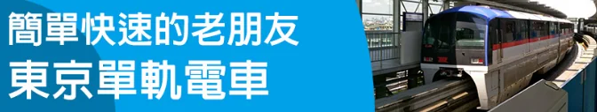

Haneda, Tokyo merkezine yakın bir konumda ve şehre ulaşmak için birkaç seçenek sunuyor: monoray, Keikyu trenleri, havalimanı otobüsleri ve taksiler; her birinin akıllıca kullanılacağı bir durum var. Cevabı üç şey belirliyor: Tokyo'nun hangi yakasında kalacağınız, ne kadar bagaj taşıyacağınız ve ne kadar geç ineceğiniz.

Bu rehber terminalden şehre uzanan kısmı ele alıyor: her hattın nereye gittiğini, ne kadar tuttuğunu, nerede aktarma yapacağınızı ve trenler durduktan sonra inerseniz ne yapacağınızı. Terminal binaları, restoranlar ve hediyelik eşyalar içinse [Haneda havalimanı rehberine](/blog/haneda-airport-guide) bakın.

## 1. Hangi bölge için hangi hat

“En hızlı hat”ı karşılaştırmak yanlış soru. Haneda'nın iki demiryolu da havalimanından çıkıyor, ama biri kuzeydoğuya, diğeri kuzeybatıya gidiyor; yanlış olanı seçmek fazladan aktarma demek.

| Bölge ve varış noktası | En iyi seçenek | Aktarma | Referans ücret |
| --- | --- | --- | --- |
| Hamamatsucho, Shimbashi, Shiodome; Odaiba | Tokyo Monorayı | Odaiba'ya Rinkai Hattı için Tennozu Isle | yaklaşık 500 ¥ |
| Tokyo İstasyonu, Akihabara, Ueno | Monoray → Hamamatsucho → JR Yamanote veya Keihin-Tohoku Hattı | Hamamatsucho | yaklaşık 500 ¥, artı JR kısmı |
| Shinagawa, Gotanda, Shibuya, Shinjuku, Ikebukuro | Keikyu → Shinagawa → JR Yamanote Hattı | Shinagawa | yaklaşık 300 ¥, artı JR kısmı |
| Ginza, Nihombashi, Asakusa, Oshiage | Toei Asakusa Hattı'na geçen Keikyu seferi | yok | 430–530 ¥ |
| Yokohama, Çin Mahallesi | Keikyu | yok | yaklaşık 340 ¥ |
| Otelinizin kapısı, Disney, Hakone, Karuizawa | Havalimanı otobüsü | yok | bölgesel, genellikle trenden pahalı |
| Geç varış, kalabalık grup, ağır bagajlar | Taksi | yok | taksimetreli |

Tek cümleyle: **doğuya gidecekseniz monorayı, batıya veya güneye gidecekseniz Keikyu'yu seçin; otobüsü yalnızca varış noktanız bir otel ya da Kanto bölgesinde uzak bir yer ise düşünün.** Bunlar referans rakamlar — seyahatten önce işletmecilerin kendi sitelerini kontrol edin.

## 2. Tokyo Monorayı — doğu Tokyo için en hızlısı

Tokyo Monorayı JR East tarafından işletiliyor ve havalimanından Hamamatsucho'ya giden tek bir hattı var: Haneda Havalimanı Hattı. Keikyu 1998'de havalimanına ulaşana kadar Haneda'ya giren tek demiryoluydu.

- **Ücret:** herhangi bir Haneda terminalinden Hamamatsucho'ya yaklaşık 500 ¥.
- **Yolculuk süresi:** Terminal 3'ten (dış hatlar) Hamamatsucho'ya en hızlı yaklaşık 14 dakika; her durakta duran trenler biraz daha uzun sürüyor.
- **Aktarmalar:** Hamamatsucho, JR Yamanote ve Keihin-Tohoku hatlarıyla bağlantılı; böylece Shimbashi, Tokyo İstasyonu, Akihabara, Ueno ve JR ağının geri kalanına ulaşmak kolay.

Odaiba için şehre girip geri dönmek yerine Tennozu Isle'da Rinkai Hattı'na aktarma yapın. Monorayın T1, T2 ve T3'ün her birinde istasyonu var — varış salonundan Monoray tabelalarını izleyin. JR grubunun bir parçası olduğu için gişede IC kartları kabul ediyor.

## 3. Keikyu — Shinagawa, Yokohama ve Asakusa

Keikyu, Haneda Havalimanı istasyonundan kalkıyor; kuzeye doğru Shinagawa'ya en hızlı yaklaşık 11 dakikada, güneye doğru Yokohama'ya ulaşıyor ve bu da onu batı Tokyo ile Kanagawa için ana yük taşıyıcı yapıyor. En yavaştan en hızlıya beş tren sınıfı işletiyor: yerel, havalimanı ekspresi, ekspres, hızlı sınırlı ekspres ve havalimanı hızlı sınırlı ekspres. **Ücret hepsinde aynı** — yalnızca durak sayısı değişiyor. Aceleniz varsa hızlı bir treni bekleyin; yoksa ilk gelen trene binin.

Ücretler Terminal 3'ten varış noktasına göre kademeli:

- **Shinagawa ve Sengakuji**, kuzeyde: yaklaşık 300 ¥
- **Yokohama**, güneyde: yaklaşık 340 ¥
- Sengakuji üzerinden **Toei Asakusa Hattı'na**: **Shimbashi**'ye yaklaşık 430 ¥, **Higashi-Ginza ve Nihombashi**'ye 470 ¥, **Asakusa ve Oshiage**'ye 530 ¥

Keikyu, Toei Asakusa Hattı'na doğrudan geçtiği için Ginza, Nihombashi ve Asakusa'ya giderken Sengakuji'de aktarma yapmanız gerekmiyor. Higashi-Ginza ve Asakusa için Keikyu'yu monoraydan daha iyi bir seçenek yapan da bu doğrudan sefer. Shinagawa'da JR Yamanote, Keihin-Tohoku ve Tokaido hatlarına ve Tokaido Shinkansen'e; Daimon'da Toei metrosuna aktarma yapabilirsiniz. Shibuya, Shinjuku ve Ikebukuro için Keikyu ile Shinagawa'ya, ardından Yamanote Hattı'na binin; ya da Keikyu ile Daimon'a, ardından metroya geçin.

## 4. Havalimanı otobüsleri — kapıdan kapıya, ama daha yavaş ve daha pahalı

Havalimanı otobüsü, sizi ve bagajlarınızı bir otel girişine kadar götüren tek seçenek. Haneda'nın ağı geniş: Tokyo'da Tokyo İstasyonu, Shinjuku, Ikebukuro, Shibuya, Shinagawa, Roppongi, Ginza, Akihabara, Asakusa ve Odaiba'ya; Kanto genelinde Chiba, Kanagawa, Saitama, Ibaraki, Tochigi, Gunma, Yamanashi ve Fukushima'ya, ayrıca Tokyo Disney Resort, Hakone, Karuizawa, Kawaguchi Gölü ve Gotemba'ya hizmet veriyor.

Havalimanının şu anda yayımladığı tahminlere göre ana seferler yaklaşık şu kadar sürüyor:

| Varış noktası | Tahmini süre | T3'teki peron |
| --- | --- | --- |
| Tokyo İstasyonu | yaklaşık 35 dakika | 1. kat, peron 1 |
| Shinjuku İstasyonu | yaklaşık 35 dakika | peron 3 |
| Shibuya İstasyonu | yaklaşık 40 dakika | peron 4 |
| Ikebukuro İstasyonu | yaklaşık 55 dakika | peron 2 |
| Asakusa | yaklaşık 1 saat 5 dakika | peron 5 |
| Tokyo Disney Resort | yaklaşık 30–40 dakika | peron 5 |
| Yokohama İstasyonu | yaklaşık 30 dakika | peron 7 |

Bilmeniz gereken birkaç şey: peronlar birinci katta ve T3'te onlara ulaşmak için ikinci kattaki varış lobisinden aşağı iniyorsunuz. Biletler makinelerden veya gişeden alınıyor ve bazı hatlar rezerve edilebiliyor. Ginza, Akasaka/Roppongi, Akihabara, Toranomon ve Shinagawa/Ebisu hatları şu anda askıda, bu yüzden önce havalimanının sitesinden doğrulayın. **Sonuç açık: basit bir şehir gidiş-dönüşü için otobüs trenden pahalı ve mutlaka daha hızlı değil. Değeri daha az aktarma, garantili koltuk ve otelde ya da banliyöde bir durak.**

## 5. Taksiler ve geç varışlar

Taksiler üç terminalin de dışında birinci katta sıra bekliyor — Taksi tabelalarını izleyin. Taksimetre çalışıyor ve çoğu merkezî varış noktası trene veya otobüse göre çok daha pahalı; saat 22.00 civarından itibaren gece tarifesi uygulanıyor, bu yüzden taksi esas olarak ücret paylaşıldığında veya bagaj çok olduğunda mantıklı.

Daha büyük sorun fiyat değil, son tren. Monoray ve Keikyu gece yarısı civarında duruyor ve kesin saatler terminale ve haftanın gününe göre değişiyor. Havalimanı ayrıca ana Tokyo istasyonlarına ve bazı otellere gece geç saatlerde ve sabah erken saatlerde servis otobüsleri işletiyor; bunlar gündüz seferlerine göre çok daha seyrek. Gece yarısına yakın inerseniz taksiye karar vermeden önce o gecenin son trenlerine ve gece otobüslerine bakın.

## 6. IC kartlar, ücretler ve son trenler

- **IC kartlar:** Suica, PASMO ve ülke genelinde geçerli IC kartlar (ICOCA ve diğerleri) monorayda, Keikyu'da ve havalimanı otobüslerinde geçiyor; girişte ve çıkışta okutun, bilet kuyruğunu atlayın. Kartlar istasyon makinelerinde satılıyor ve yükleniyor; telefonunuzdaki Suica veya PASMO da aynı şekilde çalışıyor.
- **Ücretler:** monorayda bölgeye göre, Keikyu'da mesafeye göre; JR veya metro kısmı ayrıca ücretlendiriliyor. Tüm yolculuk boyunca tek kart kullanmak her parça için ayrı bilet almaktan daha iyi.
- **Son trenler:** iki demiryolu da gece yarısı civarında duruyor ve T3, T1 ve T2'den biraz farklı. Hâlâ tren olacağını varsaymayın.
- **Gitmeden önce kontrol edin:** burada verilen ücretler 2023 tarihli. Güncel monoray, Keikyu ve havalimanı otobüsü ücretleri, tarifeleri ve gece seferleri için seyahat gününde işletmecilerin web sitelerine bakın.

## İlgili bağlantılar

- **Bu sitede**: [Haneda Havalimanı (HND)](/airport/HND), [Japonya (JP)](/country/JP)
- **Wikipedia**: [Haneda Havalimanı](https://en.wikipedia.org/wiki/Haneda_Airport)
- **Baidu Baike**: [Haneda Havalimanı](https://baike.baidu.com/item/%E7%BE%BD%E7%94%B0%E6%9C%BA%E5%9C%BA)
- **Havalimanı sitesi**: [Haneda Havalimanı ulaşım](https://tokyo-haneda.com/en/access/index.html), [otoyol ve özel otobüsler](https://tokyo-haneda.com/en/access/bus/index.html)

Görsel kaynağı: görseller özgün makaleden; güzergâh haritaları havalimanı ve işletmeciler tarafından yayımlanıyor. Buradaki ücretlerin çoğu 2023 tarihli — seyahat gününüzde Tokyo Monorayı, Keikyu ve Haneda Havalimanı web sitelerini kontrol edin.
