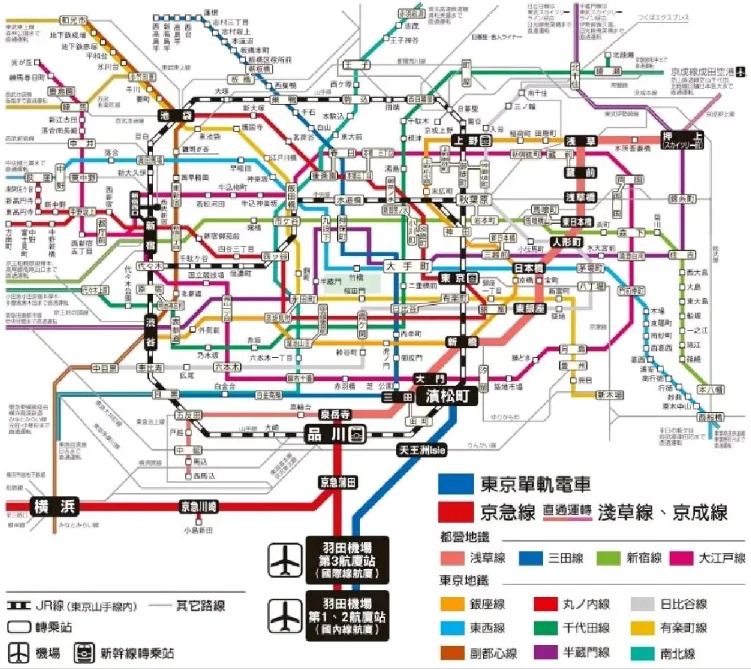

Haneda nằm gần trung tâm Tokyo và có nhiều cách vào thành phố: tàu một ray, tàu Keikyu, xe buýt sân bay và taxi, mỗi loại có chỗ dùng hợp lý riêng. Ba điều quyết định câu trả lời — bạn ở phía nào của Tokyo, bạn mang bao nhiêu hành lý và bạn hạ cánh muộn đến đâu.

Hướng dẫn này bao quát chặng từ nhà ga đến thành phố: mỗi tuyến đi đâu, giá bao nhiêu, đổi ở đâu và phải làm gì nếu hạ cánh sau khi tàu ngừng chạy. Về bản thân các nhà ga, nhà hàng và đồ lưu niệm, xem [hướng dẫn Sân bay Haneda đi kèm](/blog/haneda-airport-guide).

## 1. Tuyến nào cho khu vực nào

So sánh “tuyến nhanh nhất” là câu hỏi sai. Hai tuyến đường sắt của Haneda đều rời sân bay, nhưng một tuyến chạy về phía đông bắc và tuyến kia về phía tây bắc, và chọn nhầm sẽ phải đổi tàu thêm.

| Khu vực và điểm đến | Lựa chọn tốt nhất | Đổi tại | Giá vé tham khảo |
| --- | --- | --- | --- |
| Hamamatsucho, Shimbashi, Shiodome; Odaiba | Tokyo Monorail | Tennozu Isle để đi tuyến Rinkai đến Odaiba | khoảng 500 yên |
| Ga Tokyo, Akihabara, Ueno | Monorail → Hamamatsucho → tuyến JR Yamanote hoặc Keihin-Tohoku | Hamamatsucho | khoảng 500 yên, cộng chặng JR |
| Shinagawa, Gotanda, Shibuya, Shinjuku, Ikebukuro | Keikyu → Shinagawa → tuyến JR Yamanote | Shinagawa | khoảng 300 yên, cộng chặng JR |
| Ginza, Nihombashi, Asakusa, Oshiage | Keikyu chạy thẳng lên tuyến Toei Asakusa | không cần đổi | 430–530 yên |
| Yokohama, Phố Tàu | Keikyu | không cần đổi | khoảng 340 yên |
| Cửa khách sạn, Disney, Hakone, Karuizawa | Xe buýt sân bay | không cần đổi | theo khu vực, thường cao hơn tàu |
| Đến muộn, đi nhóm, hành lý nặng | Taxi | không cần đổi | tính theo đồng hồ |

Tóm lại trong một câu: **đi về phía đông bằng monorail, đi về phía tây hoặc nam bằng Keikyu, và chỉ nghĩ đến xe buýt khi điểm đến là khách sạn hoặc một nơi nào đó ngoài vùng Kanto.** Đây là các con số tham khảo — hãy kiểm tra trang web của chính các hãng vận hành trước khi đi.

## 2. Tokyo Monorail — nhanh nhất cho phía đông Tokyo

Tokyo Monorail do JR East vận hành và chỉ có một tuyến, Tuyến Sân bay Haneda, chạy từ sân bay đến Hamamatsucho. Mãi đến khi Keikyu đến sân bay vào năm 1998, đây là tuyến đường sắt duy nhất vào Haneda.

- **Giá vé:** khoảng 500 yên từ bất kỳ nhà ga Haneda nào đến Hamamatsucho.
- **Thời gian đi:** khoảng 14 phút với chuyến nhanh nhất từ Nhà ga 3 (quốc tế) đến Hamamatsucho; tàu dừng mọi ga lâu hơn một chút.
- **Trung chuyển:** Hamamatsucho nối với các tuyến JR Yamanote và Keihin-Tohoku, nên Shimbashi, Ga Tokyo, Akihabara, Ueno và phần còn lại của mạng JR đều thuận tiện.

Để đi Odaiba, hãy đổi ở Tennozu Isle sang tuyến Rinkai thay vì vào trung tâm rồi quay lại. Tuyến có ga ở cả T1, T2 và T3 — đi theo biển Monorail từ khu đến. Vì thuộc nhóm JR, tuyến nhận thẻ IC tại cổng soát.

## 3. Keikyu — Shinagawa, Yokohama và Asakusa

Keikyu rời Ga Sân bay Haneda, đến Shinagawa trong khoảng 11 phút với chuyến nhanh nhất về phía bắc và Yokohama về phía nam, khiến tuyến này thành trụ cột cho phía tây Tokyo và Kanagawa. Tuyến có năm hạng tàu, từ chậm nhất đến nhanh nhất: tàu thường, airport express, express, rapid limited express và airport rapid limited express. **Giá vé như nhau trên mọi hạng tàu** — chỉ số ga dừng thay đổi. Nếu vội, hãy đợi tàu rapid; nếu không, lên chuyến nào đến trước cũng được.

Giá vé chia theo điểm đến, tính từ Nhà ga 3:

- **Shinagawa và Sengakuji**, về phía bắc: khoảng 300 yên
- **Yokohama**, về phía nam: khoảng 340 yên
- Đi qua Sengakuji lên **tuyến Toei Asakusa**: khoảng 430 yên đến **Shimbashi**, 470 yên đến **Higashi-Ginza và Nihombashi**, và 530 yên đến **Asakusa và Oshiage**

Vì Keikyu chạy thẳng lên tuyến Toei Asakusa, Ginza, Nihombashi và Asakusa không cần đổi tại Sengakuji. Chính dịch vụ chạy thẳng này khiến Keikyu là lựa chọn tốt hơn monorail cho Higashi-Ginza và Asakusa. Tại Shinagawa, bạn có thể đổi sang các tuyến JR Yamanote, Keihin-Tohoku và Tokaido, và sang Tokaido Shinkansen; tại Daimon, bạn có thể đổi sang tàu điện ngầm Toei. Để đi Shibuya, Shinjuku và Ikebukuro, hãy đi Keikyu đến Shinagawa rồi chuyển sang tuyến Yamanote, hoặc Keikyu đến Daimon rồi đi tàu điện ngầm.

## 4. Xe buýt sân bay — tận cửa, nhưng chậm hơn và đắt hơn

Xe buýt sân bay là lựa chọn duy nhất đưa bạn và hành lý đến tận cửa khách sạn. Mạng lưới của Haneda rộng: trong Tokyo, xe phục vụ Ga Tokyo, Shinjuku, Ikebukuro, Shibuya, Shinagawa, Roppongi, Ginza, Akihabara, Asakusa và Odaiba, và khắp Kanto, xe đến Chiba, Kanagawa, Saitama, Ibaraki, Tochigi, Gunma, Yamanashi và Fukushima, cùng Tokyo Disney Resort, Hakone, Karuizawa, Hồ Kawaguchi và Gotemba.

Theo ước tính hiện được sân bay công bố, các chuyến chính mất khoảng:

| Điểm đến | Thời gian ước tính | Bến tại T3 |
| --- | --- | --- |
| Ga Tokyo | khoảng 35 phút | Tầng 1, bến 1 |
| Ga Shinjuku | khoảng 35 phút | bến 3 |
| Ga Shibuya | khoảng 40 phút | bến 4 |
| Ga Ikebukuro | khoảng 55 phút | bến 2 |
| Asakusa | khoảng 1 giờ 5 phút | bến 5 |
| Tokyo Disney Resort | khoảng 30–40 phút | bến 5 |
| Ga Yokohama | khoảng 30 phút | bến 7 |

Vài điều cần biết: các bến nằm ở tầng một, và tại T3 bạn đi xuống từ sảnh đến tầng hai để tới đó. Vé mua từ máy hoặc quầy, và một số tuyến có thể đặt trước. Các tuyến đến Ginza, Akasaka/Roppongi, Akihabara, Toranomon và Shinagawa/Ebisu hiện đang tạm dừng, nên hãy xác nhận trên trang web sân bay trước. **Kết luận rất rõ: với một chuyến đi đơn giản vào trung tâm và quay về, xe buýt đắt hơn tàu và không chắc nhanh hơn. Giá trị của nó nằm ở ít lần đổi chỗ, có chỗ ngồi chắc chắn, và dừng tại khách sạn hoặc tận vùng ngoại ô.**

## 5. Taxi và các chuyến đến muộn

Taxi xếp hàng ở tầng một bên ngoài cả ba nhà ga — đi theo biển Taxi. Đồng hồ chạy, và hầu hết điểm đến trung tâm đắt hơn nhiều so với tàu hoặc xe buýt; phụ phí ban đêm áp dụng từ khoảng 22:00, nên taxi chủ yếu hợp lý khi chia tiền hoặc có nhiều hành lý.

Vấn đề lớn hơn không phải giá mà là chuyến tàu cuối. Monorail và Keikyu đều dừng khoảng nửa đêm, thời gian chính xác thay đổi theo nhà ga và ngày trong tuần. Sân bay cũng có xe buýt đưa đón đêm khuya và sáng sớm đến các ga chính của Tokyo và một số khách sạn, với tần suất thưa hơn nhiều so với ban ngày. Nếu hạ cánh gần nửa đêm, hãy tra chuyến tàu cuối và xe buýt đêm của đêm đó trước khi quyết định bắt taxi.

## 6. Thẻ IC, giá vé và chuyến tàu cuối

- **Thẻ IC:** Suica, PASMO và các thẻ IC liên thông toàn quốc (ICOCA và các loại khác) dùng được trên monorail, Keikyu và xe buýt sân bay; quẹt vào và ra để bỏ qua hàng mua vé. Thẻ được bán và nạp tại máy ở ga, và Suica hoặc PASMO trong điện thoại hoạt động theo cùng cách.
- **Giá vé:** monorail tính theo đoạn, Keikyu theo khoảng cách, mọi chặng JR hoặc tàu điện ngầm tính riêng. Một thẻ cho cả chuyến đi tốt hơn mua từng chặng.
- **Chuyến tàu cuối:** cả hai tuyến đường sắt dừng khoảng nửa đêm, và T3 khác một chút so với T1 và T2. Đừng cho rằng vẫn sẽ có tàu.
- **Kiểm tra trước khi đi:** giá vé nêu ở đây từ năm 2023. Để biết giá monorail, Keikyu và xe buýt sân bay hiện tại, thời gian biểu và dịch vụ đêm khuya, hãy dùng trang web của các hãng vận hành trong ngày đi.

## Liên kết liên quan

- **Trên trang này**: [Sân bay Haneda (HND)](/airport/HND), [Nhật Bản (JP)](/country/JP)
- **Wikipedia**: [Sân bay Haneda](https://en.wikipedia.org/wiki/Haneda_Airport)
- **Baidu Baike**: [Sân bay Haneda](https://baike.baidu.com/item/%E7%BE%BD%E7%94%B0%E6%9C%BA%E5%9C%BA)
- **Trang sân bay**: [Lối vào Sân bay Haneda](https://tokyo-haneda.com/en/access/index.html), [xe buýt cao tốc và chuyên dụng](https://tokyo-haneda.com/en/access/bus/index.html)

Nguồn ảnh: ảnh từ bài viết gốc; bản đồ tuyến do sân bay và các hãng vận hành công bố. Hầu hết giá vé ở đây từ năm 2023 — hãy kiểm tra trang web của Tokyo Monorail, Keikyu và Sân bay Haneda vào ngày bạn đi.
