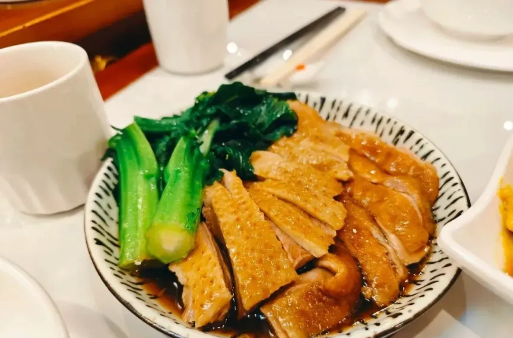
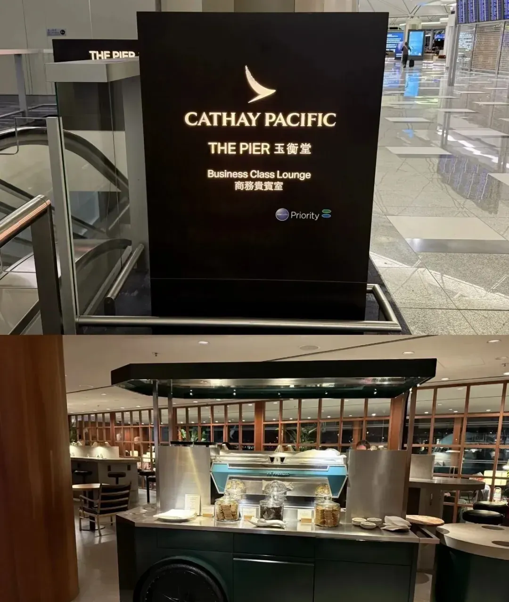

Bandara Internasional Hong Kong — Chek Lap Kok — dibuka pada 6 Juli 1998, menggantikan Kai Tak. Dibangun di atas tanah reklamasi lepas pantai Lantau, bandara ini melayani lebih dari 150 tujuan di Asia, Eropa, Amerika Utara, dan Oseania.

Hampir semua kegiatan berlangsung di **Terminal 1 (T1)**: check-in, keamanan, keberangkatan, dan kedatangan, dengan gerbang terpencil dilayani Concourse Midfield dan North Satellite. **Terminal 2** sedang diperluas dan dibuka kembali; pengumuman resmi bandara adalah acuan pasti soal waktunya.

## Transit

Berikut proses transit dasar setelah Anda mendarat di Hong Kong.

### Langkah 1: pastikan boarding pass lanjutan Anda

- **Jika sudah memilikinya:** cukup ikuti papan “Transfers / Transit” yang jelas.
- **Jika belum:** pergi ke loket transit di lantai 5 (L5), tunjukkan paspor dan e-tiket kepada staf maskapai, lalu ambil boarding pass Anda.

### Langkah 2: pemeriksaan keamanan

Setiap penumpang transit melewati pemeriksaan keamanan lagi.

### Langkah 3: ke lantai keberangkatan dan gerbang Anda

Setelah keamanan, Anda keluar di lantai 7 (L7), lantai keberangkatan, yang dipenuhi toko dan restoran. Periksa layar keberangkatan untuk nomor gerbang dan waktu naik pesawat lanjutan Anda.

**Di mana gerbangnya**

| Gerbang | Lokasi |
| --- | --- |
| 1–80 | Terminal 1 sendiri |
| 201–230 | Concourse Midfield, di barat gedung utama; dijangkau dengan Automated People Mover |
| 501–510 | North Satellite Concourse, dijangkau melalui Sky Bridge atau Automated People Mover |

**Berpindah di antaranya:** jika gerbang Anda cukup jauh, gunakan Automated People Mover (kereta tanpa masinis) di dalam terminal.

> Sisihkan setidaknya **2 jam** untuk transit, untuk mengantisipasi penerbangan masuk yang terlambat, perubahan gerbang, atau antrean panjang.

## Penitipan bagasi

Jika waktu transit Anda panjang dan Anda ingin ke kota tanpa membawa beban, bandara menyediakan layanan penitipan bagasi.

- **Di mana:** Terminal 1, aula kedatangan lantai 5, zona A (sisi publik — terbuka untuk semua penumpang)
- **Jam buka:** setiap hari, 05.30–01.30
- **Harga:** HK$14 per jam; maksimum HK$165 per item per hari (tidak ada biaya lebih tinggi dalam 24 jam)

## Menuju ke kota

Bandara menawarkan beberapa cara ke kota, jadi pilih yang sesuai dengan Anda:

- **Airport Express:** pilihan tercepat — sekitar 24 menit ke Central (Stasiun Hong Kong), berhenti di Kowloon dan Tsing Yi. HK$115 sekali jalan; terbaik untuk pelancong bisnis atau siapa pun yang kekurangan waktu.
- **Bus bandara:** pilihan termurah, dengan cakupan luas dan layanan sepanjang malam. Tarif HK$30–40; terbaik jika Anda punya waktu dan ingin menghemat.
- **Transfer bandara:** pesan penjemputan pribadi sebelumnya dan ditemani pengemudi — terbaik jika membawa banyak bagasi atau untuk keluarga.
- **Taksi:** cepat dan nyaman, pilihan bagi yang membawa tas berat atau mengutamakan privasi.

## Dua pemandangan yang layak dikunjungi

### Sky Bridge

Menghubungkan terminal utama dengan North Satellite Concourse, Sky Bridge adalah jembatan pejalan kaki sepanjang 200 meter — jembatan pejalan kaki sisi udara terpanjang di dunia — 28 meter di atas tanah, dengan lantai kaca yang memungkinkan Anda melihat pesawat bergerak di bawah kaki Anda.

**Di mana:** gerbang 13–22

### Kubah bermain

Kubah bermain adalah fasilitas bermain yang dibangun untuk anak usia 6 hingga 12 tahun. Bentuknya seperti cangkang telur raksasa dengan jaring panjat, perosotan, dan terowongan jaring melengkung, dengan pita warna-warni di atasnya.

**Di mana:** Terminal 1, lantai keberangkatan (L6), East Hall, dekat gerbang 11

## Tempat makan

### 阿鸿小吃 (Ah Hung Snacks)

Dinobatkan CNN sebagai restoran bandara terbaik di dunia, Ah Hung Snacks dikenal dengan hidangan semurnya dan daging panggang — irisan angsa semur, piring semur campur, dan hidangan khasnya, sengkel sapi semur. Rasanya kaya tanpa berat, dan banyak pelancong sengaja makan di sini sebelum naik pesawat.

**Di mana:** Terminal 1, lantai kedatangan, lantai 5 (sisi publik)

### 何洪记 (Ho Hung Kee)

Ho Hung Kee adalah restoran lokal mapan yang dikenal dengan mi wonton dan buburnya, dan pernah meraih rekomendasi Michelin. Wontonnya berkulit tipis dan berisi udang yang kenyal, dan bubur sampan punya penggemarnya sendiri — semangkuk mi Kanton panas yang enak sambil menunggu.

**Di mana:** Terminal 1, lantai kedatangan, lantai 5 (sisi publik)

### 都爹利会馆 (Duddell's)

Duddell's, restoran Kanton berbintang Michelin, memiliki gerai di food court di dalam area terbatas keberangkatan Terminal 1, menyajikan masakan Kanton berkualitas tinggi — dim sum, sup double-boiled, daging panggang, dan tumisan, dengan banyak pilihan vegetarian di menunya.

**Di mana:** Terminal 1, lantai keberangkatan, East Hall, lantai 7, toko 7E161 (sisi udara)

### Gordon Ramsay Plane Food To Go

Gordon Ramsay membawa Gordon Ramsay Plane Food To Go pertama di Asia ke Bandara Internasional Hong Kong, dengan menu hidangan Inggris bersama spesialitas Hong Kong yang dibuat khusus untuk bandara. Makanannya segar dan seimbang — camilan ringan Barat termasuk sandwich, salad, dan pasta — dan cocok untuk pelancong yang ingin sesuatu yang cepat tetapi enak.

**Di mana:** Terminal 1, lantai keberangkatan, East Hall, lantai 7 (sisi udara)

## Belanja

- **Sebelum keamanan:** Cookies Quartet, POP MART, toko museum M+, Micro Film, dan Sanrio.
- **Setelah keamanan:** toko suvenir (Kee Wah Bakery, Sweet Dreams, dan lainnya), merek mewah (Louis Vuitton, Hermès), perhiasan (Cartier, Bulgari), kecantikan (SK-II, Lancôme), dan mainan desainer serta hadiah (toko Hong Kong Disneyland, Hong Kong Design Gallery). Mereknya sangat banyak, dan Anda mendapatkan harga bebas bea di atas nilai tukar.

## Lounge

### Hong Kong Airlines — 遨堂 (Club Autus)

Club Autus menonjolkan cita rasa Hong Kong, dengan mi wonton dibuat sesuai pesanan, egg waffle, mi gerobak, puding tahu, teh susu silk-stocking, dan nasi claypot, plus koktail dari bartender juara dunia Leo Ko.

**Di mana:** Concourse Midfield, lantai 7

### Plaza Premium Lounge

Independen dari maskapai mana pun, lounge Plaza Premium terbuka untuk siapa saja yang membayar — Anda hanya perlu boarding pass yang sah. Selain bir, kopi, dan minuman ringan, mereka menyajikan makanan panas yang dimasak sesuai pesanan, seperti sup mi bakso ikan, nasi daging panggang, dan roti panggang buatan tangan, dan setiap kursi memiliki soket listrik.

**Di mana:** dekat gerbang 1, 35, dan 60

### Lounge Cathay Pacific

Hong Kong adalah basis utama Cathay Pacific, jadi maskapai ini memiliki beberapa lounge di sini, dan lounge-lounge tersebut adalah yang paling lengkap di bandara. The Pier, misalnya, menyajikan mi dan-dan serta mi wonton yang baru dimasak dengan pilihan minuman dan hidangan panas lengkap, serta memiliki rumah teh tempat Anda bisa memesan sepanci teh panas untuk menetralkan rasa yang kaya.

**Di mana:** dekat gerbang 35, 6, 63–65, 1–4, dan 5

## Layanan gratis

- **Wi-Fi gratis:** matikan data seluler → pilih jaringan “HKAirport Free WiFi” → buka browser dan masukkan URL yang valid → baca syarat dan ketentuan → ketuk “Agree and Continue”.
- **Pengisian daya gratis:** lebih dari 9.100 soket listrik di seluruh terminal, dengan port USB dan soket tiga pin Inggris di area tempat duduk dekat hampir setiap gerbang dan di zona transit.
- **Pancuran gratis:** pancuran umum di Terminal 1, gerbang 12. Tunjukkan boarding pass Anda untuk mengambil handuk bersih dan perlengkapan mandi tanpa biaya.
- **Area bermain anak:** di Terminal 1 gerbang 1, 15, 41, dan 60, untuk membantu keluarga yang transit dengan anak menghabiskan waktu.

## Satu hal yang perlu diperhatikan: pajak keberangkatan naik

Departemen Penerbangan Sipil Hong Kong telah mengumumkan bahwa untuk tiket yang diterbitkan pada atau setelah 1 Oktober 2025, **Air Passenger Departure Tax untuk penerbangan yang berangkat dari Hong Kong naik dari HK$120 menjadi HK$200** (penumpang transit pada hari yang sama dikecualikan). Di bawah aturan baru, pelancong yang tinggal di Hong Kong tidak lebih dari 48 jam dapat mengajukan pengembalian penuh pajak tersebut.

## Tautan terkait

- **Di situs ini**: [Bandara Internasional Hong Kong (HKG)](/airport/HKG)
- **Wikipedia**: [Bandara Internasional Hong Kong](https://en.wikipedia.org/wiki/Hong_Kong_International_Airport)
- **Baidu Baike**: [Bandara Internasional Hong Kong](https://baike.baidu.com/item/%E9%A6%99%E6%B8%AF%E5%9B%BD%E9%99%85%E6%9C%BA%E5%9C%BA)
