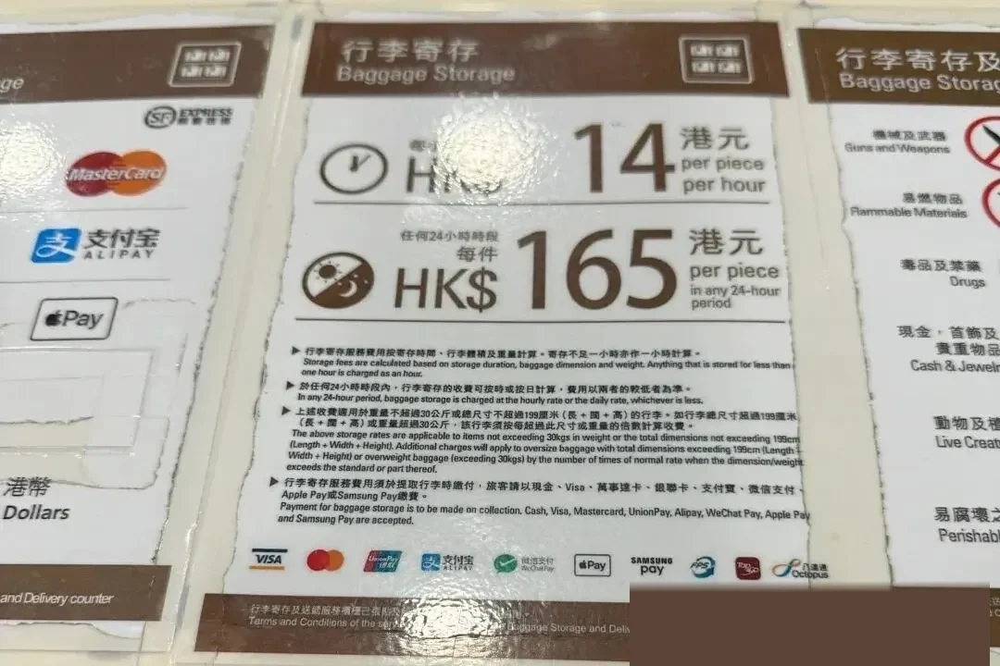
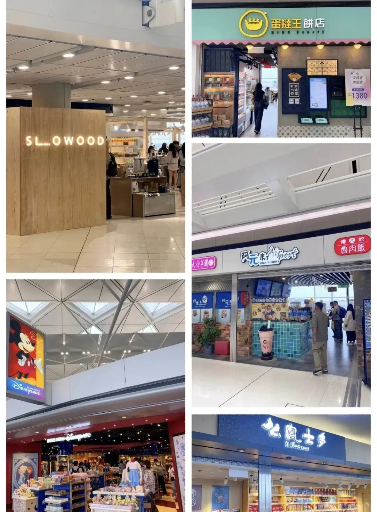
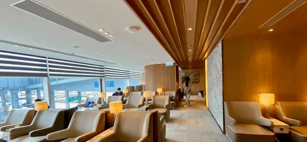

香港国際空港（チェクラップコック）は1998年7月6日に開港し、啓徳空港に代わりました。ランタオ島沖の埋め立て地に造られ、アジア、ヨーロッパ、北アメリカ、オセアニアの150以上の目的地を結んでいます。

ほぼすべての機能が**ターミナル1（T1）**に集まっています。チェックイン、保安検査、出発、到着があり、遠隔のゲートはミッドフィールド・コンコースと北サテライト・コンコースが担います。**ターミナル2**は拡張・再開準備中で、時期については空港の公式発表が最終的な判断基準です。

## 乗り継ぎ

香港到着後の基本的な乗り継ぎ手順は次のとおりです。

### ステップ1：乗り継ぎ搭乗券の確認

- **すでに持っている場合：** 「Transfers / Transit」の分かりやすい表示に従うだけです。
- **持っていない場合：** 5階（L5）の乗り継ぎカウンターへ行き、パスポートとeチケットを航空会社の係員に提示して、搭乗券を受け取ります。

### ステップ2：保安検査

乗り継ぎ客は全員、保安検査をもう一度受けます。

### ステップ3：出発階と搭乗ゲートへ

保安検査を抜けると、ショップやレストランが並ぶ出発階の7階（L7）に出ます。出発案内画面で乗り継ぎ便のゲート番号と搭乗時刻を確認してください。

**ゲートの位置**

| ゲート | 場所 |
| --- | --- |
| 1〜80 | ターミナル1内 |
| 201〜230 | 本館西側のミッドフィールド・コンコース。自動旅客輸送システム（APM）で移動 |
| 501〜510 | 北サテライト・コンコース。スカイブリッジまたはAPMで移動 |

**ゲート間の移動：** ゲートが遠い場合は、ターミナル内の自動旅客輸送システム（無人列車）を使ってください。

> 乗り継ぎには少なくとも**2時間**を見込んでください。前便の遅延、ゲート変更、長い列に対応するためです。

## 手荷物預かり

乗り継ぎ時間が長く、身軽に市内へ出たいなら、空港に手荷物預かりサービスがあります。

- **場所：** ターミナル1、5階到着ロビー、Aゾーン（陸側・全旅客利用可）
- **営業時間：** 毎日5:30〜1:30
- **料金：** 1時間HK$14。1個1日最大HK$165（24時間以内はそれを超えません）

## 市内へのアクセス

空港から市内へはいくつかの方法があり、自分に合ったものを選べます。

- **エアポートエクスプレス：** 最速の選択肢で、九龍と青衣に停まり、中央（香港駅）まで約24分。片道HK$115。ビジネス客や時間がない人に向いています。
- **空港バス：** 最も安い選択肢で、路線網が広く深夜便もあります。運賃はHK$30〜40。時間があって節約したい人に向いています。
- **空港送迎：** 事前に専用車を予約し、ドライバーの出迎えを受けます。荷物が多い人や家族連れに向いています。
- **タクシー：** 速くて便利で、重い荷物がある人やプライバシーを重視する人に向いています。

## 歩いて見る価値のある2つの見どころ

### スカイブリッジ

メインターミナルと北サテライト・コンコースを結ぶスカイブリッジは、全長200メートルの歩道橋で、制限区域内では世界最長、地上28メートルの高さにあります。床がガラスになっていて、足元を走る航空機を眺められます。

**場所：** 13〜22ゲート

### プレイドーム

プレイドームは6〜12歳の子ども向けに造られた遊び場です。巨大な卵の殻のような構造で、クライミングネット、滑り台、曲線のメッシュトンネルがあり、頭上には色鮮やかなリボンが架かっています。

**場所：** ターミナル1、出発階（L6）、東ホール、11ゲート付近

## 食事処

### 阿鸿小吃（Ah Hung Snacks）

CNNに世界最高の空港レストランとして選ばれた阿鸿小吃は、煮込み料理とローストミートで知られています。ガチョウの煮込みスライス、煮込みの盛り合わせ、看板料理の牛すねの煮込みなどです。味は濃厚ながら重すぎず、搭乗前にわざわざ立ち寄る旅行者も多くいます。

**場所：** ターミナル1、到着階5階（陸側）

### 何洪记（Ho Hung Kee）

何洪记はワンタン麺と粥で知られる老舗の地元レストランで、ミシュランの推薦を維持しています。ワンタンは皮が薄く、プリプリのエビがたっぷり詰まっています。艇仔粥（サンパン粥）にも根強いファンがいます。待ち時間に温かい広東風麺を一杯いかがでしょうか。

**場所：** ターミナル1、到着階5階（陸側）

### 都爹利会馆（Duddell's）

ミシュラン一つ星の広東料理店、都爹利会馆は、ターミナル1出発制限区域内のフードコートに出店しています。点心、蒸しスープ、ローストミート、炒め物など質の高い広東料理を提供し、メニューにはベジタリアン向けの選択肢も豊富です。

**場所：** ターミナル1、出発階、東ホール、7階、7E161号店（制限区域内）

### Gordon Ramsay Plane Food To Go

ゴードン・ラムゼイは、アジア初の「Gordon Ramsay Plane Food To Go」を香港国際空港に開きました。英国料理に、この空港のために考案した香港の名物料理を添えたメニューです。料理は新鮮でバランスがよく、サンドイッチ、サラダ、パスタなどの洋風軽食があり、手早くても質の良いものを求める旅行者に適しています。

**場所：** ターミナル1、出発階、東ホール、7階（制限区域内）

## 買い物

- **保安検査前：** Cookies Quartet、POP MART、M+ミュージアムショップ、Micro Film、Sanrio。
- **保安検査後：** 土産物店（奇華餅家、Sweet Dreamsなど）、高級ブランド（ルイ・ヴィトン、エルメス）、ジュエリー（カルティエ、ブルガリ）、ビューティー（SK-II、ランコム）、デザイナーズトイとギフト（香港ディズニーランド・ショップ、香港デザインギャラリー）。ブランド数は非常に多く、為替レートに加えて免税価格で購入できます。

## ラウンジ

### 香港航空 — 遨堂（Club Autus）

遨堂は香港の味を前面に押し出し、注文を受けてから作るワンタン麺、エッグワッフル、車仔麺、豆腐花、絲襪奶茶（ストッキングミルクティー）、煲仔飯を用意しています。さらに、世界チャンピオンのバーテンダー、Leo Koによるカクテルも楽しめます。

**場所：** ミッドフィールド・コンコース、7階

### プラザ・プレミアム・ラウンジ

プラザ・プレミアム・ラウンジは特定の航空会社に属さず、料金を払えば誰でも利用できます。必要なのは有効な搭乗券だけです。ビール、コーヒー、ソフトドリンクに加え、注文後に調理する温かい料理（フィッシュボール麺、ローストミートライス、手作りトーストなど）を提供し、すべての席に電源コンセントがあります。

**場所：** 1、35、60ゲート付近

### キャセイパシフィック航空のラウンジ

香港はキャセイパシフィック航空の本拠地で、同社はここに複数のラウンジを持ち、空港のラウンジの中でも最も設備が充実しています。例えば「The Pier」では、出来たての担々麺やワンタン麺を、豊富なドリンクや温かい料理とともに提供しています。茶屋もあり、濃厚な味をリセットする温かいポットのお茶を注文できます。

**場所：** 35、6、63〜65、1〜4、5ゲート付近

## 無料サービス

- **無料Wi-Fi：** モバイルデータをオフ→「HKAirport Free WiFi」を選択→ブラウザを開き任意の有効なURLを入力→利用規約を読む→「Agree and Continue」をタップ。
- **無料充電：** ターミナル全体に9,100以上の電源コンセントがあり、ほぼすべてのゲート付近と乗り継ぎエリアの座席にUSBポートと英国式三穴コンセントがあります。
- **無料シャワー：** ターミナル1の12ゲートに公共シャワーがあります。搭乗券を提示すると、新しいタオルとアメニティを無料で受け取れます。
- **子どもの遊び場：** ターミナル1の1、15、41、60ゲートにあり、子ども連れの乗り継ぎ家族が時間を過ごせるようになっています。

## 注意点：出国税が値上がりしました

香港民航局は、2025年10月1日以降に発券された航空券について、**香港発のフライトの航空旅客出国税がHK$120からHK$200に引き上げられる**と発表しました（同日乗り継ぎの旅客は対象外）。新規則では、香港滞在が48時間以内の旅行者は税金の全額還付を申請できます。

## 関連リンク

- **このサイト内**：[香港国際空港 (HKG)](/airport/HKG)
- **Wikipedia**：[香港国際空港](https://en.wikipedia.org/wiki/Hong_Kong_International_Airport)
- **百度百科**：[香港国際空港](https://baike.baidu.com/item/%E9%A6%99%E6%B8%AF%E5%9B%BD%E9%99%85%E6%9C%BA%E5%9C%BA)
