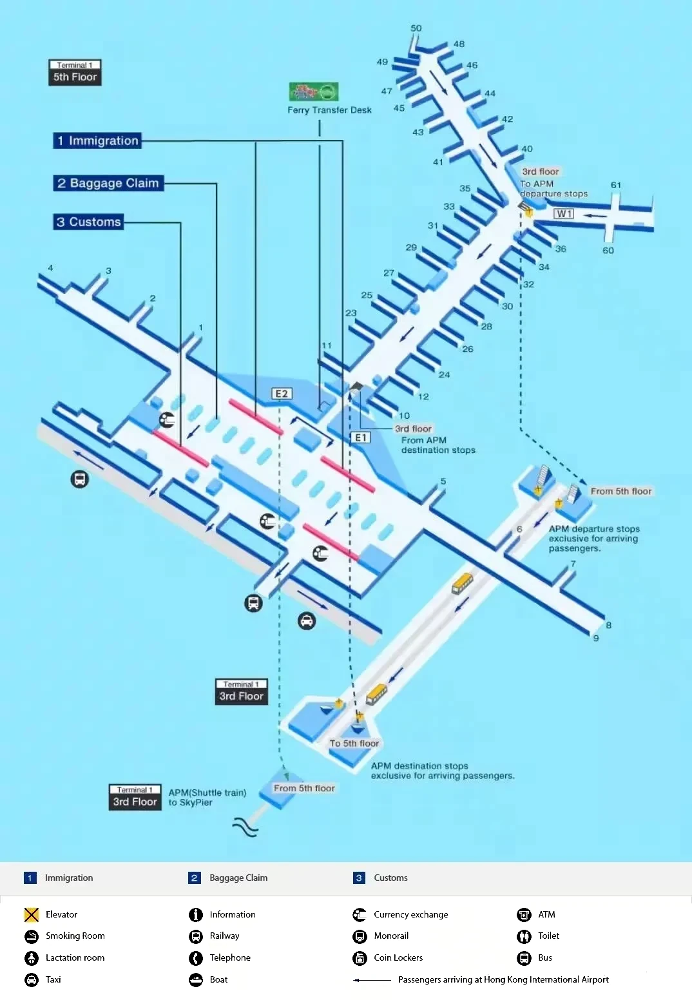

홍콩국제공항, 즉 첵랍콕 공항은 1998년 7월 6일 카이탁 공항을 대체하며 개항했습니다. 란타우섬 앞바다를 매립한 땅 위에 세워진 이 공항은 아시아, 유럽, 북미, 오세아니아를 잇는 150개 이상의 목적지에 취항합니다.

체크인, 보안검색, 출국, 도착 등 거의 모든 과정이 **제1터미널(T1)**에서 이루어지며, 외곽 게이트는 미드필드 콘코스와 노스 새틀라이트 콘코스가 담당합니다. **제2터미널**은 확장 공사를 거쳐 재개장을 준비하고 있으며, 정확한 시기는 공항 당국의 발표가 기준입니다.

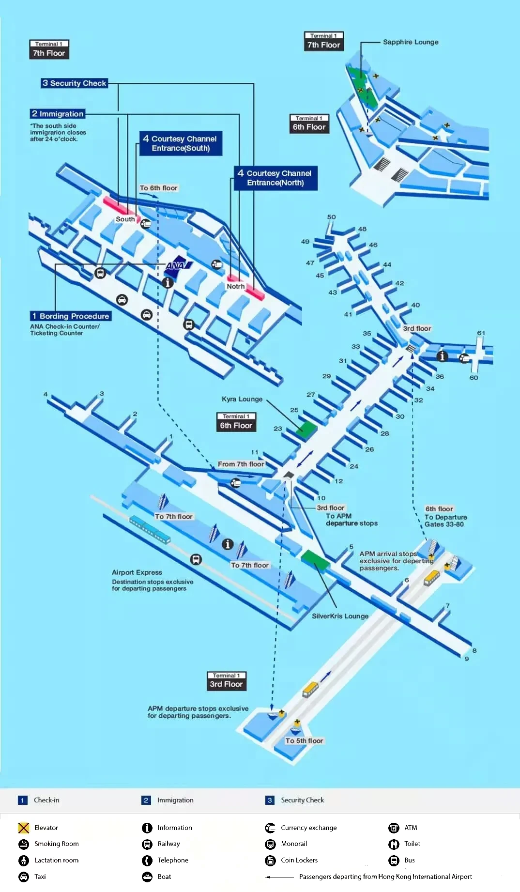

## 환승

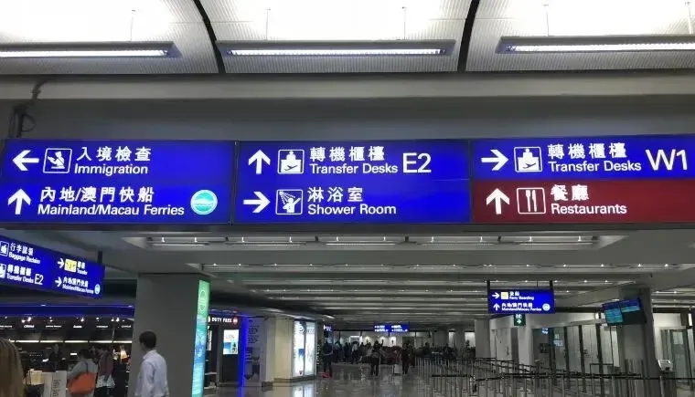

홍콩에 도착한 뒤의 기본 환승 절차는 다음과 같습니다.

### 1단계: 다음 구간 탑승권 확인

- **이미 탑승권을 갖고 있다면:** "환승(Transfers / Transit)" 표지판을 따라가면 됩니다.
- **갖고 있지 않다면:** 5층(L5) 환승 카운터로 가서 여권과 전자티켓을 항공사 직원에게 제시하고 탑승권을 받으십시오.

### 2단계: 보안검색

환승 승객은 모두 보안검색을 다시 거칩니다.

### 3단계: 출발층과 탑승구로

보안검색을 마치면 7층(L7), 즉 출발층으로 나오게 되며 이곳에 상점과 식당이 늘어서 있습니다. 안내 모니터에서 다음 구간 게이트 번호와 탑승 시각을 확인하십시오.

**게이트 위치**

| 게이트 | 위치 |
| --- | --- |
| 1–80 | 제1터미널 본관 |
| 201–230 | 본관 서쪽의 미드필드 콘코스, 무인 열차(APM)로 이동 |
| 501–510 | 스카이 브리지 또는 무인 열차로 이동하는 노스 새틀라이트 콘코스 |

**게이트 간 이동:** 목적지 게이트가 멀다면 터미널 안의 무인 열차인 자동 여객 수송기(APM)를 이용하십시오.

> 환승에는 최소 **2시간**을 확보하십시오. 앞선 항공편의 지연, 게이트 변경, 긴 대기열까지 감안하기 위해서입니다.

## 수하물 보관

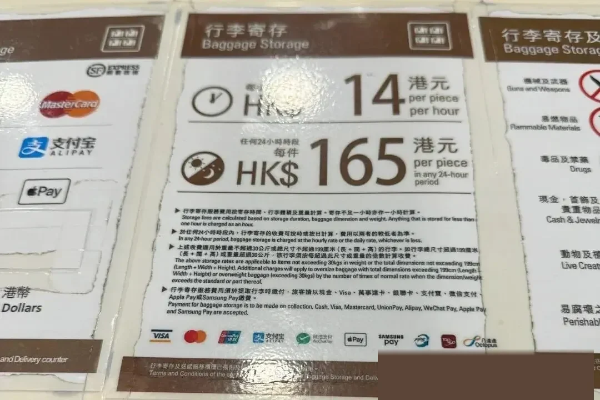

환승 대기 시간이 길어 짐을 두고 가볍게 시내에 다녀오고 싶다면 공항의 수하물 보관 서비스를 이용하십시오.

- **위치:** 제1터미널 5층 도착 홀 A 구역(일반 구역 — 모든 승객 이용 가능)
- **운영 시간:** 매일 05:30–01:30
- **요금:** 시간당 HK$14, 품목당 하루 최대 HK$165(24시간 이내에는 그 이상 받지 않음)

## 시내로 가는 방법

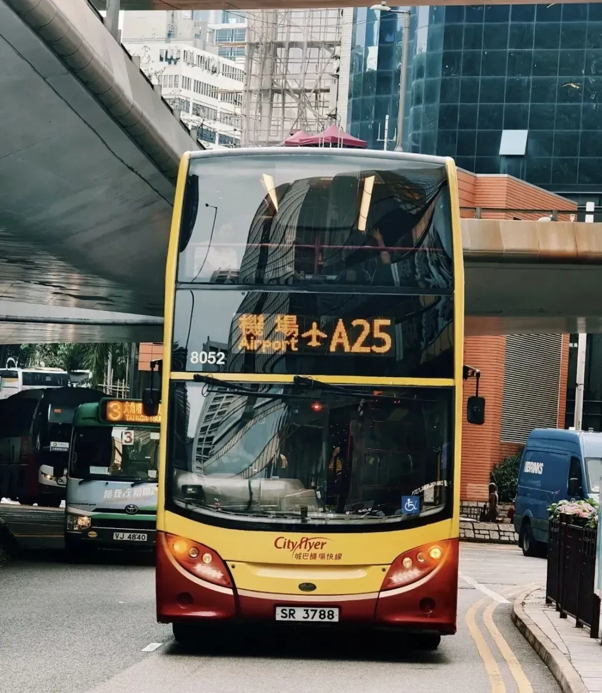

공항에서는 시내로 들어가는 여러 방법을 제공하니 자신에게 맞는 것을 고르십시오.

- **에어포트 익스프레스:** 가장 빠른 방법으로 센트럴(홍콩역)까지 약 24분이며 가우룽과 칭이에 정차합니다. 편도 HK$115로, 비즈니스 승객이나 시간이 촉박한 분에게 적합합니다.
- **공항버스:** 가장 저렴한 방법으로 노선이 촘촘하고 심야 운행도 있습니다. 요금은 HK$30–40이며, 시간이 있고 비용을 아끼고 싶은 분에게 적합합니다.
- **공항 리무진:** 사전에 전용 픽업을 예약하고 기사의 안내를 받는 방식으로, 짐이 많거나 가족과 함께 이동할 때 적합합니다.
- **택시:** 빠르고 편리하며, 무거운 짐이 있거나 사생활을 중시하는 분에게 적합합니다.

## 걸어볼 만한 두 곳

### 스카이 브리지

메인 터미널과 노스 새틀라이트 콘코스를 잇는 스카이 브리지는 길이 200미터의 보도교로, 세계에서 가장 긴 공항 내 보도교입니다. 지상 28미터 높이에 유리 바닥이 있어 발밑으로 활주로를 달리는 항공기를 내려다볼 수 있습니다.

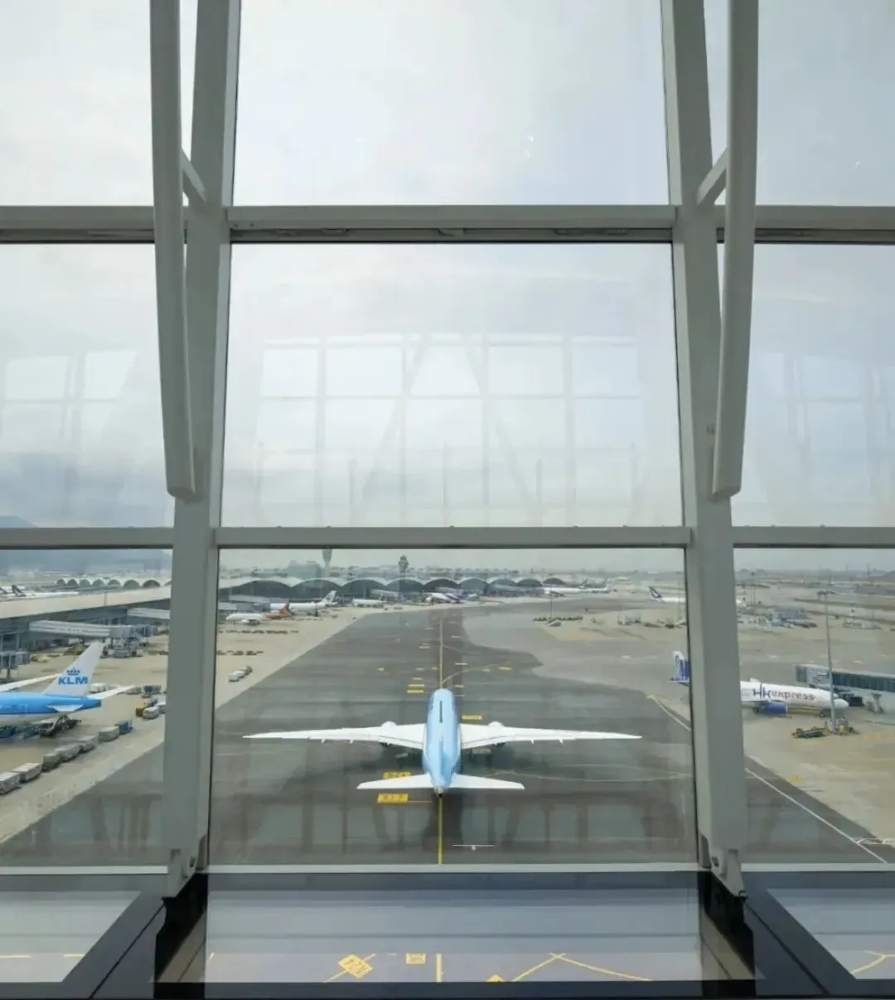

**위치:** 13–22번 게이트

### 놀이 돔

놀이 돔은 6세에서 12세 어린이를 위해 만든 놀이 시설입니다. 거대한 달걀 껍데기 모양의 구조물로 클라이밍 네트, 미끄럼틀, 곡선형 망 터널이 있으며 머리 위로는 알록달록한 리본이 걸려 있습니다.

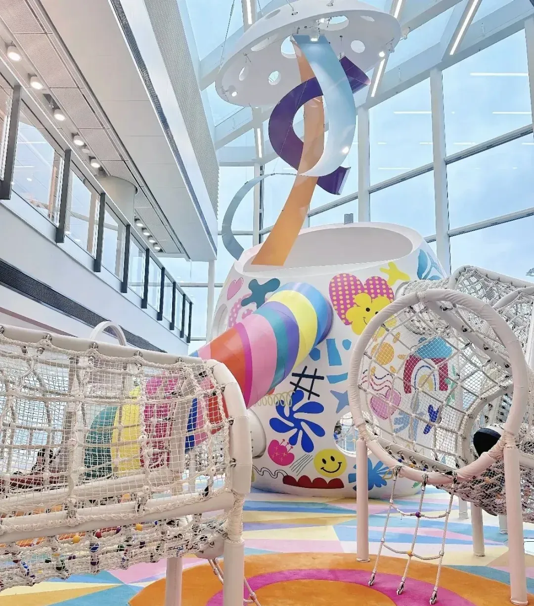

**위치:** 제1터미널 출발층(L6) 이스트 홀, 11번 게이트 인근

## 식사할 곳

### 阿鸿小吃 (아훙 샤오츠)

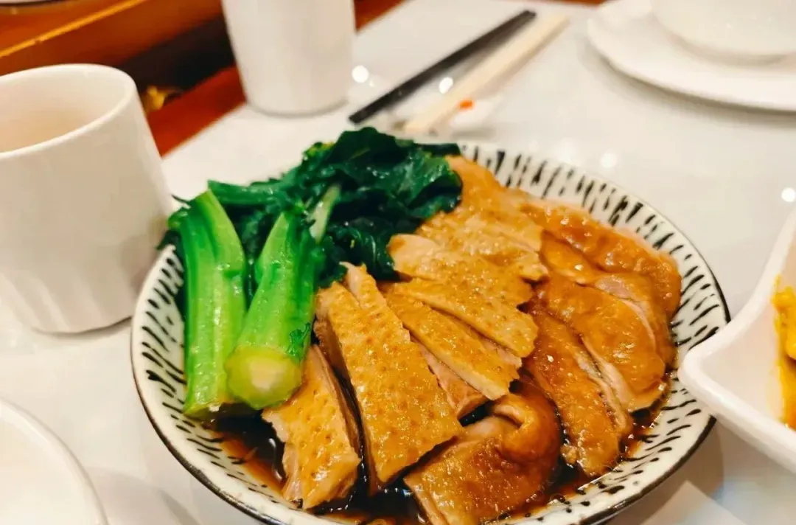

CNN이 세계 최고의 공항 식당으로 꼽은 아훙 샤오츠는 조림 요리와 구이 요리로 유명합니다. 조린 거위 슬라이스, 조림 모둠, 시그니처 조린 소 장단 등이 있으며, 맛은 진하면서도 무겁지 않아 출국 전에 일부러 들르는 여행객이 많습니다.

**위치:** 제1터미널 도착층 5층(일반 구역)

### 何洪记 (허훙지)

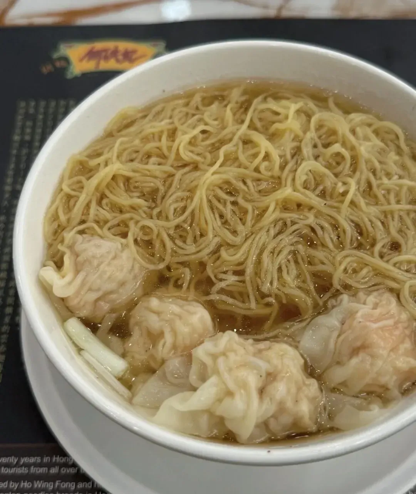

허훙지는 완탕면과 죽으로 유명한 유서 깊은 현지 식당으로, 미쉐린 추천 명단에 오른 적이 있습니다. 완탕은 피가 얇고 탄력 있는 새우가 가득 들어 있으며, 삼판죽(뱃사공 죽) 역시 두터운 마니아층을 거느리고 있습니다. 기다리는 동안 뜨끈한 광둥식 국수 한 그릇을 즐기기 좋습니다.

**위치:** 제1터미널 도착층 5층(일반 구역)

### 都爹利会馆 (더들스)

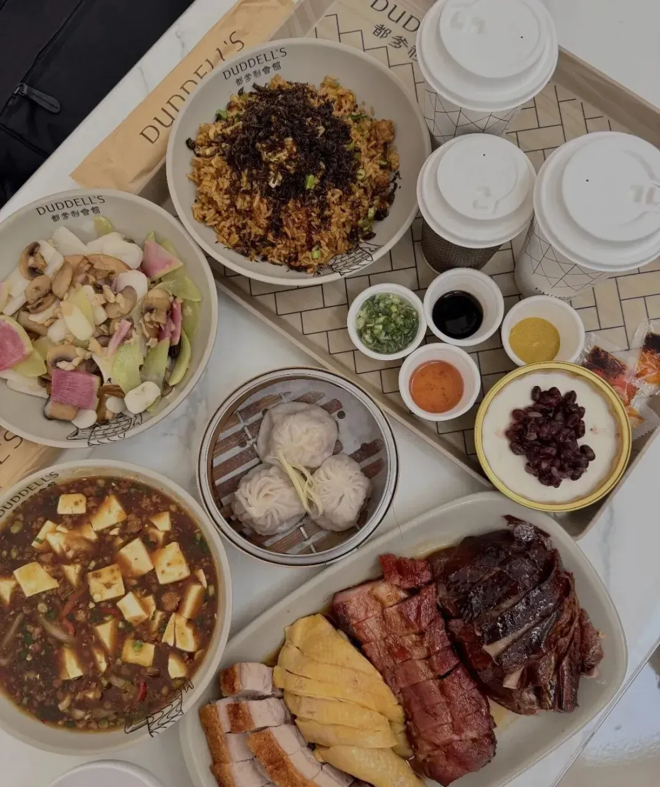

미쉐린 스타를 받은 광둥식 레스토랑 더들스는 제1터미널 출발 제한구역 안의 푸드코트에 분점을 두고 수준 높은 광둥 요리를 선보입니다. 딤섬, 탕 요리, 구이, 볶음 요리가 있고 채식 메뉴도 다양합니다.

**위치:** 제1터미널 출발층 이스트 홀 7층, 7E161호(제한구역)

### 고든 램지 플레인 푸드 투 고

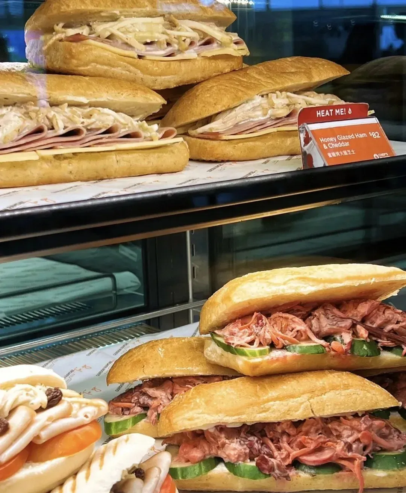

고든 램지가 아시아 최초의 고든 램지 플레인 푸드 투 고 매장을 홍콩국제공항에 열었습니다. 메뉴는 영국 요리와 공항을 위해 개발한 홍콩 특색 요리로 구성되어 있습니다. 음식은 신선하고 균형이 잡혀 있으며, 샌드위치, 샐러드, 파스타 같은 서양식 간식이 있어 빠르면서도 제대로 된 한 끼를 원하는 여행객에게 알맞습니다.

**위치:** 제1터미널 출발층 이스트 홀 7층(제한구역)

## 쇼핑

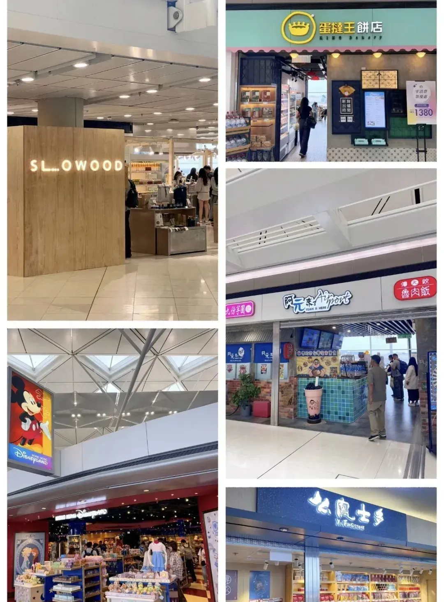

- **보안검색 전:** 쿠키스 콰르텟(Cookies Quartet), 팝 마트(POP MART), M+ 뮤지엄 숍, 마이크로 필름, 산리오.
- **보안검색 후:** 기념품점(치화병가(Kee Wah Bakery), 스위트 드림스 등), 명품(Louis Vuitton, Hermès), 주얼리(Cartier, Bulgari), 뷰티(SK-II, Lancôme), 디자이너 토이와 선물(홍콩 디즈니랜드 숍, 홍콩 디자인 갤러리). 브랜드 수가 매우 많고 환율에 더해 면세 가격이 적용됩니다.

## 라운지

### 홍콩항공 — 遨堂 (클럽 아우투스)

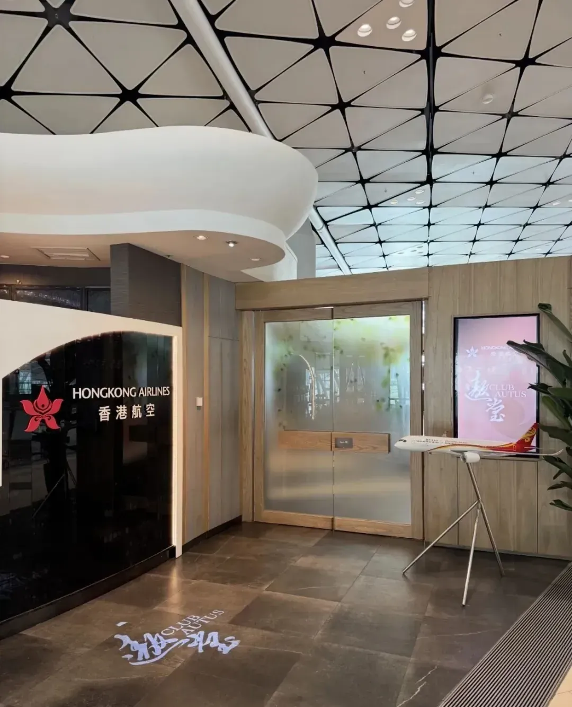

클럽 아우투스는 홍콩의 맛을 전면에 내세웁니다. 주문 즉석 완탕면, 에그와플, 처자이면, 두부 푸딩, 실크 스타킹 밀크티, 클레이팟 라이스가 있고, 세계 챔피언 바텐더 리오 코(Leo Ko)의 칵테일도 맛볼 수 있습니다.

**위치:** 미드필드 콘코스 7층

### 플라자 프리미엄 라운지

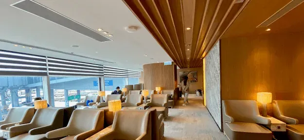

특정 항공사와 무관하게 운영되는 플라자 프리미엄 라운지는 요금을 내면 누구나 이용할 수 있고, 유효한 탑승권만 있으면 됩니다. 맥주, 커피, 청량음료와 함께 주문 즉석 따뜻한 음식(어묵 국수, 구이 고기 덮밥, 수제 토스트 등)을 제공하며, 모든 좌석에 전원 콘센트가 있습니다.

**위치:** 1, 35, 60번 게이트 인근

### 캐세이퍼시픽 라운지

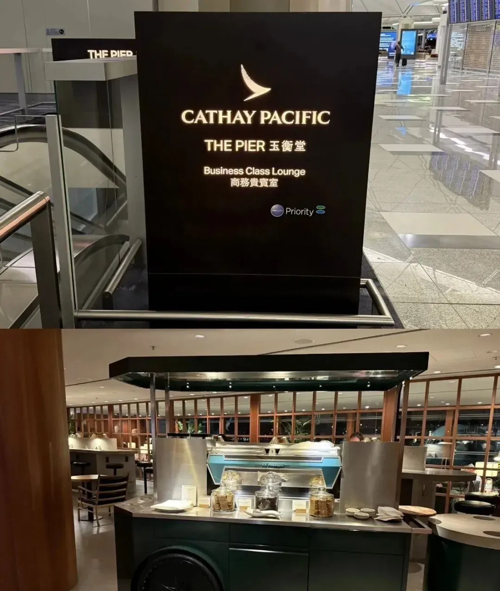

홍콩은 캐세이퍼시픽의 허브이므로 이곳에 여러 라운지가 있으며, 공항 라운지 가운데 가장 잘 갖춰져 있습니다. 예를 들어 더 피어에서는 갓 조리한 단단면과 완탕면을 각종 음료, 온요리와 함께 즐길 수 있고, 찻집에서는 뜨거운 차 한 주전자를 주문해 느끼함을 덜어낼 수 있습니다.

**위치:** 35, 6, 63–65, 1–4, 5번 게이트 인근

## 무료 서비스

- **무료 Wi-Fi:** 모바일 데이터를 끄고 → "HKAirport Free WiFi" 네트워크를 선택 → 브라우저를 열어 유효한 URL을 입력 → 약관 확인 → "동의하고 계속"을 누릅니다.
- **무료 충전:** 터미널 전체에 9,100개가 넘는 전원 콘센트가 있으며, 거의 모든 게이트 인근 좌석 구역과 환승 구역에 USB 포트와 영국식 3핀 콘센트가 있습니다.
- **무료 샤워:** 제1터미널 12번 게이트의 공용 샤워실. 탑승권을 제시하면 새 수건과 세면도구를 무료로 받을 수 있습니다.
- **어린이 놀이 구역:** 제1터미널 1, 15, 41, 60번 게이트에 있어 어린이와 함께 환승하는 가족이 시간을 보내기 좋습니다.

## 한 가지 유의할 점: 출국세가 올랐습니다

홍콩 민항국은 2025년 10월 1일 이후 발권된 항공권부터 홍콩을 출발하는 항공편의 **항공 여객 출국세가 HK$120에서 HK$200으로 인상**된다고 발표했습니다(당일 환승 승객은 제외). 새 규정에 따르면 홍콩 체류 기간이 48시간을 넘지 않는 여행객은 세금 전액 환급을 신청할 수 있습니다.

## 관련 링크

- **이 사이트:** [홍콩국제공항(HKG)](/airport/HKG)
- **위키백과:** [홍콩국제공항](https://en.wikipedia.org/wiki/Hong_Kong_International_Airport)
- **바이두 백과:** [홍콩국제공항](https://baike.baidu.com/item/%E9%A6%99%E6%B8%AF%E5%9B%BD%E9%99%85%E6%9C%BA%E5%9C%BA)
