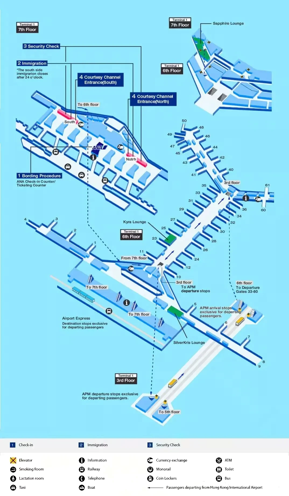

Hong Kong International Airport — Chek Lap Kok — opende op 6 juli 1998 en verving Kai Tak. De luchthaven is gebouwd op opgespoten land voor de kust van Lantau en bedient meer dan 150 bestemmingen in Azië, Europa, Noord-Amerika en Oceanië.

Bijna alles gebeurt in **Terminal 1 (T1)**: inchecken, beveiliging, vertrek en aankomst, waarbij de afgelegen gates worden afgehandeld door de Midfield Concourse en de North Satellite Concourse. **Terminal 2** wordt uitgebreid en heropend; de aankondigingen van de luchthaven zelf zijn bepalend voor het moment.

## Overstappen

Hier is het basale overstapproces nadat je in Hong Kong bent geland.

### Stap 1: bevestig je instapkaart voor de volgende vlucht

- **Heb je er al een:** volg gewoon de duidelijke borden "Transfers / Transit".
- **Heb je er geen:** ga naar de overstapbalies op niveau 5 (L5), laat je paspoort en e-ticket zien aan het personeel van de luchtvaartmaatschappij en haal je instapkaart op.

### Stap 2: veiligheidscontrole

Elke overstappende passagier gaat opnieuw door de veiligheidscontrole.

### Stap 3: naar de vertrekverdieping en je gate

Na de controle kom je uit op niveau 7 (L7), de vertrekverdieping, met aan weerszijden winkels en restaurants. Kijk op de vertrekschermen voor het gatennummer van je volgende vlucht en de instaptijd.

**Waar de gates zijn**

| Gates | Locatie |
| --- | --- |
| 1–80 | Terminal 1 zelf |
| 201–230 | Midfield Concourse, ten westen van het hoofdgebouw; bereikbaar met de Automated People Mover |
| 501–510 | North Satellite Concourse, bereikbaar via de Sky Bridge of de Automated People Mover |

**Hoe je je ertussen verplaatst:** ligt je gate ver weg, gebruik dan de Automated People Mover (de onbemande trein) in de terminal.

> Trek minstens **2 uur** uit voor een overstap, om vertraging van je aankomende vlucht, een gatewijziging of een lange rij op te vangen.

## Bagageopslag

Is je tussenstop lang en wil je onbelast de stad in, dan heeft de luchthaven een bagageopslagdienst.

- **Waar:** Terminal 1, aankomsthal niveau 5, zone A (landside — voor alle passagiers toegankelijk)
- **Openingstijden:** dagelijks, 05:30–01:30
- **Prijs:** HK$14 per uur; maximaal HK$165 per stuk per dag (binnen 24 uur komt daar niets bovenop)

## Naar de stad

De luchthaven biedt verschillende manieren om de stad in te komen, dus kies wat bij je past:

- **Airport Express:** de snelste optie — ongeveer 24 minuten naar Central (Hong Kong Station), met stops in Kowloon en Tsing Yi. HK$115 enkele reis; het beste voor zakenreizigers of wie weinig tijd heeft.
- **Luchthavenbussen:** de goedkoopste optie, met een groot bereik en nachtdiensten. Tarieven zijn HK$30–40; het beste als je tijd hebt en wilt besparen.
- **Luchthaventransfers:** boek vooraf een privétransfer en laat je door een chauffeur ophalen — het beste met veel bagage of voor gezinnen.
- **Taxi's:** snel en gemakkelijk, en de keuze voor wie zware tassen heeft of liever privacy houdt.

## Twee bezienswaardigheden die de wandeling waard zijn

### De Sky Bridge

De Sky Bridge verbindt de hoofdterminal met de North Satellite Concourse en is een 200 meter lange voetgangersbrug — de langste airside voetgangersbrug ter wereld — 28 meter boven de grond, met een glazen vloer waardoor je vliegtuigen onder je voeten ziet taxiën.

**Waar:** gates 13–22

### De speelkoepel

De speelkoepel is een speelvoorziening voor kinderen van 6 tot 12 jaar. Het is een enorme constructie in de vorm van een eierschaal met klimnetten, een glijbaan en gebogen netwerktunnels, met felgekleurde linten boven je hoofd.

**Waar:** Terminal 1, vertrekverdieping (L6), East Hall, bij gate 11

## Waar te eten

### 阿鸿小吃 (Ah Hung Snacks)

Ah Hung Snacks, door CNN uitgeroepen tot het beste luchthavenrestaurant ter wereld, staat bekend om zijn gestoofde gerechten en geroosterd vlees — plakjes gestoofde gans, een gestoofde gemengde schotel en zijn kenmerkende gestoofde runderschenkel. De smaken zijn rijk zonder zwaar te zijn, en veel reizigers maken er een punt van hier te eten voor ze aan boord gaan.

**Waar:** Terminal 1, aankomstverdieping, niveau 5 (landside)

### 何洪记 (Ho Hung Kee)

Ho Hung Kee is een al lang bestaand lokaal restaurant dat bekendstaat om zijn wontonnoedels en congee en een Michelin-vermelding heeft gekregen. De wontons hebben een dun vel en zijn royaal gevuld met veerkrachtige garnalen, en de sampan-congee heeft zijn eigen aanhang — een goede kom hete Kantonese noedels terwijl je wacht.

**Waar:** Terminal 1, aankomstverdieping, niveau 5 (landside)

### 都爹利会馆 (Duddell's)

Duddell's, een met een Michelin-ster bekroond Kantonees restaurant, heeft een vestiging in het eetgedeelte van het afgeschermde vertrekgebied van Terminal 1, met hoogwaardige Kantonese keuken — dimsum, dubbelgestoomde soepen, geroosterd vlees en wokgerechten, met volop vegetarische opties op de kaart.

**Waar:** Terminal 1, vertrekverdieping, East Hall, niveau 7, winkel 7E161 (airside)

### Gordon Ramsay Plane Food To Go

Gordon Ramsay bracht de eerste Gordon Ramsay Plane Food To Go in Azië naar Hong Kong International Airport, met een menu van Britse gerechten naast speciaal voor de luchthaven gecreëerde Hongkongse specialiteiten. Het eten is vers en uitgebalanceerd — westerse lichte hapjes zoals sandwiches, salades en pasta — en past bij reizigers die iets snels maar goeds willen.

**Waar:** Terminal 1, vertrekverdieping, East Hall, niveau 7 (airside)

## Shoppen

- **Voor de beveiliging:** Cookies Quartet, POP MART, de museumwinkel van M+, Micro Film en Sanrio.
- **Na de beveiliging:** souvenirwinkels (Kee Wah Bakery, Sweet Dreams en andere), luxemerken (Louis Vuitton, Hermès), sieraden (Cartier, Bulgari), beauty (SK-II, Lancôme) en designspeelgoed en cadeaus (de winkel van Hong Kong Disneyland, de Hong Kong Design Gallery). Er zijn heel veel merken, en je krijgt dutyfreeprijzen bovenop de wisselkoers.

## Lounges

### Hong Kong Airlines — 遨堂 (Club Autus)

Club Autus omarmt de smaken van Hong Kong, met wontonnoedels op bestelling, eierwafels, karrennoedels, tofoepudding, "silk-stocking"-melkthee en rijst uit de kleipot, plus cocktails van wereldkampioen-barman Leo Ko.

**Waar:** Midfield Concourse, niveau 7

### Plaza Premium Lounge

De Plaza Premium-lounges zijn onafhankelijk van elke luchtvaartmaatschappij en toegankelijk voor iedereen die betaalt — je hebt alleen een geldige instapkaart nodig. Naast bier, koffie en frisdrank serveren ze warm eten op bestelling, zoals visballetjes in noedelsoep, rijst met geroosterd vlees en handgemaakte toast, en elke stoel heeft een stopcontact.

**Waar:** bij gates 1, 35 en 60

### Lounges van Cathay Pacific

Hong Kong is de thuisbasis van Cathay Pacific, dus de maatschappij heeft hier meerdere lounges, en het zijn de best uitgeruste van de luchthaven. The Pier serveert bijvoorbeeld vers bereide dan dan- en wontonnoedels met een volledig assortiment drankjes en warme gerechten, en heeft een theesalon waar je een pot hete thee kunt bestellen om de rijke smaken te doorspoelen.

**Waar:** bij gates 35, 6, 63–65, 1–4 en 5

## Gratis diensten

- **Gratis wifi:** zet mobiele data uit → kies het netwerk "HKAirport Free WiFi" → open een browser en voer een willekeurige geldige URL in → lees de voorwaarden → tik op "Agree and Continue".
- **Gratis opladen:** meer dan 9.100 stopcontacten in de terminal, met USB-poorten en Britse driepolige stopcontacten bij zitplaatsen nabij bijna elke gate en in de overstapzone.
- **Gratis douches:** openbare douches in Terminal 1, bij gate 12. Laat je instapkaart zien om gratis een schone handdoek en toiletartikelen te krijgen.
- **Kinderspeelplaatsen:** in Terminal 1 bij gates 1, 15, 41 en 60, om gezinnen die met kinderen overstappen de tijd te helpen doden.

## Eén ding om te weten: de vertrekbelasting is gestegen

De Civil Aviation Department van Hong Kong heeft aangekondigd dat voor tickets die op of na 1 oktober 2025 zijn uitgegeven, de **Air Passenger Departure Tax op vluchten die uit Hong Kong vertrekken stijgt van HK$120 naar HK$200** (passagiers die dezelfde dag overstappen zijn uitgesloten). Onder de nieuwe regels kunnen reizigers die niet langer dan 48 uur in Hong Kong verblijven, een volledige terugbetaling van de belasting aanvragen.

## Gerelateerde links

- **Op deze site**: [Hong Kong International Airport (HKG)](/airport/HKG)
- **Wikipedia**: [Hong Kong International Airport](https://en.wikipedia.org/wiki/Hong_Kong_International_Airport)
- **Baidu Baike**: [Hong Kong International Airport](https://baike.baidu.com/item/%E9%A6%99%E6%B8%AF%E5%9B%BD%E9%99%85%E6%9C%BA%E5%9C%BA)
