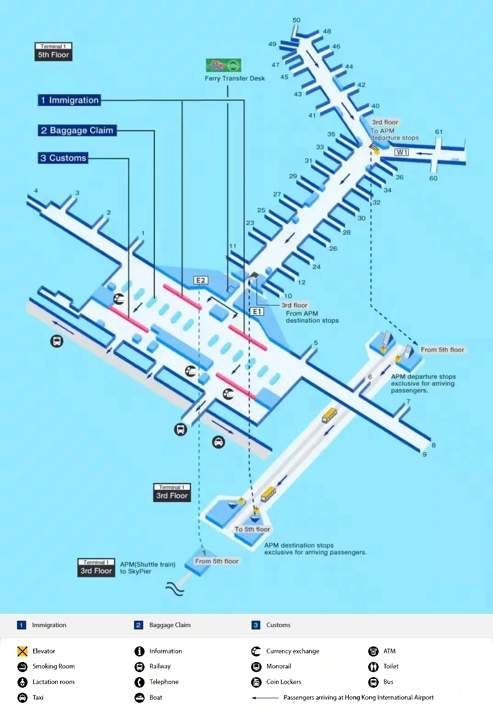

Międzynarodowe lotnisko w Hongkongu — Chek Lap Kok — zostało otwarte 6 lipca 1998 r., zastępując Kai Tak. Zbudowane na sztucznie osuszonej ziemi przy wyspie Lantau, obsługuje ponad 150 kierunków w Azji, Europie, Ameryce Północnej i Oceanii.

Niemal wszystko odbywa się w **Terminalu 1 (T1)**: odprawa, kontrola bezpieczeństwa, odloty i przyloty, a odległe bramki obsługują Midfield Concourse i North Satellite Concourse. **Terminal 2** jest rozbudowywany i ponownie otwierany; wiążące terminy podają komunikaty samego lotniska.

## Przesiadki

Oto podstawowy proces przesiadki po wylądowaniu w Hongkongu.

### Krok 1: potwierdź kartę pokładową na dalszy lot

- **Jeśli już ją masz:** wystarczy iść za wyraźnymi znakami „Transfers / Transit”.
- **Jeśli jej nie masz:** podejdź do stanowisk przesiadkowych na poziomie 5 (L5), pokaż paszport i bilet elektroniczny personelowi linii lotniczej i odbierz kartę pokładową.

### Krok 2: kontrola bezpieczeństwa

Każdy pasażer przesiadający się przechodzi ponownie kontrolę bezpieczeństwa.

### Krok 3: na poziom odlotów i do swojej bramki

Po kontroli wychodzisz na poziom 7 (L7), poziom odlotów, przy którym ciągną się sklepy i restauracje. Sprawdź na tablicach odlotów numer bramki dalszego lotu i godzinę wejścia na pokład.

**Gdzie są bramki**

| Bramki | Lokalizacja |
| --- | --- |
| 1–80 | sam Terminal 1 |
| 201–230 | Midfield Concourse, na zachód od głównego budynku; dojazd Automated People Mover |
| 501–510 | North Satellite Concourse, dostępny przez Sky Bridge lub Automated People Mover |

**Przemieszczanie się między nimi:** jeśli twoja bramka jest daleko, skorzystaj z Automated People Mover (pociągu bez maszynisty) wewnątrz terminalu.

> Zarezerwuj na przesiadkę co najmniej **2 godziny**, aby uwzględnić opóźnienie lotu przylatującego, zmianę bramki lub długą kolejkę.

## Przechowalnia bagażu

Jeśli masz długą przesiadkę i chcesz pojechać do miasta bez bagażu, lotnisko oferuje przechowalnię bagażu.

- **Gdzie:** Terminal 1, hol przylotów na poziomie 5, strefa A (część ogólnodostępna — dla wszystkich pasażerów)
- **Godziny:** codziennie 05:30–01:30
- **Cena:** 14 HKD za godzinę; maksymalnie 165 HKD za sztukę na dobę (w ciągu 24 godzin nie zapłacisz więcej)

## Dojazd do miasta

Lotnisko oferuje kilka sposobów dostania się do miasta — wybierz ten, który ci odpowiada:

- **Airport Express:** najszybsza opcja — około 24 minut do Central (Hong Kong Station), z przystankami w Kowloon i Tsing Yi. 115 HKD w jedną stronę; najlepsza dla podróżujących służbowo lub osób, którym brakuje czasu.
- **Autobusy lotniskowe:** najtańsza opcja, z szerokim zasięgiem i nocnymi kursami. Bilety 30–40 HKD; najlepsze, jeśli masz czas i chcesz oszczędzić.
- **Transfery lotniskowe:** zarezerwuj z wyprzedzeniem prywatny odbiór i spotkaj się z kierowcą — najlepsze przy dużej ilości bagażu lub z rodziną.
- **Taksówki:** szybkie i wygodne, wybór dla osób z ciężkimi bagażami lub ceniących prywatność.

## Dwie atrakcje warte spaceru

### Sky Bridge

Sky Bridge, łączący główny terminal z North Satellite Concourse, to 200-metrowa kładka dla pieszych — najdłuższa na świecie kładka w strefie zastrzeżonej — zawieszona 28 metrów nad ziemią, ze szklaną podłogą, przez którą można obserwować kołujące pod stopami samoloty.

**Gdzie:** bramki 13–22

### Kopuła do zabawy

Kopuła do zabawy to plac zabaw dla dzieci w wieku od 6 do 12 lat. To ogromna konstrukcja w kształcie skorupki jajka z siatkami do wspinania, zjeżdżalnią i zakrzywionymi tunelami z siatki, a nad głowami wiszą jaskrawe wstążki.

**Gdzie:** Terminal 1, poziom odlotów (L6), East Hall, przy bramce 11

## Gdzie zjeść

### 阿鸿小吃 (Ah Hung Snacks)

Ah Hung Snacks, nazwana przez CNN najlepszą restauracją lotniskową na świecie, słynie z dań duszonych i pieczonych mięs — krojonej duszonej gęsi, mieszanego półmiska dań duszonych i charakterystycznej duszonej goleni wołowej. Smaki są bogate, ale nie ciężkie, a wielu podróżnych robi sobie punkt z jedzenia tutaj przed wejściem na pokład.

**Gdzie:** Terminal 1, poziom przylotów, poziom 5 (część ogólnodostępna)

### 何洪记 (Ho Hung Kee)

Ho Hung Kee to zasłużona lokalna restauracja znana z makaronu z wontonami i congee, wyróżniona rekomendacją Michelin. Wontony mają cienkie ciasto i są hojnie nadziewane sprężystymi krewetkami, a congee po sampanowemu ma własnych wielbicieli — dobra miska gorącego kantońskiego makaronu na czas oczekiwania.

**Gdzie:** Terminal 1, poziom przylotów, poziom 5 (część ogólnodostępna)

### 都爹利会馆 (Duddell's)

Duddell's, kantońska restauracja z gwiazdką Michelin, ma lokal w strefie gastronomicznej w zastrzeżonej części odlotów Terminalu 1, serwując wysokiej jakości kuchnię kantońską — dim sum, zupy gotowane metodą podwójnej kąpieli, pieczone mięsa i dania z woka, z wieloma opcjami wegetariańskimi w menu.

**Gdzie:** Terminal 1, poziom odlotów, East Hall, poziom 7, sklep 7E161 (strefa zastrzeżona)

### Gordon Ramsay Plane Food To Go

Gordon Ramsay sprowadził do międzynarodowego lotniska w Hongkongu pierwszy w Azji lokal Gordon Ramsay Plane Food To Go, z menu łączącym dania brytyjskie i specjalności Hongkongu stworzone dla lotniska. Jedzenie jest świeże i zrównoważone — lekkie przekąski w stylu zachodnim, w tym kanapki, sałatki i makarony — i pasuje podróżnym, którzy chcą czegoś szybkiego, ale dobrego.

**Gdzie:** Terminal 1, poziom odlotów, East Hall, poziom 7 (strefa zastrzeżona)

## Zakupy

- **Przed kontrolą bezpieczeństwa:** Cookies Quartet, POP MART, sklep muzeum M+, Micro Film i Sanrio.
- **Po kontroli bezpieczeństwa:** sklepy z pamiątkami (Kee Wah Bakery, Sweet Dreams i inne), marki luksusowe (Louis Vuitton, Hermès), biżuteria (Cartier, Bulgari), kosmetyki (SK-II, Lancôme) oraz designerskie zabawki i prezenty (sklep Hong Kong Disneyland, Hong Kong Design Gallery). Marek jest bardzo wiele, a ceny bezcłowe dochodzą do korzystnego kursu walut.

## Saloniki

### Hong Kong Airlines — 遨堂 (Club Autus)

Club Autus stawia na smaki Hongkongu: makaron z wontonami przygotowywany na zamówienie, wafle jajeczne, makaron z wózka, pudding tofu, mleczna herbata „silk-stocking” i ryż w glinianym garnku, a do tego koktajle od mistrza świata barmanów Leo Ko.

**Gdzie:** Midfield Concourse, poziom 7

### Plaza Premium Lounge

Saloniki Plaza Premium, niezależne od żadnej linii lotniczej, są otwarte dla każdego, kto zapłaci — wystarczy ważna karta pokładowa. Obok piwa, kawy i napojów bezalkoholowych serwują gorące dania przygotowywane na zamówienie, takie jak zupa z makaronem i klopsikami rybnymi, ryż z pieczonym mięsem i ręcznie robiony tost, a każde miejsce ma gniazdko elektryczne.

**Gdzie:** przy bramkach 1, 35 i 60

### Saloniki Cathay Pacific

Hongkong to baza macierzysta Cathay Pacific, więc linia ma tu kilka saloników i są to najlepiej wyposażone saloniki na lotnisku. The Pier na przykład serwuje świeżo przyrządzane dan dan i makaron z wontonami, z pełną ofertą napojów i gorących dań, i ma herbaciarnię, gdzie można zamówić dzbanek gorącej herbaty, by przełamać ciężkość dań.

**Gdzie:** przy bramkach 35, 6, 63–65, 1–4 i 5

## Darmowe usługi

- **Darmowe Wi-Fi:** wyłącz dane mobilne → wybierz sieć „HKAirport Free WiFi” → otwórz przeglądarkę i wpisz dowolny prawidłowy adres URL → przeczytaj regulamin → dotknij „Agree and Continue”.
- **Darmowe ładowanie:** ponad 9100 gniazdek elektrycznych w terminalu, z portami USB i brytyjskimi gniazdkami trójbolcowymi w strefach siedzenia przy niemal każdej bramce i w strefie przesiadkowej.
- **Darmowe prysznice:** publiczne prysznice w Terminalu 1 przy bramce 12. Pokaż kartę pokładową, aby bezpłatnie odebrać świeży ręcznik i zestaw kosmetyków.
- **Place zabaw dla dzieci:** w Terminalu 1 przy bramkach 1, 15, 41 i 60, aby rodziny przesiadające się z dziećmi mogły przyjemnie spędzić czas.

## Jedna uwaga: podatek odlotowy wzrósł

Departament Lotnictwa Cywilnego Hongkongu ogłosił, że w przypadku biletów wystawionych 1 października 2025 r. lub później **podatek odlotowy dla pasażerów lotniczych na lotach z Hongkongu wzrasta ze 120 do 200 HKD** (pasażerowie przesiadający się tego samego dnia są wyłączeni). Zgodnie z nowymi zasadami podróżni, którzy przebywają w Hongkongu nie dłużej niż 48 godzin, mogą ubiegać się o pełny zwrot podatku.

## Powiązane linki

- **Na tej stronie**: [Międzynarodowe lotnisko w Hongkongu (HKG)](/airport/HKG)
- **Wikipedia**: [Międzynarodowe lotnisko w Hongkongu](https://en.wikipedia.org/wiki/Hong_Kong_International_Airport)
- **Baidu Baike**: [Międzynarodowe lotnisko w Hongkongu](https://baike.baidu.com/item/%E9%A6%99%E6%B8%AF%E5%9B%BD%E9%99%85%E6%9C%BA%E5%9C%BA)
