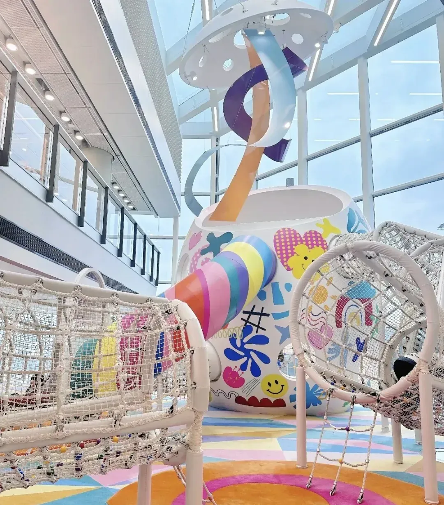

O Aeroporto Internacional de Hong Kong — Chek Lap Kok — foi inaugurado em 6 de julho de 1998, substituindo Kai Tak. Construído em terreno aterrado ao largo de Lantau, atende a mais de 150 destinos na Ásia, Europa, América do Norte e Oceania.

Quase tudo acontece no **Terminal 1 (T1)**: check-in, segurança, partidas e chegadas, com os portões remotos atendidos pela Área Central e pela Área Satélite Norte. O **Terminal 2** está em expansão e reabrindo; os anúncios do próprio aeroporto são a palavra final sobre quando.

## Conexões

Este é o processo básico de conexão depois que você aterrissa em Hong Kong.

### Etapa 1: confirme seu cartão de embarque de continuação

- **Se você já tem um:** basta seguir as placas claras de “Conexões / Trânsito”.
- **Se não tem:** vá aos balcões de conexão no nível 5 (L5), mostre seu passaporte e e-ticket à equipe da companhia aérea e retire seu cartão de embarque.

### Etapa 2: controle de segurança

Todo passageiro em conexão passa pelo controle de segurança novamente.

### Etapa 3: até o nível de partidas e seu portão

Depois da segurança, você sai no nível 7 (L7), o nível de partidas, repleto de lojas e restaurantes. Verifique os painéis de partidas para o número do portão de continuação e o horário de embarque.

**Onde ficam os portões**

| Portões | Localização |
| --- | --- |
| 1–80 | O próprio Terminal 1 |
| 201–230 | Área Central, a oeste do edifício principal; acesso pelo Automated People Mover |
| 501–510 | Área Satélite Norte, acesso pela Sky Bridge ou pelo Automated People Mover |

**Como circular entre eles:** se seu portão for longe, use o Automated People Mover (o trem sem condutor) dentro do terminal.

> Reserve pelo menos **2 horas** para uma conexão, para absorver um voo de chegada atrasado, uma mudança de portão ou uma fila longa.

## Guarda-volumes

Se sua escala for longa e você quiser ir à cidade sem bagagem, o aeroporto tem serviço de guarda-volumes.

- **Onde:** Terminal 1, saguão de chegadas do nível 5, zona A (área pública — aberto a todos os passageiros)
- **Horário:** todos os dias, 05:30–01:30
- **Preço:** HK$14 por hora; máximo de HK$165 por item por dia (nada acima disso dentro de 24 horas)

## Como chegar à cidade

O aeroporto oferece várias formas de chegar à cidade, então escolha a que combina com você:

- **Airport Express:** a opção mais rápida — cerca de 24 minutos até Central (Estação de Hong Kong), com paradas em Kowloon e Tsing Yi. HK$115 só de ida; melhor para viajantes de negócios ou para quem está com pouco tempo.
- **Ônibus de aeroporto:** a opção mais barata, com ampla cobertura e serviços noturnos. As tarifas são de HK$30–40; melhor se você tem tempo e quer economizar.
- **Traslados do aeroporto:** reserve um transporte privado com antecedência e seja recebido por um motorista — melhor com muita bagagem ou para famílias.
- **Táxis:** rápidos e práticos, e a escolha de quem tem malas pesadas ou prefere privacidade.

## Dois lugares que valem a caminhada

### A Sky Bridge

Ligando o terminal principal à Área Satélite Norte, a Sky Bridge é uma passarela de 200 metros — a passarela airside mais longa do mundo — 28 metros acima do solo, com piso de vidro que deixa você ver os aviões taxiando sob seus pés.

**Onde:** portões 13–22

### O domo de brinquedos

O domo de brinquedos é uma instalação lúdica construída para crianças de 6 a 12 anos. É uma estrutura gigante em forma de casca de ovo, com redes de escalada, um escorregador e túneis de malha curvos, com fitas coloridas suspensas no alto.

**Onde:** Terminal 1, nível de partidas (L6), Salão Leste, perto do portão 11

## Onde comer

### 阿鸿小吃 (Ah Hung Snacks)

Eleito pela CNN o melhor restaurante de aeroporto do mundo, o Ah Hung Snacks é conhecido pelos pratos braseados e carnes assadas — fatias de ganso braseado, um prato misto braseado e seu prato-assinatura, o músculo de boi braseado. Os sabores são ricos sem pesar, e muitos viajantes fazem questão de comer aqui antes de embarcar.

**Onde:** Terminal 1, nível de chegadas, nível 5 (área pública)

### 何洪记 (Ho Hung Kee)

O Ho Hung Kee é um restaurante local tradicional, conhecido pelo macarrão com wonton e pelo congee, e já recebeu recomendação do Michelin. Os wontons têm massa fina e recheio generoso de camarão firme, e o congee sampan tem seus próprios fãs — uma boa tigela de macarrão cantonês quente enquanto você espera.

**Onde:** Terminal 1, nível de chegadas, nível 5 (área pública)

### 都爹利会馆 (Duddell's)

O Duddell's, restaurante cantonês com estrela Michelin, tem uma unidade na praça de alimentação dentro da área restrita de partidas do Terminal 1, servindo cozinha cantonesa de alta qualidade — dim sum, sopas cozidas em banho-maria, carnes assadas e refogados, com muitas opções vegetarianas no menu.

**Onde:** Terminal 1, nível de partidas, Salão Leste, nível 7, loja 7E161 (área airside)

### Gordon Ramsay Plane Food To Go

Gordon Ramsay trouxe o primeiro Gordon Ramsay Plane Food To Go da Ásia para o Aeroporto Internacional de Hong Kong, com um menu de pratos britânicos ao lado de especialidades de Hong Kong criadas para o aeroporto. A comida é fresca e equilibrada — lanches leves ocidentais, incluindo sanduíches, saladas e massas — e agrada a quem quer algo rápido, mas bom.

**Onde:** Terminal 1, nível de partidas, Salão Leste, nível 7 (área airside)

## Compras

- **Antes da segurança:** Cookies Quartet, POP MART, a loja do museu M+, Micro Film e Sanrio.
- **Depois da segurança:** lojas de lembranças (Kee Wah Bakery, Sweet Dreams e outras), marcas de luxo (Louis Vuitton, Hermès), joalherias (Cartier, Bulgari), beleza (SK-II, Lancôme) e brinquedos de design e presentes (a loja do Hong Kong Disneyland, a Hong Kong Design Gallery). Há muitas marcas, e você ainda tem preços duty-free além da taxa de câmbio.

## Salas VIP

### Hong Kong Airlines — 遨堂 (Club Autus)

A Club Autus aposta nos sabores de Hong Kong, com macarrão com wonton feito na hora, waffles de ovo, macarrão de carrinho, pudim de tofu, chá com leite meia-calça e arroz em panela de barro, além de coquetéis do bartender campeão mundial Leo Ko.

**Onde:** Área Central, nível 7

### Plaza Premium Lounge

Independentes de qualquer companhia aérea, as salas Plaza Premium são abertas a quem paga — você só precisa de um cartão de embarque válido. Além de cerveja, café e refrigerantes, servem comida quente preparada na hora, como sopa de macarrão com bolinho de peixe, arroz com carne assada e torradas artesanais, e cada assento tem tomada.

**Onde:** perto dos portões 1, 35 e 60

### Salas da Cathay Pacific

Hong Kong é a base da Cathay Pacific, então a companhia tem várias salas VIP aqui, e são as mais bem equipadas do aeroporto. A The Pier, por exemplo, serve dan dan e macarrão com wonton preparados na hora, com uma linha completa de bebidas e pratos quentes, e tem uma casa de chá onde você pode pedir um bule de chá quente para equilibrar o sabor marcante.

**Onde:** perto dos portões 35, 6, 63–65, 1–4 e 5

## Serviços gratuitos

- **Wi-Fi grátis:** desligue os dados móveis → escolha a rede “HKAirport Free WiFi” → abra um navegador e digite qualquer URL válida → leia os termos e condições → toque em “Concordo e continuar”.
- **Recarga gratuita:** mais de 9.100 tomadas em todo o terminal, com portas USB e tomadas de três pinos do Reino Unido nas áreas de assento perto de quase todos os portões e na zona de conexões.
- **Chuveiros gratuitos:** chuveiros públicos no Terminal 1, portão 12. Mostre seu cartão de embarque para receber uma toalha limpa e artigos de higiene sem custo.
- **Áreas de lazer infantil:** nos portões 1, 15, 41 e 60 do Terminal 1, para ajudar as famílias em conexão com crianças a passar o tempo.

## Uma coisa a observar: o imposto de saída aumentou

O Departamento de Aviação Civil de Hong Kong anunciou que, para bilhetes emitidos a partir de 1º de outubro de 2025, o **Air Passenger Departure Tax em voos que partem de Hong Kong sobe de HK$120 para HK$200** (passageiros em trânsito no mesmo dia ficam de fora). Pelas novas regras, viajantes que ficam em Hong Kong por no máximo 48 horas podem solicitar o reembolso integral do imposto.

## Links relacionados

- **Neste site**: [Aeroporto Internacional de Hong Kong (HKG)](/airport/HKG)
- **Wikipédia**: [Hong Kong International Airport](https://en.wikipedia.org/wiki/Hong_Kong_International_Airport)
- **Baidu Baike**: [Hong Kong International Airport](https://baike.baidu.com/item/%E9%A6%99%E6%B8%AF%E5%9B%BD%E9%99%85%E6%9C%BA%E5%9C%BA)
