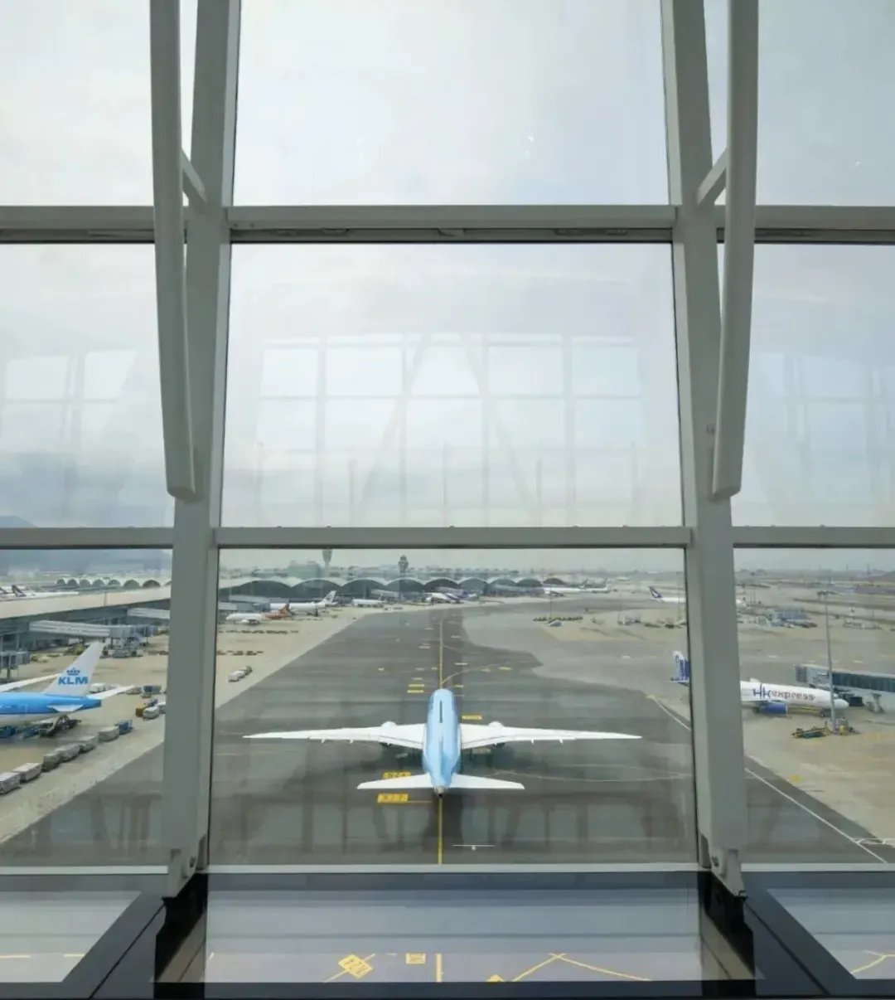

Aeroportul Internațional Hong Kong — Chek Lap Kok — a fost deschis la 6 iulie 1998, înlocuind Kai Tak. Construit pe terenuri recuperate din mare, în largul insulei Lantau, deservește peste 150 de destinații din Asia, Europa, America de Nord și Oceania.

Aproape totul se întâmplă în **Terminalul 1 (T1)**: check-in, securitate, plecări și sosiri, iar porțile îndepărtate sunt deservite de Midfield Concourse și North Satellite Concourse. **Terminalul 2** este în curs de extindere și redeschidere; anunțurile oficiale ale aeroportului sunt cele care stabilesc definitiv când.

## Escale

Iată procesul de bază de escală după ce aterizezi în Hong Kong.

### Pasul 1: confirmă cartea de îmbarcare pentru zborul următor

- **Dacă o ai deja:** urmează pur și simplu indicatoarele clare „Transfers / Transit”.
- **Dacă nu o ai:** mergi la ghișeele de transfer de la nivelul 5 (L5), arată pașaportul și biletul electronic personalului companiei aeriene și ridică-ți cartea de îmbarcare.

### Pasul 2: controlul de securitate

Fiecare pasager în tranzit trece din nou prin controlul de securitate.

### Pasul 3: spre nivelul de plecări și poarta ta

După controlul de securitate ajungi la nivelul 7 (L7), nivelul de plecări, mărginit de magazine și restaurante. Verifică ecranele de plecări pentru numărul porții următoare și ora de îmbarcare.

**Unde se află porțile**

| Porți | Locație |
| --- | --- |
| 1–80 | Terminalul 1 propriu-zis |
| 201–230 | Midfield Concourse, la vest de clădirea principală; acces cu Automated People Mover |
| 501–510 | North Satellite Concourse, accesibil prin Sky Bridge sau cu Automated People Mover |

**Deplasarea între ele:** dacă poarta ta este departe, folosește Automated People Mover (trenul fără conductor) din interiorul terminalului.

> Lasă cel puțin **2 ore** pentru o escală, ca să acoperi un zbor de sosire întârziat, o schimbare de poartă sau o coadă lungă.

## Depozit de bagaje

Dacă escala ta este lungă și vrei să mergi în oraș fără bagaje, aeroportul are un serviciu de depozitare a bagajelor.

- **Unde:** Terminalul 1, holul de sosiri de la nivelul 5, zona A (în zona publică — accesibil tuturor pasagerilor)
- **Program:** zilnic, 05:30–01:30
- **Preț:** 14 HK$ pe oră; maximum 165 HK$ pe articol pe zi (nimic peste această sumă în 24 de ore)

## Cum ajungi în oraș

Aeroportul oferă mai multe modalități de a ajunge în oraș, așa că alege-o pe cea care ți se potrivește:

- **Airport Express:** cea mai rapidă opțiune — aproximativ 24 de minute până în Central (Hong Kong Station), cu opriri la Kowloon și Tsing Yi. 115 HK$ pe un sens; ideal pentru călătorii de afaceri sau pentru oricine este strâns de timp.
- **Autobuze de aeroport:** cea mai ieftină opțiune, cu acoperire largă și servicii de noapte. Tarifele sunt de 30–40 HK$; ideal dacă ai timp și vrei să economisești.
- **Transferuri de aeroport:** rezervă în avans un transfer privat și fii întâmpinat de un șofer — ideal cu mult bagaj sau pentru familii.
- **Taxiuri:** rapide și comode, alegerea pentru oricine are bagaje grele sau preferă intimitatea.

## Două obiective care merită drumul

### Sky Bridge

Sky Bridge leagă terminalul principal de North Satellite Concourse: este o pasarelă pietonală de 200 de metri — cea mai lungă de acest fel din lume în zona din spatele controlului de securitate —, la 28 de metri deasupra solului, cu podea de sticlă, prin care poți urmări aeronavele rulând sub picioarele tale.

**Unde:** porțile 13–22

### Cupola de joacă

Cupola de joacă este un spațiu de joacă conceput pentru copiii între 6 și 12 ani. Este o structură uriașă în formă de coajă de ou, cu plase de cățărare, un tobogan și tuneluri curbate din plasă, cu panglici viu colorate deasupra.

**Unde:** Terminalul 1, nivelul de plecări (L6), East Hall, lângă poarta 11

## Unde mănânci

### 阿鸿小吃 (Ah Hung Snacks)

Numit de CNN cel mai bun restaurant din aeroporturi din lume, Ah Hung Snacks este cunoscut pentru preparatele înăbușite și cărnurile la rotisor — felii de gâscă înăbușită, un platou mixt înăbușit și specialitatea casei, pulpă de vită înăbușită. Aromele sunt bogate fără să fie grele, iar mulți călători își fac un scop din a mânca aici înainte de îmbarcare.

**Unde:** Terminalul 1, nivelul de sosiri, nivelul 5 (în zona publică)

### 何洪记 (Ho Hung Kee)

Ho Hung Kee este un restaurant local cu tradiție, cunoscut pentru tăițeii cu wonton și congee, și a avut o recomandare Michelin. Wontonii au coaja subțire și sunt umpluți din belșug cu creveți fermi, iar congee-ul „sampan” are propriii săi fani — un bol bun de tăiței cantonezi fierbinți cât aștepți.

**Unde:** Terminalul 1, nivelul de sosiri, nivelul 5 (în zona publică)

### 都爹利会馆 (Duddell's)

Duddell's, un restaurant cantonez cu stea Michelin, are un punct de vânzare în zona de restaurante din zona restricționată de plecări a Terminalului 1, unde servește bucătărie cantoneză de înaltă calitate — dim sum, supe fierte la abur în vas dublu, cărnuri la rotisor și mâncăruri la wok, cu multe opțiuni vegetariene în meniu.

**Unde:** Terminalul 1, nivelul de plecări, East Hall, nivelul 7, magazinul 7E161 (în zona după control)

### Gordon Ramsay Plane Food To Go

Gordon Ramsay a adus la Aeroportul Internațional Hong Kong primul Gordon Ramsay Plane Food To Go din Asia, cu un meniu de feluri britanice alături de specialități din Hong Kong create pentru aeroport. Mâncarea este proaspătă și echilibrată — gustări ușoare occidentale, inclusiv sandvișuri, salate și paste — și se potrivește călătorilor care vor ceva rapid, dar bun.

**Unde:** Terminalul 1, nivelul de plecări, East Hall, nivelul 7 (în zona după control)

## Cumpărături

- **Înainte de controlul de securitate:** Cookies Quartet, POP MART, magazinul muzeului M+, Micro Film și Sanrio.
- **După controlul de securitate:** magazine de suveniruri (Kee Wah Bakery, Sweet Dreams și altele), mărci de lux (Louis Vuitton, Hermès), bijuterii (Cartier, Bulgari), produse de înfrumusețare (SK-II, Lancôme) și jucării și cadouri de designer (magazinul Hong Kong Disneyland, Hong Kong Design Gallery). Sunt foarte multe mărci, iar peste cursul de schimb beneficiezi și de prețuri duty-free.

## Saloane

### Hong Kong Airlines — 遨堂 (Club Autus)

Club Autus mizează pe aromele din Hong Kong, cu tăiței wonton pregătiți la comandă, vafe cu ou, tăiței cu garnituri la alegere, budincă de tofu, ceai cu lapte „silk-stocking” și orez gătit în oală de lut, plus cocktailuri de la Leo Ko, campion mondial la bartending.

**Unde:** Midfield Concourse, nivelul 7

### Plaza Premium Lounge

Independente de orice companie aeriană, saloanele Plaza Premium sunt deschise oricui plătește — ai nevoie doar de o carte de îmbarcare validă. Pe lângă bere, cafea și băuturi răcoritoare, servesc mâncare caldă gătită la comandă, cum ar fi supă de tăiței cu chiftele de pește, orez cu carne la rotisor și pâine prăjită făcută în casă, iar fiecare loc are o priză.

**Unde:** lângă porțile 1, 35 și 60

### Saloanele Cathay Pacific

Hong Kong este baza principală a Cathay Pacific, așa că compania are aici mai multe saloane, iar acestea sunt cele mai bine dotate dintre saloanele aeroportului. The Pier, de exemplu, servește tăiței dan dan și wonton gătiți pe loc, cu o gamă completă de băuturi și feluri calde, și are o casă de ceai unde poți comanda un ceainic de ceai fierbinte care să taie din bogăția preparatelor.

**Unde:** lângă porțile 35, 6, 63–65, 1–4 și 5

## Servicii gratuite

- **Wi-Fi gratuit:** oprește datele mobile → alege rețeaua „HKAirport Free WiFi” → deschide un browser și introdu orice adresă URL validă → citește termenii și condițiile → apasă „Agree and Continue”.
- **Încărcare gratuită:** peste 9.100 de prize în tot terminalul, cu porturi USB și prize britanice cu trei pini în zonele de ședere de lângă aproape fiecare poartă și în zona de transfer.
- **Dușuri gratuite:** dușuri publice în Terminalul 1, poarta 12. Arată cartea de îmbarcare pentru a primi un prosop curat și articole de toaletă gratuit.
- **Locuri de joacă pentru copii:** în Terminalul 1, la porțile 1, 15, 41 și 60, pentru ca familiile în tranzit cu copii să își umple timpul.

## Un lucru de reținut: taxa de plecare a crescut

Departamentul Aviației Civile din Hong Kong a anunțat că, pentru biletele emise la sau după 1 octombrie 2025, **taxa de plecare pentru pasagerii aerieni pentru zborurile care pleacă din Hong Kong crește de la 120 HK$ la 200 HK$** (pasagerii în tranzit în aceeași zi sunt excluși). Conform noilor reguli, călătorii care rămân în Hong Kong cel mult 48 de ore pot solicita rambursarea integrală a taxei.

## Linkuri utile

- **Pe acest site**: [Aeroportul Internațional Hong Kong (HKG)](/airport/HKG)
- **Wikipedia**: [Aeroportul Internațional Hong Kong](https://en.wikipedia.org/wiki/Hong_Kong_International_Airport)
- **Baidu Baike**: [Aeroportul Internațional Hong Kong](https://baike.baidu.com/item/%E9%A6%99%E6%B8%AF%E5%9B%BD%E9%99%85%E6%9C%BA%E5%9C%BA)
