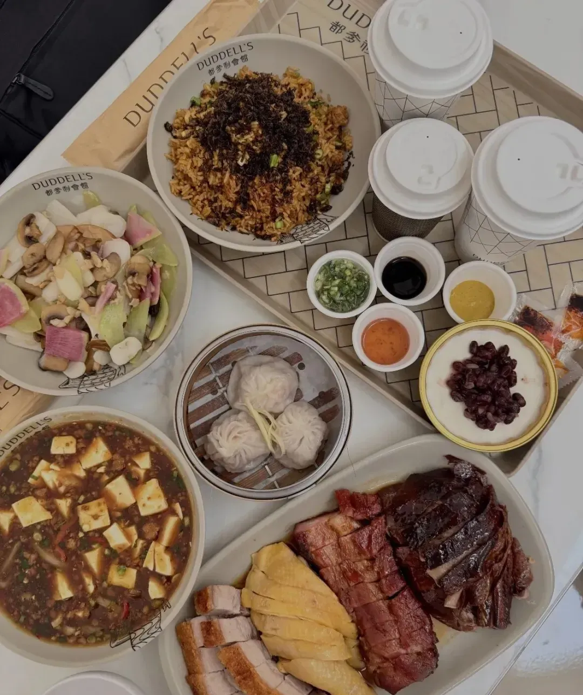

Международный аэропорт Гонконга — Чек-Лап-Кок — открылся 6 июля 1998 года, заменив Кайтак. Построенный на насыпной земле у Лантау, он обслуживает более 150 направлений в Азии, Европе, Северной Америке и Океании.

Почти всё происходит в **терминале 1 (T1)**: регистрация, досмотр, вылеты и прилёты, а удалёнными выходами управляют галереи Midfield и North Satellite. **Терминал 2** расширяется и вновь открывается; сроки точнее всего называют в официальных сообщениях аэропорта.

## Пересадки

Вот основной процесс пересадки после прилёта в Гонконг.

### Шаг 1: подтвердите посадочный талон на следующий рейс

- **Если он у вас уже есть:** просто идите по понятным указателям «Transfers / Transit».
- **Если нет:** подойдите к стойкам пересадки на уровне 5 (L5), покажите паспорт и электронный билет сотрудникам авиакомпании и получите посадочный талон.

### Шаг 2: досмотр безопасности

Каждый транзитный пассажир снова проходит досмотр безопасности.

### Шаг 3: на уровень вылета и к своему выходу

После досмотра вы выходите на уровень 7 (L7) — уровень вылета, где расположены магазины и рестораны. Проверьте на табло номер выхода на следующий рейс и время посадки.

**Где находятся выходы**

| Выходы | Расположение |
| --- | --- |
| 1–80 | Сам терминал 1 |
| 201–230 | Галерея Midfield, к западу от основного здания; добраться можно на автоматическом пассажирском транспорте |
| 501–510 | Северная спутниковая галерея, куда ведёт Sky Bridge или автоматический пассажирский транспорт |

**Как перемещаться между ними:** если ваш выход далеко, пользуйтесь автоматическим пассажирским транспортом (поездом без машиниста) внутри терминала.

> Закладывайте на пересадку не меньше **2 часов**, чтобы учесть задержку входящего рейса, смену выхода или длинную очередь.

## Камера хранения

Если пересадка долгая и вы хотите съездить в город налегке, в аэропорту есть камера хранения.

- **Где:** терминал 1, зал прилёта на уровне 5, зона A (до контроля — доступно всем пассажирам)
- **Часы работы:** ежедневно, 05:30–01:30
- **Цена:** 14 HK$ в час; максимум 165 HK$ за предмет в сутки (в пределах 24 часов дороже не берут)

## Как добраться до города

Аэропорт предлагает несколько способов добраться до города — выберите подходящий:

- **Airport Express:** самый быстрый вариант — около 24 минут до Центрального района (станция Гонконг) с остановками в Коулуне и Цинъи. 115 HK$ в одну сторону; лучше всего для деловых путешественников и тех, кто спешит.
- **Аэропортовые автобусы:** самый дешёвый вариант с широким покрытием и ночными рейсами. Тарифы 30–40 HK$; подходит, если у вас есть время и вы хотите сэкономить.
- **Трансферы из аэропорта:** заранее закажите частную встречу, и вас встретит водитель — лучший выбор при большом багаже или для семей.
- **Такси:** быстро и удобно; выбор для тех, у кого тяжёлые сумки или кто предпочитает приватность.

## Две достопримечательности, ради которых стоит пройтись

### Sky Bridge

Sky Bridge соединяет основной терминал с Северной спутниковой галереей: это пешеходный мост длиной 200 метров — самый длинный мост в стерильной зоне в мире — на высоте 28 метров над землёй, со стеклянным полом, через который видно рулящие внизу самолёты.

**Где:** выходы 13–22

### Игровой купол

Игровой купол — игровая площадка для детей от 6 до 12 лет. Это гигантская конструкция в форме яичной скорлупы с лазательными сетками, горкой и изогнутыми сетчатыми туннелями, а над головой висят яркие ленты.

**Где:** терминал 1, уровень вылета (L6), восточный зал, рядом с выходом 11

## Где поесть

### 阿鸿小吃 (Ah Hung Snacks)

Признанный CNN лучшим аэропортовым рестораном в мире, Ah Hung Snacks известен тушёными блюдами и жареным мясом — ломтиками тушёного гуся, тушёной смешанной закуской и фирменной тушёной говяжьей голенью. Вкус насыщенный, но не тяжёлый, и многие путешественники специально едят здесь перед посадкой.

**Где:** терминал 1, уровень прилёта, уровень 5 (до контроля)

### 何洪记 (Ho Hung Kee)

Ho Hung Kee — давно известный местный ресторан, знаменитый лапшой вонтон и конджи, отмеченный рекомендацией Michelin. Вонтоны с тонким тестом и щедрой начинкой из упругих креветок, а конджи «сампан» имеет своих поклонников — хорошая миска горячей кантонской лапши, пока вы ждёте.

**Где:** терминал 1, уровень прилёта, уровень 5 (до контроля)

### 都爹利会馆 (Duddell's)

Duddell's — кантонский ресторан со звездой Michelin, у которого есть точка во фуд-корте в стерильной зоне вылета терминала 1; здесь подают качественную кантонскую кухню — димсамы, супы двойной варки, жареное мясо и блюда вок, а в меню много вегетарианских вариантов.

**Где:** терминал 1, уровень вылета, восточный зал, уровень 7, магазин 7E161 (после контроля)

### Gordon Ramsay Plane Food To Go

Gordon Ramsay открыл первый в Азии Gordon Ramsay Plane Food To Go в Международном аэропорту Гонконга: в меню британские блюда и гонконгские фирменные блюда, созданные для аэропорта. Еда свежая и сбалансированная — западные лёгкие закуски, включая сэндвичи, салаты и пасту, — и подходит путешественникам, которые хотят быстро, но хорошо поесть.

**Где:** терминал 1, уровень вылета, восточный зал, уровень 7 (после контроля)

## Шопинг

- **До контроля:** Cookies Quartet, POP MART, магазин музея M+, Micro Film и Sanrio.
- **После контроля:** сувенирные магазины (Kee Wah Bakery, Sweet Dreams и другие), люксовые бренды (Louis Vuitton, Hermès), ювелирные (Cartier, Bulgari), косметика (SK-II, Lancôme) и дизайнерские игрушки и подарки (магазин Hong Kong Disneyland, Hong Kong Design Gallery). Брендов очень много, и к курсу добавляется беспошлинная цена.

## Залы ожидания

### Hong Kong Airlines — 遨堂 (Club Autus)

Club Autus делает ставку на гонконгские вкусы: лапша вонтон на заказ, вафли с яйцом, лапша с тележки, тофу-пудинг, чай «шелковый чулок» и рис в глиняном горшке, а также коктейли от чемпиона мира бармена Лео Ко.

**Где:** галерея Midfield, уровень 7

### Plaza Premium Lounge

Независимые от авиакомпаний залы Plaza Premium открыты для всех, кто платит, — нужен только действующий посадочный талон. Помимо пива, кофе и безалкогольных напитков здесь подают горячую еду на заказ, например суп с фрикадельками из рыбы, рис с жареным мясом и тосты ручной работы, а у каждого места есть розетка.

**Где:** рядом с выходами 1, 35 и 60

### Залы Cathay Pacific

Гонконг — домашняя база Cathay Pacific, поэтому у авиакомпании здесь несколько залов, и они лучше всего оборудованы в аэропорту. Например, The Pier подаёт свежеприготовленную лапшу дань-дань и вонтон с полным набором напитков и горячих блюд, а в чайном доме можно заказать чайник горячего чая, чтобы сбалансировать сытную еду.

**Где:** рядом с выходами 35, 6, 63–65, 1–4 и 5

## Бесплатные услуги

- **Бесплатный Wi-Fi:** отключите мобильные данные → выберите сеть «HKAirport Free WiFi» → откройте браузер и введите любой действительный URL → прочитайте условия → нажмите «Agree and Continue».
- **Бесплатная зарядка:** более 9 100 розеток по всему терминалу, с USB-портами и британскими трёхконтактными розетками у мест ожидания почти у каждого выхода и в транзитной зоне.
- **Бесплатный душ:** общественные душевые в терминале 1, у выхода 12. Покажите посадочный талон, чтобы бесплатно получить свежее полотенце и принадлежности.
- **Детские игровые зоны:** в терминале 1 у выходов 1, 15, 41 и 60 — чтобы семьи с детьми на пересадке могли занять время.

## Одна вещь, которую стоит учесть: вылетный налог вырос

Управление гражданской авиации Гонконга объявило, что для билетов, выпущенных 1 октября 2025 года или позже, **налог на авиапассажиров при вылете из Гонконга повышается со 120 до 200 HK$** (транзитные пассажиры в тот же день исключены). По новым правилам путешественники, которые находятся в Гонконге не более 48 часов, могут подать заявку на полный возврат налога.

## Полезные ссылки

- **На этом сайте**: [Международный аэропорт Гонконга (HKG)](/airport/HKG)
- **Википедия**: [Международный аэропорт Гонконга](https://en.wikipedia.org/wiki/Hong_Kong_International_Airport)
- **Baidu Baike**: [Международный аэропорт Гонконга](https://baike.baidu.com/item/%E9%A6%99%E6%B8%AF%E5%9B%BD%E9%99%85%E6%9C%BA%E5%9C%BA)
