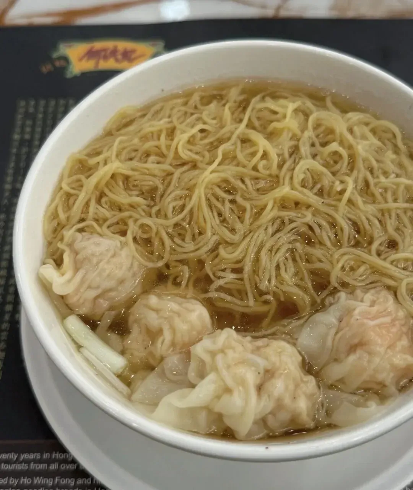
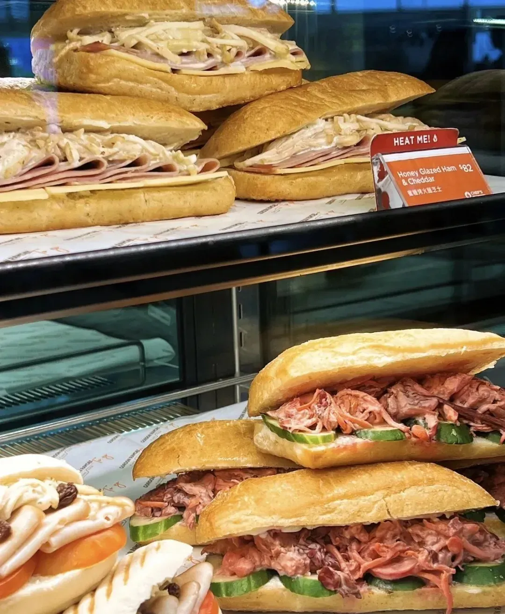
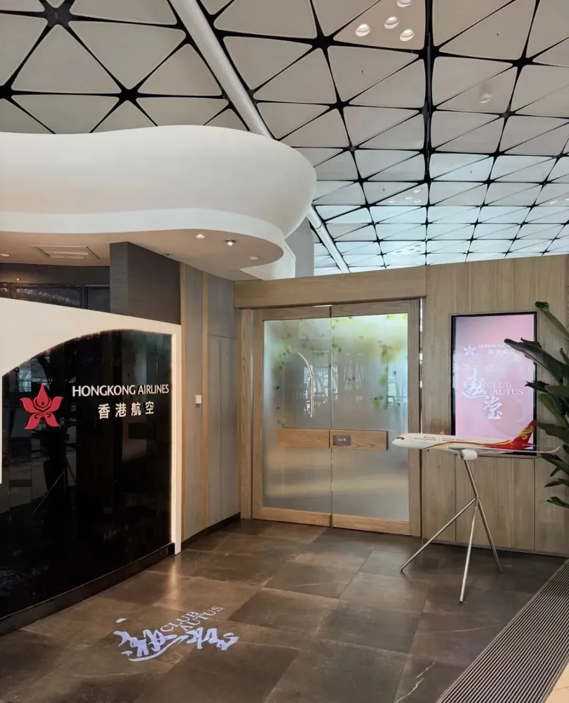

Hongkong internationella flygplats – Chek Lap Kok – öppnade den 6 juli 1998 och ersatte Kai Tak. Den byggdes på återvunnen mark utanför Lantau och trafikerar fler än 150 destinationer i Asien, Europa, Nordamerika och Oceanien.

Nästan allt sker i **terminal 1 (T1)**: incheckning, säkerhetskontroll, avgångar och ankomster, medan de avlägsna gaterna hanteras av Midfield- och North Satellite-konkurerna. **Terminal 2** byggs ut och återöppnas; flygplatsens egna meddelanden är avgörande för när.

## Transfer

Här är den grundläggande transferprocessen efter att du landat i Hongkong.

### Steg 1: bekräfta ditt boardingkort för vidare resa

- **Har du redan ett:** följ bara de tydliga skyltarna "Transfers / Transit".
- **Har du inte:** gå till transferdiskarna på nivå 5 (L5), visa pass och e-biljett för flygbolagets personal och hämta ditt boardingkort.

### Steg 2: säkerhetskontroll

Varje transferpassagerare går igenom säkerhetskontrollen igen.

### Steg 3: till avgångsnivån och din gate

Efter säkerhetskontrollen kommer du ut på nivå 7 (L7), avgångsnivån, kantad av butiker och restauranger. Kontrollera avgångstavlorna för din nästa gate och boardingtid.

**Var gaterna ligger**

| Gater | Placering |
| --- | --- |
| 1–80 | Terminal 1 |
| 201–230 | Midfield Concourse, väster om huvudbyggnaden; nås med Automated People Mover |
| 501–510 | North Satellite Concourse, nås via Sky Bridge eller Automated People Mover |

**Ta dig mellan dem:** ligger din gate långt bort, använd Automated People Mover (det förarlösa tåget) inne i terminalen.

> Räkna med minst **2 timmar** för en transfer, för att täcka in ett försenat ankommande flyg, ett gatebyte eller en lång kö.

## Bagageförvaring

Har du lång mellanlandning och vill ta dig in till stan utan att släpa på bagaget erbjuder flygplatsen bagageförvaring.

- **Var:** terminal 1, ankomsthall på nivå 5, zon A (före säkerhetskontrollen – öppen för alla passagerare)
- **Öppettider:** dagligen 05:30–01:30
- **Pris:** 14 HKD per timme; högst 165 HKD per föremål och dygn (inget utöver det inom 24 timmar)

## In till staden

Flygplatsen erbjuder flera sätt att ta sig in till staden, så välj det som passar dig:

- **Airport Express:** det snabbaste alternativet – cirka 24 minuter till Central (Hong Kong Station), med stopp i Kowloon och Tsing Yi. 115 HKD enkel resa; bäst för affärsresenärer eller den som har ont om tid.
- **Flygbussar:** det billigaste alternativet, med stort nät och nattrutter. Priserna är 30–40 HKD; bäst om du har tid och vill spara pengar.
- **Flygplatstransfer:** boka en privat hämtning i förväg och bli mött av en chaufför – bäst med mycket bagage eller för familjer.
- **Taxi:** snabbt och bekvämt, och valet för den med tungt bagage eller som föredrar avskildhet.

## Två sevärdheter värda promenaden

### Sky Bridge

Sky Bridge förbinder huvudterminalen med North Satellite Concourse och är en 200 meter lång gångbro – världens längsta gångbro på luftplatssidan – 28 meter över marken, med ett glasgolv där du kan se flygplan taxa under fötterna.

**Var:** gate 13–22

### Lekkupolen

Lekkupolen är en lekplats byggd för barn mellan 6 och 12 år. Det är en jättelik äggskalskonstruktion med klätternät, en rutschkana och böjda nätunnlar, med färgstarka band ovanför.

**Var:** terminal 1, avgångsnivån (L6), East Hall, nära gate 11

## Var du äter

### 阿鸿小吃 (Ah Hung Snacks)

Ah Hung Snacks utsågs av CNN till världens bästa flygplatsrestaurang och är känd för sina bräserade rätter och rostade kött – skivor av bräserad gås, ett bräserat blandfat och signaturen bräserad nötlägg. Smakerna är rika utan att vara tunga, och många resenärer ser till att äta här före boarding.

**Var:** terminal 1, ankomstnivån, nivå 5 (före säkerhetskontrollen)

### 何洪记 (Ho Hung Kee)

Ho Hung Kee är en anrik lokal restaurang känd för sina wonton-nudlar och sin gröt och har fått Michelin-rekommendation. Wontonen har tunt skal och är generöst fylld med spänstig räka, och sampangröten har sina egna fans – en bra skål varma kantonesiska nudlar medan du väntar.

**Var:** terminal 1, ankomstnivån, nivå 5 (före säkerhetskontrollen)

### 都爹利会馆 (Duddell's)

Duddell's, en kantonesisk restaurang med Michelinstjärna, har ett utskänkningsställe i mathallen inne i terminal 1:s avgångsområde och serverar kantonesisk mat av hög kvalitet – dim sum, dubbelkokta soppor, rostat kött och wokrätter, med gott om vegetariska alternativ på menyn.

**Var:** terminal 1, avgångsnivån, East Hall, nivå 7, butik 7E161 (efter säkerhetskontrollen)

### Gordon Ramsay Plane Food To Go

Gordon Ramsay öppnade den första Gordon Ramsay Plane Food To Go i Asien på Hongkong internationella flygplats, med en meny av brittiska rätter sida vid sida med Hongkong-specialiteter skapade för flygplatsen. Maten är färsk och balanserad – västerländska lättare rätter som smörgåsar, sallader och pasta – och passar resenärer som vill ha något snabbt men gott.

**Var:** terminal 1, avgångsnivån, East Hall, nivå 7 (efter säkerhetskontrollen)

## Shopping

- **Före säkerhetskontrollen:** Cookies Quartet, POP MART, M+-museets butik, Micro Film och Sanrio.
- **Efter säkerhetskontrollen:** souvenirbutiker (Kee Wah Bakery, Sweet Dreams med flera), lyxmärken (Louis Vuitton, Hermès), smycken (Cartier, Bulgari), skönhet (SK-II, Lancôme) och designleksaker och presenter (Hong Kong Disneyland-butiken, Hong Kong Design Gallery). Det finns väldigt många märken, och du får taxfreepris ovanpå växelkursen.

## Lounger

### Hong Kong Airlines — 遨堂 (Club Autus)

Club Autus satsar på Hongkong-smaker, med wonton-nudlar tillagade på beställning, äggvåfflor, cart noodles, tofuputding, silkesstrumpste med mjölk och lergryteris, plus cocktails från världsmästaren i bartending Leo Ko.

**Var:** Midfield Concourse, nivå 7

### Plaza Premium Lounge

Plaza Premium-loungerna är oberoende av flygbolag och öppna för alla som betalar – du behöver bara ett giltigt boardingkort. Utöver öl, kaffe och läsk serverar de varm mat tillagad på beställning, som fiskbollssoppa med nudlar, ris med rostat kött och handgjord toast, och varje sittplats har ett eluttag.

**Var:** nära gate 1, 35 och 60

### Cathay Pacifics lounger

Hongkong är Cathay Pacifics hemmabas, så flygbolaget har flera lounger här, och de är de bäst utrustade av flygplatsens lounger. The Pier serverar till exempel nykokta dan dan- och wonton-nudlar med ett fullt sortiment av drycker och varma rätter, och har ett tehus där du kan beställa en kanna varmt te som bryter igenom det feta.

**Var:** nära gate 35, 6, 63–65, 1–4 och 5

## Gratis tjänster

- **Gratis Wi-Fi:** stäng av mobildata → välj nätverket "HKAirport Free WiFi" → öppna en webbläsare och ange valfri giltig URL → läs villkoren → tryck på "Agree and Continue".
- **Gratis laddning:** fler än 9 100 eluttag i terminalen, med USB-portar och brittiska trepoliga uttag vid sittplatser nära nästan varje gate och i transferzonen.
- **Gratis duschar:** allmänna duschar i terminal 1, gate 12. Visa boardingkortet för att få en färsk handduk och toalettartiklar utan kostnad.
- **Lekplatser för barn:** i terminal 1 vid gate 1, 15, 41 och 60, för att hjälpa familjer med barn på transfer att få tiden att gå.

## En sak att notera: avgångsskatten har höjts

Hongkongs civilaviationsavdelning har meddelat att för biljetter utfärdade den 1 oktober 2025 eller senare **höjs Air Passenger Departure Tax för flyg som avgår från Hongkong från 120 HKD till 200 HKD** (transferpassagerare samma dag undantas). Enligt de nya reglerna kan resenärer som vistas i Hongkong i högst 48 timmar ansöka om full återbetalning av skatten.

## Relaterade länkar

- **På den här sajten**: [Hongkong internationella flygplats (HKG)](/airport/HKG)
- **Wikipedia**: [Hongkong internationella flygplats](https://en.wikipedia.org/wiki/Hong_Kong_International_Airport)
- **Baidu Baike**: [Hongkong internationella flygplats](https://baike.baidu.com/item/%E9%A6%99%E6%B8%AF%E5%9B%BD%E9%99%85%E6%9C%BA%E5%9C%BA)
