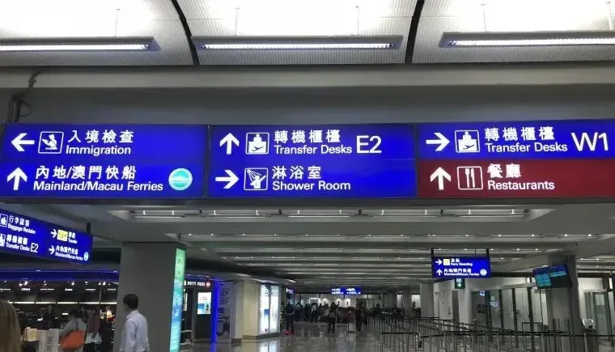

ท่าอากาศยานนานาชาติฮ่องกง — เช็กล้าปก๊อก — เปิดให้บริการเมื่อวันที่ 6 กรกฎาคม 1998 แทนที่สนามบินไคตัก สร้างบนพื้นที่ถมทะเลนอกเกาะลันเตา ให้บริการมากกว่า 150 จุดหมายทั่วเอเชีย ยุโรป อเมริกาเหนือ และโอเชียเนีย

เกือบทุกอย่างเกิดขึ้นใน**อาคารผู้โดยสาร 1 (T1)**: เช็คอิน จุดตรวจสัมภาระ ขาออก และขาเข้า ส่วนประตูขึ้นเครื่องระยะไกลให้บริการโดยโถงมิดฟิลด์และโถงนอร์ทแซทเทลไลท์ **อาคารผู้โดยสาร 2** กำลังขยายและเปิดให้บริการอีกครั้ง โดยประกาศของสนามบินเองเป็นข้อมูลสุดท้ายเรื่องกำหนดเวลา

## การเปลี่ยนเครื่อง

นี่คือขั้นตอนการเปลี่ยนเครื่องพื้นฐานหลังจากคุณลงจอดที่ฮ่องกง

### ขั้นที่ 1: ยืนยันบัตรโดยสารขาออกของคุณ

- **หากมีอยู่แล้ว:** เพียงทำตามป้าย "Transfers / Transit" ที่ชัดเจน
- **หากยังไม่มี:** ไปที่เคาน์เตอร์เปลี่ยนเครื่องชั้น 5 (L5) แสดงหนังสือเดินทางและตั๋วอิเล็กทรอนิกส์ต่อเจ้าหน้าที่สายการบิน แล้วรับบัตรโดยสาร

### ขั้นที่ 2: การตรวจรักษาความปลอดภัย

ผู้โดยสารเปลี่ยนเครื่องทุกคนต้องผ่านการตรวจรักษาความปลอดภัยอีกครั้ง

### ขั้นที่ 3: ไปยังชั้นขาออกและประตูขึ้นเครื่องของคุณ

หลังผ่านจุดตรวจ คุณจะออกมาที่ชั้น 7 (L7) ซึ่งเป็นชั้นขาออกที่เต็มไปด้วยร้านค้าและร้านอาหาร ตรวจดูจอแสดงเที่ยวบินขาออกเพื่อหาหมายเลขประตูขึ้นเครื่องและเวลาขึ้นเครื่องของคุณ

**ประตูขึ้นเครื่องอยู่ที่ไหน**

| ประตูขึ้นเครื่อง | ตำแหน่ง |
| --- | --- |
| 1–80 | อาคารผู้โดยสาร 1 |
| 201–230 | โถงมิดฟิลด์ ทางตะวันตกของอาคารหลัก; เข้าถึงด้วยรถไฟ Automated People Mover |
| 501–510 | โถงนอร์ทแซทเทลไลท์ เข้าถึงทางสกายบริดจ์หรือรถไฟ Automated People Mover |

**การเดินทางระหว่างโถง:** หากประตูขึ้นเครื่องอยู่ไกล ให้ใช้ Automated People Mover (รถไฟไร้คนขับ) ภายในอาคารผู้โดยสาร

> เผื่อเวลาอย่างน้อย **2 ชั่วโมง** สำหรับการเปลี่ยนเครื่อง เพื่อรองรับเที่ยวบินขาเข้าที่ล่าช้า การเปลี่ยนประตูขึ้นเครื่อง หรือคิวที่ยาว

## การฝากกระเป๋า

หากคุณมีเวลาพักเปลี่ยนเครื่องนานและต้องการเข้าเมืองโดยไม่ต้องแบกสัมภาระ สนามบินมีบริการฝากกระเป๋า

- **สถานที่:** อาคารผู้โดยสาร 1 โถงขาเข้าชั้น 5 โซน A (ฝั่งนอกเขตควบคุม — เปิดให้ผู้โดยสารทุกคน)
- **เวลาเปิด:** ทุกวัน 05:30–01:30
- **ราคา:** HK$14 ต่อชั่วโมง สูงสุด HK$165 ต่อชิ้นต่อวัน (ไม่เกินนั้นภายใน 24 ชั่วโมง)

## การเข้าเมือง

สนามบินมีทางเข้าเมืองหลายวิธี เลือกวิธีที่เหมาะกับคุณ:

- **แอร์พอร์ตเอ็กซ์เพรส:** ทางเลือกที่เร็วที่สุด — ประมาณ 24 นาทีถึงเซ็นทรัล (สถานีฮ่องกง) จอดที่เกาลูนและชิงอี ราคา HK$115 ต่อเที่ยว เหมาะกับนักเดินทางเพื่อธุรกิจหรือผู้ที่มีเวลาน้อย
- **รถบัสสนามบิน:** ทางเลือกที่ถูกที่สุด ครอบคลุมกว้างและมีบริการข้ามคืน ค่าโดยสาร HK$30–40 เหมาะหากคุณมีเวลาและต้องการประหยัด
- **รถรับส่งสนามบิน:** จองรถรับส่วนตัวล่วงหน้าและมีคนขับมารับ — เหมาะที่สุดเมื่อมีสัมภาระมากหรือเดินทางกับครอบครัว
- **แท็กซี่:** รวดเร็วและสะดวก เป็นตัวเลือกสำหรับผู้ที่มีกระเป๋าหนักหรือชอบความเป็นส่วนตัว

## สองจุดชมที่คุ้มค่าเดินไป

### สกายบริดจ์

สกายบริดจ์เชื่อมอาคารผู้โดยสารหลักกับโถงนอร์ทแซทเทลไลท์ เป็นสะพานคนเดินยาว 200 เมตร — สะพานคนเดินฝั่งอากาศยานที่ยาวที่สุดในโลก — สูงจากพื้น 28 เมตร พื้นกระจกให้คุณมองเห็นเครื่องบินเคลื่อนตัวอยู่ใต้เท้า

**สถานที่:** ประตูขึ้นเครื่อง 13–22

### โดมเด็กเล่น

โดมเด็กเล่นเป็นพื้นที่เล่นที่สร้างสำหรับเด็กอายุ 6 ถึง 12 ปี เป็นโครงสร้างรูปเปลือกไข่ขนาดใหญ่พร้อมตาข่ายปีนป่าย สไลเดอร์ และอุโมงค์ตาข่ายโค้ง พร้อมริบบิ้นสีสันสดใสแขวนอยู่ด้านบน

**สถานที่:** อาคารผู้โดยสาร 1 ชั้นขาออก (L6) โถงตะวันออก ใกล้ประตูขึ้นเครื่อง 11

## ที่น่าทาน

### 阿鸿小吃 (Ah Hung Snacks)

阿鸿小吃 (Ah Hung Snacks) ได้รับการยกย่องจาก CNN ว่าเป็นร้านอาหารสนามบินที่ดีที่สุดในโลก มีชื่อเสียงด้านอาหารพะโล้และเนื้ออบ — ห่านพะโล้สไลด์ จานรวมพะโล้ และเนื้อวัวพะโล้ลายเซ็นของร้าน รสชาติเข้มข้นแต่ไม่หนักเกินไป และนักเดินทางจำนวนมากตั้งใจมาทานที่นี่ก่อนขึ้นเครื่อง

**สถานที่:** อาคารผู้โดยสาร 1 ชั้นขาเข้า ชั้น 5 (ฝั่งนอกเขตควบคุม)

### 何洪记 (Ho Hung Kee)

หอหุ่งกี่ (Ho Hung Kee) เป็นร้านอาหารท้องถิ่นเก่าแก่ที่มีชื่อเสียงด้านบะหมี่เกี๊ยวและโจ๊ก และเคยได้รับการแนะนำจากมิชลิน เกี๊ยวมีแป้งบางและไส้กุ้งแน่นหนึบ โจ๊กแบบเรือสำเภาก็มีแฟนประจำของตัวเอง — บะหมี่กวางตุ้งร้อน ๆ สักชามระหว่างรอ

**สถานที่:** อาคารผู้โดยสาร 1 ชั้นขาเข้า ชั้น 5 (ฝั่งนอกเขตควบคุม)

### 都爹利会馆 (Duddell's)

ตูเดลส์ (Duddell's) ร้านอาหารกวางตุ้งที่ได้รับดาวมิชลิน มีสาขาในฟู้ดคอร์ทภายในเขตหวงห้ามขาออกของอาคารผู้โดยสาร 1 เสิร์ฟอาหารกวางตุ้งคุณภาพสูง — ติ่มซำ ซุปตุ๋น เนื้ออบ และผัดต่าง ๆ พร้อมเมนูมังสวิรัติให้เลือกมากมาย

**สถานที่:** อาคารผู้โดยสาร 1 ชั้นขาออก โถงตะวันออก ชั้น 7 ร้าน 7E161 (ฝั่งในเขตควบคุม)

### Gordon Ramsay Plane Food To Go

กอร์ดอน แรมซีย์นำ Gordon Ramsay Plane Food To Go สาขาแรกในเอเชียมาที่ท่าอากาศยานนานาชาติฮ่องกง พร้อมเมนูอาหารอังกฤษควบคู่กับอาหารพิเศษฮ่องกงที่สร้างสรรค์สำหรับสนามบิน อาหารสดและสมดุล — ของว่างแบบตะวันตกรวมถึงแซนด์วิช สลัด และพาสต้า — เหมาะกับนักเดินทางที่ต้องการของเร็ว ๆ ที่ยังมีคุณภาพ

**สถานที่:** อาคารผู้โดยสาร 1 ชั้นขาออก โถงตะวันออก ชั้น 7 (ฝั่งในเขตควบคุม)

## การช้อปปิ้ง

- **ก่อนจุดตรวจสัมภาระ:** Cookies Quartet, POP MART, ร้านพิพิธภัณฑ์ M+, Micro Film และ Sanrio
- **หลังจุดตรวจสัมภาระ:** ร้านของที่ระลึก (Kee Wah Bakery, Sweet Dreams และอื่น ๆ) แบรนด์หรู (Louis Vuitton, Hermès) เครื่องประดับ (Cartier, Bulgari) ความงาม (SK-II, Lancôme) และของเล่นดีไซเนอร์และของขวัญ (ร้านฮ่องกงดิสนีย์แลนด์, Hong Kong Design Gallery) มีแบรนด์มากมาย และคุณได้ราคาปลอดภาษีบวกอัตราแลกเปลี่ยน

## เลานจ์

### Hong Kong Airlines — 遨堂 (Club Autus)

Club Autus เน้นรสชาติฮ่องกง ด้วยบะหมี่เกี๊ยวทำตามสั่ง วาฟเฟิลไข่ บะหมี่รถเข็น เต้าฮวย ชานมไหม และข้าวอบหม้อดิน พร้อมค็อกเทลจากลีโอ โก บาร์เทนเดอร์แชมป์โลก

**สถานที่:** โถงมิดฟิลด์ ชั้น 7

### Plaza Premium Lounge

Plaza Premium เป็นเลานจ์อิสระจากสายการบินใด ๆ เปิดให้ทุกคนที่จ่ายเงิน — เพียงมีบัตรโดยสารที่ยังใช้ได้ นอกจากเบียร์ กาแฟ และน้ำอัดลมแล้ว ยังมีอาหารร้อนทำตามสั่ง เช่น ก๋วยเตี๋ยวลูกชิ้นปลา ข้าวหมูแดง และขนมปังปิ้งทำสด และทุกที่นั่งมีปลั๊กไฟ

**สถานที่:** ใกล้ประตูขึ้นเครื่อง 1, 35 และ 60

### เลานจ์คาเธ่ย์แปซิฟิก

ฮ่องกงเป็นฐานหลักของคาเธ่ย์แปซิฟิก สายการบินจึงมีเลานจ์หลายแห่งที่นี่ และเป็นเลานจ์ที่อุปกรณ์ครบครันที่สุดของสนามบิน ตัวอย่างเช่น The Pier เสิร์ฟบะหมี่ตานตานและบะหมี่เกี๊ยวปรุงสด พร้อมเครื่องดื่มและอาหารร้อนครบครัน และมีร้านน้ำชาที่คุณสั่งชาร้อนหนึ่งหม้อเพื่อตัดความเลี่ยนได้

**สถานที่:** ใกล้ประตูขึ้นเครื่อง 35, 6, 63–65, 1–4 และ 5

## บริการฟรี

- **Wi-Fi ฟรี:** ปิดข้อมูลมือถือ → เลือกเครือข่าย "HKAirport Free WiFi" → เปิดเบราว์เซอร์และใส่ URL ที่ถูกต้องใดก็ได้ → อ่านข้อกำหนดและเงื่อนไข → แตะ "Agree and Continue"
- **ชาร์จไฟฟรี:** ปลั๊กไฟกว่า 9,100 จุดทั่วอาคารผู้โดยสาร พร้อมพอร์ต USB และปลั๊กสามขาแบบอังกฤษที่บริเวณที่นั่งใกล้ประตูขึ้นเครื่องเกือบทุกประตูและในโซนเปลี่ยนเครื่อง
- **ห้องอาบน้ำฟรี:** ห้องอาบน้ำสาธารณะที่อาคารผู้โดยสาร 1 ประตูขึ้นเครื่อง 12 แสดงบัตรโดยสารเพื่อรับผ้าเช็ดตัวสะอาดและของใช้ในห้องน้ำโดยไม่เสียค่าใช้จ่าย
- **พื้นที่เล่นเด็ก:** ที่อาคารผู้โดยสาร 1 ประตูขึ้นเครื่อง 1, 15, 41 และ 60 ช่วยให้ครอบครัวที่เปลี่ยนเครื่องพร้อมเด็กใช้เวลาได้

## เรื่องหนึ่งที่ควรทราบ: ภาษีขาออกเพิ่มขึ้น

กรมการบินพลเรือนฮ่องกงประกาศว่าสำหรับตั๋วที่ออกตั้งแต่วันที่ 1 ตุลาคม 2025 เป็นต้นไป **ภาษีผู้โดยสารขาออกสำหรับเที่ยวบินที่ออกจากฮ่องกงจะเพิ่มจาก HK$120 เป็น HK$200** (ไม่รวมผู้โดยสารที่เปลี่ยนเครื่องในวันเดียวกัน) ภายใต้กฎใหม่ นักเดินทางที่พำนักในฮ่องกงไม่เกิน 48 ชั่วโมงสามารถขอคืนภาษีได้เต็มจำนวน

## ลิงก์ที่เกี่ยวข้อง

- **ในเว็บไซต์นี้**: [ท่าอากาศยานนานาชาติฮ่องกง (HKG)](/airport/HKG)
- **Wikipedia**: [ท่าอากาศยานนานาชาติฮ่องกง](https://en.wikipedia.org/wiki/Hong_Kong_International_Airport)
- **Baidu Baike**: [ท่าอากาศยานนานาชาติฮ่องกง](https://baike.baidu.com/item/%E9%A6%99%E6%B8%AF%E5%9B%BD%E9%99%85%E6%9C%BA%E5%9C%BA)
