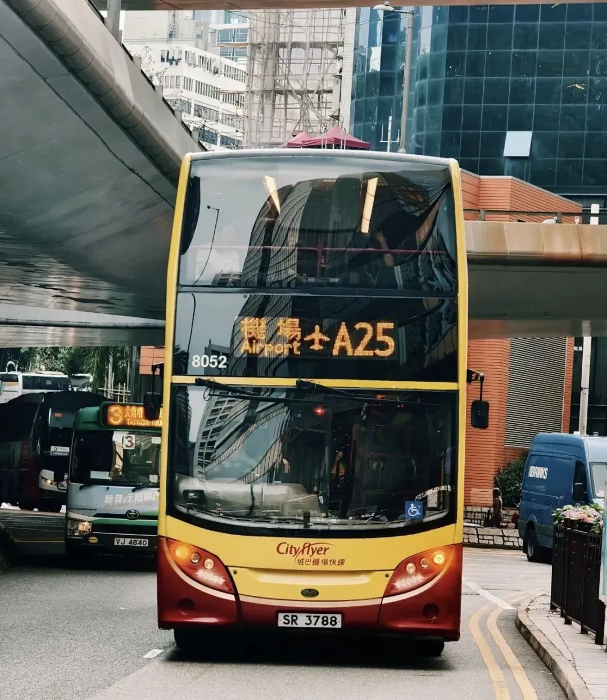

Hong Kong Uluslararası Havalimanı — Chek Lap Kok — 6 Temmuz 1998'de Kai Tak'ın yerine açıldı. Lantau açıklarındaki dolgu arazide inşa edilen havalimanı, Asya, Avrupa, Kuzey Amerika ve Okyanusya genelinde 150'den fazla varış noktasına hizmet veriyor.

Neredeyse her şey **Terminal 1'de (T1)** gerçekleşiyor: check-in, güvenlik, kalkışlar ve varışlar; uzak kapılar ise Midfield ve North Satellite koridorları tarafından işletiliyor. **Terminal 2** genişletilip yeniden açılıyor; ne zaman açılacağı konusunda havalimanının kendi duyuruları belirleyici.

## Aktarmalar

Hong Kong'a indikten sonra izleyeceğiniz temel aktarma süreci şöyle.

### 1. Adım: Aktarma uçuşunuzun biniş kartını doğrulayın

- **Zaten varsa:** “Transfers / Transit” (Aktarmalar / Transit) tabelalarını izlemeniz yeterli.
- **Yoksa:** 5. kattaki (L5) aktarma gişelerine gidin, pasaportunuzu ve e-biletinizi havayolu görevlisine gösterin ve biniş kartınızı alın.

### 2. Adım: Güvenlik kontrolü

Aktarma yapan her yolcu güvenlik kontrolünden yeniden geçiyor.

### 3. Adım: Kalkış katına ve kapınıza

Güvenlikten sonra mağazalar ve restoranlarla çevrili 7. kata (L7), kalkış katına çıkıyorsunuz. Aktarma uçuşunuzun kapı numarası ve biniş saati için kalkış ekranlarına bakın.

**Kapılar nerede**

| Kapılar | Konum |
| --- | --- |
| 1–80 | Terminal 1'in kendisi |
| 201–230 | Ana binanın batısındaki Midfield Koridoru; otomatik yolcu taşıma sistemiyle ulaşılır |
| 501–510 | Sky Bridge veya otomatik yolcu taşıma sistemiyle ulaşılan North Satellite Koridoru |

**Aralarında ulaşım:** kapınız uzaktaysa terminal içindeki otomatik yolcu taşıma sistemini (sürücüsüz tren) kullanın.

> Aktarma için en az **2 saat** ayırın; geciken varış uçuşu, kapı değişikliği veya uzun bir kuyruk için pay bırakın.

## Bagaj emaneti

Aktarma beklemeniz uzunsa ve yükünüz olmadan şehre gitmek istiyorsanız havalimanında bagaj emaneti hizmeti var.

- **Nerede:** Terminal 1, 5. kat varış salonu, A bölgesi (kara tarafı — tüm yolculara açık)
- **Çalışma saatleri:** her gün, 05.30–01.30
- **Ücret:** saat başına 14 HK$; eşya başına günde en fazla 165 HK$ (24 saat içinde bunun üzerinde ücret alınmıyor)

## Şehre ulaşım

Havalimanı şehre ulaşmak için birkaç seçenek sunuyor; size uygun olanı seçin:

- **Airport Express:** en hızlı seçenek — Central'a (Hong Kong İstasyonu) yaklaşık 24 dakika; Kowloon ve Tsing Yi'de duruyor. Tek yön 115 HK$; iş yolcuları veya zamanı kısıtlı olanlar için en iyisi.
- **Havalimanı otobüsleri:** en ucuz seçenek; geniş kapsama alanı ve gece seferleri var. Ücretler 30–40 HK$; zamanınız varsa ve tasarruf etmek istiyorsanız en iyisi.
- **Havalimanı transferleri:** önceden özel bir araç rezervasyonu yapın ve şoför tarafından karşılanın — çok bagajlıysanız veya aileyseniz en iyisi.
- **Taksiler:** hızlı ve pratik; ağır bagajı olanlar veya mahremiyeti tercih edenler için ideal.

## Yürümeye değer iki görülecek yer

### Sky Bridge

Ana terminali North Satellite Koridoru'na bağlayan Sky Bridge, 200 metrelik bir yaya köprüsü — dünyanın en uzun havalimanı içi yaya köprüsü — olup yerden 28 metre yüksekliktedir ve cam zemini sayesinde ayaklarınızın altında taksi yapan uçakları izlemenizi sağlar.

**Nerede:** 13–22 kapıları

### Oyun kubbesi

Oyun kubbesi, 6–12 yaş çocuklar için yapılmış bir oyun alanı. Tırmanma ağları, bir kaydırak ve kavisli file tünellerden oluşan dev bir yumurta kabuğu yapısı; tepesinde rengârenk kurdeleler var.

**Nerede:** Terminal 1, kalkış katı (L6), Doğu Holü, 11. kapı yakını

## Nerede yenir

### 阿鸿小吃 (Ah Hung Snacks)

CNN tarafından dünyanın en iyi havalimanı restoranı seçilen Ah Hung Snacks, kısık ateşte pişirilmiş yemekleri ve kızarmış etleriyle tanınıyor: kısık ateşte pişirilmiş kaz dilimleri, karışık bir güveç tabağı ve imza yemeği kısık ateşte pişirilmiş dana incik. Lezzetler ağır olmadan zengin ve pek çok gezgin uçağa binmeden önce burada yemeyi kendine görev ediniyor.

**Nerede:** Terminal 1, varış katı, 5. kat (kara tarafı)

### 何洪记 (Ho Hung Kee)

Ho Hung Kee, wontonlu eriştesi ve lapasıyla tanınan, Michelin önerisi almış köklü bir yerel restoran. Wontonlar ince hamurlu ve bol, diri karidesli; sampan lapasının da kendi hayran kitlesi var — beklerken iyi bir kâse sıcak Kanton eriştesi.

**Nerede:** Terminal 1, varış katı, 5. kat (kara tarafı)

### 都爹利会馆 (Duddell's)

Michelin yıldızlı bir Kanton restoranı olan Duddell's, Terminal 1 kalkış bölgesinin arkasındaki yemek alanında bir şube işletiyor; yüksek kaliteli Kanton mutfağı sunuyor: dim sum, çift kaynatılmış çorbalar, kızarmış etler ve tavada soteler, menüde bolca vejetaryen seçenek de var.

**Nerede:** Terminal 1, kalkış katı, Doğu Holü, 7. kat, 7E161 numaralı dükkân (hava tarafı)

### Gordon Ramsay Plane Food To Go

Gordon Ramsay, Asya'daki ilk Gordon Ramsay Plane Food To Go'yu Hong Kong Uluslararası Havalimanı'na getirdi; menüde İngiliz yemeklerinin yanı sıra havalimanı için özel hazırlanmış Hong Kong lezzetleri var. Yemekler taze ve dengeli — sandviçler, salatalar ve makarna gibi hafif Batı tarzı atıştırmalıklar — ve hızlı ama iyi bir şeyler isteyen gezginlere uygun.

**Nerede:** Terminal 1, kalkış katı, Doğu Holü, 7. kat (hava tarafı)

## Alışveriş

- **Güvenlikten önce:** Cookies Quartet, POP MART, M+ müze mağazası, Micro Film ve Sanrio.
- **Güvenlikten sonra:** hediyelik eşya mağazaları (Kee Wah Bakery, Sweet Dreams ve diğerleri), lüks markalar (Louis Vuitton, Hermès), mücevher (Cartier, Bulgari), güzellik (SK-II, Lancôme) ve tasarım oyuncaklar ile hediyeler (Hong Kong Disneyland mağazası, Hong Kong Design Gallery). Çok sayıda marka var ve döviz kurunun üzerine gümrüksüz fiyat avantajı elde ediyorsunuz.

## Yolcu salonları

### Hong Kong Airlines — 遨堂 (Club Autus)

Club Autus Hong Kong lezzetlerine yöneliyor: sipariş üzerine hazırlanan wontonlu erişte, yumurtalı waffle, cart noodles, tofu pudingi, ipek çorap sütlü çayı ve toprak kapta pilav; ayrıca dünya şampiyonu barmen Leo Ko'nun kokteylleri.

**Nerede:** Midfield Koridoru, 7. kat

### Plaza Premium Lounge

Herhangi bir havayoluna bağlı olmayan Plaza Premium salonları, ödeme yapan herkese açık — yalnızca geçerli bir biniş kartına ihtiyacınız var. Bira, kahve ve alkolsüz içeceklerin yanı sıra sipariş üzerine sıcak yemek sunuyorlar: balık köfteli erişte çorbası, kızarmış etli pilav ve el yapımı tost gibi; her koltukta bir priz var.

**Nerede:** 1, 35 ve 60 numaralı kapılar yakını

### Cathay Pacific yolcu salonları

Hong Kong, Cathay Pacific'in ana üssü; bu yüzden havayolunun burada birkaç yolcu salonu var ve bunlar havalimanının en iyi donatılmış salonları. Örneğin The Pier, taze hazırlanmış dan dan ve wontonlu erişteyi eksiksiz bir içecek ve sıcak yemek yelpazesiyle sunuyor; ayrıca yemeğin ağırlığını dengelemek için bir demlik sıcak çay sipariş edebileceğiniz bir çay evi var.

**Nerede:** 35, 6, 63–65, 1–4 ve 5 numaralı kapılar yakını

## Ücretsiz hizmetler

- **Ücretsiz Wi-Fi:** mobil veriyi kapatın → “HKAirport Free WiFi” ağını seçin → bir tarayıcı açıp geçerli herhangi bir adres girin → koşulları okuyun → “Agree and Continue”a dokunun.
- **Ücretsiz şarj:** terminal genelinde 9.100'den fazla priz; neredeyse her kapının yakınındaki oturma alanlarında ve aktarma bölgesinde USB portları ve İngiliz üç pinli prizler var.
- **Ücretsiz duşlar:** Terminal 1, 12. kapıda halka açık duşlar. Ücretsiz temiz havlu ve tuvalet malzemeleri almak için biniş kartınızı gösterin.
- **Çocuk oyun alanları:** Terminal 1'de 1, 15, 41 ve 60 numaralı kapılarda; çocuklarla aktarma yapan ailelerin zaman geçirmesine yardımcı oluyor.

## Dikkat edilmesi gereken bir nokta: kalkış vergisi arttı

Hong Kong Sivil Havacılık Dairesi, 1 Ekim 2025 ve sonrasında düzenlenen biletler için **Hong Kong'dan kalkan uçuşlardaki Havayolu Yolcu Kalkış Vergisi'nin 120 HK$'dan 200 HK$'a çıktığını** duyurdu (aynı gün transit geçen yolcular hariç). Yeni kurallara göre Hong Kong'da 48 saatten fazla kalmayan gezginler verginin tamamının iadesini talep edebiliyor.

## İlgili bağlantılar

- **Bu sitede**: [Hong Kong Uluslararası Havalimanı (HKG)](/airport/HKG)
- **Wikipedia**: [Hong Kong Uluslararası Havalimanı](https://en.wikipedia.org/wiki/Hong_Kong_International_Airport)
- **Baidu Baike**: [Hong Kong Uluslararası Havalimanı](https://baike.baidu.com/item/%E9%A6%99%E6%B8%AF%E5%9B%BD%E9%99%85%E6%9C%BA%E5%9C%BA)
