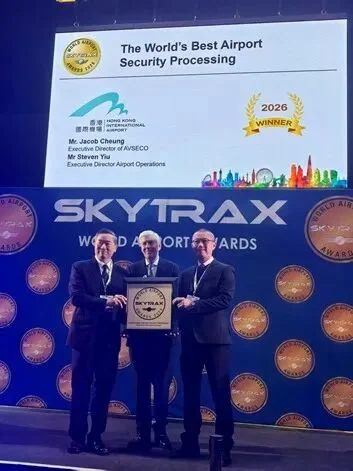
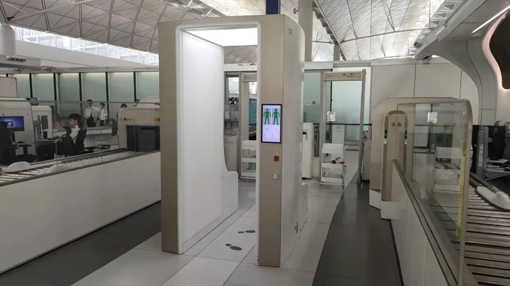
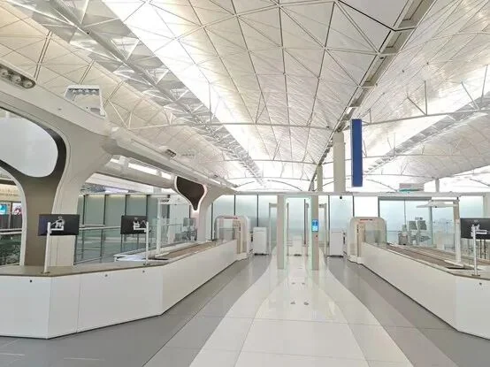

Le 30 mars, Nuctech a annoncé avoir reçu une lettre de remerciement de l'Autorité aéroportuaire de Hong Kong, exprimant son appréciation pour sa contribution au prix Skytrax de la meilleure sûreté aéroportuaire du monde remporté par l'aéroport international de Hong Kong (HKG).

Douze jours plus tôt. Le 18 mars, les Skytrax World Airport Awards 2026 ont été annoncés à Passenger Terminal Expo, à Londres, où l'aéroport international de Hong Kong s'est classé quatrième au monde et a remporté pour la première fois le prix de la meilleure sûreté aéroportuaire du monde. Un prix décerné au poste de contrôle de sûreté peut ressembler à une histoire technique, mais le contrôle de sûreté est le moment le plus tendu du passage d'un passager dans le terminal et la partie la plus susceptible de susciter des plaintes. Cet article sépare les faits liés au prix du récit du fournisseur, puis examine ce que le système change réellement.

## 1. Les faits : quatrième au monde, une première en 28 ans, une première en Asie

Commençons par ce qui peut être vérifié. L'aéroport international de Hong Kong a ouvert à Chek Lap Kok en 1998 ; 2026 est donc sa 28e année. C'est la première fois qu'il remporte la catégorie sûreté, et la première fois qu'un aéroport asiatique l'obtient. Les quatre premiers mondiaux de 2026 étaient Singapour Changi (deuxième année consécutive, 14e titre), Séoul Incheon, Tokyo Haneda et Hong Kong International.

Selon la lettre de l'Autorité aéroportuaire, l'enquête World Airport Survey qui fonde les prix s'est déroulée d'août 2025 à février 2026 et a évalué l'ensemble du parcours des passagers ; la lettre indique que les bonnes notes de l'aéroport au traitement de la sûreté doivent quelque chose à l'environnement fluide, efficace et technologiquement avancé que Nuctech a contribué à façonner.

Le fondement du prix mérite d'être précisé : Skytrax classe les aéroports à partir d'enquêtes de satisfaction des passagers, et non de spécifications d'équipement. Les passagers ne savent peut-être pas distinguer un scanner CT à bagages d'un portique à ondes millimétriques, mais ils remarquent la longueur de la file, s'ils doivent déballer leurs affaires et la fréquence à laquelle un sac est mis de côté pour un second examen. Ces expériences deviennent la note.

## 2. Ce que contient « le premier aéroport au monde entièrement intégré en matière de sûreté intelligente »

Selon Nuctech, le système relie six types d'équipements à une plateforme de gestion unique : le contrôle CT des bagages cabine, le contrôle CT statique des bagages de soute, le retour automatique des bacs, le scanner corporel à ondes millimétriques, la détection de traces d'explosifs et la détection de liquides par spectroscopie Raman. Les données sont partagées entre les machines et le flux est coordonné depuis un seul endroit.

Le « contrôle CT statique des bagages de soute » couvre les bagages après l'enregistrement et avant le chargement ; le « retour automatique des bacs » répond à l'ancien problème des bacs qu'il fallait rapporter à la main jusqu'à l'entrée ; la détection Raman sert à identifier sur place le contenu des liquides. Réunir les six sur une seule plateforme constitue le principal fondement de la description « entièrement intégré ».

La lettre de l'Autorité aéroportuaire crédite la technologie de contrôle CT et la solution de sûreté intégrée de Nuctech comme le soutien essentiel de cette étape, et affirme que les technologies de l'entreprise « ont joué un rôle déterminant pour transformer le contrôle de sûreté en une expérience fluide et de classe mondiale ». Il s'agit d'une déclaration publique d'un partenaire reconnaissant la contribution d'un fournisseur, et non d'un test indépendant des performances du système.

## 3. Ce que remarquent les passagers : les ordinateurs portables restent dans le sac, dix secondes par sac

Selon Nuctech, l'imagerie tridimensionnelle du CT de nouvelle génération signifie que les passagers n'ont plus besoin de sortir les ordinateurs portables, téléphones ou autres appareils électroniques, ni de retirer à l'avance les liquides, gels et aérosols. Pour les voyageurs fréquents, cela vaut plus que n'importe quelle spécification : plus besoin de se baisser devant la machine pour ouvrir un sac, ni de sortir l'ordinateur pour le remettre aussitôt.

Sur le débit, les chiffres de l'entreprise indiquent qu'une voie est passée de 240 passagers par heure à 360, soit une hausse d'environ 50 %, et qu'un sac est scanné en une dizaine de secondes.

Ces chiffres viennent du fournisseur d'équipement. Ils sont utiles pour comprendre le plafond de la technologie, et non comme une promesse sur une voie particulière un matin particulier. La vitesse réelle dépend encore du nombre de voies ouvertes, de la connaissance de la procédure par les passagers et du nombre de sacs nécessitant un second contrôle.

## 4. Ondes millimétriques et vie privée : pourquoi l'écran n'affiche qu'une silhouette

Le scanner corporel à ondes millimétriques est l'autre élément que les voyageurs ont tendance à mal interpréter. Selon Nuctech, il balaie à 360 degrés sans contact et présente les résultats sous la forme d'une silhouette corporelle simplifiée, en ne marquant que la position d'un objet éventuel et sans montrer aucun détail anatomique. Cela réduit le recours aux palpations et, tout aussi important, la crainte d'être « vu ».

Le même système ajoute la récupération automatique des bacs, des rappels d'objets oubliés et un nouveau système de protection contre l'incendie. Rien de tout cela n'accélère directement une voie, mais tout cela décide si la voie reste stable aux heures de pointe : des bacs qui s'accumulent à la sortie ou un téléphone oublié dans un bac ralentiront une file aussi sûrement qu'un scanner lent.

## 5. Comment lire cette histoire : deux types d'affirmations

Il y a deux types d'affirmations dans cette histoire, et les mélanger la déforme.

La première est le prix. Skytrax, à partir d'enquêtes auprès des passagers, a attribué à l'aéroport international de Hong Kong le prix de la meilleure sûreté aéroportuaire du monde 2026 et confirmé sa quatrième place au classement général. Cela peut être cité directement, et c'est la première fois en 28 ans que l'aéroport remporte cette catégorie.

La seconde est la technologie : six types d'équipements, une plateforme, 360 passagers par heure, dix secondes par sac, une silhouette corporelle simplifiée. Ce sont les descriptions du fournisseur concernant son propre système. Elles sont très probablement exactes, mais ce sont des affirmations commerciales et elles doivent être lues séparément du prix.

Rapprochez les deux et la conclusion raisonnable est que l'expérience de sûreté de l'aéroport international de Hong Kong a été reconnue par les passagers en 2026, et que la technologie qui la sous-tend a été fournie par Nuctech. Savoir si le système est le premier du genre au monde, et si chaque voie atteint 360 passagers par heure à toute heure, se traite mieux comme une indication de tendance que comme un résultat établi.

## 6. Ce que cela signifie si vous partez de Hong Kong

Premièrement, la procédure est réellement plus simple. Ne pas avoir à sortir les ordinateurs portables et les liquides permet de préparer son bagage cabine en pensant au contrôle et d'arrêter de le reconstituer au poste ; sur une correspondance serrée, cela fait gagner des minutes qui comptent.

Deuxièmement, ne lisez pas le prix comme « plus de files ». Le nombre de voies, les vagues de vols et le trafic des jours fériés décident toujours de la durée d'attente, et les pointes du matin et du soir restent les pires. Gardez votre marge, surtout si vous demandez un remboursement de taxe ou transportez des marchandises à déclarer.

Troisièmement, si l'on vous demande un second contrôle, suivez le personnel. Le scanner à ondes millimétriques affiche une silhouette simplifiée et le contrôle complémentaire concerne en général un endroit précis, pas vous ; tout le dispositif vise à réduire la « gêne nécessaire » au moment le plus court possible.

## Liens utiles

- **Sur ce site** : [Aéroport international de Hong Kong (HKG)](/airport/HKG), [Chine (CN)](/country/CN)
- **Wikipédia** : [Aéroport international de Hong Kong](https://en.wikipedia.org/wiki/Hong_Kong_International_Airport), [Nuctech](https://en.wikipedia.org/wiki/Nuctech)
- **Baidu Baike** : [Aéroport international de Hong Kong](https://baike.baidu.com/item/%E9%A6%99%E6%B8%AF%E5%9B%BD%E9%99%85%E6%9C%BA%E5%9C%BA), [Nuctech](https://baike.baidu.com/item/%E5%90%8C%E6%96%B9%E5%A8%81%E8%A7%86)

Source des images : Nuctech. Les noms et critères des prix sont ceux publiés par Skytrax ; les spécifications des équipements et les chiffres de débit viennent du fournisseur, et les dispositions de sûreté du jour s'appliquent telles qu'elles sont dirigées à l'aéroport international de Hong Kong.
