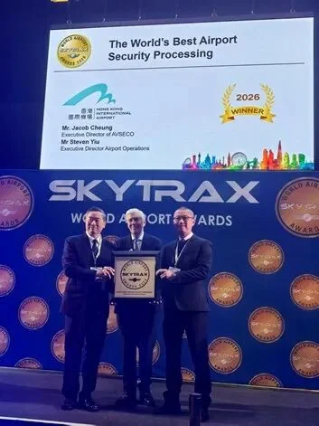
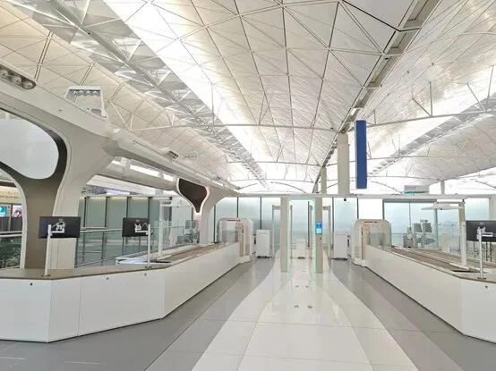

30 मार्च को Nuctech ने कहा कि उसे हांगकांग हवाई अड्डा प्राधिकरण से एक धन्यवाद पत्र मिला है, जिसमें हांगकांग अंतर्राष्ट्रीय हवाई अड्डे (HKG) को Skytrax का विश्व का सर्वश्रेष्ठ हवाई अड्डा सुरक्षा पुरस्कार जीतने में उसके योगदान के लिए आभार व्यक्त किया गया है।

बारह दिन पीछे चलिए। 18 मार्च को लंदन में Passenger Terminal Expo में Skytrax World Airport Awards 2026 की घोषणा हुई, जहां हांगकांग अंतर्राष्ट्रीय दुनिया में चौथे स्थान पर रहा और पहली बार विश्व का सर्वश्रेष्ठ हवाई अड्डा सुरक्षा पुरस्कार अपने नाम किया। सुरक्षा लेन के लिए मिला पुरस्कार तकनीकी कहानी जैसा लगता है, लेकिन सुरक्षा जांच यात्री के टर्मिनल में बिताए समय का सबसे तनावपूर्ण हिस्सा है और शिकायतों का सबसे बड़ा स्रोत भी। यह लेख पुरस्कार के तथ्यों और विक्रेता के विवरण को अलग-अलग रखता है, और फिर देखता है कि यह सिस्टम असल में क्या बदलता है।

## 1. तथ्य: दुनिया में चौथा स्थान, 28 वर्षों में पहली बार, एशिया में पहली बार

जो जांचा जा सकता है, उससे शुरू करें। हांगकांग अंतर्राष्ट्रीय हवाई अड्डा 1998 में चेक लैप कोक में खुला, इसलिए 2026 उसका 28वां वर्ष है; यह पहली बार है कि उसने सुरक्षा श्रेणी जीती है, और पहली बार है कि किसी एशियाई हवाई अड्डे ने यह श्रेणी जीती है। 2026 के वैश्विक शीर्ष चार थे सिंगापुर चांगी (लगातार दूसरा वर्ष, 14वां खिताब), सियोल इंचियोन, टोक्यो हानेदा और हांगकांग अंतर्राष्ट्रीय।

प्राधिकरण के पत्र के अनुसार, पुरस्कारों के पीछे चला World Airport Survey अगस्त 2025 से फरवरी 2026 तक चला और उसमें यात्री की पूरी यात्रा का मूल्यांकन किया गया; पत्र में कहा गया है कि सुरक्षा प्रक्रिया में हवाई अड्डे के ऊंचे अंक कुछ हद तक उस सहज, कुशल और तकनीकी रूप से उन्नत वातावरण का परिणाम थे जिसे बनाने में Nuctech ने मदद की।

पुरस्कार का आधार स्पष्ट करना जरूरी है: Skytrax हवाई अड्डों की रैंकिंग यात्री-संतुष्टि सर्वेक्षणों के आधार पर करता है, उपकरणों के विनिर्देशों के आधार पर नहीं। यात्रियों को शायद यह पता न हो कि बैगेज CT और मिलीमीटर-वेव पोर्टल में क्या अंतर है, लेकिन वे यह जरूर नोटिस करते हैं कि कतार कितनी लंबी है, उन्हें सामान खोलना पड़ता है या नहीं, और कितनी बार किसी बैग को दोबारा देखने के लिए अलग किया जाता है। यही अनुभव अंक बन जाते हैं।

## 2. "दुनिया का पहला पूरी तरह एकीकृत स्मार्ट सुरक्षा हवाई अड्डा" में क्या है

Nuctech के अनुसार, यह सिस्टम छह तरह के उपकरणों को एक ही प्रबंधन प्लेटफॉर्म से जोड़ता है: केबिन-बैगेज CT स्क्रीनिंग, स्थिर होल्ड-बैगेज CT स्क्रीनिंग, स्वचालित ट्रे वापसी, मिलीमीटर-वेव बॉडी स्कैनिंग, ट्रेस विस्फोटक पहचान और रमन तरल पहचान। मशीनों के बीच डेटा साझा होता है और पूरा प्रवाह एक ही जगह से समन्वित होता है।

"स्थिर होल्ड-बैगेज CT" में चेक-इन के बाद और लोडिंग से पहले के बैग आते हैं; "स्वचालित ट्रे वापसी" उस पुरानी समस्या का समाधान है जिसमें ट्रे हाथ से प्रवेश द्वार तक वापस ले जानी पड़ती थीं; रमन पहचान का इस्तेमाल मौके पर ही तरल पदार्थों की सामग्री की पहचान के लिए किया जाता है। सभी छह को एक ही प्लेटफॉर्म पर लाना ही "पूरी तरह एकीकृत" कहे जाने का मुख्य आधार है।

प्राधिकरण का पत्र Nuctech की CT सुरक्षा तकनीक और एकीकृत सुरक्षा समाधान को इस उपलब्धि का मुख्य सहारा बताता है, और कहता है कि कंपनी की तकनीकें "सुरक्षा जांच को एक सहज, विश्वस्तरीय अनुभव में बदलने में निर्णायक रही हैं"। यह एक साझेदार का सार्वजनिक बयान है जो आपूर्तिकर्ता के योगदान को स्वीकार करता है, सिस्टम के प्रदर्शन की स्वतंत्र जांच नहीं।

## 3. यात्री क्या नोटिस करते हैं: लैपटॉप बैग में ही रहते हैं, एक बैग दस सेकंड में

Nuctech के अनुसार, नई पीढ़ी के CT की त्रि-आयामी इमेजिंग का मतलब है कि यात्रियों को अब लैपटॉप, फोन या अन्य इलेक्ट्रॉनिक उपकरण निकालने की जरूरत नहीं, न ही तरल, जेल और एरोसोल पहले से बाहर रखने की। बार-बार यात्रा करने वालों के लिए यह किसी भी विनिर्देश से ज्यादा कीमती है: मशीन के पास झुककर बैग खोलने की मजबूरी नहीं, लैपटॉप निकालकर फिर रखने की परेशानी नहीं।

क्षमता के बारे में कंपनी के आंकड़े यह हैं कि एक लेन प्रति घंटे 240 यात्रियों से बढ़कर 360 हो गई है, यानी लगभग 50 प्रतिशत की वृद्धि, और एक बैग की स्कैनिंग में करीब दस सेकंड लगते हैं।

ये आंकड़े उपकरण आपूर्तिकर्ता के हैं। ये तकनीक की अधिकतम सीमा समझने के लिए उपयोगी हैं, किसी खास सुबह की किसी खास लेन के बारे में कोई वादा नहीं। असली रफ्तार अब भी इस पर निर्भर है कि कितनी लेन खुली हैं, यात्री प्रक्रिया जानते हैं या नहीं, और कितने बैगों को दोबारा जांच चाहिए।

## 4. मिलीमीटर वेव और निजता: स्क्रीन पर सिर्फ रूपरेखा क्यों दिखती है

मिलीमीटर-वेव बॉडी स्कैनर वह दूसरी चीज है जिसे यात्री अक्सर गलत समझते हैं। Nuctech के अनुसार, यह बिना संपर्क के 360 डिग्री स्कैन करता है और परिणाम सरलीकृत शरीर-रूपरेखा के रूप में दिखाता है, जिसमें केवल किसी संभावित वस्तु की जगह चिह्नित होती है और कोई शारीरिक विवरण नहीं दिखता। इससे तलाशी की जरूरत कम होती है और उतना ही जरूरी, "देखे जाने" का डर भी।

इसी सिस्टम में स्वचालित ट्रे वापसी, भूली हुई वस्तुओं की याद दिलाने की सुविधा और नया अग्नि सुरक्षा सिस्टम भी जुड़ा है। इनमें से कोई भी लेन को सीधे तेज नहीं करता, लेकिन सब मिलकर तय करते हैं कि व्यस्त समय में लेन स्थिर रहती है या नहीं: निकास पर ट्रे का ढेर लगना या बिन में छूटा फोन कतार को उतना ही धीमा करेगा जितना धीमा स्कैनर।

## 5. इस खबर को कैसे पढ़ें: दो तरह के दावे

इस खबर में दो तरह के दावे हैं, और इन्हें मिला देना तस्वीर को विकृत कर देता है।

पहला है पुरस्कार। Skytrax ने यात्री सर्वेक्षणों के आधार पर हांगकांग अंतर्राष्ट्रीय को 2026 का विश्व का सर्वश्रेष्ठ हवाई अड्डा सुरक्षा पुरस्कार दिया और कुल मिलाकर उसका चौथा स्थान बरकरार रखा। इसे सीधे उद्धृत किया जा सकता है, और 28 वर्षों में यह पहली बार है कि हवाई अड्डे ने यह श्रेणी जीती है।

दूसरी है तकनीक: छह तरह के उपकरण, एक प्लेटफॉर्म, प्रति घंटे 360 यात्री, एक बैग दस सेकंड में, सरलीकृत शरीर-रूपरेखा। ये आपूर्तिकर्ता के अपने सिस्टम के बारे में किए गए वर्णन हैं। इनके सही होने की बहुत संभावना है, लेकिन ये विक्रेता के दावे हैं और इन्हें पुरस्कार से अलग करके पढ़ना चाहिए।

दोनों को साथ रखने पर उचित निष्कर्ष यह है कि हांगकांग अंतर्राष्ट्रीय के सुरक्षा अनुभव को 2026 में यात्रियों ने मान्यता दी, और उसके पीछे की तकनीक Nuctech ने दी थी। क्या यह सिस्टम दुनिया में अपनी तरह का पहला है, और क्या हर लेन हर घंटे 360 यात्री प्रति घंटे के आंकड़े तक पहुंचती है — इन्हें किसी तयशुदा नतीजे के बजाय दिशा का संकेत मानना बेहतर है।

## 6. अगर आप हांगकांग से उड़ान भर रहे हैं, तो इसका क्या मतलब है

पहला, प्रक्रिया सचमुच आसान है। लैपटॉप और तरल पदार्थ निकालने की जरूरत न होने का मतलब है कि आप अपना केबिन बैग स्क्रीनिंग को ध्यान में रखकर पैक कर सकते हैं और लेन पर उसे फिर से सजाना बंद कर सकते हैं; कम कनेक्शन समय में यह उन मिनटों की बचत करता है जो मायने रखते हैं।

दूसरा, पुरस्कार को "कोई कतार नहीं" न समझें। लेनों की संख्या, उड़ानों की लहरें और छुट्टियों की भीड़ अब भी तय करती हैं कि आपको कितनी देर इंतजार करना होगा, और सुबह तथा शाम के व्यस्त घंटे सबसे खराब रहते हैं। बफर रखें, खासकर अगर आप टैक्स रिफंड ले रहे हैं या घोषित करने योग्य सामान ले जा रहे हैं।

तीसरा, अगर आपको दोबारा जांच के लिए कहा जाए, तो कर्मचारियों का कहना मानें। मिलीमीटर-वेव स्कैनर सरलीकृत रूपरेखा दिखाता है और आगे की कार्रवाई आमतौर पर किसी खास जगह के बारे में होती है, आपके बारे में नहीं; पूरा डिजाइन "जरूरी परेशानी" को यथासंभव छोटे क्षण में सिमटाने के लिए है।

## संबंधित लिंक

- **इस साइट पर**: [हांगकांग अंतर्राष्ट्रीय हवाई अड्डा (HKG)](/airport/HKG), [चीन (CN)](/country/CN)
- **विकिपीडिया**: [हांगकांग अंतर्राष्ट्रीय हवाई अड्डा](https://en.wikipedia.org/wiki/Hong_Kong_International_Airport), [Nuctech](https://en.wikipedia.org/wiki/Nuctech)
- **बाइडू बाइके**: [हांगकांग अंतर्राष्ट्रीय हवाई अड्डा](https://baike.baidu.com/item/%E9%A6%99%E6%B8%AF%E5%9B%BD%E9%99%85%E6%9C%BA%E5%9C%BA), [Nuctech](https://baike.baidu.com/item/%E5%90%8C%E6%96%B9%E5%A8%81%E8%A7%86)

चित्र स्रोत: Nuctech। पुरस्कारों के नाम और मानदंड Skytrax द्वारा प्रकाशित रूप में हैं; उपकरणों के विनिर्देश और क्षमता के आंकड़े आपूर्तिकर्ता से हैं, और उस दिन की सुरक्षा व्यवस्था हांगकांग अंतर्राष्ट्रीय हवाई अड्डे पर दिए गए निर्देशों के अनुसार है।
