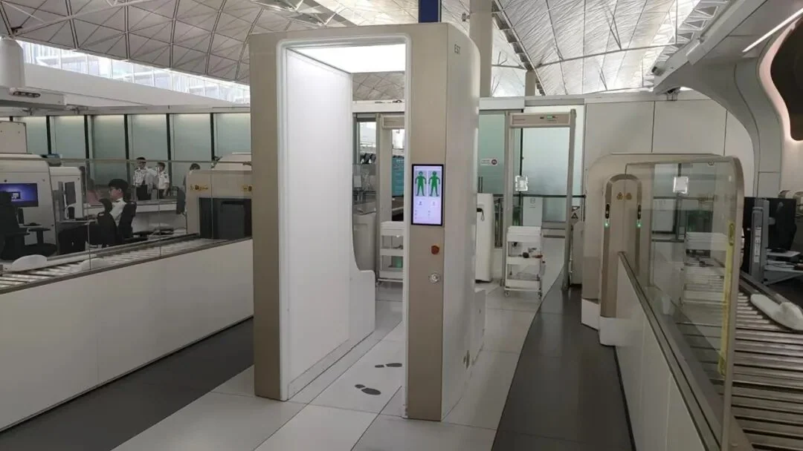

30 marca firma Nuctech poinformowała, że otrzymała od Airport Authority Hong Kong list z podziękowaniami za wkład w zdobycie przez port lotniczy Hongkong (HKG) nagrody Skytrax za najlepsze bezpieczeństwo lotniskowe na świecie.

Cofnijmy się o 12 dni. 18 marca na targach Passenger Terminal Expo w Londynie ogłoszono wyniki Skytrax World Airport Awards 2026: port lotniczy Hongkong zajął czwarte miejsce na świecie i po raz pierwszy zdobył tytuł najlepszego bezpieczeństwa lotniskowego na świecie. Nagroda dla stanowiska kontroli bezpieczeństwa brzmi jak historia techniczna, tymczasem kontrola bezpieczeństwa to najbardziej nerwowy moment pobytu pasażera w terminalu i zarazem ten, który najczęściej wywołuje skargi. W tym artykule fakty o nagrodzie i relacja dostawcy są omówione osobno, a następnie przyglądamy się, co system rzeczywiście zmienia.

## 1. Fakty: czwarte miejsce na świecie, pierwsze zwycięstwo od 28 lat, pierwsze w Azji

Zacznijmy od tego, co da się sprawdzić. Port lotniczy Hongkong został otwarty na Chek Lap Kok w 1998 roku, więc rok 2026 to jego 28. rok działalności; po raz pierwszy wygrał w kategorii bezpieczeństwa i po raz pierwszy uczyniło to lotnisko azjatyckie. W pierwszej czwórce na świecie w 2026 roku znalazły się: Singapur Changi (drugi rok z rzędu, 14. tytuł), Seul Incheon, Tokio Haneda i port lotniczy Hongkong.

Według listu Airport Authority ankieta World Airport Survey, na której opierają się nagrody, trwała od sierpnia 2025 do lutego 2026 roku i oceniała całą podróż pasażera; w liście stwierdzono, że wysokie oceny lotniska w zakresie odprawy bezpieczeństwa zawdzięcza ono po części płynnemu, wydajnemu i zaawansowanemu technologicznie środowisku, które pomogła stworzyć firma Nuctech.

Warto jasno wyłożyć podstawę nagrody: Skytrax ocenia lotniska na podstawie ankiet satysfakcji pasażerów, a nie specyfikacji sprzętu. Pasażerowie mogą nie odróżniać tomografu bagażowego od bramki milimetrowej, ale zauważają, jak długa jest kolejka, czy trzeba rozpakowywać bagaż i jak często torba zostaje odłożona do ponownej kontroli. To właśnie te doświadczenia składają się na ocenę.

## 2. Co zawiera „pierwsze na świecie w pełni zintegrowane lotnisko z inteligentnym systemem bezpieczeństwa”

Według firmy Nuctech system łączy sześć rodzajów urządzeń na jednej platformie zarządzania: tomografię bagażu podręcznego, stacjonarną tomografię bagażu rejestrowanego, automatyczny zwrot tac, skanowanie ciała falami milimetrowymi, wykrywanie śladowych ilości materiałów wybuchowych oraz wykrywanie płynów metodą Ramana. Dane są udostępniane między maszynami, a przepływ koordynowany jest z jednego miejsca.

„Stacjonarna tomografia bagażu rejestrowanego” obejmuje torby po odprawie i przed załadunkiem; „automatyczny zwrot tac” rozwiązuje stary problem ręcznego odnoszenia tac do wejścia; wykrywanie metodą Ramana służy do identyfikacji zawartości płynów na miejscu. Umieszczenie wszystkich sześciu elementów na jednej platformie to główna podstawa określenia „w pełni zintegrowane”.

List Airport Authority przypisuje technologii tomograficznej kontroli bezpieczeństwa i zintegrowanemu rozwiązaniu bezpieczeństwa firmy Nuctech kluczowe wsparcie tego przełomu i stwierdza, że technologie firmy „odegrały kluczową rolę w przekształceniu kontroli bezpieczeństwa w płynne, światowej klasy doświadczenie”. To publiczne oświadczenie partnera uznające wkład dostawcy, a nie niezależny test działania systemu.

## 3. Co zauważają pasażerowie: laptop zostaje w torbie, dziesięć sekund na torbę

Według firmy Nuctech trójwymiarowe obrazowanie nowej generacji tomografu sprawia, że pasażerowie nie muszą już wyjmować laptopów, telefonów ani innych urządzeń elektronicznych, a także z wyprzedzeniem wyciągać płynów, żeli i aerozoli. Dla często latających jest to warte więcej niż jakakolwiek specyfikacja: żadnego schylania się przy maszynie, by otworzyć torbę, żadnego wyjmowania laptopa tylko po to, by go z powrotem schować.

Jeśli chodzi o przepustowość, dane firmy mówią, że jedno stanowisko przeszło z 240 pasażerów na godzinę do 360, czyli wzrost o około 50%, a zeskanowanie torby trwa około dziesięciu sekund.

Te liczby pochodzą od dostawcy sprzętu. Są przydatne do zrozumienia granic możliwości technologii, ale nie stanowią obietnicy dotyczącej konkretnego stanowiska w konkretny poranek. Rzeczywista szybkość nadal zależy od tego, ile stanowisk jest otwartych, czy pasażerowie znają procedurę i ile toreb wymaga ponownej kontroli.

## 4. Fale milimetrowe i prywatność: dlaczego ekran pokazuje tylko kontur sylwetki

Skaner ciała falami milimetrowymi to drugi element, który podróżni często błędnie interpretują. Według firmy Nuctech skanuje on w 360 stopniach bez kontaktu i przedstawia wynik jako uproszczony kontur sylwetki, zaznaczając jedynie położenie możliwego przedmiotu i nie pokazując żadnych szczegółów anatomicznych. Zmniejsza to potrzebę rewizji osobistej, a co równie ważne — obawę przed byciem „oglądanym”.

Ten sam system dodaje automatyczne odzyskiwanie tac, przypomnienia o zapomnianych przedmiotach i nowy system ochrony przeciwpożarowej. Żadne z tych rozwiązań nie przyspiesza stanowiska bezpośrednio, ale wszystkie decydują o tym, czy w godzinach szczytu utrzyma ono stabilne tempo: piętrzące się przy wyjściu tace albo telefon zostawiony w pojemniku spowolnią kolejkę równie skutecznie jak wolny skaner.

## 5. Jak czytać tę historię: dwa rodzaje twierdzeń

W tej historii występują dwa rodzaje twierdzeń, a ich mieszanie zniekształca obraz.

Pierwszy to nagroda. Skytrax, opierając się na ankietach pasażerów, przyznał portowi lotniczemu Hongkong nagrodę za najlepsze bezpieczeństwo lotniskowe na świecie w 2026 roku i potwierdził czwarte miejsce w klasyfikacji generalnej. To można cytować wprost — i jest to pierwszy raz od 28 lat, gdy lotnisko zdobyło tę kategorię.

Drugi to technologia: sześć rodzajów urządzeń, jedna platforma, 360 pasażerów na godzinę, dziesięć sekund na torbę, uproszczony kontur sylwetki. To opisy własnego systemu podane przez dostawcę. Są bardzo prawdopodobnie trafne, ale pozostają twierdzeniami producenta i należy czytać je osobno od nagrody.

Zestawiając oba, rozsądny wniosek brzmi: doświadczenie kontroli bezpieczeństwa na lotnisku w Hongkongu zostało w 2026 roku docenione przez pasażerów, a stojącą za nim technologię dostarczyła firma Nuctech. Czy system jest pierwszy na świecie w swoim rodzaju i czy każde stanowisko osiąga 360 pasażerów na godzinę o każdej porze, lepiej traktować jako wskazówkę kierunku niż jako ustalony wynik.

## 6. Co to oznacza, jeśli lecisz z Hongkongu

Po pierwsze, proces jest naprawdę prostszy. Brak konieczności wyjmowania laptopów i płynów oznacza, że możesz spakować bagaż podręczny z myślą o kontroli i nie musisz go od nowa układać przy stanowisku; przy krótkim czasie na przesiadkę oszczędza to minuty, które mają znaczenie.

Po drugie, nie odczytuj nagrody jako „brak kolejek”. Liczba otwartych stanowisk, fale odlotów i ruch świąteczny nadal decydują o czasie oczekiwania, a poranne i wieczorne szczyty pozostają najgorsze. Zachowaj zapas czasu, zwłaszcza jeśli ubiegasz się o zwrot podatku lub wieziesz towary wymagające zgłoszenia celnego.

Po trzecie, jeśli zostaniesz poproszony o ponowną kontrolę, słuchaj obsługi. Skaner falami milimetrowymi pokazuje uproszczony kontur, a dalsze czynności dotyczą zwykle konkretnego miejsca, nie ciebie; całe rozwiązanie ma sprowadzić „konieczną niedogodność” do najkrótszego możliwego momentu.

## Powiązane linki

- **W tym serwisie**: [Port lotniczy Hongkong (HKG)](/airport/HKG), [Chiny (CN)](/country/CN)
- **Wikipedia**: [Port lotniczy Hongkong](https://en.wikipedia.org/wiki/Hong_Kong_International_Airport), [Nuctech](https://en.wikipedia.org/wiki/Nuctech)
- **Baidu Baike**: [Port lotniczy Hongkong](https://baike.baidu.com/item/%E9%A6%99%E6%B8%AF%E5%9B%BD%E9%99%85%E6%9C%BA%E5%9C%BA), [Nuctech](https://baike.baidu.com/item/%E5%90%8C%E6%96%B9%E5%A8%81%E8%A7%86)

Źródło zdjęć: Nuctech. Nazwy i kryteria nagród podano zgodnie z publikacjami Skytraxu; specyfikacje sprzętu i dane o przepustowości pochodzą od dostawcy, a bieżące zasady kontroli bezpieczeństwa obowiązują zgodnie z wytycznymi portu lotniczego Hongkong.
