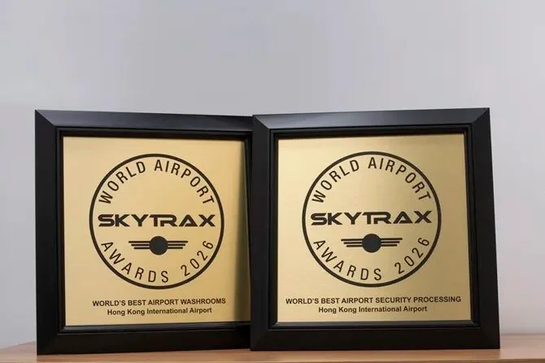

2026 সালের এপ্রিলে Global Travel Awards 2026-এ 'বিশ্বের সেরা বিমানবন্দর' নির্বাচিত হয় হংকং আন্তর্জাতিক বিমানবন্দর (HKG)। বিশ্বজুড়ে লাখ লাখ যাত্রী এই পুরস্কার নির্ধারণ করেন এবং এতে দুটি বিষয় বিবেচিত হয়: বিমানবন্দরের বিমান-পরিকাঠামো যথাযথ কি না, এবং যাত্রী-অভিজ্ঞতা যথাযথ কি না। প্রথমটি বিমান, ব্যাগ ও মানুষকে ভবনের ভেতর দিয়ে সরানোর বিষয়; দ্বিতীয়টি আগমন থেকে বোর্ডিং পর্যন্ত যাত্রা কতটা অনায়াস মনে হয় তার বিষয়।

বছরে কয়েক কোটি যাত্রী সামলানো একটি আন্তর্জাতিক হাবের কাছে 'বিশ্বের সেরা' কদাচিৎ একটি বিচ্ছিন্ন ট্রফি। একই সময়ে হংকং আন্তর্জাতিক বিমানবন্দর টানা তৃতীয়বার TTG China Travel Awards-এ 'চীনের সেরা বিমানবন্দর' নির্বাচিত হয়, এবং Skytrax World Airport Awards 2026-এ জিতে নেয় 'বিশ্বের সেরা বিমানবন্দর নিরাপত্তা প্রক্রিয়া' ও 'বিশ্বের সেরা বিমানবন্দর ওয়াশরুম'। চারটি ট্রফি একটি সিদ্ধান্তেই পৌঁছে দেয়: এই বিমানবন্দর নিয়ে যাত্রীদের রায় 'সহজে ট্রান্সফার করা যায়' থেকে 'সবকিছু ঠিকঠাক চলে'-এর দিকে প্রশস্ত হচ্ছে।

## 1. চারটি ট্রফি, তিন ধরনের বিচার

চারটি পুরস্কার আসে তিনটি ভিন্ন বিচারব্যবস্থা থেকে, আর প্রতিটি কিছুটা ভিন্ন জিনিস মাপে। Global Travel Awards ভোট রাখে যাত্রীদের হাতে এবং পরিকাঠামো ও অভিজ্ঞতার সমন্বয়ের ওপর জোর দেয়। TTG China Travel Awards ভিত্তি করে ভ্রমণ-শিল্প ও তার পাঠকদের ওপর, এবং চীনের বাজারে বিমানবন্দরের রুট নেটওয়ার্ক ও সুনামকে বেশি গুরুত্ব দেয়। Skytrax তার ফল নির্ধারণ করে 100-এর বেশি দেশের 500-এর বেশি বিমানবন্দরের যাত্রী-সন্তুষ্টি জরিপের ভিত্তিতে, আর এর বিভাগীয় পুরস্কারগুলো দৈনন্দিন পরিচালনার স্বাস্থ্যপরীক্ষার মতো পড়া যায়।

| পুরস্কার | বিভাগ | হংকং আন্তর্জাতিক বিমানবন্দর |
| --- | --- | --- |
| Global Travel Awards 2026 | বিশ্বের সেরা বিমানবন্দর | বিজয়ী |
| TTG China Travel Awards 2026 | চীনের সেরা বিমানবন্দর | বিজয়ী, টানা তৃতীয় বছর |
| Skytrax World Airport Awards 2026 | বিশ্বের সেরা বিমানবন্দর নিরাপত্তা প্রক্রিয়া | বিজয়ী |
| Skytrax World Airport Awards 2026 | বিশ্বের সেরা বিমানবন্দর ওয়াশরুম | বিজয়ী |

## 2. নিরাপত্তা ও ওয়াশরুম: যাত্রীরা যে খুঁটিনাটি মনে রাখেন

চারটি পুরস্কারের দুটো একটু ভালোভাবে দেখা দরকার। নিরাপত্তা প্রক্রিয়া বলতে টার্মিনালে যাত্রীর সবচেয়ে টানটান অংশটুকু বোঝায়: লাইন কত লম্বা, ল্যাপটপ ও তরল আবার বের করতে হয় কি না, আর ব্যাগ তল্লাশি মসৃণভাবে চলে কি না। ওয়াশরুম হলো আরেকটি উচ্চ-কম্পাঙ্কের সংযোগস্থল, যেখানে পরিচ্ছন্নতার সময়সূচি, লাইন ও সহজলভ্য নকশা প্রায়ই নাটকীয় ছাদের চেয়ে বেশি প্রভাব ফেলে মতামত গড়ায়।

একসঙ্গে দুটোই জেতা বোঝায়, যাত্রীরা যেসব কাজ প্রায় কখনো ছবি তোলেন না সেগুলোতে বিমানবন্দর সত্যিই সম্পদ ঢেলেছে। যাত্রীদের জন্য বাস্তব অর্থ সহজ: হংকং হয়ে সকাল বা সন্ধ্যার কানেকশনে নিরাপত্তা ও ওয়াশরুম যাত্রার দুর্বল জায়গা হওয়ার সম্ভাবনা কম।

## 3. পুরস্কারের পেছনে: দীর্ঘ প্রস্তুতি

হংকং আন্তর্জাতিক বিমানবন্দর 1998 সালে চেক ল্যাপ ককে চালু হয় এবং দীর্ঘদিন ধরে বিশ্বের ব্যস্ততম আন্তর্জাতিক কার্গো বিমানবন্দরগুলোর মধ্যে রয়েছে; এটি মূল ভূখণ্ড চীন, দক্ষিণ-পূর্ব এশিয়া এবং ইউরোপ ও উত্তর আমেরিকার দূরপাল্লার রুটের মধ্যে একটি গুরুত্বপূর্ণ ট্রান্সফার কেন্দ্রও। সাম্প্রতিক বছরগুলোতে বিমানবন্দরটি তার তিন-রানওয়ে ব্যবস্থা সম্পন্ন করেছে এবং টার্মিনালের ভেতরের সুবিধাগুলো নবায়ন করে চলেছে — এমন বিনিয়োগ যা কখনো ট্রফিতে দেখা যায় না, কিন্তু যে অভিজ্ঞতা বিচার করা হচ্ছে তার ভিত্তি হয়ে থাকে।

টানা তৃতীয়বার TTG-এর 'চীনের সেরা বিমানবন্দর' পুরস্কার মূল ভূখণ্ডের যাত্রীরা এখনও বিমানবন্দরটিকে কীভাবে দেখেন তা নিয়েও কিছু বলে। তৃতীয় কোনো দেশে যাওয়ার পথে হংকং হয়ে কানেক্ট করা যাত্রীদের কাছে এর মূল্য ডিউটি-ফ্রি দোকান ও লাউঞ্জের চেয়ে বেশি ঘন ফ্লাইট-ঢেউ, স্পষ্ট ট্রান্সফার সাইনবোর্ড আর তুলনামূলকভাবে স্থিতিশীল সময়ানুবর্তিতায়।

## 4. যাত্রীদের জন্য এর অর্থ

হংকং হয়ে ভ্রমণের পরিকল্পনা করলে পুরস্কারগুলোকে নিশ্চয়তা নয়, বরং কাজের সংকেত হিসেবে ধরুন। আপনার যাত্রা ঠিক করে ফ্লাইটের সময়সূচি, কানেকশনের সময় আর আপনার কাগজপত্রই: ফ্লাইটের মাঝে যথেষ্ট সময় রাখুন, হংকং-এ প্রবেশ করতে হবে কি না আগেই যাচাই করুন, আর ব্যস্ত সময়ে নিরাপত্তায় অতিরিক্ত 20–30 মিনিট ধরুন। এতে যেকোনো ট্রফির চেয়ে বেশি কাজ হবে।

## সংশ্লিষ্ট লিংক

- **এই সাইটে**: [হংকং আন্তর্জাতিক বিমানবন্দর (HKG)](/airport/HKG), [চীন (CN)](/country/CN)
- **উইকিপিডিয়া**: [হংকং আন্তর্জাতিক বিমানবন্দর](https://en.wikipedia.org/wiki/Hong_Kong_International_Airport)
- **বাইডু বাইকে**: [হংকং আন্তর্জাতিক বিমানবন্দর](https://baike.baidu.com/item/%E9%A6%99%E6%B8%AF%E5%9B%BD%E9%99%85%E6%9C%BA%E5%9C%BA)

ছবির সূত্র: গুয়াংডংয়ে হংকং বিশেষ প্রশাসনিক অঞ্চল সরকারের কার্যালয় এবং হংকং বিমানবন্দর কর্তৃপক্ষ। পুরস্কারের নাম ও মানদণ্ড আয়োজকদের প্রকাশিত হিসেবেই।
