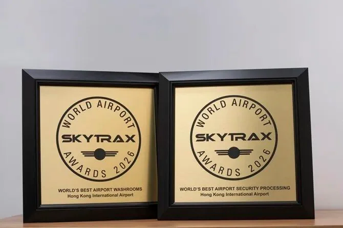

En avril 2026, l'aéroport international de Hong Kong (HKG) a été élu meilleur aéroport du monde aux Global Travel Awards 2026. Le prix est décidé par des millions de voyageurs du monde entier et pèse deux choses : la solidité de l'infrastructure aéronautique de l'aéroport et la qualité de l'expérience des passagers. La première concerne la circulation des avions, des bagages et des personnes dans le bâtiment ; la seconde, la fluidité ressentie du parcours de l'arrivée à l'embarquement.

Pour un hub international traitant des dizaines de millions de passagers par an, « meilleur du monde » est rarement un trophée isolé. Sur la même période, l'aéroport international de Hong Kong a été élu meilleur aéroport de Chine aux TTG China Travel Awards pour la troisième année consécutive, et a remporté les prix du meilleur traitement de sûreté et des meilleurs sanitaires d'aéroport du monde aux Skytrax World Airport Awards 2026. Quatre trophées mènent à une conclusion : le verdict des voyageurs sur cet aéroport s'élargit de « facile pour les correspondances » à « tout fonctionne ».

## 1. Quatre trophées, trois types de jury

Les quatre prix viennent de trois systèmes d'évaluation différents, et chacun mesure quelque chose d'un peu différent. Les Global Travel Awards placent le vote entre les mains des voyageurs et insistent sur la combinaison de l'infrastructure et de l'expérience. Les TTG China Travel Awards s'appuient sur le secteur du voyage et ses lecteurs, et accordent plus d'attention au réseau de lignes d'un aéroport et à sa réputation sur le marché chinois. Skytrax fonde ses résultats sur des enquêtes de satisfaction auprès des passagers dans plus de 500 aéroports de plus de 100 pays, et ses prix par catégorie ressemblent souvent à un bilan de santé de l'exploitation quotidienne.

| Prix | Catégorie | Aéroport international de Hong Kong |
| --- | --- | --- |
| Global Travel Awards 2026 | Meilleur aéroport du monde | Lauréat |
| TTG China Travel Awards 2026 | Meilleur aéroport de Chine | Lauréat, troisième année consécutive |
| Skytrax World Airport Awards 2026 | Meilleur traitement de sûreté aéroportuaire du monde | Lauréat |
| Skytrax World Airport Awards 2026 | Meilleurs sanitaires d'aéroport du monde | Lauréat |

## 2. Sûreté et sanitaires : les détails dont les voyageurs se souviennent

Deux des quatre prix méritent un examen plus attentif. Le traitement de la sûreté couvre le moment le plus tendu du passage d'un passager dans le terminal : la longueur de la file, si ordinateurs portables et liquides doivent ressortir, et si une fouille de sac se déroule sans heurt. Les sanitaires sont l'autre point de contact à haute fréquence, où les programmes de nettoyage, les files et l'accessibilité pèsent souvent plus dans l'opinion qu'un toit spectaculaire.

Remporter les deux à la fois suggère que l'aéroport a investi de vrais moyens dans des opérations que les passagers photographient rarement. Pour les voyageurs, la signification pratique est simple : lors d'une correspondance matinale ou vespérale à Hong Kong, la sûreté et les sanitaires ne seront probablement pas le maillon faible du voyage.

## 3. Derrière les prix : une longue préparation

L'aéroport international de Hong Kong a ouvert à Chek Lap Kok en 1998 et se classe depuis longtemps parmi les aéroports de fret international les plus fréquentés du monde ; c'est aussi un point de correspondance clé entre la Chine continentale, l'Asie du Sud-Est et les liaisons long-courriers vers l'Europe et l'Amérique du Nord. Ces dernières années, l'aéroport a achevé son système à trois pistes et n'a cessé de rénover les installations des terminaux — des investissements qui n'apparaissent jamais sur un trophée mais qui sous-tendent l'expérience jugée.

Le troisième titre consécutif de meilleur aéroport de Chine aux TTG dit aussi quelque chose de la façon dont les voyageurs du continent voient encore l'aéroport. Pour les passagers en correspondance à Hong Kong vers un pays tiers, sa valeur tient moins aux boutiques duty-free et aux salons qu'à des vagues de vols denses, une signalétique de correspondance claire et une ponctualité relativement stable.

## 4. Ce que cela signifie pour les voyageurs

Si vous préparez un voyage via Hong Kong, traitez les prix comme un signal utile plutôt qu'une garantie. Ce qui décide de votre voyage reste l'horaire des vols, le temps de correspondance et vos documents : laissez assez de temps entre les vols, vérifiez à l'avance si vous devez entrer à Hong Kong, et prévoyez 20 à 30 minutes de plus au contrôle de sûreté aux heures de pointe. Cela fera plus pour votre voyage que n'importe quel trophée.

## Liens utiles

- **Sur ce site** : [Aéroport international de Hong Kong (HKG)](/airport/HKG), [Chine (CN)](/country/CN)
- **Wikipédia** : [Aéroport international de Hong Kong](https://en.wikipedia.org/wiki/Hong_Kong_International_Airport)
- **Baidu Baike** : [Aéroport international de Hong Kong](https://baike.baidu.com/item/%E9%A6%99%E6%B8%AF%E5%9B%BD%E9%99%85%E6%9C%BA%E5%9C%BA)

Source des images : Hong Kong SAR Government Office in Guangdong et l'Autorité aéroportuaire de Hong Kong. Les noms et critères des prix sont ceux publiés par les organisateurs.
